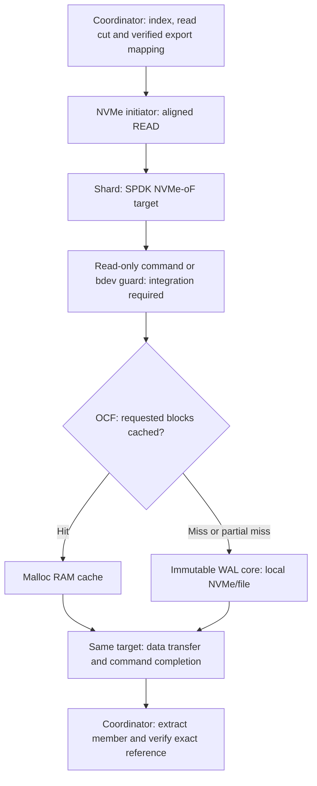

# Cache-aware NVMe-oF read target: implementation and qualification plan

**Date:** 2026-10-31. **Status:** research and design only; no source implementation or cluster launch. The documentation branch `docs/cache-aware-nvmeof-2026-10-31` was created from `348b6dca3e53e71c74af5fd04dea466e5052d7dc` (`perf/spill-residency-batch-cache`); existing local changes were preserved. The proposed implementation branch is `experiment/cache-aware-nvmeof-read-target`, based on this source revision, not the benchmark workflow branch. Before implementation, reconcile its source identity with the newer cloud-tested `c9b7e261021da042a53d71bd825d12804ffd75c1`; do not silently discard later fixes or claim identical trees. No implementation branch, commit or push was made in this research.

This plan supersedes the **transport and proposed offload claims**, not the historical measurements, in [the 2026-10-08 design](CACHE_RDMA_NVME_OF_DESIGN_2026-10-08.md). It builds on and does not supersede the implemented P1/P2 or measurement caveats in [the 2026-10-30 residency plan](LOCAL_RESIDENCY_TAIL_PLAN_2026-10-30.md), particularly §§2, 8–9. Source lines below are anchors at the stated base, not claims about any future implementation.

## Decision and exact meaning

Experiment with a **library-managed, read-only storage target** which exposes sealed immutable WAL images through NVMe-oF and chooses RAM-cache or backing-storage service *behind the same logical NVMe read command*. A candidate is SPDK's OCF write-through (WT) bdev with a malloc RAM cache and an immutable file/image or dedicated NVMe core bdev, exported by its NVMe-oF target. This is a block cache, not a drop-in replacement for Tidehunter's exact encoded-member cache. First prove namespace identity, mapping, authorization, readonly enforcement and lifecycle; no particular library, Rust binding, hardware/provider, or latency is assumed qualified by this proposal.

The coordinator still resolves the key and read cut against the authoritative index and checks the exact reference. A storage owner/control plane admits only eligible durable sealed segments, binds the reference to an immutable export generation and a bounded range, and holds the required pins. The initiator sends an NVMe command for aligned blocks; the target processes it, reads from its RAM cache or core, then transfers data and completes. For SPDK NVMe/RDMA, target-to-initiator data is **RDMA WRITE** followed by completion SEND; this is not the client issuing a literal libfabric `FI_READ` that transparently reaches NAND. NVMe/TCP is TCP, not EFA/SRD. A direct `FI_READ` of registered resident RAM remains a separate existing control. One logical command/exchange does not establish packet or physical switch-hop count.

Unaligned records require checked round-down/up to namespace block boundaries, overflow-safe bounds, isolation of authorized surrounding bytes and extraction of the exact encoded member; count extra transferred/cache/storage bytes. A block cache cannot automatically key by `ValueRecordReference`, validate member integrity, publication or cuts, or represent source-generation ownership. Preserve `CompleteBatch::decode_record` (`codec.rs:461–482`): the distributed subrecord path verifies its independent member checksum using trusted authority metadata, not the entire parent CRC frame. No assumption of zero amplification, 5 µs latency, physical-media access or faster operation.

NVMe-oF is a distinct **storage-read backend/protocol**, not a `tidehunter-fabric::FabricBackend` case carrying record-RPC bytes. Preserve owner RPC/control configuration and select NVMe target transport TCP or RDMA separately; the initial backend is optional per eligible immutable export. No global index or WAL is introduced.

For the existing checked positional plan, the actual member file offset is `batch_address.offset % wal_file_bytes + 8 + descriptor.offset` and length is `descriptor.len`; the eight bytes are `CrcFrame::CRC_HEADER_LENGTH` (`tidehunter/src/crc.rs:15`). `storage.rs:2038` resolves grouped batch member position in the receipt; do not add group offsets twice. Identify the actual exported namespace logical block size rather than hardcoding 4 KiB: OCF's cache-line default is distinct. Round the member range outward to that block size with overflow and image bounds checks, then extract and verify only the exact member. These formulas describe the current file mapping, not a license to turn it into an LBA without the validated immutable export map.

One sealed file per bdev/cache/namespace can qualify a first fixture, but does not create a free shared per-shard cache across files. Scaling requires an explicitly proven stable virtual mapping/composition and shared budgeting, potentially a real new mapping bdev; lifecycle, cache sharing and overhead must be measured. The storage library alone does not supply Tidehunter's authority integration.

Initial scope is immutable sealed WAL only. Active tail and unqualified, retired, inaccessible, oversized or unauthorized mappings use the existing file-aware path. Do not expose arbitrary live filesystem extents or let writers modify a bdev cache's core behind it. There is no change to Sui-facing semantics, native WAL format, write durability, coordinator index, snapshots or GC algorithm, and no replacement of the complete Tidehunter backend. Existing TCP, OFI/EFA messaging and registered-RAM RMA paths remain real explicit controls and fallbacks; choosing an unsupported transport must fail clearly, not become a no-op or silently masquerade as another.

### One data request; no cache-probe RPC

This is the steady-state path for an eligible scalar read fitting the negotiated transfer limits. A partial cache hit can combine cache and core work behind that command. Large reads can require multiple commands; a batch of records is not necessarily one NVMe command or one packet.

**Control plane:** Rust configures SPDK over local JSON-RPC at setup/reconfiguration, publishes export mappings and leases, and handles retirement. That JSON-RPC is not a per-value request and does not relay value bytes. A separately running SPDK target on the owning shard does not itself add another network hop: the coordinator's initiator talks directly to it.

**Authority amortization is a required design decision:** the owner must validate and pin a sealed export when issuing its bounded export lease/mapping. On each read, the coordinator must resolve the original cut/reference against that admitted mapping without asking the owner to validate the record again over RPC. The exact lease/manifest proof and its metadata budget are not implemented. If proving it requires a per-read owner RPC, that is a different, extra-exchange variant and must not be advertised as this single-request design. Direct namespace access is limited to the trusted database coordinator and authorized aligned bytes; other clients retain the record-aware service.

**What the library replaces:** eligible sealed-read cache lookup, miss storage submission, cache fill and network data completion. **What it does not replace:** key/index lookup, WAL-reference authority, visibility, export mapping/leases, generation fencing, returned-member integrity, native writes, recovery or GC ownership.

## Evidence, bottlenecks and action

| Evidence | What it establishes | Action / limitation |
|---|---|---|
| [Oct 30 campaign summary](reports/2026-10-30-kv-comparison-41109588049/SUMMARY.md), [metrics](reports/2026-10-30-kv-comparison-41109588049/METRICS.md), [stage audit](reports/2026-10-30-kv-comparison-41109588049/STAGE_AUDIT.md) | Six-host synthetic KV campaign, not Sui replay. Single-repetition descriptive results; EFA/TCP primary history loads and coordinator batch lock contention motivated P1/P2, since implemented. Qualified registered C1 medians about 47–52 µs; FI_READ mean 46.496 µs includes progress. | This proposal does not solve coordinator metadata/cache locking or direct-RAM progress cost. Do not present those synthetic numbers as Sui or as isolated NVMe service time. |
| Oct 31 spill-residency final report: workspace file `checkpoint-work/aws-ci-runs/2026-10-31-spill-residency-campaign/final-report.json`, source `c9b7e261021da042a53d71bd825d12804ffd75c1` | Newer synthetic campaign evidence for the implemented residency changes, not a new Sui replay or a qualified physical-NAND read distribution. This workspace artifact is outside this fork and is not a portable GitHub document link. | Preserve exact case/configuration provenance; neither its primary read nor warm-remote-data population isolates SSD service. Publish the evidence with a future report before citing it as a repository-hosted artifact. |
| Oct 30 campaign and [residency plan §2](LOCAL_RESIDENCY_TAIL_PLAN_2026-10-30.md#2-measured-evidence-and-priority-order) | Distributed cold windows recorded block requests, but windows were wider than measured reads; native nominal-cold controls had only 1/0 matched reads. | No qualified physical-NAND latency distribution exists. Establish matched measurement-window/device/file attribution first; an OS/direct-I/O request alone is not proof of a NAND access. |
| [SPDK v26.09 target guide](https://spdk.io/doc/nvmf.html), [pinned target RDMA state machine](https://github.com/spdk/spdk/blob/v26.09/lib/nvmf/rdma.c#L2168-L2265), [target data RDMA WRITE](https://github.com/spdk/spdk/blob/v26.09/lib/nvmf/rdma.c#L1430-L1448) | An NVMe command is target-processed; target-managed I/O and CQ lifetime are real work. | Measure command, queue, bdev and transfer/completion stages separately, preserving independent denominators and nested intervals. |
| [Linux v6.12 NVMe/RDMA host](https://github.com/torvalds/linux/blob/v6.12/drivers/nvme/host/rdma.c), [AWS EFA documentation](https://docs.aws.amazon.com/AWSEC2/latest/UserGuide/efa.html) | Stock host transport relies on RDMA CM/RC semantics; EFA's SRD/libfabric interface and available RMA operations do not alone prove NVMe/RDMA compatibility. | Require exact provider, transport and actual connect/read/teardown on real hardware; do not call a software-provider result hardware EFA. |
| [Linux FIEMAP documentation](https://docs.kernel.org/filesystems/fiemap.html) | File extent discovery does not make bypassing a mounted filesystem safe. | Never use FIEMAP-derived LBAs for a live mounted WAL; never bind a filesystem-owned controller to userspace. |
| [Tidehunter paper v2](https://arxiv.org/html/2602.01873v2) §§3.2, 3.4, 4.2–4.4 | Direct index-to-value-WAL reads and safe retention through relocation; residency is a policy, not universal. | Preserve direct references, recovery, snapshot and GC invariants; this storage experiment is not a new index or WAL. |

### Candidate mechanics and alternatives

[SPDK bdev OCF guide](https://spdk.io/doc/bdev.html#bdev_config_ocf) and [`bdev_ocf_create` RPC](https://spdk.io/doc/jsonrpc.html#rpc_bdev_ocf_create) describe configuring SPDK with `--with-ocf`, making a malloc cache bdev and core bdev, then e.g. `bdev_ocf_create Cache1 wt Malloc0 Nvme0n1`. Exporting `Cache1` is proposed only after the separate readonly and authorization gates below. `Malloc0` uses volatile hugepage memory; the default OCF cache line is 4 KiB and default metadata is nonvolatile-disabled. Cache capacity is not total memory: include [OCF metadata](https://open-cas.com/ocf/design/metadata/), queues, hugepages, I/O buffers, initiator and target overhead. Linux page cache is a different layer; [SPDK AIO](https://github.com/spdk/spdk/blob/v26.09/module/bdev/aio/bdev_aio.c#L172-L189) attempts `O_DIRECT` and may fall back. Validate actual alignment, backing and mode.

At the [OCF commit pinned by SPDK v26.09](https://api.github.com/repos/spdk/spdk/contents/ocf?ref=v26.09), [generic read handling](https://github.com/Open-CAS/ocf/blob/6ad1007e6fa47ff6468eaba0b304d77334c34d4a/src/engine/engine_rd.c) serves cache hits from cache and misses from core; on the inspected miss path it copies into a separate backfill buffer before completing the requester and then initiates backfill. Admission/bypass, partial hits, errors and dirty state have additional paths; a completed miss does not prove backfill already finished. WT is not write prevention. The [malloc bdev read path](https://github.com/spdk/spdk/blob/v26.09/module/bdev/malloc/bdev_malloc.c#L371-L405) uses an accelerator copy to I/O vectors; do not promise zero-copy through the stacked cache.

An independent comparator is kernel NVMe/TCP file-backed nvmet with buffered I/O using the Linux page cache, subject to its own readonly and safety gate; it is not OCF and is not a proven readonly replacement. [TeRM](https://www.usenix.org/conference/fast24/presentation/yang-zhe) is useful for thinking about residency and miss handling but uses custom RNIC/driver mechanisms: it does not establish transparent FI_READ of NAND or compatibility with this target.

The SPDK v26.09 [OCF submodule pin](https://api.github.com/repos/spdk/spdk/contents/ocf?ref=v26.09) predates [upstream OCF v26.09](https://github.com/Open-CAS/ocf/compare/6ad1007e6fa47ff6468eaba0b304d77334c34d4a...v26.09); unversioned OCF documentation is not proof that all newer behavior exists at the pin. Assign an owner for advisories, support, license notices and qualified upgrades/backports. No vulnerability or compatibility claim follows merely from the version gap.

### Prior-resource map: what to use and what not to copy

Local parsed-paper paths below refer to the parent workspace, not files published in this fork. Public primary links make the references usable independently of that workspace.

| Resource and exact part | Problem/mechanism relevant here | Application or exclusion |
|---|---|---|
| [Tidehunter v2](https://arxiv.org/html/2602.01873v2), §§3.1–3.4, 4.3–4.4; `papers/parsed/Tidehunter-2026-v2.md` | Values stay at indexed WAL positions; foreground/page-cache durability differs from explicit persistence; relocation must preserve newer writes and retained readers. | Keep native encoding, write/replay contracts and publication. Add a safe read-source mapping, not another authoritative value store or global WAL. |
| [SPDK v26.09 bdev guide](https://github.com/spdk/spdk/blob/v26.09/doc/bdev.md), malloc/AIO/OCF sections; [OCF `engine_rd.c`](https://github.com/Open-CAS/ocf/blob/6ad1007e6fa47ff6468eaba0b304d77334c34d4a/src/engine/engine_rd.c) | A target-side cache selects RAM or core and manages backfill. | Actual candidate for replacing eligible owner cache/storage source selection. OCF still has cache-line/mapping synchronization and copies; do not describe the stack as universally lock-free or zero-copy. |
| [SPDK v26.09 NVMf guide](https://github.com/spdk/spdk/blob/v26.09/doc/nvmf.md), bdev namespace and transport creation; [`rdma.c`](https://github.com/spdk/spdk/blob/v26.09/lib/nvmf/rdma.c) | One command dispatches storage work and returns data/completion over the same transport. | Reuse target protocol, queues and completion machinery rather than writing a new NVMe wire protocol. Target and initiator are separate components. |
| [TeRM FAST '24](https://www.usenix.org/conference/fast24/presentation/yang-zhe), §§2.2, 4.1.2, 4.2–4.3, 5; [implementation](https://github.com/thustorage/TeRM); `papers/parsed/TeRM-2024.md` | One-sided resident reads with software miss handling; buffered versus direct I/O tiering. Supported ODP can fault through the OS, but TeRM avoids that hardware-fault path with a magic-page/miss protocol. | Use its residency/miss distinction and explicit completion ownership. Its miss uses RPC then RDMA WRITE; modified Mellanox drivers and magic-pattern mapping are not an SPDK cache or portable EFA feature. Do not import that mechanism into native CRC/authority handling. |
| [ReFlex ASPLOS '17](https://doi.org/10.1145/3037697.3037732), dataplane and scheduling; `papers/parsed/ReFlex-2017.md` | Remote flash latency depends on queue ownership, bounded work and network/storage scheduling, not only transport names. | Keep per-owner concurrency and CPU/QD budgets explicit. Do not copy its hardware-era latency as our expected result or claim its TCP dataplane is NVMe/RDMA. |
| [ntprof NSDI '25](https://www.usenix.org/conference/nsdi25/presentation/kang), NVMe/TCP pipeline and profiling; `papers/parsed/ntprof-NVMe-over-TCP-2025.md` | Distinguish initiator, network-stack, target and block/device stages. | Adopt measurement boundaries and request correlation; kernel tracing does not automatically cover userspace SPDK/OCF, so add the latter's own traces/counters. |
| [RackBlox SOSP '23](https://arxiv.org/abs/2309.06513), design/implementation | Co-designed network/storage scheduling and GC visibility. | Exclude as a drop-in: programmable Tofino switch, P4 and programmable SSD assumptions do not match the present cluster. No switch/FTL redesign is required for target-managed caching. |
| [Linux v6.17 nvmet file backend](https://github.com/torvalds/linux/blob/v6.17/drivers/nvme/target/io-cmd-file.c), [`buffered_io` ABI](https://github.com/torvalds/linux/blob/v6.17/Documentation/ABI/stable/configfs-nvmet) | A file-backed target can use Linux page cache and storage fallback. | Secondary cache-aware target baseline, not a Rust cache library. It opens the file O_RDWR; qualify write protection rather than assuming buffered means read-only. |
| [Linux NVMe/RDMA host](https://github.com/torvalds/linux/blob/v6.12/drivers/nvme/host/rdma.c), [SPDK RDMA discovery](https://github.com/spdk/spdk/blob/v26.09/lib/nvmf/rdma.c#L3778-L3792), [EFA](https://docs.aws.amazon.com/AWSEC2/latest/UserGuide/efa.html) | Host/target RC and RDMA-CM interoperability versus the existing SRD/libfabric path. | Gate the exact hardware/provider combination. Preserve EFA record/RMA baselines; unsupported NVMe/RDMA cannot silently fall back and retain an RDMA label. |
| [Linux FIEMAP](https://docs.kernel.org/filesystems/fiemap.html), mounted-filesystem raw access warning | File offsets/extents are not a safe exclusive raw-device interface. | Reject raw extent export and VFIO rebinding of a filesystem-owned controller. Use immutable file-backed exports or exclusively owned disposable storage. |

### Rust and integration candidates (source inspection, not dependency selection)

| Candidate | Inspected capabilities and limitation |
|---|---|
| [OpenEBS spdk-rs `311aae78`](https://github.com/openebs/spdk-rs/tree/311aae78bc33ea53f54f733b03863b39dbfd186f), [Mayastor `1e796a58`](https://github.com/openebs/mayastor/tree/1e796a58e1e598fb46e2ab1b1ac7f0b1502002ef) | Rust wrapping native SPDK, not a pure-Rust or complete safe OCF target. Mayastor's pinned gitlink uses this wrapper; [its SPDK fork configuration](https://github.com/openebs/spdk/blob/bc57f3ea7933b0965c09e9d751c21a3968c6cc11/CONFIG) sets `CONFIG_OCF=n`, [build script](https://github.com/openebs/spdk-rs/blob/311aae78bc33ea53f54f733b03863b39dbfd186f/build_scripts/build_spdk.sh) does not enable OCF, and [link setup](https://github.com/openebs/spdk-rs/blob/311aae78bc33ea53f54f733b03863b39dbfd186f/build.rs) and [headers](https://github.com/openebs/spdk-rs/blob/311aae78bc33ea53f54f733b03863b39dbfd186f/wrapper.h) do not expose the OCF stack by default. [Mayastor transports](https://github.com/openebs/mayastor/blob/1e796a58e1e598fb46e2ab1b1ac7f0b1502002ef/io-engine/src/subsys/nvmf/transport.rs) implement TCP and optional RDMA with TCP fallback, not evidence of EFA. |
| [libublk-rs `285f5d87`](https://github.com/ublk-org/libublk-rs/blob/285f5d87aec193eb7b5f9d7a03d24d5b28e3f817/README.md) | Rust Linux userspace block-handler framework, not a ready cache or NVMe-oF target; still needs actual cache, authority and exporter implementation. |
| [libnvme Rust binding 0.9.0](https://docs.rs/libnvme/0.9.0/libnvme/struct.Connect.html) | A host/initiator management and command interface over native libnvme, not a target/cache. Its alpha fabrics support requires target qualification; native library and license/build requirements remain. |
| [Foyer `0fb76283`](https://github.com/foyer-rs/foyer/blob/0fb762837b38a50681eff9c37c5f1f8b1893af8b/README.md) | Real Rust hybrid KV cache, but not an NVMe-oF target or transparent block cache over the authoritative WAL. |
| [GPUCache `aadbb64c`](https://github.com/rustfs/GPUCache/blob/aadbb64ce71f3ea884e2e5dde99b8570696a7bc0/README.md) | Inference-cache project explicitly describes simulated/unlinked hardware paths; not evidence of a working SPDK/RDMA target or durable Tidehunter store. |

The least-coupled credible functional spike is Rust-managed, separately built OCF-enabled SPDK `nvmf_tgt` via local JSON-RPC, plus a separately selected host initiator and read-only gate. This is **not an embedded Rust library**, but its control RPC is setup/lifecycle work, not a per-read proxy or extra network hop. The embedded alternative needs a custom OCF-enabled build, explicit C bindings/link/registration, reactor affinity and callback/lifetime wrappers; it is not present as a complete safe drop-in API. Verify actual registered RPCs, native requirements, transitive license notices and teardown before selection. This targeted survey does not prove that no other library exists.

For the first local NVMe/TCP integration, prefer the Linux host initiator and asynchronous reads of its namespace device through Rust's existing I/O facilities; connect/disconnect/discovery are control operations. Evaluate libnvme bindings separately rather than confuse them with a target/cache. In-process SPDK initiation is a later measured alternative, not a mandatory rewrite of Tidehunter's runtime. Existing Rust remains Rust; external SPDK/OCF is native C software, not a pure-Rust dependency.

License/build inventory from the inspected revisions: `spdk-rs` and Mayastor are Apache-2.0 wrappers/applications over native SPDK/DPDK and RDMA dependencies; upstream SPDK and the inspected OCF pin are BSD-3-Clause. `libublk-rs` is MIT OR Apache-2.0; the inspected Rust libnvme wrapper is MIT OR Apache-2.0 over LGPL-2.1+ libnvme. Foyer and GPUCache are Apache-2.0. Check all transitive notices and platform/unsafe boundaries before adoption; this inventory is not legal clearance. The inspected Foyer revision declares Rust 1.95 and is not a reason to raise this project's toolchain for an unrelated cache.

## Current source map and intended cutover

Paths in this table are relative to `tidehunter-sharded-wal/`; proposed components below are design concepts, **not existing APIs or files**. Keep existing public behavior and test controls; extension only where stated.

| Current code at base | Current responsibility | Experiment action |
|---|---|---|
| `tidehunter/src/distributed/remote_db/pending_read/concurrent.rs:50–73,81–281,300–466,492–566` (`get`, `submit_get_cut`, `get_many_cut`, `resolve_concurrent_get`, `prepare_concurrent_miss`, `submit_record_at`) | Scalar/batch cut resolution, index and coordinator cache, bounded 32-slot batch cache windows, grouping and pinned misses. | **Keep** key/cut authority, index guard, ordering, duplicate/error behavior and cache hit fast path. **Extend** only owner-miss dispatch to an eligible read target; retain RPC and existing direct-RAM routes. Never send arbitrary keys or bypass the coordinator on cache misses. |
| `tidehunter/src/distributed/remote_db/read_cache.rs`, `tidehunter/src/distributed/reference_directory.rs:124,610–700,1004–1156` | Coordinator decoded-value cache; owner registered immutable authority, metadata credits, resident/cold lookup and post-adoption retention. | **Keep** both distinct cache and authority semantics. A block-cache hit is neither a coordinator hit nor a validated authority descriptor; no credit double counting. |
| `tidehunter/src/distributed/types.rs:35–56,64–97`; `tidehunter/src/distributed/storage.rs:1518–1541,1568–1573`; `tidehunter/src/distributed/reference_directory.rs:38–41` | `PhysicalValueAddress` names partition, generation and frame including CRC header; `RecordDescriptor` names member bounds excluding it, and `ValueRecordReference` binds batch identity, digest, address and descriptor. Checksums/digests are integrity, not caller authentication; reference alone proves neither membership, durability, publication nor a GC lease. | **Keep** all fields and owner `validate_record_authority`/durable checks. No proposed manifest, cache key or namespace possession substitutes for those checks or authorizes a caller. |
| `tidehunter/src/distributed/storage.rs:513–590,1533–1638,1666–1694` (`PartitionLog`, `RecordReadPlan`, `ResidentReadOwner`, `try_plan_record_read`, `plan_record_read`, `plan_registered_record_read`) | Durable frontier and exact registered member validation before native file/offset plan. Plan pins descriptor/log and member file; resident owner also holds file/log/authority. | **Extend** admission/manifest generation only after these checks. Pin descriptor, exact immutable file/image and log plus export generation through target and transport retirement. Keep cold authority on bounded worker; retain poisoning and failure behavior. |
| `tidehunter/src/distributed/tcp.rs:1862–1904` (`read_record`, `read_records`, profiled variants); `tidehunter/src/distributed/tcp/reactor.rs:168–185,296–300,1421–1465,1875–1880` | Scalar and batch owner protocol, session output and completion ownership, client pending reads and RMA state. | **Extend** eligible dispatch and completion integration; **keep** requests, profiling, batching and ordinary owner transport as comparison/fallback. No socket/session guard held through an I/O wait. |
| `tidehunter/src/distributed/tcp/resident.rs:161–205,383–389,439–567`; `tidehunter-fabric/src/endpoint.rs:103–117,153–169,191–219,287–325,382–409`; `tidehunter-fabric/src/config.rs:8–20,48–50` | Grants bind exact references and envelope; registry reserves, publishes, releases or quarantines generation-scoped owners; provider reports capabilities and owns read operations/destination buffers. | **Keep** registered-RAM grants and direct reads as independent control; never claim these grant APIs are NVMe-oF or reuse their address/rkey as a NAND pointer. Compare exact selected provider/security/polling; CQ lifetime rules remain mandatory. |
| `tidehunter/src/distributed/tcp/read_executor.rs:19–24,92–101,170–181,237–240,345–456,457–511,582–600,601–1319`; `tidehunter/src/distributed/tcp/read_executor/cache.rs:12–21` | Node-wide bounded encoded-member cache keyed by full reference, leases/accounting, bounded `RWF_NOWAIT` probes then `io_uring` for remaining bytes, buffers and plans held through completion. | **Keep** as fallback/control and for active tails. A target block cache may replace source selection for *eligible* sealed reads only; it cannot replace this exact-member cache mechanically. Account target RAM, metadata, pending/DMA buffers and reactor overhead separately and in the node-wide total; do not multiply budgets by connections. |
| `tidehunter/src/wal/mod.rs:218–245,353–355,383–468`; `tidehunter/src/db.rs:947–1018,1183–1237,1712–1749`; `tidehunter/src/distributed/native_index.rs:650–655,909–912`; `tidehunter/src/distributed/remote_db/concurrent.rs:325–340` | Native WAL read, checked member range and positional plan; writer GC/deletion; relocation and snapshot/history retention. | **Keep** native on-disk/replay/write behavior. Export mapping must be built from immutable file/image identity and checked length, not raw logical offsets interpreted as device LBAs. Coordinate retirement, relocation, old cuts and delayed completions; old exports must remain pinned or be revoked and drained before reuse. |
| `tidehunter/src/wal/mod.rs:276–280,414–464`; `tidehunter/src/wal/layout.rs:96–113`; `tidehunter/src/distributed/storage.rs:1850,1888–1936` | `WalMemberReadPlan` pins an `Arc<File>` with file-relative offset and length; `checked_member_range` rejects direct I/O and incorporates `CrcFrame::CRC_HEADER_LENGTH`; layout translates WAL positions into file-relative offsets. Retirement requires healthy sealed storage, completed recovery prefix and read-admission coordination. `wal_file_page` is explicitly not ownership proof. | **Preserve** exact validation, header adjustment and file pin; the proposed export manifest is new and must map checked file-relative bytes, not blindly reinterpret an address as an LBA. Preserve direct-I/O rejection unless a separately proven aligned implementation replaces it. |
| `benchmarks/kv-research/src/main.rs:15–29,56–74,85–103`; `benchmarks/kv-research/src/config.rs:61–98,145–168,192–204`; `benchmarks/kv-research/src/backends/tidehunter.rs:20–33,41–79,86–125`; `.github/workflows/kv-comparison.yaml`, `.github/workflows/aws-efa-benchmarks.yaml` | Existing backend admission, external owner prep, transport/owner configuration, workload and diagnostics, CI orchestration. | **Extend** validated explicit experiment options, matrix and result schema when implemented; unsupported target/provider must reject. **Keep** native, TCP, EFA and registered-RAM controls, comparable workloads and existing CI. No CI dispatch or cloud allocation now. |
| `tidehunter/src/distributed/remote_db/coordinator_profile.rs:52–55,138–140`, `tidehunter/src/distributed/remote_db/pending_read.rs:366–370,686–690`; `tidehunter/src/distributed/tcp/read_executor.rs:103–159` | Sampled coordinator stage count/sum/max, grant stages and owner cache/I/O counters. | **Extend** bounded target/initiator instrumentation with denominators and unavailable states; retain existing metrics. Never add overlapping stage means or encode missing measurements as zero. |
| `tidehunter/src/distributed/sui.rs` and external Sui | Existing Sui adapter and API. | **Keep unchanged** unless actual integration disproves that boundary; run real checkpoint replay through the existing adapter. Core repo remains primary implementation location; no separate fake backend or Sui fork rewrite. |

### Proposed files and exact replacement boundary

These paths and type names are **proposed**, not current APIs. Start on `experiment/cache-aware-nvmeof-read-target`; do not edit the archived middleware. Keep the first integration internal to the distributed feature instead of introducing a general-purpose storage abstraction before two actual implementations exist.

| Proposed/change location | Concrete responsibility | What it replaces, or deliberately does not replace |
|---|---|---|
| New `tidehunter/src/distributed/nvmeof/mod.rs` and registration in `distributed/mod.rs` | Explicit optional read-backend configuration and eligibility result. Distinguish storage protocol, NVMe TCP/RDMA transport and existing fabric provider. | Replaces no default. Unsupported explicit configuration errors before serving. No `FabricBackend::NvmeOf` masquerading as record RPC. |
| New `distributed/nvmeof/manifest.rs`; narrow extensions to `storage.rs` and inventory/control handling | Proposed `SealedWalExport` identifies admitted source file/image, owner/database, physical generation, export epoch, NQN/NSID/namespace identity, block geometry, bounded logical mapping and revocable lifetime. Establish exact member eligibility from existing durable authority, not a file directory listing. | Replaces repeated record-RPC authority work only where equivalent admitted mapping/lease evidence is already available. It does not remove `ValueRecordReference`, owner validation, read cuts or visibility rules. |
| New `distributed/nvmeof/target_control.rs` | Manage external `nvmf_tgt`, explicit `--with-ocf` capability, source AIO bdev, volatile RAM cache, OCF WT bdev, enforced read-only guard, namespaces and host admission. Fail construction if required RPC/filter is absent. | SPDK/OCF replaces cache lookup, core-read scheduling, fill and data completion for eligible reads. Rust does not forward their payloads or duplicate OCF eviction logic. The read-only guard is real additional work, not a verified existing RPC. |
| New `distributed/nvmeof/initiator.rs` and `lifetime.rs` | Connect once, map admitted reference bytes to aligned reads, bound queue/memory, own submitted buffers, retain pins through completion/teardown and extract exact members. Initial Linux host path uses normal async device I/O; an embedded SPDK initiator would be a distinct implementation. | Replaces the selected remote byte-fetch mechanism, not `CompleteBatch::decode_record`, key validation or coordinator decoded-value caching. A timed-out DMA buffer cannot be recycled. Returned slices must retain/charge the full backing allocation or copy into a correctly accounted exact allocation. |
| `remote_db/pending_read/concurrent.rs:300–392,394–490,532–564` and `remote_db/pending_read.rs` submission/completion plumbing | After existing index/cache resolution, choose admitted NVMe export or the current route; complete through the existing error/cache/member-consumption boundary. Cover concurrent scalar, ordered batch, scan and older mutable `RemoteDatabase` callers rather than only one benchmark path. | Eligible reads no longer issue owner `read_record(s)` RPC or require `read_executor` source selection. Ineligible reads still do. Preserve per-owner grouping, bounded concurrent commands, duplicates and ordering; coalesce only compatible nearby block ranges within an explicit over-read budget. Never serialize batch reads in a new blocking loop. |
| Owner `tcp/read_executor.rs`, `tcp/resident.rs`, `tidehunter-fabric` | Keep as native-file/RPC and one-sided-RAM paths, active-tail service and matched controls; record which path actually ran. | Do not delete or wrap EFA's existing data plane inside NVMe/TCP. OCF and existing record caches do not share allocations or residency automatically. Later shared-cache work requires a separate ownership/accounting design. |
| `benchmarks/kv-research` configuration, backend adapter and result validation; experiment planning and existing CI inputs | Add explicit eligible NVMe transport/target/cache cohorts, source identity and validation, without changing other backends or original controls. Initial local mode can prepare an immutable fixture; production mode must use real admitted WAL exports, not a copied fixture mislabeled as the live database. | Extends comparison choices, not a new fake KV implementation. CI must reject unqualified hardware claims and collect the target's logs/counters. No workflow dispatch or benchmark-branch merge during this document task. |
| `tidehunter/Cargo.toml`, workspace/build setup and benchmark target preparation | Reuse existing Rust JSON/I/O facilities first; make SPDK/OCF an explicitly pinned target dependency with a capability probe, not a mandatory default native build. Add bindings/dependencies only if the selected implementation actually requires them, with exact locks and license review. | Do not change the native Tidehunter default feature/toolchain, pull Mayastor's full storage control plane into the engine, or assume its OCF-disabled build is suitable. The library/target must be present and verified before any later paid deployment. |

For source transport/target management, the exact SPDK composition is `bdev_malloc_create` → `bdev_aio_create`/dedicated NVMe core → `bdev_ocf_create` → the required read-only guard → `nvmf_subsystem_add_ns`, transport creation and listener/host configuration. These are setup operations, not a runnable deployment recipe: order and names for the new guard and owner export protocol remain to be implemented and verified. A copied fixture establishes functionality only; it cannot establish end-to-end append cost or removal of native WAL writes.

## Authority, safety and lifecycle contract

1. Only after seal and durable-frontier publication, construct a manifest binding database/partition, exact WAL identity and segment generation, immutable image/namespace identity, file-relative to exported-byte mapping, length, alignment and creation epoch. Publish it atomically after image construction and persistence; do not claim a copied image is a live WAL file. A dedicated device/namespace or independently constructed immutable image must have exclusive ownership. No cache core is externally mutated while exported; WT does not provide coherence against external writes.
2. Per read preserve cut/index pin and full `ValueRecordReference`, exact `RegisteredBatch` membership, durable frontier and checked member range. Bind request to the export's generation. Before exposing data, verify exact length, member integrity and key/reference semantics at the consuming boundary just as today. A block-level read grant can expose neighboring bytes: reject unless namespace access and range isolation authorize the entire aligned transfer. An authenticated owner connection alone is not proof of per-record block authorization.
3. Implement and demonstrate actual readonly enforcement at namespace/target/backing layer and negative write tests, not a configuration name or an `O_RDWR` file opened under a read-only intention. Secure initiator access and namespace discovery, identity, authentication and confidentiality appropriate to the chosen protocol; neither NVMe-oF nor network placement automatically supplies these. If safe access requires a trusted target/proxy rather than direct namespace grants, retain that explicit mediation and measure it.
4. Existing file/log/descriptor pins are necessary but not sufficient for a separately exported image. Pin the image, manifest and target generation while requests, CQ completions, registered DMA buffers and result clones may survive. Retirement closes admission, revokes export/authorization, drains in-flight work including disconnect/cancel/error paths, fences late completions, then releases ownership; failure to establish quiescence quarantines resources rather than freeing/reusing them. GC, compaction and snapshot old cuts must continue to observe their original values. Define crash/reopen handling of orphaned immutable images and identity changes before deployment.
5. Bounded admission must include OCF RAM, target metadata, pinned images, per-session buffers, queues, registration, result and cancellation state, plus any extant owner cache. State whether limits represent requested bytes versus RSS; report separately and avoid uncounted per-connection multiplication. Ensure no cache or authority mutex spans network/storage progress. Cache eviction releases only cache ownership, never an outstanding reader's pin.
6. Correctness failures, checksum mismatch, stale generation, out-of-range or authorization violation fail closed. An ordinary unavailable/unqualified route may fall back through the existing authenticated owner path only with the original exact reference and cut; record fallback and its reason. Do not hide integrity or fencing failures as harmless hits.
7. A timeout or caller cancellation does not itself stop a DMA operation. Retain its original initiator buffer, request context and generation/file pins until terminal completion or proven queue teardown, even if an idempotent fallback read has already succeeded. Quarantine on uncertain teardown; never recycle memory based only on cancellation or another path's success.

**Concrete SPDK readonly blocker:** [v26.09 `bdev_aio_create`](https://spdk.io/doc/jsonrpc.html#rpc_bdev_aio_create) accepts `readonly=true`; its [implementation opens `O_RDONLY`](https://github.com/spdk/spdk/blob/v26.09/module/bdev/aio/bdev_aio.c#L172-L189) and [rejects WRITE](https://github.com/spdk/spdk/blob/v26.09/module/bdev/aio/bdev_aio.c#L742-L746). Yet [its capability and fallocate-dependent UNMAP/WRITE_ZEROES handling](https://github.com/spdk/spdk/blob/v26.09/module/bdev/aio/bdev_aio.c#L783-L803), and [OCF's passthrough of core mutation support and write-open of core](https://github.com/spdk/spdk/blob/v26.09/module/bdev/ocf/vbdev_ocf.c#L702-L715) ([open path](https://github.com/spdk/spdk/blob/v26.09/module/bdev/ocf/vbdev_ocf.c#L1400-L1435)), do **not** prove a readonly OCF namespace or cache coherence on rejected writes. [Namespace options](https://github.com/spdk/spdk/blob/v26.09/include/spdk/nvmf.h#L1220-L1294) have no readonly setting. Use `readonly=true` and disable fallocate as backing-file defense, but require a proven read-only filter above OCF or comprehensive NVMe command authorization rejecting all mutation, passthrough, format and related commands, plus exclusive control-plane access. Verify readonly core attachment, cache state after rejected operations and teardown; no stock OCF readonly claim. For comparison, [Linux v6.17 nvmet file backend opens `O_RDWR`](https://github.com/torvalds/linux/blob/v6.17/drivers/nvme/target/io-cmd-file.c#L32-L43).

## Implementation phases and gates

These phases are proposed future work, not tasks executed in this research. Each phase depends on its predecessors; no cloud resource or launch is authorized by this document.

1. **Measurement and design freeze, local-only.** Freeze base/config, reproduce reference/cut/cache lifecycle with focused tests, instrument matched API intervals and owner device/file requests, and identify all resource/security controls. Decide whether immutable copied images or dedicated storage-owned sealed segments satisfy the contract; if neither, stop. Native/core write path and current transports remain controls.
2. **Immutable image and target library spike, local-only.** On disposable files, implement the owner-authoritative manifest, image pinning and read-only checks, source boundaries and fault cases. Start with an externally running, explicitly OCF-enabled SPDK target controlled by Rust over local JSON-RPC, not an unnecessary in-process FFI rewrite. Implement or qualify the read-only guard above OCF; an embedded variant instead needs explicit native bindings and SPDK thread/callback ownership. Establish cancellation, shutdown and cache coherence before production coupling. Reject the design if authorization or lifecycle cannot be preserved.
3. **Actual initiator and coordinator integration, local-only.** Integrate scalar then batch eligible reads with validated generation mapping, block extraction and exact member verification. Use NVMe/TCP localhost or software target as a functional control, label it as such. Preserve real fallback and all write/read/control paths. Cover mixed references, duplicate keys, cuts and malformed/corrupt/short responses; test snapshot/GC/relocation, revocation races, completion-after-cancel, disconnect, crash/reopen, and memory/accounting under pressure. Exercise cached and cold paths with target counters and demonstrate actual success; a stub or fake fallback is not acceptance.
4. **Local matched benchmarking.** Compare current local positional/owner-RPC, resident grants, NVMe/TCP and target cache enabled/disabled on identical bytes and admission/CPU budgets. Include scalar C1/C16, batch sizes, 1 KiB/8 KiB and a realistic range of record offsets, concurrency/QD; record alignment amplification. Real Sui checkpoint replay should use the current adapter and available genuine checkpoint artifacts, explicitly label trace/replay scope; if unavailable report missing evidence, never relabel synthetic KV. One independent repetition per development case; preserve raw samples and schema, count successful/offered/rejected/fallback requests, p50/p95/p99/p99.9, mean, standard deviation, max and throughput exposure. Record warmup, seeds, dataset, owners, exact binary and cache settings, sampling and CPU/memory. Establish matched actual-miss windows before claiming device latency.
5. **Provider/RDMA gate before any cluster comparison.** Verify exact host/target transport, RDMA CM/QP/provider, supported API and version with actual connect, command, data, CQ and teardown on the intended hardware; FI_READ or a successful software-provider test is insufficient. Check polling versus interrupt mode, queue/core budgets, authentication, storage ownership and real readonly enforcement. EFA/SRD is an unresolved compatibility question, not an assumed NVMe/RDMA transport. If unsupported, retain NVMe/TCP and a separately labeled proven IB/RoCE comparison; do not represent it as EFA.
6. **Later separately authorized cluster comparison.** Only after all local and provider/security gates pass, seek explicit launch authorization. Use same hardware, placement, device, workload, security, CPU/polling budgets, data and measurement windows for native local, current TCP/OFI owner RPC, registered RAM RMA, NVMe/TCP and only proven NVMe/RDMA. Track target cache hit/miss/eviction, source and transferred bytes, physical requests/completions when attributable, queue and bdev intervals, initiator/target CPU, errors, admitted/fallback/short reads and end-to-end raw latency. One development repetition is descriptive; an eventual causal claim requires a predeclared matched multi-repetition protocol. Report no improvement or inconclusive results honestly and stop on an unmet safety gate.

## Open decisions and blockers

- **Target embedding versus separate process:** the preferred first spike isolates SPDK/OCF in a shard-local target process; Rust handles setup and lifecycle. It does not require a value relay or an extra per-read control RPC. Embedding is an optional later experiment requiring native linking, Rust/C FFI, SPDK thread-affinity and callback/shutdown ownership; prefer it only for a demonstrated benefit. Neither choice removes the initiator or Tidehunter's mapping/authority integration.
- **Image strategy:** copied sealed immutable images provide an independently controlled export but add copying, space, creation latency and divergence/recovery concerns. Storage-owned immutable sealed files can avoid copies only if the selected bdev API, permissions, ownership and readonly semantics are actually established. Never raw-map an active filesystem to avoid the cost.
- **Authorization granularity:** block-aligned direct namespace access may reveal adjacent members. Either prove whole-namespace trust/isolation or mediate authorized exact reads at the target; without one, direct initiator access is blocked.
- **Provider support and target operation:** no local laptop or existing libfabric capability establishes SPDK NVMe/RDMA over EFA. No measured qualified Sui or physical-NAND result exists for this target. Target bdev APIs, read-only enforcement and lifecycle must be demonstrated on the chosen versions, not inferred from library existence.
- **Cost and objective:** target block-cache locality may be worse or better than the current exact-member cache and can amplify I/O; source selection, network transport, metadata resolution and progress all contribute. Define an acceptable memory/CPU/security budget and material effect threshold before comparison. No promised native-equivalent or few-microsecond read latency.

## Measurement schema and decision criteria

- Keep coordinator-cache hits, existing owner encoded-member hits, registered-RAM `FI_READ`, NVMe-oF target all-cache hits, partial hits, core-device reads and fallback as separate origins. A target warmup is not proof of an all-cache hit; asynchronous backfill can still be pending. A core read is not proof of a physical NAND access.
- Target evidence must include OCF/core request and byte counters, cache misses/fills/bypasses, allocation/lock/queue waits where exposed, copies and target CPU/hugepage usage. Add sampled request traces where aggregate statistics cannot classify each case. Correlate controller/session generation, queue ID and command ID without assuming reused command IDs are globally unique.
- Capture initiator enqueue/submit/completion, target receive/dispatch, OCF/cache/core submission/completion, data-transfer posting/completion and exact-member decode. Use same-host elapsed clocks. Do not subtract unsynchronized host timestamps to report wire latency; one-way network attribution needs a verified clock method.
- Preserve raw API, scheduling and response timings and calculate p50, p95, p99, p99.9, mean, standard deviation, maximum, throughput and rejection counts from compatible per-case samples. Preserve per-case counts, sample-count warnings, preload/warmup and the full backends/value-size/workload/concurrency/offered-load/cohort matrix. One independent repetition is the development default, not reduced operations per case; show no run-to-run bars or confidence claims.
- Include 8 KiB batch32 in matched comparisons, not only scalar cases. Match fixed logical data, real Sui input when used, source/toolchain, security, CPU, polling, QD, budgets and case operation counts. Label the laptop's shared SSD and software/loopback transport; it proves function, not distributed performance.
- Define a materially important effect threshold before a rerun. Repeat uncertain/regressed configurations across every backend involved, using frozen settings; use matched historical repetitions where available. Retain multiple repetitions for final publication or explicit reproducibility checks. No paper supplies a guaranteed microsecond result for this implementation.

## Research and delivery record

Two source researchers separately audited Rust/library capabilities and SPDK/OCF/target safety; a third agent drafted the source-mapped document, then the parent integrated and validated it. Evidence scope is primary-source inspection, local source/paper reads and document checks, not a built or running target. QMD MCP was not mounted; local parsed papers and primary public sources were used. The `skills/README.md` path referenced by the workspace rules is absent; no project skill was changed or made stale by this documentation-only work.

Local report/plan links resolve in the present workspace; some were already untracked at task start. Their existence is not a claim that they are published on GitHub. Include the required evidence or use a published artifact URL when publishing this document. No pre-existing report or source file was staged, committed or removed.
