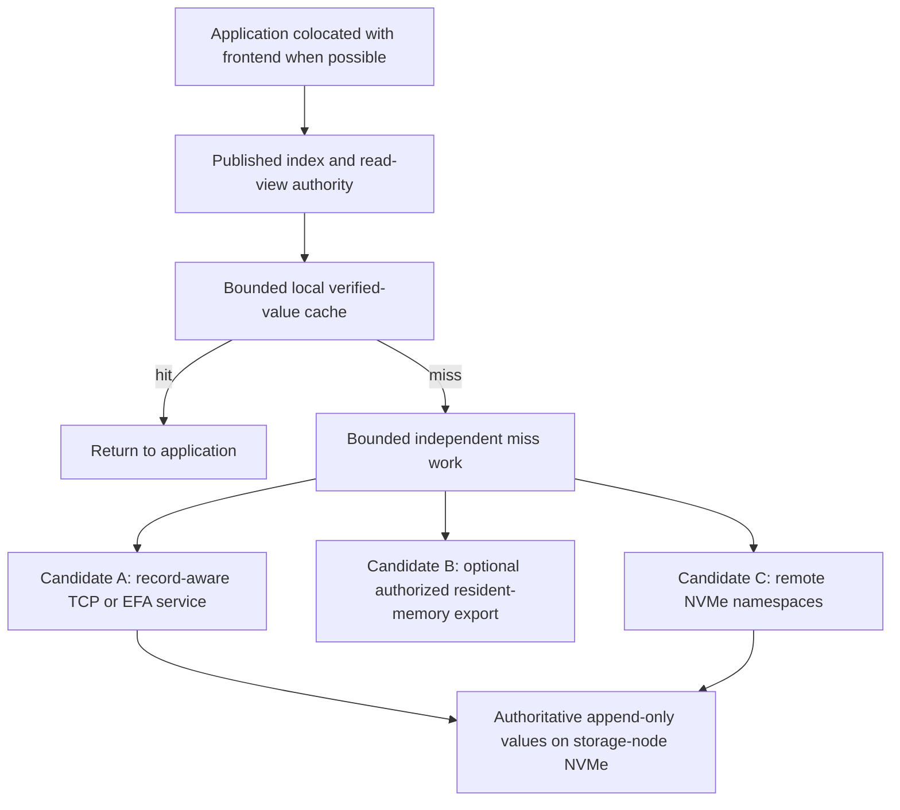

# Compute-local caching, EFA and NVMe-oF for distributed Tidehunter

Date: 8 October 2026. **Research and proposed design only.** No engine changes,
new benchmarks, AWS inventory calls or cloud launches are part of this review.

This document separates measured bottlenecks, inspected implementation facts and
unverified design hypotheses. `[INFERENCE]` marks predictions. It supersedes a
categorical rejection of NVMe-oF or a claim that every remote operation must retain
our current latency gap. It does not supersede the measurements in the
[7 October EFA report](EFA_CLUSTER_RESULTS_2026-10-07.md).

Later implementations:
[bounded coordinator read progress and mapped/positional measurements, 8 October](../../experiments/aws-sharded-wal/README.md#implemented-8-october-bounded-read-progress),
then [checkpoint adoption and bounded asynchronous WAL reads, 9 October](CHECKPOINT_ASYNC_READS_2026-10-09.md).
The later [completed hardware comparison](../../experiments/aws-sharded-wal/README.md#completed-campaign-8-october-2026)
reports native/TCP/EFA results, regressions, cache controls and verified cleanup.
Source descriptions and proposed work below remain the research-time snapshot;
these later results do not turn its untested proposals into measurements.

## 1. Decision and direct answers

1. **EFA bypasses the TCP data path, not automatically TLS or our application.**
   We chose to carry TLS records over EFA after a TCP authentication/bootstrap
   exchange. Our storage requests are two-sided messages, not one-sided WAL reads.
2. **A larger compute/coordinator-local cache is a fitting design.** It can make
   a resident read local to the application. The current coordinator already has
   a small immutable-reference cache; the latest cloud campaign disabled it.
3. **NVMe-oF can work.** In particular, mounting remote block storage on the
   compute host can put the filesystem page cache beside the application. Warm
   reads can then avoid the network, even without an application value cache.
   This is a substantive architectural alternative, not merely a faster RPC.
4. **Cache placement and storage transport are independent decisions.** A local
   cache can front record-aware TCP/EFA, one-sided resident-memory reads, or
   NVMe-oF storage. Do not choose between caching and NVMe-oF as if they conflict.
5. **Select compute-local index/cache as the target topology. Keep two backend
   candidates:** an improved record-aware Value-WAL service, and compute-owned
   Tidehunter over remote NVMe namespaces. Compare them before committing to a
   large storage rewrite. One-sided immutable exports are an optional hot tier.
6. **Parity must be scoped.** Local cache-hit latency and competitive batched or
   cold-storage throughput are plausible targets. No examined source establishes
   native parity for every hit, miss, small durable write, tail, recovery event,
   security policy and failure mode at once.

The logical counter is not the value cache. In this fork it is already a local,
epoch-scoped atomic at the publication authority, not an extra remote sequencer
call. The frontend's preparation, publication and serving ownership matter more
than making that counter a distributed atomic.

## 2. What actually travels over TCP, TLS and EFA

### 2.1 Current implementation

| Layer or phase | TCP mode | EFA mode |
| --- | --- | --- |
| Peer identity, transport negotiation, address bootstrap | Mutual TLS over TCP | Mutual TLS over TCP |
| Established data path | Application frames → TLS records → TCP socket | Application frames → the same TLS record stream → libfabric messages → EFA/SRD |
| Kernel TCP networking for value transfer | Yes | No |
| TLS encryption/decryption and record processing | Yes | Yes |
| Storage-node request parsing, membership checks and record reads | Yes | Yes |
| One-sided remote memory load or NVMe-oF command | No | No |

The source is explicit:

- [`tcp/fabric.rs::bootstrap`](../../tidehunter/src/distributed/tcp/fabric.rs#L65)
  authenticates and exchanges addresses before moving the TLS stream.
- [`endpoint/resources.rs`](../../tidehunter-fabric/src/endpoint/resources.rs#L132)
  requests `FI_EP_RDM`, `FI_MSG | FI_DIRECTED_RECV`, manual progress and
  send-after-send ordering. It does not request a one-sided `FI_RMA` read path.
- [`tcp.rs::DeadlineIo`](../../tidehunter/src/distributed/tcp.rs#L1461)
  selects the socket or fabric endpoint beneath rustls. The file name `tcp.rs`
  does not mean that EFA value traffic still uses TCP.
- [`endpoint.rs`](../../tidehunter-fabric/src/endpoint.rs#L13) has four send and
  four receive slots. Buffer pipelining is not application-request multiplexing:
  [`Client`](../../tidehunter/src/distributed/tcp.rs#L780) still owns one request
  at a time per connection.

The TCP connection remains for bootstrap/liveness; it is not a second value-data
hop. The software `fabric-tcp` provider is a separate correctness option, not EFA
hardware evidence. These distinctions agree with the
[AWS EFA architecture](https://docs.aws.amazon.com/AWSEC2/latest/UserGuide/efa.html)
and [libfabric EFA provider description](https://ofiwg.github.io/libfabric/main/man/fi_efa.7.html).

### 2.2 Security is a separate design axis

RDMA is not inherently encrypted application communication. Kernel bypass does
not remove the need to establish peer identity, authorize database access, bind
requests to an epoch, reject replays and verify returned values.

TLS itself does not require TCP. [RFC 8446 §1](https://www.rfc-editor.org/rfc/rfc8446.html#section-1)
requires a reliable, in-order stream; our adapter provides that over fabric
messages. Conversely, session-sequenced TLS records cannot simply become reusable
random-access ciphertext for arbitrary one-sided reads.

Our current mTLS choice preserves these transport protections while changing the
underlying transport. **The logs do not measure TLS CPU separately.** It is not
supported to attribute the entire exchange delay to TLS or promise that removing
TLS removes that delay.

AWS documents hardware AEAD encryption for eligible Nitro instance-to-instance
traffic, including EFA, and lists C6id among supported families. This makes a
platform-protected data plane worth investigating; it is not equivalent to our
process-level mutual-TLS identity and session binding. Eligibility, network path,
authorization and threat model must be checked before changing security policy.
Sources: [AWS HPC data protection](https://docs.aws.amazon.com/wellarchitected/latest/high-performance-computing-lens/data-protection.html),
[EC2 encryption in transit](https://docs.aws.amazon.com/AWSEC2/latest/UserGuide/data-protection.html#encryption-transit).

Possible designs to assess, not silently enable:

- Retain TLS while fixing request scheduling and completion ownership.
- Use an established authenticated-message construction with independent framing
  and replay protection, after security review, rather than rebuilding an ordered
  stream solely to carry TLS records. Do not invent a cryptographic protocol.
- Use authenticated immutable, bounded exports for one-sided reads. Remote-memory
  keys alone do not establish logical freshness, application identity or payload
  confidentiality. Replacing end-to-end encryption with infrastructure encryption
  is an explicit trust-boundary change, not a free equivalent optimization.

The current `efa` provider supplies ordering/progress features in software.
Current upstream documentation also describes `efa-direct`, with different
ordering, message-size and progress constraints. It is **not** a drop-in switch
for this ordered TLS stream. Upstream documentation is moving; the measured cloud
runtime was `2.6.0amzn1.0`, not an assertion that every current upstream feature was
available in the campaign.

## 3. Evidence: what is slow, and what is not established

### 3.1 Measurement boundary

Run `th-2d6015657fbdf380` used five RF1 storage hosts plus a client/native host,
with independent instance-store NVMe. It verified 68 API cases and 170 node
archives. All EFA node archives had positive hardware-traffic evidence; no swap
was observed. No Sui execution, replication or automatic HA was measured.

The benchmark calls native `Db` and distributed `RemoteDatabase` directly from
the driver process. It does not include an external application's network hop to
a separately hosted coordinator. See
[`Backend::get/get_many`](../../tidehunter/examples/sharded_wal_bench.rs#L480).
Native multi-get is the driver's loop over the native scalar API. Current results
are not the maximum throughput of either engine under arbitrary concurrency.

Both sides use the synchronous Value-WAL file/directory durability barrier.
Tidehunter's ordinary foreground/page-cache acknowledgement is a different mode.
Application value caches were disabled; OS cache hits remained possible. Logical
values occupied at most about 96 MiB. Cold phases recorded physical reads but
could warm after initial eviction. They do not establish sustained capacity-scale
behavior. Warm figures below are medians of three runs; cold figures use two.

| Case | Native paired with EFA | EFA | EFA/native |
| --- | ---: | ---: | ---: |
| 1 KiB B1/W1 warm scalar p50 | 0.495 µs | 39.306 µs | 79.41× |
| 8 KiB B32/W32 warm scalar p50 | 3.038 µs | 55.655 µs | 18.32× |
| 8 KiB 32-key warm p50 | 84.349 µs | 756.263 µs | 8.97× |
| 8 KiB B32/W32 scalar p99 | 4.286 µs | 67.063 µs | 15.65× |
| 8 KiB 32-key warm p99 | 112.846 µs | 1,045.044 µs | 9.26× |
| 8 KiB cache-evicted scalar p50 | 92.381 µs | 393.447 µs | 4.26× |
| 8 KiB cache-evicted 32-key p50 | 2,417.822 µs | 3,669.592 µs | 1.52× |
| 1 KiB B1/W1 full write load | 34.145 ms | 203.826 ms | 5.97× |
| 8 KiB B32/W32 full write load | 160.613 ms | 199.302 ms | 1.24× |
| 8 KiB B32/W32 mixed phase | 34.730 ms | 150.208 ms | 4.33× |
| 8 KiB B32/W32 full scan | 28.230 ms | 35.524 ms | 1.26× |
| 8 KiB B32/W32 delete phase | 6.793 ms | 6.466 ms | 0.95× |
| 8 KiB B32/W32 reopen | 2.538 ms | 721.244 ms | 284.21× |

B32/W32 is the write batch/window configuration, not 32 concurrent scalar reads.
Read p99s are medians of per-run percentiles, not pooled percentiles. Write and
maintenance rows are whole-phase durations, not per-key latencies. Mixed read and
write rows share a timer. Full metrics, CPU/RSS qualifications and raw paths are
in the [cluster report](EFA_CLUSTER_RESULTS_2026-10-07.md).

### 3.2 Bottleneck-to-mechanism map

| ID | Measured fact and inspected mechanism | What could address it | What is not yet proved |
| --- | --- | --- | --- |
| B1: warm misses | Diagnostic mean: 57.619 µs whole call, 48.035 µs exchange including server, 1.696 µs server handler, 7.858 µs client verification. Scalar actor handoffs are already bypassed. | Compute-local verified cache; request/completion-oriented transport; optional one-sided resident export. | Exchange is not pure wire time. No isolated TLS, CPU-frequency, provider or scheduling attribution. |
| B2: batched misses | Five shard RPCs per 32-key call, dispatched before waiting. Mean per-shard exchange 153.133 µs; handler 9.216 µs. | Independent request progress, bounded per-node concurrency, whole-call completion tracking and parallel verification where useful. | Do not add five exchange means and call that the critical path. End-to-end actor/return/slowest-shard attribution is missing. |
| B3: cold storage | Diagnostic shard record access 359.820 µs inside a 447.893 µs EFA call; native WAL/decode 107.547 µs. Shard records are fetched in a loop. | Compare bounded positional I/O with mmap; overlap/coalesce independent reads within each shard; retain NVMe-oF as a competing backend. | Device service, page faults, layout and read amplification are not separately timed. This is not solely network cost. |
| B4: writes | Preparation wall 81.776 ms inside admission/validation 82.958 ms; storage wait 95.251 ms; publication 20.342 ms. Node work includes canonical decode and persistence. | Reduce repeated work/copies; preserve independent preparation and storage overlap; improve bounded persistence grouping and publication handoff. | These clocks overlap. Parallel node sums are not serial elapsed time. Cache and RDMA do not remove durable storage obligations. |
| B5: completion/progress | Server warm response-send mean 37.182 µs, including 34.172 µs TX drain. Current stream drains at RPC boundaries. | Retain DMA buffers until actual completion without blocking unrelated requests; distinguish posted, delivered and locally completed events. | Drain overlaps receipt. It is not an additive 34 µs saving. TLS-chunk drains have already been removed. |
| B6: reopen | Connection/status and fencing loops are serial; recovery replays retained histories. EFA startup adds provider setup. | Parallelize independent setup with complete-inventory barriers; persist usable recovery snapshots and replay only a safe suffix. | Split setup/fencing/replay clocks are missing. Cache warmup does not fix authoritative recovery. |
| B7: CPU and frontend scaling | Node CPU/case-second is about 10.3× TCP for EFA, not CPU/op. Controller CPU was not captured. `RemoteDatabase::get` needs `&mut self`. | Separate read-view ownership and miss I/O; bounded workers, controlled polling and CPU/NUMA placement; measure frontend memory/NIC ceilings. | No saturated throughput/CPU-efficiency claim is supported. A larger cache alone does not provide concurrent serving. |

Index lookup was 0.480 µs and measured inventory-lock wait 0.029 µs in the warm
scalar diagnostic. Replacing the global logical counter or inventing another
DHT is not supported as the first fix for B1. Already implemented mechanisms
include direct reference reads, scalar actor bypass, concurrent cross-shard
fanout, SIMD BLAKE2b-256 verification and bounded write preparation/pipelining.

### 3.3 A concrete cold-read asymmetry worth isolating

Native [`Wal::read`](../../tidehunter/src/wal/mod.rs#L311) calls
`frame_source(pos, true)`. Distributed
[`read_record_payload_range`](../../tidehunter/src/wal/mod.rs#L352) calls
`frame_source(parent, false)`. The
[`frame_source` policy](../../tidehunter/src/wal/mod.rs#L448) deliberately sends a
whole-frame read through positional I/O when its mapping was not populated, to
avoid page-by-page faults. Partial reads keep using the mapping.

[INFERENCE] This policy could contribute to B3 for multi-page members. It is not
a proved explanation of the measured gap: we need the actual mapped/syscall
choice, page faults, bytes fetched and completion time per request. Any positional
alternative must remain a bounded member read, not reintroduce whole-batch read
amplification. Change neither native read policy nor checksums without evidence.

## 4. A dedicated cache/coordinator: useful, but placement matters

### 4.1 This is partly implemented already

The client host already holds the publication authority/index separately from the
five physical Value-WAL nodes. Its
[`ReadCache`](../../tidehunter/src/distributed/remote_db/read_cache.rs) is a
byte-accounted four-way CLOCK cache keyed by the complete immutable
`ValueRecordReference`, not just a user key or physical offset. It stores verified,
detached record bytes. It fills on reads and starts empty on reopen. Scan-fill
bypass already protects it from scan pollution.

[`RemoteDatabaseConfig`](../../tidehunter/src/distributed/remote_db.rs#L61)
defaults to 8 MiB and rejects budgets above 256 MiB. Thus a multi-GiB cache requires
an explicit budget/layout review, not just setting an existing unbounded option.
The `--tcp-read-cache-bytes` benchmark option also configures this shared frontend
when EFA is selected; its name is historical. The latest cloud run set it to zero.

Historical local evidence from
[6 October, §9](PIPELINE_AND_READ_CACHE_2026-10-06.md#repeated-cache-hot-reads-and-memory-policy-qualification):

| All-hit scalar p50; 3,072 total requests | 1 KiB | 8 KiB |
| --- | ---: | ---: |
| Distributed frontend with 8 MiB cache | 0.585 µs | 0.695 µs |
| Native with application value cache disabled | 0.598 µs | 1.592 µs |

This demonstrates local-hit speed, **not equal-memory superiority or current
cloud parity**. The ordinary mostly-miss B32 trace had only 6.45% hits and did not
show the same benefit. Native has its own value cache and OS page cache; enable or
budget them fairly in a cache comparison.

### 4.2 Logical network exchanges

Assume established connections, known routing, no retries and a scalar read.
These are application/storage exchanges, not physical switch-hop counts.

| Placement | Cache hit | Cache miss |
| --- | --- | --- |
| Application and frontend in the same process | No inter-host exchange | One frontend→storage exchange |
| Separate application process on the same machine | Local IPC remains | IPC plus one storage exchange |
| External application→dedicated frontend/cache | One application→frontend exchange | Outer application exchange plus a dependent frontend→storage exchange |
| Application-local cache of a valid immutable reference | No value-fetch exchange | Fetch from its owner; latest-reference discovery may still require communication |

A remote cache server is not equivalent to an embedded cache. Compare an external
frontend with native Tidehunter behind the same external API as well as retaining
the original embedded-native baseline. Do not hide the extra hop by changing only
one side's API boundary.

### 4.3 Proposed cache contract

Keep the existing immutable-reference design, with these explicit requirements:

1. Establish valid serving authority and capture the required published view.
   A local remembered epoch is not an HA read lease.
2. Resolve the requested key through the authoritative index/read cut. A delete
   or absence must not be replaced by any older cached value for that key.
3. Look up the exact reference, retaining full-key checks and database, version,
   member and physical-generation identity. A hit need not fetch/hash the same
   verified immutable bytes again; it must still belong to the requested view.
4. On a miss, retain the reference/view lifetime and release unrelated serving
   resources before network/I/O wait. Verify the returned member against that
   exact reference before filling or returning it.
5. Concurrent fills for the same reference may be coalesced under a bounded
   in-flight budget. A delayed fill cannot replace a newer key→reference mapping.
6. Optional post-publication write priming may reuse verified committed input.
   It must not expose speculative writes, delay acknowledgement unnecessarily,
   or turn a failed optional cache insertion into an apparent transaction abort.
7. Preserve complete-batch publication, same-key order and checkpoint semantics.
   Do not invent transactional multi-get semantics absent from the API.
8. Retain/revoke remote references before relocation or address reuse. Cached
   bytes are not permission to delete WAL/recovery evidence.
9. Poisoned, incompletely recovered or no-longer-authorized frontends must not
   answer cached latest reads. Clear on reopen unless recovered authority proves
   that retained cache identities remain eligible.
10. Cache contents are disposable. A cache hit or fill is never a durable receipt.

`get(&mut self)` currently holds frontend ownership while a miss waits. Native
`Db::get(&self)` has a different concurrency boundary. A larger concurrent cache
therefore needs a retained, safely published read view and isolated miss workers,
not a single larger global mutex. Cache CLOCK metadata and in-flight accounting
still need bounded synchronization/ownership. Lock-free everywhere is not a goal.

With future multiple frontends, immutable payload replication is simpler than
replicating the meaning of **latest**. Async invalidations alone do not establish
that meaning. Before HA, define how an isolated old coordinator stops cached
latest reads; fencing only its storage writes is insufficient. The present static
RF1 system does not claim this HA protocol.

### 4.4 Capacity and tail limits

For a fixed request population, the law of total expectation gives
`E[L] = h E[L|hit] + (1-h) E[L|miss]`. Use measured conditional **means**, not p50s.
Queueing and contention can change both conditional means as hit rate changes.

Illustration only: assume a 1 µs local hit, a 60 µs miss, no queueing, and independent
hit events across 32 requested keys. These are not projected cloud timings.

| Per-key hit rate | Illustrative scalar mean | Chance a 32-key call has at least one miss |
| --- | ---: | ---: |
| 90% | 6.900 µs | 96.566% |
| 95% | 3.950 µs | 80.629% |
| 99% | 1.590 µs | 27.502% |
| 99.9% | 1.059 µs | 3.151% |

The batch expression is `1-h^32`. In this idealized separated hit/miss model,
99% of complete batches are all-hit only at `h >= 0.99^(1/32)`, about **99.9686%**.
Actual correlations, eviction conflicts and queueing require measured tails.
A good scalar median therefore does not establish good batch p99.

Measure reuse by exact version/reference, not only user key. Under uniform random
access to an equal-sized immutable set, a cache holding fraction `C/W` has at most
that approximate stationary hit fraction without other locality. Skew, write
churn and repeated versions change the result; a large hot set is not assumed.

Budget values, keys, descriptors, table slots, allocator overhead, in-flight
buffers, snapshots, retained versions and OS cache together. Larger cache tables
can increase CPU-cache misses and eviction work. An external frontend also has a
NIC egress ceiling of roughly effective payload bandwidth divided by returned
bytes per operation. More backend SSDs do not increase one frontend's CPU, DRAM
bandwidth or NIC capacity. Keep cache-hit workers independent of cold misses.

## 5. Candidate architectures

### A. Compute-local cache plus a record-aware Value-WAL service

Keep one logical publication authority, with independent physical WAL partitions.
Application reads resolve a published reference locally; resident bytes return
locally. Misses use one record request to the owning storage node. Whole atomic
batches remain on one partition under the current contract.

Improve request scheduling, buffer reuse and within-shard I/O while retaining
storage membership checks and native record placement. This is the closest
extension of the current code and works with default TCP and optional EFA.

[INFERENCE] A bounded, request-oriented fast path can reduce B1/B2/B5 without
changing WAL authority. It must distinguish short resident reads from blocking
storage work; neither monopolizing a poller with cold I/O nor adding a worker
handoff to every tiny hit is universally best.

### B. Add one-sided immutable resident exports to A

A frontend with an authorized reference and valid export descriptor can fetch
registered resident bytes without a server request handler for that access. If it
must first fetch the index or negotiate an export, those dependencies add exchanges.
A remote-memory read does not command an NVMe SSD to load a cold WAL page.

Required mechanisms: bounded registered-memory budget; exact generation/address
identity; retained immutable bytes; access control and the chosen encryption
policy; publication eligibility; descriptor expiry/revocation; drain before reuse;
corruption checks; miss/revocation fallback to the record service. Do not register
an unbounded WAL and assume cold pages, relocation and security are solved.

[INFERENCE] This may improve resident remote misses, but handler removal alone
cannot account for the entire measured gap because that handler is already small.
Evaluate the complete path, including descriptor hit rate and verification.

### C. Compute-owned Tidehunter over remote NVMe namespaces

This is a valid alternative to A, not a rejected design. Separate two variants.

**C1: kernel NVMe-oF plus a filesystem owned by one active compute host.** Export
remote namespaces, attach them as block devices, and run native Tidehunter's file
and mmap path on the compute host. A striped logical device can distribute block
I/O across SSDs; separate namespaces permit explicit partition placement instead.

The important locality change is the **compute-host page cache**. Linux normal
file reads, writes and mmaps use that host's page cache. Warm native reads can
therefore be local memory operations even though backing blocks are remote.
Current record RPC instead relies on page-cache residency at the storage host
when the frontend cache is disabled. Sources:
[Linux page cache](https://docs.kernel.org/mm/page_cache.html),
[SPDK NVMe-oF target/host documentation](https://spdk.io/doc/nvmf.html).

[INFERENCE] C1 could match native warm-path behavior and approach native cold-I/O
performance, depending on cache policy and storage-stack overhead. This is not
proof that its uncached request is as fast as a local SSD request. It also does
not demonstrate scaling compute work across the storage machines.

C1 can preserve native WAL-as-values and existing frame/index logic more directly
than a custom distributed KV wire format. It does not inherently require a second
value log. Filesystem metadata journaling and alignment still affect physical
write amplification. A minimal correctness comparison should retain native file
semantics before attributing gains to a userspace block rewrite.

[INFERENCE] C1 could also avoid our distributed canonical request/member envelope
and storage-node application decoding by issuing native file/block I/O instead.
That makes it a candidate for B4 as well as cache locality. It moves the trust and
ownership boundary to the namespace/filesystem owner; native frame validation,
complete-batch recovery and target fencing still apply. This is not an assertion
that every measured preparation cost disappears or that old distributed data can
be mounted as an unchanged native database.

**C2: userspace SPDK initiator and an explicit asynchronous Tidehunter I/O backend.**
This can remove kernel/block/filesystem overhead, but it no longer gets native
mmap/page-cache behavior automatically. It needs its own bounded buffer/cache and
completion model, aligned I/O, durable flush semantics and allocator/recovery
integration. This is a significant Tidehunter fork change, not a transport flag.

Both variants must specify:

- Single active filesystem/WAL owner or a real distributed ownership protocol.
  Never mount the same ordinary writable filesystem independently on several
  initiators and treat native directory locks as distributed fencing.
- Mapping from logical positions to namespace/extents, including generations and
  persistence of allocation/ownership metadata. A shared address space is not a
  distributed atomic commit protocol.
- Exact durability point: NIC completion and remote RAM receipt are not stable
  NVMe storage. Account for controller write caches, FUA/flush and every touched
  target, plus any filesystem namespace obligations.
- Recovery after partial writes, uncertain completion, compute failure, target
  failure and partial fencing. Striping a batch across devices expands its
  completion/recovery dependencies; retaining a whole batch on one partition
  preserves a simpler boundary.
- Relocation, retained reads/snapshots and no stale access after extent reuse.
- Replication/failure scope separately from transport. RAID-0 is not redundancy;
  AWS instance-store persistence does not survive instance loss merely because
  another machine accesses it remotely.
- Comparable authentication, confidentiality, CPU/core use and memory budgets.

For a raw/userspace backend, verify the backing device's volatile-cache and flush
contract rather than treating any successful completion as durable. The
[NVM Command Set specification, §2.1.4.3.2](https://nvmexpress.org/wp-content/uploads/NVM-Express-NVM-Command-Set-Specification-Revision-1.1-2024.08.05-Ratified.pdf)
describes the no-FUA volatile-cache qualification. SPDK's
[`nvmf_bdev_ctrlr_flush_cmd`](https://github.com/spdk/spdk/blob/master/lib/nvmf/ctrlr_bdev.c)
can return success when a backing bdev does not support flush. That can be correct
for an appropriate bdev contract, but is not proof of physical persistence for an
arbitrary chosen backend.

Takeover must exclude the old owner from **every** participating namespace and
handle its outstanding I/O. Verified reservations/preempt-abort support or an
equivalent target control protocol may supply this. A heartbeat timeout, an etcd
lease, an NQN string or a local lock file alone does not.

NVMe/RDMA commands generally have command, data and completion transfers; their
number depends on direction, in-capsule data and transport. Count dependencies,
not an invented universal number of packet or switch hops. A known block can
require one submitted remote storage operation, while device service, data
movement and completion remain inside it. Index misses, metadata lookup, flushes
and replication can add further operations.

Concretely, a usual non-inline NVMe/RDMA write sends a command, lets the target
RDMA-read the host data, executes storage I/O and returns a completion. A read
executes storage I/O, RDMA-writes data into the host buffer and returns completion.
Inline writes and transport batching change the message sequence. The inspected
[SPDK request state machine](https://github.com/spdk/spdk/blob/master/lib/nvmf/rdma.c)
and [programming guide](https://spdk.io/doc/nvmf_tgt_pg.html) describe a target CPU
driving NIC/memory/SSD DMA, not a generic CPU-free NIC-to-flash instruction.

### 5.1 AWS compatibility is a gate, not a blanket rejection

AWS lists RDMA read/write support for the campaign's `c6id.32xlarge`. EFA therefore
must not be described as lacking RDMA. But EFA/SRD/libfabric support is not proof
that a stock RoCE/InfiniBand NVMe/RDMA stack works unchanged. SPDK documents RDMA
NIC/verbs/connection-manager requirements; its TCP transport is a different route.
Establish actual initiator/target/provider compatibility before selecting hardware.

Sources: [AWS EFA capability table](https://docs.aws.amazon.com/AWSEC2/latest/UserGuide/efa.html#efa-instance-types),
[EFA SRD queue-pair API](https://github.com/linux-rdma/rdma-core/blob/master/providers/efa/man/efadv_create_qp_ex.3.md),
[SPDK requirements](https://spdk.io/doc/nvmf.html#nvmf_rdma).

The compatibility distinction is concrete in upstream source:
[`nvmf_rdma_listen`](https://github.com/spdk/spdk/blob/master/lib/nvmf/rdma.c) and
[`nvme_rdma_qpair_connect`](https://github.com/spdk/spdk/blob/master/lib/nvme/nvme_rdma.c)
use `RDMA_PS_TCP` through
[`rdma_create_id`](https://github.com/spdk/spdk/blob/master/lib/rdma_cm/rdma_cm_cma.c);
the [verbs provider](https://github.com/spdk/spdk/blob/master/lib/rdma_provider/rdma_provider_verbs.c)
creates `IBV_QPT_RC` queue pairs. EFA's documented SRD interface is not a statement
that this connection-manager/RC binding is available.
`RDMA_PS_TCP` names an RDMA port space, **not TCP payload transport**; see the
[librdmacm contract](https://man7.org/linux/man-pages/man3/rdma_create_id.3.html).
Stock SPDK NVMe/RDMA compatibility with our EFA deployment remains unestablished.

A supported RoCE/InfiniBand cluster remains an option if required. A kernel
NVMe/TCP comparison can establish the architectural/cache-placement mechanism
without proving RDMA latency. Neither a software provider nor laptop loopback
validates EFA, independent-NVMe scaling or offloaded security performance.

## 6. A fitting target topology, without choosing an unproved backend

This is a choice of backend paths, not a proposal to send each operation through
all three. In C1 the local cache may be the native value cache plus filesystem
page cache rather than our explicit `ReadCache`. The frontend may retain control
metadata/index snapshots without hosting a physical value shard.

A cache benefits all candidates. A different block backend does not solve frontend
serialization by itself. Conversely, independent frontend read workers do not
solve cold per-record I/O by themselves. Keep these experiments separable.

**Recommended decision order:** retain A as the functioning reference; specify and
validate the common compute-local cache/read-view boundary; compare A's corrected
cold path with C1 before funding C2; add B only if resident remote misses remain
material. Do not require A to achieve perfection before admitting C as a genuine
competing design. Do not replace A solely because the current stream adapter is
not an optimized RDMA KV implementation.

## 7. Source mechanisms, applicability and limits

Research used QMD plus primary online documentation/source, with separate parallel
reviews for cache coherence, fast RDMA KV and remote NVMe storage. Read scope is
selected relevant sections, not every page of every project. QMD figure/base64
truncation was not counted as complete reading; local primary PDFs were used where
needed. Moving documentation/source URLs were checked on 8 October 2026.

| Source and exact part | Mechanism and problem addressed here | Limit: what must not be copied or claimed |
| --- | --- | --- |
| [Tidehunter](https://arxiv.org/abs/2602.01873v2), §§2.3, 3.1–3.4, 4.4; [local PDF](../../../papers/Tidehunter-2026-v2.pdf) | Direct final Value-WAL placement, local cache/index lookup, complete publication/replay and safe relocation anchor every candidate. Native snapshots motivate B6 recovery work. | Ordinary page-cache acknowledgement is not our synchronous benchmark barrier. A global position is not committed state or permission to reclaim. |
| [Redis client caching](https://redis.io/docs/latest/develop/reference/client-side-caching/), Tracking, Avoiding race conditions, Losing connection | Client-local hits avoid the server; stale-fill races and invalidation loss require explicit handling. Applies to B1/cache placement and future multiple frontends. | Async invalidation or TTL does not implement Tidehunter authority fencing. Exact immutable-reference bytes need not be invalidated on every newer user-key version. |
| [Scaling Memcache at Facebook](https://www.usenix.org/system/files/conference/nsdi13/nsdi13-final170.pdf), §§3.1–3.3, 4.1–4.3 | Bounded fanout, fill leases/coalescing, interference-aware pools and controlled cold warmup address B2 and cache miss storms. | Fill leases are not coordinator-serving leases. Stale-serving/Gutter behavior and heuristic warmup invalidation do not preserve our undeclared latest-read semantics. |
| [Memcached meta protocol](https://docs.memcached.org/protocols/meta/), Atomic Stampeding Herd Handling, Early Recache, Serve Stale; [Mcrouter warmup](https://github.com/facebook/mcrouter/wiki/Cold-cache-warm-up-setup) | Concrete current implementation mechanisms for one fill winner and background warmup. | A warmup route alone does not guarantee update/delete propagation to every pool. Keep backing WAL authoritative; no uncertain-write replay or silent stale result. |
| [MICA](https://www.usenix.org/system/files/conference/nsdi14/nsdi14-paper-lim.pdf), §§2, 4.1–4.3, 5.1–5.3 | Per-core/NUMA-local ownership and approximate recency reduce cache contention and memory traffic, relevant to B7. | DRAM KV research, no durable complete batches; principal throughput uses tiny values, not encrypted 8 KiB NVMe reads. Do not adopt a lossy authoritative index. |
| [RAMCloud](https://web.stanford.edu/~ouster/cgi-bin/papers/ramcloud-tocs.pdf), §§3.2, 4.2, 5.1–5.2, 7.10–7.11, 9, 10.4 | DRAM-first service, direct routing and the old-master/zombie-read problem clarify local versus remote hits and read fencing. | All primary data in RAM and backup power/persistence assumptions differ. Its repository explicitly says [No Longer Maintained](https://github.com/PlatformLab/RAMCloud); it is not a new supported dependency. |
| [eRPC](https://www.usenix.org/system/files/nsdi19-kalia.pdf), §§3.1–3.2, 4.2.2 | Asynchronous requests, exclusive progress ownership, short versus blocking handlers and DMA-buffer lifetime address B2/B5/B7. | Existing exclusive endpoints and scalar bypass are not new work. Its unsignaled-send technique is not blindly portable to this provider or a reason to reuse DMA-owned bytes. |
| [HERD](https://www.cs.cmu.edu/~dga/papers/herd-sigcomm2014-readable.pdf), §§3.2–3.3, 4.1–4.3 | Request windows, server-local lookup and amortized completions address B2/B5 without dependent remote pointer chasing. | In-memory cache semantics, lossy eviction and roughly 1 KiB items differ. The [original implementation](https://github.com/efficient/HERD) says it is no longer maintained and points to a research benchmark successor. Our index is already frontend-local. |
| [Pilaf](https://www.usenix.org/system/files/conference/atc13/atc13-mitchell.pdf), §§3.1–3.4, 4 | Server-controlled mutation plus one-sided read-only exports, self-verifying references and pre-registration inform B. | Uncached index→value lookup takes dependent reads. CRC64 is not cryptographic; default disk logging is asynchronous. It does not supply our durable batch or remote-retirement contract. |
| [FUSEE](https://www.usenix.org/system/files/fast23-shen.pdf), §§4.1–4.6, 5.1–5.4, 6.1 | Cached descriptor speculation, phased updates and bounded remote allocation inform optional B; its own §4.6 permits a best-case one-round SEARCH. | Uncached search takes two rounds. Experiments use registered DRAM, not synchronous NVMe durability. Its remote index protocol would add complexity to our already-local lookup. [Artifact](https://github.com/dmemsys/FUSEE), not a verified production foundation. |
| [RCuckoo](https://www.usenix.org/system/files/atc25-grant.pdf), §§3.1–3.4, 4.1–4.4, 5.1–5.5 | Parallel candidate reads, compact inline values and explicit extent ownership clarify one-sided read dependencies. | Inline GET is one phase; large extents need another. NIC-memory/masked-CAS assumptions are not established on EFA. §4.4 acknowledges unimplemented stale-client fencing; server-failure replication is deferred. [Research implementation](https://github.com/wantonsolutions/RemoteDataStructres/tree/master/rcuckoo_rdma). |
| [ReFlex](https://anakli.inf.ethz.ch/papers/reflex.pdf), §3.1, §§4.1–4.3, 5.1–5.3 | Completion-driven network and flash queues show how remote flash can approach local flash, relevant to B3 and C. | Optimized TCP requires an efficient client too. Device-buffered write latency is not a durable-sync baseline. Its historical [artifact](https://github.com/stanford-mast/reflex) does not establish encrypted complete-batch KV performance. |
| [CETOFS](https://www.usenix.org/system/files/fast26-jia.pdf), §§3, 5, 7 | Host/target collaboration and batched command/completion handling inform C. §5 explicitly places atomicity work at the target. | Its redo log then checkpoint is not Tidehunter's final value placement; do not add that double-write design by accident. Multiple-target/initiator extensions are future work in §7. |
| [KVell](https://raw.githubusercontent.com/BLepers/KVell/master/sosp19-final40.pdf), §§4.1–4.4, 5.1–5.6, 6.6 | Worker-local queues/caches, bounded asynchronous I/O and writes to final locations address B3/B7 without another payload log. | Local KV with specific page-atomicity assumptions, not distributed whole-batch semantics. Its [implementation overview](https://github.com/BLepers/KVell/blob/master/OVERVIEW.md) explicitly warns it is a prototype, not for production. |
| [LEED](https://pages.cs.wisc.edu/~mgliu/papers/leed-sigcomm23.pdf), §§3.1–3.5, 3.7–3.8, 4.1–4.4, 4.7–4.8 | Closely related persistent KV: append/circular values, record-aware RDMA, SPDK, per-device credits and a separate membership plane. B3/B5/B7 inspiration. | Per-key semantics, SmartNIC memory tradeoffs and additional SSD index accesses differ; full power-loss flush/FUA and stale-authority guarantees are not established by the inspected evidence. Its [RDMA source](https://github.com/netlab-wisconsin/LEED/blob/main/spdk/app/leed/kv_rdma.c) also uses RC/CM, not an established EFA binding. |
| [FASTER recovery documentation](https://microsoft.github.io/FASTER/docs/fasterkv-recovery/), Overall Summary and Concurrent Prefix Recovery | Separates memory completion from durable session completion; a useful B4 acknowledgement comparison. | Ordinary operation rates cannot be equated with synchronous durable writes. Checkpoint initiation and `WaitForCommitAsync` are material to its stated recovery contract. |
| [Autonomous Commit](https://lamduynguyen.github.io/assets/pdf/latency.pdf), §§3.1, 3.3 | Independent bounded flushing and separation of persistence from acknowledgement processing inform B4. | Dependency tracking/acknowledgement protocol is not a drop-in substitute for our complete-batch ordered prefix. |
| [Aerospike architecture](https://aerospike.com/docs/database/learn/architecture/), Client layer and Data storage layer; [Flexible storage](https://aerospike.com/docs/database/learn/architecture/hybrid-storage/) | Current production design uses smart TCP clients, DRAM indexes, SSD copy-on-write records and defragmentation. Supports cache/index locality and final-ish record placement without requiring NVMe-oF. | Do not transfer its headline latency, replication policy or transaction guarantees to our code. It is evidence that high-usage KV does not imply one universal fabric architecture. |
| [ScyllaDB technical design](https://developers.scylladb.com/stable/getting-started/differentiators.html), Shard per Core, Internal Caching, Schedulers | Per-core resource ownership, internal row caching and explicit I/O scheduling inform B3/B7. | Its LSM and replica model are not necessary replacements for Tidehunter's Value WAL; marketing scaling claims are not our measured evidence. |
| [SPDK target](https://spdk.io/doc/nvmf.html), RDMA/TCP requirements, CPU/NUMA assignment, NVMe-oF TLS | Maintained block-transport implementation and a concrete compatibility/security checklist for C. | The documented TLS facility is NVMe/TCP-specific; do not assume identical security facilities on every transport or EFA compatibility from the word RDMA. |

High-speed systems optimize different boundaries: local memory, remote DRAM,
remote flash, durable commit or aggregate throughput. Their headline numbers are
not comparable unless value sizes, persistence, cache residency, security,
concurrency and resource budgets match.

### 7.1 What the remote-flash evidence actually supports

These are each paper's own configurations, not cross-paper rankings or forecasts
for Tidehunter. They establish that remote flash need not inherit our present RPC
overhead, while preserving the distinction from local DRAM.

| Primary experiment | Local read | Remote read | Qualification |
| --- | ---: | ---: | --- |
| ReFlex §5.2, Table 2, 4 KiB QD1 average | SPDK 78 µs | IX client 99 µs; Linux client 117 µs | Historical TCP block service. Client stack matters; not encrypted durable KV. |
| CETOFS §2.2.1, Table 1, 4 KiB device read | Optane 7.01 µs | 14.38 µs | Different, low-latency storage medium and experimental stack from our NVMe campaign. |
| CETOFS §2.2.1, same table, filesystem read | Local Ext4 13.56 µs | Remote Ext4 42.34 µs | Software can cost more than remote-device transport. |

LEED is particularly relevant because it is already a record-aware persistent
RDMA KV, rather than a raw remote-memory hash table. It does **not** show that
turning every KV access into generic NVMe-oF is mandatory. Its primary design
trades DRAM/core use for more SSD access and has per-key consistency rather than
our atomic multi-key publication. Borrow its ownership/credit separation, not
its latency numbers or unexamined failure assumptions.

The source review also found stale “only RDMA” wording in the SPDK programming
guide. Current target documentation and `lib/nvmf/tcp.c` explicitly support TCP;
use those for transport availability. A maintained project can still have stale
individual documentation sections.

## 8. Repository changes a later implementation would require

Paths are relative to this fork. Symbols are the source anchors; line numbers may
move. No item in this table was implemented by this document.

| Area | Existing source | Candidate change and scope |
| --- | --- | --- |
| Frontend cache | `tidehunter/src/distributed/remote_db/read_cache.rs`; `remote_db.rs::RemoteDatabaseConfig`, `fetch_cached`, `get_cut` | Review larger budgets and admission; preserve exact identity; separate concurrent hits from bounded miss work. Moderate distributed-layer change. Do not just remove the 256 MiB cap. |
| Published read view | `native_index.rs::get`, `publication.rs`, `native_publication.rs`, `remote_db.rs::publish_completed` | Establish lifetime-safe read cuts alongside mutation/publication. Significant concurrency change if allowing simultaneous readers/writer; native semantics remain the contract. |
| RPC scheduling | `tcp.rs::Client::exchange`, `StorageNode::read_response`; `remote_db.rs::fetch_uncached` | Bounded request concurrency, completion ownership and cold-handler isolation. Potentially significant transport change; default TCP remains supported. |
| EFA and optional exports | `tcp/fabric.rs`; `tidehunter-fabric/src/endpoint.rs`, `endpoint/resources.rs` | Preserve current negotiated path; assess message-oriented or one-sided export protocol with explicit lifetime/security. Significant change for B, not merely a feature toggle. |
| Cold WAL access | `storage.rs::read_member_range`; `wal/mod.rs::read_record_payload_range`, `frame_source` | Controlled member-range I/O selection/overlap. Small experimental helper change may suffice for a discriminator; no inherited native behavior change without evidence. |
| Write CPU and barriers | `remote_db/preparation.rs`; `codec.rs`; `storage.rs`; `publication.rs` | Reduce measured repeated work while retaining canonical bytes, complete receipts and ordering. SIMD and parallel preparation already exist. |
| Recovery | `remote_db.rs::open_inner`, replay helpers; `tcp/inventory.rs`; `native_index.rs` | Parallel independent setup and safe snapshot/suffix recovery. Significant correctness work; never recover from only responsive RF1 streams. |
| C1 remote block candidate | Native `wal/mod.rs`, allocator, mapper, filesystem/control APIs; deployment configuration | First assess native file semantics on a single-owner remote block filesystem. Could require primarily storage/deployment changes; compatibility/durability must be proved, not assumed. |
| C2 userspace storage | Native WAL/mapper/control/replay and an explicit I/O/cache boundary | Major Tidehunter fork modification; replace mmap assumptions deliberately. Preserve final-value log format/semantics where feasible. |
| Benchmark | `tidehunter/examples/sharded_wal_bench.rs`; diagnostics; `experiments/aws-sharded-wal/` | Add fair cache/API/storage controls and missing critical-path clocks later. Preserve source/binary identity, full values and logs. No new campaign now. |
| Sui and old middleware | Existing sibling repositories, not modified in this review | None required to investigate A/B/C locally. Application/frontend colocation and backend selection may need a Sui adapter later; no Sui semantic rewrite is justified by these measurements. Old middleware stays historical baseline, not a mandatory proxy. |

## 9. Correctness rules that every candidate must retain

Read the [native correctness inventory](native_correctness_and_storage_options_2026-10-06.md)
with its historical-path warning, and use the current fork's native implementation
as source authority. The important obligations are:

- Nonoverlapping allocations and validated complete records/batches.
- Same-key logical ordering; relocation must not make an old value a new mutation.
- Atomic batch visibility and a completed/published prefix that cannot jump over
  unknown earlier outcomes. Largest observed sequence is not completion.
- Explicit acknowledgement mode. Durable mode requires sufficient stable evidence
  for recovery, not just a cache insertion, NIC CQ entry or remote RAM receipt.
- Exact retry identity after uncertain outcomes. A timeout is neither an abort
  nor permission to retry as a fresh write on another transport.
- Recovery metadata ordering, complete inventory and stale-writer fencing before
  new authority. Add cached-read fencing before promising HA latest reads.
- Retained reference/snapshot/replica lifetimes before reclamation or address reuse.
- Matching corruption detection, full-key identity, authorization and declared
  confidentiality guarantees across compared configurations.
- Bounded memory, admitted work, registered regions and completion queues; reserve
  progress capacity for recovery/control work under overload.

The current bounded RF1 implementation has no automatic distributed authority
lease, replication, reclamation or Sui selection. Its retained versions/histories
and configured limits are not an indefinitely growing production store. A larger
cache, one-sided RDMA or a shared namespace does not implement those missing
properties. Async replication, when added, must not be advertised as lossless
promotion after permanent primary loss.

## 10. Is native-level performance possible per metric?

These are design assessments, not new measured results.

| Metric / comparison | Assessment | Necessary condition or obstacle |
| --- | --- | --- |
| Resident in-process scalar read | [INFERENCE] Native-like latency is plausible; historical local hits demonstrate the mechanism. | Safe local reference/view and resident bytes. Compare native's own enabled cache and full RAM cost. |
| External-client read | [INFERENCE] Competitive with a network-served native baseline is plausible. | An application→server exchange remains. Do not compare it only with a sub-microsecond embedded memory access and call the difference a storage defect. |
| Remote resident-value miss | [INFERENCE] The present gap is not an RDMA hardware floor; substantial improvement is plausible. | Efficient request/progress or one-sided export, descriptor locality, security and verification. No exact target is established. |
| Cold individual NVMe read | [INFERENCE] Near-native order of latency is plausible for A or C. | Local versus remote storage path, faults, layout and command overhead must be controlled. More SSDs do not accelerate a single dependency automatically. |
| Concurrent cold reads / scans | [INFERENCE] Can match or beat one SSD at sufficient independent concurrency. | Shard and within-shard I/O depth, balanced load, frontend NIC/CPU capacity and comparable native concurrency. Cache misses/tails still matter. |
| Batched durable writes | [INFERENCE] Parity or better throughput is a credible target, not established. | Preparation/decoding/publication and persistence grouping must keep drives fed without weakening durability. |
| Small dependent durable write | [INFERENCE] Same order may be achievable; equality in every case is not promised. | Remote persistence plus publication remains; a DRAM ACK is a different contract. |
| Foreground/page-cache write | [INFERENCE] C1 can retain local dirty-page acknowledgement behavior. | This is native's weaker policy, not proof of current durable-mode parity or remote-node survival. |
| p99/p999 under misses or overload | Unproved; cache-hit medians are insufficient. | Miss mixture, queueing, correlated batches, backpressure, pauses, fault handling and polling budget. |
| Reopen / recovery | Current gap is architectural, not solved by cache or fabric alone. | Usable snapshots, suffix replay, complete fencing and bounded parallel connection setup. |
| CPU, RAM and cost per operation | Unproved; faster EFA latency currently costs more node CPU/case-second. | Include frontend, polling cores, cache replicas, registration and network transfer, not just storage-node wall time. |
| Replicated durability / availability | Not measured by the RF1 campaign. | Specify and compare the same failure model and acknowledgement policy; RF1 timings are not quorum timings. |

There is no physical theorem that a new remote-storage implementation cannot beat
our particular native measurement: it may do less software work or exploit more
parallel devices. There is also no basis for promising that a truly remote,
uncached, dependent access equals the best local-memory access under every
condition. **Locality can remove a network operation; RDMA only makes an operation
that still crosses the network cheaper.**

## 11. Evidence needed before selecting and implementing the backend

This is a proposed evaluation order, not work run by this review.

1. **Fix the comparison contract.** Keep embedded-native results, add an external
   native-server control if assessing a remote frontend, and report both. Match
   value size, batch/point semantics, security and acknowledgement policy.
2. **Quantify the useful cache.** Obtain representative key/version reuse and
   read/write traces, not just a tiny all-resident benchmark. Compare disabled,
   equal-budget and separately labeled larger-cache cases. Record request/byte
   hits, all-hit versus partial-miss batches, warmup, churn and scan interference.
3. **Isolate scheduling from transport.** Timestamp enqueue/start, encoding,
   crypto, send posting, server receive/handler, response posting, client receipt,
   CQ completion, verification and final return. Server/client local intervals do
   not produce one-way wire time without synchronized clocks. Control CPU/NUMA
   placement, polling and frequency; capture frontend CPU and memory traffic.
4. **Discriminate the cold-path cause.** On identical requested offsets, record
   mapped versus positional access, faults, physical bytes and I/O completion.
   Compare bounded member reads and independent within-shard depth. Retain native
   serial API results and a separately labeled native concurrency control.
5. **Compare A and C1 at the same cache boundary.** Use the same SSD class,
   security, working set, durability and I/O depth. For C1, separately report warm
   frontend page cache and forced/capacity misses. Establish a supported NVMe-oF
   initiator/target pair; TCP is an architecture control, not RDMA evidence.
6. **Admit B or C2 only with a measured reason.** B targets material resident
   remote misses; C2 targets demonstrated kernel/block overhead. Include their
   memory-lifetime, authority and security designs before performance claims.
7. **Validate failure behavior before performance deployment.** Exercise torn
   batches, lost durable replies, cache refill races, delete/overwrite/checkpoint
   reads, stale authority, registration revocation and restart. C adds flush/FUA,
   target loss, extent ownership and multi-device partial failure obligations.
8. **Use the cluster only for irreducible hardware questions.** The laptop can
   validate protocols and relative software changes, not independent-NVMe or EFA
   speed. Any later cloud run needs a fresh source-bound build, verified transport,
   full results/log retrieval, bounded spend/lifetime and ownership-scoped cleanup.
   No cloud deployment is authorized or started by this research document itself.

Select the backend on complete workload distributions and equivalent guarantees,
not on one median or a paper's fastest configuration. The first shared design
investment is the compute-local read/cache boundary; the storage backend remains
an evidence-based choice between record-aware service and remote block storage.

## 12. Review provenance

Local source, saved raw benchmark summaries and complete relevant paper/document
sections were inspected. Representative EFA/native ratios and the illustrative
cache/batch arithmetic were recomputed without running a benchmark. Source URLs
are design provenance, not a claim that source projects or their dependencies have
been vendored or that their performance transfers to this fork.

The repository's referenced `skills/` trees are absent. No existing skill file was
changed. This review makes no new implementation contract that invalidates a
present skill. The earlier transport documents retain their historical skill
maintenance notes.
