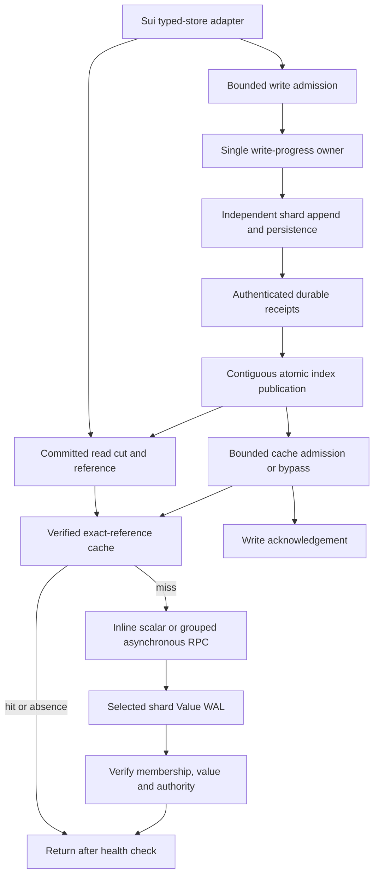

# Concurrent authority and native-parity read path, 13–15 October 2026

## Scope

The 13 October cutover removed the Sui adapter's database-owner mutex from
reads, permitted bounded concurrent durable writes, restored per-shard bulk
reads, and removed periodic idle sleeps. The 14 October local changes add
post-publication cache admission, grouped Sui iterator reads, independent shard
read authority, per-lane admission, reusable plaintext buffers, and bounded
write diagnostics. They do not create a global physical WAL or weaken durable
publication. No AWS resources were launched or changed for these local changes.

The value WAL remains distributed by **complete batch placement**, not by TiKV-like
key-range ownership. A key's new version can reside on another physical partition.
The coordinator's committed index contains the exact partition, epoch, position,
version, and integrity information required to read that value. Reads do not ask
a remote counter for a WAL position.

The measured sections below retain their original dates. The 13 October local
results and the completed 14 October cloud campaign both precede the new
cache/read-authority changes. They are baselines, not evidence of the new code's
cluster performance. Older cloud measurements remain in
[the RAM/read-path plan](CLUSTER_RAM_AND_READ_PATH_PLAN_2026-10-11.md#20-completed-nativetcpefa-real-checkpoint-matrix-13-october-2026).

## Serving path



## Repository and source map

Explicitly rooted paths are relative to this fork. Short Rust paths such as
`remote_db.rs`, `remote_db/...`, `tcp.rs` and `storage.rs` are relative to
`tidehunter/src/distributed/`.

| Code | Implemented responsibility | Source mechanism adopted |
|---|---|---|
| `tidehunter/src/distributed/remote_db/concurrent.rs` | Own bounded write admission, progress independent nodes, acknowledge only contiguous durable publication; serve committed metadata without borrowing the writer | FoundationDB §§2.3–2.6: separate transaction ordering/commit progress from reads of committed versions |
| `remote_db/pending_read/concurrent.rs` | Resolve a stable cut, check exact-reference cache entries, run an idle scalar lane in its caller, and group bulk misses by storage node | TiKV read-delegate validity checks; eRPC §§3.1–3.2: short work need not cross another worker queue |
| `remote_db/pending_read.rs` | Share bounded credits and per-lane reservations; prefer an idle actor lane over a busy one; retain queued and active ownership and absolute deadlines | eRPC bounded flow control; ReFlex independent completion progress |
| `tidehunter/src/distributed/sui.rs` | Shared normal-write gate and exclusive maintenance gate; grouped iterator lookahead starts at four rows and grows to at most 256; preserve stable cuts and full-key boundaries | Native Tidehunter batch/iterator semantics; DiskANN bounded frontiers, adapted to exact KV reads |
| `tidehunter/src/distributed/native_index.rs` | Separate checkpoint preparation, immutable persistence and installation; disk/network waits do not hold the serving index guard | Tidehunter §§4.1 and 4.3: protect index state, but let readers use existing state during slow persistence |
| `tidehunter/src/distributed/tcp/reactor.rs` | Park fully drained adaptive TCP on socket readability; retain active progress for pending/output work and fabric completion queues | eRPC endpoint progress ownership and ReFlex's independent I/O progress, adapted to the existing authenticated transport |
| `tidehunter/src/distributed/tcp/diagnostics.rs` | Report readiness waits as `idle_wait_calls/ns`, not sleep counters | Distinguish blocking readiness from a polling delay; no claim that either is physical network RTT |
| `remote_db.rs`, `remote_db/read_cache.rs` | Share one bounded cache between the write owner and readers; admit canonical records only after durable contiguous publication; detach buffers outside the cache lock | Native `LargeTableEntry::insert` and `apply_committed_changes` populate the LRU during writes |
| `remote_db/read_pipeline.rs` | Group exact-reference iterator misses by node with byte/count bounds and `ScanNoFill`; reconstruct results in index order | DiskANN cache filtering, bounded I/O frontiers and original-slot reconstruction |
| `tcp.rs`, `tcp/inventory.rs`, `storage.rs`, `reference_directory.rs` | Pin immutable read authority independently of append/persistence ownership; require the registered group's durable frontier; recheck fencing before response | Tidehunter reader/persistence separation and TiKV read-validity separation, without importing Raft leases |
| `tcp/reactor.rs` | Reuse initialized plaintext storage, track active frame length, and expose only fully overwritten frame bytes | Native buffer reuse principle; no unsafe initialization or new allocator |
| `tcp.rs`, `remote_db.rs`, `remote_db/concurrent.rs`, `sui.rs` | Collect bounded profiles on the actual append connections; export local snapshots of persistence, checkpoint and publication waiting | Attribute distinct stages before changing scheduling or durability |
| `tidehunter/examples/sharded_wal_adapter_bench.rs` | Exercise the actual Sui adapter with five separate local storage processes, cached/uncached reads and concurrent durable writers | Measure the changed caller path, not only the older single-owner engine API |
| `experiments/sui-checkpoint/{run,analyze}.py` | Require new runtime counters and retain source-bound native/remote replay evidence | Attribute API work, RPC work and hardware I/O separately |

`RemoteDatabase` remains the engine owned by the write-progress thread and the
single-owner API used by explicit engine experiments. `ConcurrentRemoteDatabase`
is a serving owner with different concurrency semantics, not a compatibility
alias. The Sui adapter uses the concurrent owner. No Sui repository code changes
were needed: its existing typed-store adapter and dynamic metric collector use
this fork. No middleware runtime changes were needed.

### Exact references and limits of the adaptation

* [Tidehunter, 2026 v2](https://arxiv.org/abs/2602.01873v2),
  [local parsed paper](../../../papers/parsed/Tidehunter-2026-v2.md): §3.1 supplies
  the complete-batch, long-lived Value-WAL location and allocation principles;
  §3.2 supplies index-to-WAL addressing and bounded caching; §§4.1/4.3 supply the
  index synchronization and reader/persistence separation. No second durable
  payload log was introduced. The paper's default asynchronous durability was
  **not** substituted for this benchmark's synchronous durability.
  The direct code baseline is
  [`LargeTableEntry::insert`](../../tidehunter/src/large_table.rs#L1898), including
  its LRU update at lines 1914–1918, and `apply_committed_changes` at lines
  2025–2040. The distributed cache uses immutable references rather than a
  mutable key-only identity. Canonical data is admitted after an authenticated
  durable receipt and index publication, not when a WAL position is allocated.
* [FoundationDB paper](https://www.foundationdb.org/files/fdb-paper.pdf),
  §§2.3–2.6, and inspected commit
  [`cc854d8a4939ba9e6b08c7928449e69427a3cc79`](https://github.com/apple/foundationdb/tree/cc854d8a4939ba9e6b08c7928449e69427a3cc79):
  `fdbserver/commitproxy/CommitProxyServer.cpp` (`commitBatchImpl`) and
  `fdbserver/storageserver/storageserver.cpp` (`waitForVersion`,
  `getValueReadPath`, `checkChangeCounter`). Ordered visibility need not make
  committed reads wait for an unrelated in-flight write. This implementation
  does **not** inherit FoundationDB's consensus, transactions or failover.
* [TiKV source, commit `5f7037a4adfb9d18e3c44778ab051bb55a3a233c`](https://github.com/tikv/tikv/tree/5f7037a4adfb9d18e3c44778ab051bb55a3a233c):
  `components/raftstore/src/store/worker/read.rs` (`ReadDelegate`) separates
  read validity from write scheduling;
  `src/storage/txn/scheduler.rs` and `src/storage/txn/latch.rs` keep logical
  conflict ownership distinct from asynchronous storage work. Here validity is
  the existing RF1 authority/health contract, not a fabricated Raft read lease.
* [eRPC, NSDI 2019](https://www.usenix.org/system/files/nsdi19-kalia.pdf),
  §§3.1–3.2, and the [implementation](https://github.com/erpc-io/eRPC): endpoint
  ownership, short foreground work and bounded admission motivate caller-owned
  scalar progress and keeping longer/multiple operations asynchronous. Its
  RAM-only RPC figures are not NVMe or durable-write targets for this engine.
* [ReFlex, FAST 2017](https://mast.stanford.edu/pubs/reflex_remote_flash_local_flash/),
  §§3–4: overlap request handling and device completion, preserve batching, and
  distinguish storage time from transport scheduling. This code does not claim
  ReFlex's userspace TCP stack or reproduce its hardware results.
* [DiskANN, NeurIPS 2019](https://papers.nips.cc/paper_files/paper/2019/file/09853c7fb1d3f8ee67a61b6bf4a7f8e6-Paper.pdf),
  §§3.3/4.2, and the pinned
  [source map](DISKANN_SOURCE_REVIEW_2026-10-06.md#2-source-mechanism--measured-problem--implementation):
  `CachedDiskVertexProvider::load_vertices` filters cached work;
  `DiskVertexProvider::process_loaded_node` retains result identity;
  `LinuxAlignedFileReader::read` bounds outstanding work. The new Sui iterator
  uses the existing exact scan machinery rather than a per-row remote fetch.
  Four-row initial lookahead limits speculative reads for short iterators.
  Approximate graph search, recall tradeoffs and DiskANN's storage format are
  not adopted.
* [Neki overview](https://planetscale.com/docs/neki/overview) and
  [Postgres sharding](https://planetscale.com/docs/postgres/sharding) illustrate
  routing independent work to storage shards. Their independent-shard commit
  boundary is not adopted: Sui's complete batches and coherent read cuts must
  not be weakened to independent per-key commits.

These are design adaptations, not copied implementations or benchmark promises.
No new dependency was added.

## Lock inventory and removal rationale

**No inherited native Tidehunter WAL, allocator, index-cell, relocation or
snapshot lock was removed or weakened.** Changes are in the experimental
distributed layer and its adapter. The only inherited native source change in
this work is a test-only empty-slice assertion in `primitives/cursor.rs` to
resolve type inference; it does not change engine behavior.

| Synchronization | State after this change | Why it remains or was removed |
|---|---|---|
| Sui `Remote.db: Mutex<RemoteDatabase>` | Removed | A remote append/read wait must not own committed read metadata. A bounded write-progress owner now owns mutations. |
| Sui exclusive gate around every remote write | Replaced by a shared `RwLock` guard for ordinary remote writes | Independent writes overlap; maintenance still takes the exclusive guard and waits for all admitted foreground writers to finish. |
| Native adapter durability gate | Still exclusive | Keep the existing native foreground write plus WAL-persistence-barrier contract. This is not native asynchronous-write throughput. |
| Committed `NativeIndex` | Shared `RwLock` | Readers share the index. Complete-batch publication and checkpoint installation need brief exclusive access. No network or persistence wait spans that guard. |
| Snapshot preparation | Shared index guard | Encoding can delay publication, but not other readers. Persistence and node proof RPCs run after releasing the guard. |
| Coordinator verified cache | One shared short mutex for lookup/admission | CLOCK metadata mutates. Canonical or verified record preparation runs before taking this lock. No network, persistence or index operation runs under it. |
| Write admission and stats | Short budget/snapshot mutexes; bounded channels | Charge retained bytes through acknowledgement; read counters without waiting for the writer's network I/O. |
| Read credits and lane reservations | Retained-credit mutex, lane registry guard, short per-lane scheduling mutex, generation/Condvar | Reserve in retained → lanes → scheduling order. Count queued and active lane work. A rejected reservation creates no credit and sends no false capacity notification. |
| TLS/fabric client lane | Exclusive connection ownership retained | Framing and authenticated stream sequence state cannot be mutated concurrently. Inline reads reserve only an idle lane; actor reads prefer idle lanes, then use bounded busy lanes. |
| Shard `NodeInventory` | Retained for append, persistence and control changes; removed from ordinary read admission/rechecks | A separate short `ReaderAuthority` guard pins epoch/log metadata. A durable frontier prevents reads of registered but unpersisted records. Response checks retain fencing and terminal fail-stop behavior. |
| Native storage partition/WAL internals | Unchanged | Existing allocation, durability, registered-reference and recovery invariants remain authoritative. |

This is not a lock-free implementation. “No database lock during network wait”
and “no locks anywhere” are different claims.

## Correctness rules

1. A write acknowledgement requires an authenticated durable complete-batch
   receipt **and** contiguous atomic publication. A later physical completion
   cannot bypass an earlier unpublished batch.
2. A read captures a committed reference/cut, not the write owner's transient
   state. Bulk calls retain one cut across all bounded windows and preserve input
   order, duplicate keys, absent keys and per-key validation errors.
3. A cache entry is keyed by the full immutable WAL reference. A newer value,
   old checkpoint cut, different epoch or reused offset cannot alias it by key.
   Admission requires either transport-verified bytes or canonical bytes bound
   to an authenticated durable receipt after contiguous index publication.
   Admission can bypass a disabled, full or unsuitable cache without failing
   the durable write. Write credit remains charged through cache preparation
   and release of the retained canonical backing.
4. Observed unknown append, authority, transport or integrity failure is
   monotonic. Cached, absent and detached results cannot bypass a poisoned
   authority. A normal in-progress write is not poison.
5. Request count and byte admission remain bounded. Queued write inputs are
   detached because a small `minibytes` view can retain an arbitrarily large
   caller allocation. This deliberate copy bounds ownership; it is not free.
6. Grouped reads use the existing largest-fitting per-node RPC mechanism. They
   remove source slots only after successful admission, because another caller
   can take credits after a capacity snapshot. Each window is at most 256 keys;
   actual in-flight requests/bytes still obey the configured service limits.
7. Credit cancellation, completion, poison and stop wake waiters. Absolute
   deadlines also apply when repeated generation changes would otherwise keep a
   caller retrying without entering the Condvar wait.
8. Maintenance waits for foreground writers through the exclusive adapter gate.
   Checkpoint persistence runs outside the serving index lock; installation does
   not replace newer published state with an older snapshot.
9. Clean shutdown drains admitted work and joins progress. Unwinding resolves
   retained replies and fences readers. A process configured with panic-abort
   instead stops the process and requires recovery; it cannot promise a reply
   after process termination.
10. TLS/authentication, CRC/digest checks, epoch fencing and synchronous WAL
    persistence are unchanged. RF1, retained-history bounds, lack of physical WAL
    GC and lack of automated failover remain restrictions of this architecture.
11. Registration alone does not make a shard record readable. The complete
    registered group's end must be at or below an acquire-loaded durable
    frontier. File persistence and required directory persistence precede its
    release-store. Recovery initializes it only after persistence succeeds.
    Unknown I/O failure or panic cannot advance that frontier.
12. An iterator validates shared authority health before every returned row,
    including rows already prefetched. Its fixed cut, forward/reverse order,
    full-key boundaries and byte/count limits remain intact. Scan misses do
    not fill or evict the point-read cache.
13. A lane's queued and active work excludes inline ownership. The actor
    scheduler first chooses an idle, non-reserved lane. A third read must not
    return to a stalled first lane while the second lane has become idle.
    The regression uses real cold RPCs after releasing and reopening the DB;
    writes otherwise correctly populate the cache.

## Instrumentation

* `scalar_read`, `bulk_read`, and `write_commit` are completed adapter spans.
  `bulk_read` counts bounded windows, not necessarily API calls. `read_calls` and
  `read_keys` remain the API/key denominators. An invalid key is a per-key error;
  `bulk_read_errors` counts an outer window failure, not every invalid key.
* `read_submit`, `read_admission_wait`, `read_detached_wait`, and `read_finish`
  describe the remaining detached record/scan path. Removed owner-wait counters
  are not silently redefined as another kind of wait.
* `read_rpcs` counts submitted logical read groups, not necessarily wire frames:
  the client transport splits a group at negotiated count/byte/frame limits.
  `read_profile_wire_requests` records wire requests in successfully completed
  sampled transport profiles. Unsampled traffic is not included in that field.
* `read_profile_inline_completed` / `read_profile_inline_ns` and
  `read_profile_actor_completed` separate scalar inline work from actor work.
  Do not divide actor residence by total inline-plus-actor completions.
  `read_profile_returned` counts actor returns only; inline completions must not
  dilute actor-return timing. Both paths collect actual transport/server spans
  when selected by the bounded sample.
* `write_durable_batches`, `write_concurrent_admitted/completed`,
  `write_concurrent_pending_peak`, `write_concurrent_queued_peak`,
  `write_concurrent_queue_bytes_peak`, and `write_peak_inflight_nodes` expose
  physical progress versus acknowledged publication. Peaks are cumulative, not
  per-phase counts. Independently read counters are not a transactional snapshot.
* `cache_inserts`, rejection/bypass counts, `cache_admitted_bytes` and
  `cache_entries` expose bounded admission alongside existing hit/miss/eviction
  counters. These are cache lookups, not physical NVMe reads.
* `write_checkpoint_ns/count` and `write_foreground_checkpoint_ns/count`
  separate all checkpoint work from the foreground subset; they are nested.
* `write_durable_receipt_publication_blocked_batches/ns` counts receipts
  accepted behind an unresolved durable-prefix gap. Waiting/peak gauges count
  retained receipts. The clock starts when the owner accepts a receipt, not
  when a remote device finishes persistence.
* `write_profile_limit` defaults to zero and accepts 0–65536 appends per owning
  connection. An enabled connection captures its existing `ConnectionProfile`
  at the limit; `finish_write_profile()` can drain and capture a shorter sample.
  Metrics scraping only reads a local snapshot and sends no control RPC.
  Disabled sampling starts no write-profile clocks or collection RPCs.
* `write_profile_available` requires every expected append owner to be captured.
  Partial samples are unavailable, not zero-cost operations. Each profile
  preserves client, server, append, persistence, socket and transport counters.
  Profile-control exchanges are excluded from client request counts. The
  diagnostic collection itself still has overhead; clean runs disable both
  read and write sampling.
* File-sync means use `write_profile_storage_file_persist_calls`; namespace-sync
  means use `write_profile_storage_namespace_persist_calls`. Do not divide these
  stages by all appends. `append_inventory_residence_ns` covers the guarded
  append/persistence section; decode/group preparation now runs outside it.
  Owner `storage_wait` is notification waiting, not an fsync timer.
* `idle_wait_calls/ns` measure TCP readiness waits, not sleeps. Busy/fabric paths
  do not use the TCP readability wait. Adaptive fabric still needs CPU for CQ
  progress; software-fabric results on this laptop are not hardware EFA latency.
* Nested spans and sums over concurrent calls cannot be added into an elapsed
  wall-time breakdown. OS `read_bytes`, logical WAL submissions, cache hits and
  returned values are different measurements.

## Local evidence and reproducibility

The adapter diagnostic uses five real storage processes, 512 keys, 256-byte and
8-KiB values, one/eight client workers, one/32-member durable batches, and an
explicit zero/16-MiB coordinator-cache comparison. Native cache capacity is a
nominal value allowance; distributed cache accounting includes metadata. Both
backends use the native Value-WAL persistence barrier semantics. Values are
verified before timing reads and after version-distinct writes. Reported latency
excludes value comparison; throughput includes verification and thread rendezvous.
All data belongs to fresh temporary directories and is removed after the owned
processes stop. Small result files and process evidence remain.

Run from the fork root with the installed libfabric development/runtime paths:

```sh
export PKG_CONFIG_PATH="$PWD/../middleware/target/toolchains/libfabric-2.6/lib/pkgconfig"
export LD_LIBRARY_PATH="$PWD/../middleware/target/toolchains/libfabric-2.6/lib"
cargo build -p tidehunter --features experimental-fabric,test-utils --release --examples --offline -j 2
target/release/examples/sharded_wal_adapter_bench NEW_OUTPUT_DIRECTORY
```

The first diagnostic is retained in
`../checkpoint-work/2026-10-13-concurrent-authority/adapter/summary.json`.
It exposed one admitted read group per key: 128 calls of 32 keys submitted 4,096
groups. Grouped reads reduced that to 128 groups for the same calls. These keys
were initially placed together in one complete batch, so this is a same-shard
bulk-read measurement, not evidence of five-device read scaling. Separate
correctness tests exercise mixed-node groups under one shared admission credit.
The diagnostic records an executable hash, not a full frozen-source archive.
The real-Sui harness separately freezes dirty sources, rebuilds native/remote
binaries, verifies executable/source hashes, replays the same checkpoint range,
and audits all selected rows and the RocksDB control before accepting results.

A single shared laptop SSD cannot prove independent-NVMe scaling, EFA behavior,
network latency or production tail latency. Cached local microsecond reads are
not remote NVMe fetches. Remote cache misses still pay transport, verification
and shard service; durable writes still pay persistence. Cluster targets remain
unproven until a later user-approved hardware run.

### Grouped adapter measurements

Evidence: `../checkpoint-work/2026-10-13-concurrent-authority/adapter-grouped/summary.json`
and each case's `measurements.yaml`. All 54 rows verified returned data and all
20 storage process IDs from the four distributed cases had exited afterward.
The summary records the executable SHA-256. This executable precedes only the
final diagnostic-counter correction: inline completions no longer inflate the
actor-return count, and sampled wire requests have their own counter.

| Operation | Value bytes | Native | Distributed, coordinator hit | Distributed, coordinator cache disabled |
|---|---:|---:|---:|---:|
| Warm scalar p50, µs | 256 | 0.186 | 0.628 | 12.618 |
| Warm scalar p50, µs | 8,192 | 0.170 | 0.785 | 23.219 |
| Warm 32-key call p50, µs | 256 | 3.594 | 13.036 | 132.192 |
| Warm 32-key call p50, µs | 8,192 | 2.384 | 8.432 | 346.693 |
| Durable 32-member batches/s, eight writers | 256 | 1,214.8 | 3,694.4 | 3,632.8 |
| Durable 32-member batches/s, eight writers | 8,192 | 781.8 | 1,077.4 | 1,103.3 |

All eight-writer distributed cases reached five simultaneously active storage
nodes. Native writes retain the existing exclusive adapter durability gate;
distributed writes now overlap independent nodes. These small shared-SSD samples
are not production scaling results. Each writer issues only 32 measured batches.

The preceding same-task, ungrouped run measured uncached 32-key p50 calls at
191.319 µs for 256-byte values and 459.639 µs for 8-KiB values. Group submission
count fell exactly 32-fold; latency did not. The remaining time still includes
actor scheduling, authentication, per-value validation and shard service.
These are two sequential samples, not a confidence interval or a comparison to
the previous released architecture. The frozen Sui replay supplies the separate
end-to-end comparison against the prior local checkpoint run.

The warm native and coordinator-hit working sets fit RAM. Disabling the
coordinator cache forces actual loopback requests, but does not evict the shard's
Linux page cache. None of these rows measures a physical NVMe miss.

### Correctness and build checks

* The fabric-enabled library suite passed: 681 tests, zero failures, 11 ignored.
* The final concurrent-owner subset passed all nine tests after the profiling
  correction. It covers stalled-write read independence, failure fencing,
  grouped reads/cache cuts, shared-credit races and deadline enforcement.
* Four separately selected software-fabric integration tests passed. This
  checks fabric control/authentication and progress, not EFA hardware latency.
* The checkpoint harness passed 46 tests; transport-floor and stage-timing
  analyzers passed 17 and 16 tests respectively.
* Release examples built with TCP and fabric support. Default Clippy with
  `-D warnings` passed for the library and examples.
* The additional crate-wide `clippy::pedantic` gate is **not clean**: its run
  reported 1,159 diagnostics, including inherited native-engine and older
  experimental code. New-module findings from that run were corrected; no
  claim of a clean strict-pedantic run is made.

The referenced `kvstore-*` skill directory is absent from this checkout. No
skill files were updated; the source-specific correctness rules above and the
existing native durability contract remain the basis for this change.

### Matched real-Sui checkpoint replay

The rebuilt native and remote Sui binaries both completed checkpoints 0–1,775
from the existing private-network fixture. This executes real Sui checkpoint
processing; it is not a mainnet workload or a large cold-storage workload.
The checkpoint digest, range, synchronous durability, cache budgets, topology,
4,096-group profiling limit and final table counts match the earlier local run.
All selected rows in all three namespaces and all three RocksDB control groups
passed the exact final-state audit.

| Local run | Native elapsed, s | Distributed TCP elapsed, s | Distributed/native |
|---|---:|---:|---:|
| Prior adapter, `2026-10-13-efa/local-tcp` | 14.078 | 17.301 | 1.229 |
| Concurrent adapter, this cutover | 13.544 | 13.262 | 0.979 |

Elapsed time includes startup and exit sampling. The distributed run took 23.3%
less elapsed time than its prior local run; its distributed/native ratio fell
20.3%. This pair is consistent with end-to-end parity for this fixture, **not**
a statistically established 2.1% advantage or parity for every operation.
No compiler or other benchmark was run concurrently with the replay.

The topology is five storage processes **per database**, hence 15 processes for
three databases, on the same laptop SSD. Peak sampled aggregate RSS was
1,022,070,784 bytes native and 1,657,053,184 bytes distributed. All recorded
benchmark-process swap samples were zero. Host-wide swap-out increased by six
pages during native replay and zero during distributed replay; those host
counters also cover unrelated processes. All 17 final-sampled Sui/storage PIDs
had exited after the run.

During this workload the independent-node write peaks were two for checkpoints
and three for each store namespace. The separate eight-writer diagnostic reached
five. Every namespace's admitted/completed/durable batch totals matched at the
foreground observation.

#### Remaining mixed-workload read cost

These are **sampled means**, not p50, and exclude coordinator hits and absent
keys. The bounded population includes startup and scans. Nested server spans
are included in exchange time and must not be added to it.

| Namespace | Prior exchange, µs/group | New exchange, µs/group | New inventory-lock wait, µs/group | New record-read span, µs/group |
|---|---:|---:|---:|---:|
| Checkpoints | 166.781 | 115.525 | 50.303 | 9.196 |
| Epoch store | 134.361 | 139.918 | 61.234 | 12.717 |
| Perpetual store | 18.277 | 16.266 | 0.138 | 2.091 |

The epoch-store exchange did not improve. Greater write overlap can expose more
same-shard inventory contention [INFERENCE]; the measured wait itself is real.
It would be wrong to call these intervals pure network latency or claim that
removing the coordinator mutex solved all read latency.

At that 13 October revision, the next synchronization problem was the shard
inventory guard across append/persistence. The 14 October change replaces its
read-side use with committed read authority, durable-frontier checks and
equivalent epoch, fail-stop and response-time checks. The old measurements
above must not be presented as measurements of the new path.
Authentication, per-value verification, actor scheduling for bulk work and
physical persistence also remain costs.

All 15 shard processes reported zero OS-charged `read_bytes` in the final
foreground sample. Remote requests did occur, but this does not establish
physical NVMe-miss performance. Independent-NVMe scaling and hardware EFA still
need a later user-approved cluster comparison.

#### Exact evidence

Paths below are relative to the fork root:

* `../checkpoint-work/2026-10-13-concurrent-authority/build/build-receipt.json`
* `../checkpoint-work/2026-10-13-concurrent-authority/build/build-manifest.json`
* `../checkpoint-work/2026-10-13-concurrent-authority/local-tcp/summary.json`
* `../checkpoint-work/2026-10-13-concurrent-authority/local-tcp/evidence.tar.gz`
* `../checkpoint-work/2026-10-13-concurrent-authority/local-comparison.json`

The frozen source archive SHA-256 is
`976774f3b9184af04aee33fcd0a028478e87c92f34f2c781044fed9a0868daff`.
The build manifest SHA-256 is
`c192d17850189d397074b7b586c3a976a51d3e53c8db272fc2240871a32aa52c`.
The manifest binds native Sui, remote Sui, storage-node and both audit binaries
to their hashes. The analyzer verified source/build/result provenance and the
complete audit before accepting this result. No AWS upload or launch occurred.

## 14 October local validation of the parity fixes

### Correctness and build gates

Three Rust implementation slices owned coordinator/cache progress, read serving,
and shard/transport authority. The parent integrated them and ran the checks.

* The final complete library run passed **693 tests**, with **12 ignored**.
* Five ignored software-fabric tests then passed explicitly: authenticated
  append/recovery, out-of-order completion, control-channel violation,
  authenticated RAM-probe boundaries/shutdown, and a persistent connection
  surviving an idle interval longer than the operation timeout. These use
  `tcp;ofi_rxm`, not EFA hardware. Seven tests remain ignored.
* The checkpoint Python harness passed **71 tests**. The offline controller
  suite ran **190 tests**, with **3 skipped**. Its cached SDK environment had
  AWS credentials/config disabled; these were not cloud experiments.
* Clippy passed for the library, tests and examples with
  `experimental-fabric,test-utils` and `-D warnings`.
  The broader all-target gate remains blocked by an unchanged native benchmark
  expression at `tidehunter/benches/large_table_benchmarks.rs:169`
  (`clippy::manual_is_multiple_of`). The existing broad pedantic baseline is
  not claimed clean.
* No native production lock, wire protocol version, runtime dependency, or Sui
  repository code changed. Protocol remains 7. No unsafe block was added.

The active regressions cover published-cache values across overwrite/delete
and immutable cuts; read/iterator poison; rejected inline reservations without
false wakeups; repeated use of an idle lane while another is stalled; old
durable reads during append persistence; rejection of newly registered but
unpersisted values; file/directory sync failure; and recycled partial frames.
The ignored native WAL-tracker tests still document pre-existing asynchronous
tracker timing issues. This change does not claim to resolve those issues.

The existing backlog-only write grouping remains unchanged. It already merges
work waiting for a node while dispatching an isolated write immediately.
Adding a fixed coalescing delay would add latency to Sui's dependency-limited
single writes without proof of a compensating benefit.

### Frozen experiment identity

The initial local parity build is under
`../checkpoint-work/2026-10-14-native-parity-local/build/`, relative to the fork.
Its frozen source archive is
`ad92336aa3cb9149623f445b2914062f990984f2644d0fb59fe235eb0aeb697c`.
The source freeze precedes this documentation update; benchmark code and build
outputs remain bound to the immutable archive, not to later prose edits.

The matched baseline is
`../checkpoint-work/2026-10-14-concurrent-authority-aws/local-tcp/`.
It uses five shards per database, an 8 MiB coordinator cache per database,
zero explicit shard cache, read sampling 4096 and write sampling disabled.
Its source archive is
`69b431b8b7ec6391f847f56952451a7288a939816b96f6ddf7ef0ab453de56f3`.
Both use the retained private Sui checkpoint chain, not mainnet:
checkpoints 0–1775 inclusive and 4096 generated user transactions, with tip
`EhUPyfwLGDEKH5Ssg3nFbVAHwi4XA87xNKvnFEo3ZJb6`.

Each local shard is a separate process, but all use one SSD and shared host
memory. This can establish exact-state behavior and changes in RPC work. It
cannot establish independent-NVMe scaling, hardware EFA latency, production
cache hit rate, or parity for a working set larger than RAM.

### Long-lived session correction

The initial long software-fabric replay aborted at checkpoint 948 with
`fabric control peer closed`. Its failed receipt and logs remain under
`local-fabric/`; it is not a valid performance result. The process sampler
reported permission denied while Sui was aborting; `remote.log` preserves the
underlying database error.

The shared reactor previously applied `io_timeout` to an empty pending queue
after enough connection inactivity. That expires a healthy cache-warmed read
lane with no request in progress. Short TCP replays did not reach the
60-second deployment timeout; the longer software-fabric replay exposed it.

The corrected contract separates **request deadlines** from **session lifetime**:

* Initial Status, accepted requests, held requests and partial application
  frames retain their deadlines.
* An initialized authenticated session may remain idle. Adaptive TCP parks on
  readiness with a bounded shutdown-check interval; it does not spin against a
  permanently expired idle deadline. Fabric keeps its existing progress path.
* Peer closure and observed transport failure remain terminal. No request retry,
  durability downgrade or enlarged timeout was added.
* Connection-count admission remains bounded. A silently partitioned idle peer
  has no bounded detection guarantee until real work resumes. This is not an
  automated failover or lease implementation.

The native/TCP and software-fabric short-timeout regressions retain one client
connection across the idle interval and then verify the stored record. The
existing partial-frame, expired-request, peer-failure and shutdown regressions
remain active.

### Final rebuilt replay and retained evidence

The final source, including the idle-session correction, was rebuilt before
the last three replays. All five binaries are recorded in
`../checkpoint-work/2026-10-14-native-parity-local/build-final/`.
The build took 851.72 seconds. Its identities are:

* Source archive:
  `a26422d864ccdb134763c1d26caaa3425ea73df2d12541a754dc0070bb667087`.
* Build manifest:
  `b0ae0cb0e0f1ee05a505ece2758cfb469f12f56688316b3da76c980b95415ace`.
* Binary bundle:
  `f2af78fc6623029bc9d2cf4d6820730d94be8b34e6c3fc9e2c8f6c1888f9537f`.

The final native/TCP, larger-cache TCP and software-fabric pairs all completed
the retained checkpoint chain and passed the complete state audit and
source/build/result provenance checks. In particular, the software-fabric
remote replay ran for 97.575 seconds, beyond the 60-second operation timeout,
without the previous idle-session failure. It exercised real libfabric
completion queues through `tcp;ofi_rxm`; it did not exercise EFA hardware.

Evidence is under
`../checkpoint-work/2026-10-14-native-parity-local/`.
Each successful run contains its original logs, receipt, state audit, resource
samples and `summary.json`. `comparison.json` retains all successful runs,
the matched previous-architecture baseline, stage timings, API histograms
and explicit limitations. The failed `local-fabric/` run is excluded, not
silently replaced. A final process snapshot found no remaining Sui node,
storage node, audit binary or checkpoint runner from these experiments.
Nothing was uploaded to AWS and no cluster was launched.

### Replay elapsed time is not a stable performance claim

Cache capacity below is per database. Explicit shard value caches were
disabled. Read/write budgets are the bounded profiling settings; zero
disables the corresponding profiling path.

| Run | Transport | Cache MiB | Read/write budgets | Native seconds | Distributed seconds | Distributed/native |
|---|---|---:|---|---:|---:|---:|
| Previous `local-tcp` baseline | TCP | 8 | 4096 / 0 | 14.297 | 14.123 | 0.988 |
| Initial `local-matched` | TCP | 8 | 4096 / 0 | 14.376 | 18.197 | 1.266 |
| Initial `local-diagnostic` | TCP | 8 | 4096 / 128 | 21.591 | 15.451 | 0.716 |
| Initial `local-clean` | TCP | 8 | 0 / 0 | 24.745 | 15.421 | 0.623 |
| Initial `local-cache64` | TCP | 64 | 4096 / 128 | 16.757 | 27.817 | 1.660 |
| Final `local-final-tcp` | TCP | 8 | 4096 / 0 | 26.008 | 14.325 | 0.551 |
| Final `local-final-cache64` | TCP | 64 | 4096 / 128 | 19.174 | 14.136 | 0.737 |
| Final `local-final-fabric` | Software fabric | 8 | 4096 / 128 | 30.077 | 97.575 | 3.244 |

These are individual paired runs, not medians or confidence intervals.
The initial matched remote log contains a 6.138-second checkpoint-0-to-1
gap and explicitly reports no newly synced checkpoint for five seconds.
That gap is retained in elapsed time. Other runs also show substantial
write-latency variation. Neither the fast final TCP ratios nor the slow
initial larger-cache ratio establishes a stable architecture speedup or
regression. Profiling runs must not be pooled with clean runs.

### Read work removed and remaining read cost

The larger cache is not required for the write-admission mechanism to help.
At the same 8 MiB capacity as the baseline, it removes most perpetual and
epoch read RPCs. The checkpoint working set needs more room.

| Namespace | Previous 8 MiB read RPCs | Final 8 MiB read RPCs | Final 64 MiB read RPCs |
|---|---:|---:|---:|
| Perpetual | 4151 | 23 | 0 |
| Epoch | 1778 | 24 | 0 |
| Checkpoints | 5871 | 2373 | 12 |

Cache admission still has a cost. Final 8 MiB cache evictions were
173781 / 37154 / 13977 for perpetual / epoch / checkpoints; at 64 MiB they
were 127915 / 6014 / 99. This workload does not prove that admitting every
published value is optimal for a much larger production working set.

The following are means for matching **typed-store APIs**, including their
wrapper/deserialization work. They are not raw engine-read latencies or
uncached NVMe service times.

| API | Final 8 MiB native µs | Final 8 MiB distributed µs | Final 64 MiB native µs | Final 64 MiB distributed µs |
|---|---:|---:|---:|---:|
| `certified_checkpoints.get` | 31.661 | 61.661 | 32.343 | 34.277 |
| `full_checkpoint_content_v2.get` | 24.527 | 46.665 | 24.419 | 28.484 |
| `state_hash_by_checkpoint.get` | 4.809 | 6.283 | 4.894 | 5.795 |

The first two APIs have p50 histogram bounds of 10–50 µs in both final TCP
configurations and in native. The small state-hash API has bounds of
0–10 µs. Those buckets do not establish identical p50 values.
The previous distributed checkpoint/full-content API means were
97.600 / 87.804 µs; their native means were 41.843 / 32.096 µs.
Different native timings are another reason not to treat the absolute
before/after difference as a controlled cluster estimate.

The final 8 MiB checkpoint namespace sampled 2373 actual read RPCs:
mean client exchange was **85.952 µs**, authority lookup **2.114 µs** and
record read **13.298 µs**. These are nested stages, not additive independent
costs. The removed inventory wait is zero on this path; the short read
authority guard remains inside authority lookup. Response recheck
deferrals were zero. The previous checkpoint run recorded 56.445 µs
inventory wait and 17781 response recheck deferrals. Cache admission
changes the request population, so stage comparisons are not matched
per-key experiments.

In particular, a cache hit can approach native memory-read cost; a miss
still incurs transport and server work. This does not establish 5 µs
remote WAL reads. Shard OS `read_bytes` totaled only 4 KiB and 140 KiB in
the final TCP runs. They are mainly resident/page-cache workloads, not
cold-NVMe read experiments.

### Write stages and publication

The final 64 MiB TCP diagnostic captured 640 append samples per database:
the first 128 on each of five owner connections. All owner profiles were
available, and no sampled operation reported an error.

| Namespace | Client exchange mean µs | Control queue mean µs | Append inventory wait mean µs | Storage append mean µs | WAL file persistence mean µs |
|---|---:|---:|---:|---:|---:|
| Checkpoints | 943.337 | 18.152 | 0.057 | 15.920 | 753.090 |
| Epoch | 1218.996 | 17.301 | 0.058 | 20.879 | 1062.591 |
| Perpetual | 1273.928 | 21.492 | 0.070 | 34.090 | 1002.597 |

Persistence dominates these early sampled writes on the shared SSD.
Inventory lock acquisition does not. The file-persistence mean uses file
persist calls; namespace persistence has a separate denominator.
The stages overlap, and early prefix samples do not describe all later
writes. No fsync, directory sync or durable-publication requirement was
removed to obtain these numbers.

Full-run typed-store batch-commit means in that pair were
native/distributed 2463.414 / 1300.026 µs for checkpoints,
2171.555 / 1351.787 µs for epoch, and 2115.993 / 1702.789 µs for perpetual.
The earlier larger-cache pair went the other way. These observations
support measuring independent disks later, not a stable write-speedup claim.
Durable-receipt publication waiting gauges ended at zero in all final
namespaces. The counters expose accepted durable receipts blocked by an
earlier missing receipt; they are not physical fsync timestamps.

### Memory, swap and remaining validation limits

There are five shards **per database**, or fifteen local storage processes,
not five independent physical SSDs. Aggregate sampled RSS peaks for the
remote phase were 1552 MiB (TCP, 8 MiB cache), 1612 MiB (TCP, 64 MiB cache)
and **12.685 GiB** (software fabric).

The initial four successful TCP runs had no host swap activity. The final
runs did. In the final TCP pairs, benchmark processes reported zero
`VmSwap` at the last sample, but the host swapped other or earlier pages;
the host counters cannot be attributed solely to these processes.
In the final software-fabric remote phase, the benchmark processes
themselves held **3.342 GiB of swapped pages at the last sample**.
Its slow timings are therefore unsuitable as a hardware-EFA comparison.
No allocation profile was captured to attribute the software-provider
memory footprint to a particular buffer pool.

The local correctness fixes and current build are validated. Remaining
performance questions require a separately approved cluster run: clean
native/TCP/EFA repetitions, independent NVMe persistence, controlled RAM
budgets and cache-hit/miss populations, larger working sets, and hardware
completion-queue/transport timings. The preserved RF1, static-owner,
retained-history and no-automatic-failover limits still apply.
This change does not claim full native feature parity or production
distributed latency parity.

The repository has no `skills/` directory to update. This design document
and the checkpoint harness README record the changed contracts and
measurement settings.

## 14 October cloud admission and authentication blocker

This attempt has **no new cloud benchmark results**. The AWS operator made
fifteen atomic six-host launch attempts: `g6.8xlarge`, `g6.16xlarge` and
`c6id.32xlarge`, each in `us-east-1a/b/c/d/f`. All returned
`InsufficientInstanceCapacity`. Scoped reconciliation found no allocated
instances, EBS volumes or network interfaces. These failures do not measure
Tidehunter performance.

### Supported fallback and fresh local admission

The next candidate is six `g6e.8xlarge` hosts with EFA and cluster placement:
one controller and five storage hosts. AWS reported 32 vCPUs, 256 GiB RAM,
25 Gbps networking and two 450 GB local NVMe disks per host.
`experiments/aws-sharded-wal/bootstrap.py` now accepts this type and checks
for its two blank instance disks before selecting exactly one. The root
disk and the second instance disk remain untouched. No Sui or Rust engine
code changed for this hardware addition, and no lock was removed.

All five benchmark/audit binaries were rebuilt from a fresh frozen tree in
`checkpoint-work/2026-10-14-native-parity-aws/build-g6e/`.
The build receipt binds:

- Source archive: `ae540ed46d9cb81a6f155065886881486c1a133e42625d53a45dcb898e162c0a`.
- Build manifest: `8b58e9d915b51c4b00b3bd59606849c953c264a9503159a55e6c64cdda180c9b`.
- Build bundle: `1dfaefb75a1bd195dc6960b00417e167395d4c730d18d938025b394700dfa348`.

Fresh local admissions used the same retained private generated-transfer
Sui chain: checkpoints 0–1775 and 4096 user transactions, not a mainnet
capture. Each replay completed its full state audit.

| Admission directory under `2026-10-14-native-parity-aws/` | Transport | Coordinator cache per database | Full chain and audit |
|---|---|---:|---|
| `local-g6e-cache8/` | TCP loopback | 8 MiB | Passed |
| `local-g6e-cache64/` | TCP loopback | 64 MiB | Passed |
| `local-g6e-fabric/` | Software fabric over TCP | 8 MiB | Passed |

These are one-SSD correctness admissions, not hardware-EFA or independent
NVMe performance evidence. The controller suite passed 190 tests with three
skips; the checkpoint suite passed 71 tests. Controller checks used the
existing cached `uv` environment with `boto3` and `botocore[crt]`; system
Python lacked `boto3`. No dependency download was required.

### Startup, retention and remaining work

The cache8 run is `th-56b54fbcd3385349`; the prepared cache64 run is
`th-212ef0776691bd62`. Run them sequentially, never concurrently.
Each campaign retains four TCP/EFA repetitions with per-cell native
controls, clean/diagnostic/diagnostic/clean populations, complete Sui
replay, state audits and hardware-provider evidence.

The refreshed bootstrap includes all 27 frozen Python helpers. Isolated
startup imports passed. Its user data is 15489 bytes, below EC2's 16384-byte
limit. Build, bootstrap, fixture and cache8 verification inputs were
verified against S3 full-object SHA-256 and length. Use the existing
`control.user_data(plan)` renderer; it embeds
`atomic_start.launch_contract(plan)`, not the entire mutable operation
plan. Derived artifact hashes belong in a separate admission record.

The AWS MCP route returned `Unknown tool`; the existing SDK fallback
completed input upload and preflight. Its historical exception logger
recorded only formatted errors, so the failed launch request IDs were not
captured. The run-local `sdk_runtime.py` now also records exception
`ResponseMetadata` request IDs, HTTP status and retry counts.

Before the g6e launch, the watchdog could not refresh the `tidehunter`
login token. AWS CLI 2.37.1 independently reported an expired session.
**No g6e allocation was attempted. The watchdog is not active.**
The last successful preflight found no owned instances, volumes or ENIs.
The private S3 inputs and prepared IAM, security-group and placement-group
resources remain; this is not a completed cleanup receipt.

Resume requires approved AWS login, renewed scoped preflight, an active
token-bound watchdog and a fresh launch admission. Use a 2700-second host
TTL and a 600-second export reserve. At the observed g6e price, two full
45-minute fleets would cost $40.75704 in compute; the total cap remains
$60 including ancillary costs. After each campaign, retain and checksum
all results locally, confirm every exact instance is terminated, and
remove owned transient resources before proceeding to the next campaign.
Only then analyze the new cloud comparison. Do not substitute previous
cloud results or these local admissions for it.

### Cloud execution resumed in Ireland

The user renewed AWS access, authorized deployment outside the original
US region, and replaced the $60 restriction with a $200 total-cost
guardrail. The preceding authentication pause and budget are historical.

At `2026-10-14T20:59:57Z`, the cache8 fleet was allocated in `eu-west-1c`:
six `c6id.32xlarge` hosts in cluster placement group
`pg-04c6be7c6d1bdd61d`, with EFA and one selected instance-store NVMe disk
per host. The instance roles are:

- Controller: `i-0f064a281f34dc938`.
- Storage 0: `i-050dd99ffdf5c8e3c`.
- Storage 1: `i-05a04281c12abfa04`.
- Storage 2: `i-037d4080dc6dad1da`.
- Storage 3: `i-0c001ef87991546ae`.
- Storage 4: `i-032a37617e7c7a384`.

The same freshly rebuilt binaries and full local admissions apply; no
region-specific engine rebuild was needed. The controller configuration
SHA-256 is
`d72b0bdfe9c43898b1550f8bac3592397b6653a47a32d1a94fca80dad28a4da0`.
The independent watchdog was active when allocation completed.
The observed Ireland price implies $65.9232 in compute for two complete
45-minute fleets, before ancillary charges.

This records allocation and controller dispatch, not completed benchmark
results or closure. Final evidence must cover the Ireland resources,
the temporary US-East-1 S3 bucket, global run IAM resources, and the
unused US-East-1 security/placement groups if they remain.

### Closed cache8 cloud result

`th-56b54fbcd3385349` completed all eight cells. Every cell replayed
checkpoints 0–1775 from the retained private generated-transfer Sui chain,
with its own native control and full-state audit. This is not mainnet data.
The four EFA cells passed hardware-provider and traffic checks.

All 410 S3 objects, totalling 449551618 bytes, were retained locally and
checksum-verified before the bucket was deleted. The controller archive is
84459083 bytes, SHA-256
`19b4c964c3e9ca16468af1d1588459a7411b46076ee99b747eb1e3d9d1cc678c`.
The closure receipt at `2026-10-14T21:29:28Z` confirms all six instances
terminated, no owned volumes or ENIs, and absence of the bucket, EU and
prepared US security/placement groups, and all six IAM roles/profiles.
Previous usage can still appear on the bill; no run-owned resources remain.

The existing offline analyzer passed all source, binary, checkpoint, cell,
node-archive, placement and closure checks. Evidence is under
`../../../checkpoint-work/2026-10-14-native-parity-aws/th-56b54fbcd3385349/`
relative to this document's directory:

- `retrieval-manifest.json`, `cleanup-verified.json` and
  `prepared-resource-absence-us-east-1.json`.
- `retrieved/controller.tar.gz`, all forty storage archives, and eight
  `paired-results/<cell>/evidence.tar.gz` archives.
- `analysis-details.json`, `cell-summary.csv`,
  `all-wrapper-latencies.csv` and `adapter-means.csv`.
- `phase-start-analysis.json`, derived from the verified Sui execution logs.

#### Replay comparison and startup bias

These are two clean repetitions per transport, not a confidence interval.
The ratio column is the median of each cell's remote/native ratio, not the
ratio of the two elapsed-time medians.

| Transport | Native median, seconds | Distributed median, seconds | Median paired ratio | Individual paired ratios |
|---|---:|---:|---:|---|
| TCP | 16.017 | 20.601 | 1.313 | 1.133, 1.494 |
| EFA | 16.152 | 16.708 | 1.073 | 0.853, 1.292 |

**The 1.073 ratio does not establish stable parity.** In `r01-efa`, native
logged a 6.046-second gap between execution starts for checkpoints 0 and 1,
including `Received no new synced checkpoints for 5s`. The remote gap was
1.613 seconds. The same effect appears in `r01-tcp` native. This is an
observed initial state-sync wait, not evidence of slower native WAL service.

For the additional checkpoint-1-to-1775 execution-start span, the clean
paired ratios are 1.520/1.482 for TCP and 1.106/1.247 for EFA. These spans
exclude genesis and final completion, and still include ingestion,
scheduling and waiting. They supplement, not replace, full replay time.
Do not remove slow repetitions or call this span pure engine throughput.

These C6 results are not a code-only comparison with the prior G6 run.
Hardware, region and native control timings differ. The configured native
engine also uses the retained fixture settings, including synchronous
writes, a 1000-entry default value cache, one default mutex and 128 dirty
keys; this is not a claim about the paper's best production configuration.

#### Operation-level evidence

Values below are medians of clean cell means in microseconds. Keep the
native controls separate for TCP and EFA. Full counts, histograms and
additional operations remain in `all-wrapper-latencies.csv`.

| Operation | Native with TCP control | TCP | Native with EFA control | EFA |
|---|---:|---:|---:|---:|
| Get `state_hash_by_checkpoint` | 4.697 | 7.068 | 4.209 | 7.915 |
| Get `certified_checkpoints` | 32.587 | 211.534 | 27.703 | 57.111 |
| Get `checkpoint_content` | 10.058 | 69.443 | 8.393 | 21.241 |
| Get `full_checkpoint_content_v2` | 31.698 | 95.722 | 28.082 | 48.631 |
| Put `state_hash_by_checkpoint` | 1230.079 | 2072.076 | 1268.819 | 1559.859 |
| Put `watermarks` | 1006.007 | 1974.999 | 964.181 | 1460.880 |
| Commit checkpoint batch | 1475.482 | 2152.449 | 1461.091 | 1555.556 |
| Commit epoch batch | 1344.808 | 2130.197 | 1364.120 | 1581.823 |
| Commit perpetual batch | 1515.591 | 2641.007 | 1581.084 | 2001.844 |

Small cached/locally resolved calls are in the same microsecond range, but
general read/write parity is not established. The wrapper p50 buckets for
state-hash gets are `(0, 10]` microseconds; they do not prove an exact
5-microsecond p50. The common `rocksdb_*` wrapper names also cover retained
RocksDB tables; their measurements are not all distributed Tidehunter work.

#### Remaining costs

The diagnostic checkpoint namespace has the following medians of two cell
means. Read samples contain successful remote requests; write samples
contain the first 128 appends per owner, 640 total per cell.

| Nested span | TCP, microseconds | EFA, microseconds |
|---|---:|---:|
| Read client exchange | 476.280 | 73.589 |
| Read server handler | 30.093 | 5.344 |
| Read authority lookup | 3.792 | 0.945 |
| Read buffered WAL record | 24.092 | 4.190 |
| Write client exchange | 1352.335 | 1159.285 |
| Write control queue | 121.670 | 89.197 |
| Write WAL file persistence | 731.534 | 968.443 |

Read inventory wait is zero in these samples. Write-gate, append-state and
persist-serialization lock means are below one microsecond. These locks
are not the observed dominant cost. EFA substantially reduces the remote
read envelope here; it is not slower than TCP on these sampled reads.
The exchange/handler difference includes client/transport scheduling and
framing, not only physical network time. Do not add nested spans.

Checkpoint cache misses remain material: 2219–2804 remote read groups per
cell, with approximately 8 MiB retained in that namespace. All storage
process samples report zero physical read bytes and no host swap activity;
the logical WAL reads are not evidence of cold NVMe fetches. All five
storage hosts do record physical writes. This fixture does not establish
aggregate cold-read NVMe bandwidth.

Synchronous file persistence is the largest measured write service span.
The checkpoint namespace also performs eight foreground checkpoints per
diagnostic cell, about 15 ms each, and some durable receipts wait behind
publication gaps. These remain separate from mutex wait. Native internal
index/WAL/persistence spans are unavailable; the data cannot assign the
whole native/distributed difference to one storage syscall.

The clean and diagnostic runs must remain separate. Their observed timing
differences mix profiling, startup and normal run variation; neither zero
measurement overhead nor a causal overhead percentage was established.

### Capacity and cost policy for the remaining campaign

The user now requires the cheapest compatible available fleet, preferring
a region change before a larger machine. Larger machines are permitted
only as a last resort after cheaper compatible options fail. The $200
combined guardrail remains a ceiling, not a spending target.

The cache64 campaign must use the same fresh build, a new validated launch
contract and watchdog, and its own native controls. If its hardware or
region differs, cache8 versus cache64 is not a cache-only causal comparison.
Retain complete results, terminate all exact owned instances, delete
temporary S3 and other owned resources, and verify absence before reporting
completion. No cache64 cloud result is recorded in this section yet.

### Cache64 allocation in Frankfurt

The next fleet uses smaller, cheaper `g6.8xlarge` hosts. US-East-1a returned
`InsufficientInstanceCapacity`. US-East-2 and Stockholm returned regional
64-vCPU limits, below the 192 vCPUs required for six hosts; no instances
were allocated in those attempts. Frankfurt then accepted the atomic
six-host request in `eu-central-1a` at `2026-10-14T22:20:14Z`.

- Run: `th-212ef0776691bd62`.
- Controller: `i-0adfeea44c0f26aad`.
- Storage: `i-0ccd3373bc397d87f`, `i-09789ef5dee633497`,
  `i-0b9afb26f5b0ac5c0`, `i-059a0b8876af4ffa2`,
  `i-097daf22d2abe91b8`.
- Controller configuration SHA-256:
  `cfbd055b463dfffcf31aa2074aa44d7e51dcc482816509c1ef1348c803c787ef`.
- Allocation request ID: `3f47759d-58a7-43fc-98ea-1ae2ad2631e6`.
- On-demand fleet rate: $15.114/hour; watchdog deadline:
  `2026-10-14T23:04:46Z`.

Automatic startup uses the already rebuilt binaries and the cache64 local
admission. This allocation is not yet a completed result. Final cleanup
must also remove the unused prepared US-East-1, US-East-2 and Stockholm
security/placement groups, not only the Frankfurt resources.

### Closed cache64 result and campaign conclusions

The Frankfurt campaign completed all eight cells, including the complete
private Sui chain, per-cell native controls, all-row audits and hardware-EFA
evidence. The transient AWS-agent DNS failure was recovered by restarting
the same agent; no replacement fleet or second controller was launched.
All six instances reached termination with transition time
`2026-10-14T22:31:33Z`. Final independent cleanup observations are dated
`2026-10-14T22:54:08Z`.

All 404 S3 objects, totalling 447040381 bytes, are retained locally. Local
copies match their retention-manifest lengths and SHA-256 hashes. Seven
objects also had comparable S3 full-object SHA-256 checksums; 397 did not.
No ETag was assumed to be an MD5 checksum. The controller and nested replay
and storage archives passed their source-bound receipt/hash checks. The
controller archive is 83963681 bytes, SHA-256
`6310295ceaa1b2d5487d386b74ed3e6bb271761e675b766eb0558b987cd68920`.

The run bucket was deleted after retention and returned `HeadBucket 404`.
All four attempted regions' owned security/placement groups and the six
global roles/profiles are absent. No owned ENIs, EBS volumes or snapshots
remain. Unrelated resources were not included in cleanup.

Evidence is under
`../../../checkpoint-work/2026-10-14-native-parity-aws/th-212ef0776691bd62/`,
relative to this document:

- Full archives and receipts in `retrieved/` and `paired-results/`.
- `local-retention-manifest.json`, `retrieval-manifest.json`,
  `cleanup-regional-absence.json` and `sdk-api-call-log.jsonl`.
- `cleanup-verified.json`, plus the unmodified detailed operations receipt
  in `cleanup-operations-report.json`.
- `analysis-details.json`, `cell-summary.csv`,
  `all-wrapper-latencies.csv`, `adapter-means.csv` and
  `phase-start-analysis.json`.

The operations agent initially emitted a different closure JSON shape,
which the analyzer correctly rejected. Its original receipt was preserved;
observed states and recorded AWS absence errors were converted to the
existing closure schema. The analyzer was not relaxed. It then passed all
eight cells, source/binary bindings, audits and complete closure checks.

#### Frankfurt replay and warm reads

Again, these are medians of two clean repetitions per transport. Paired
slowdown is computed per cell before taking the median.

| Transport | Native, seconds | Distributed, seconds | Paired slowdown |
|---|---:|---:|---:|
| TCP | 6.262 | 9.147 | 1.461 |
| EFA | 6.261 | 8.063 | 1.288 |

There are no five-second no-synced-checkpoint warnings in these runs.
The additional checkpoint-1-to-1775 execution-start ratios are
1.477/1.456 for clean TCP and 1.201/1.194 for clean EFA. These remain
start spans, not completed-operation latency. The full replay is still
about 46% slower with TCP and 29% slower with EFA.

The operation means below are microseconds. Native columns remain paired
with the corresponding transport population.

| Operation | Native with TCP control | TCP | Native with EFA control | EFA |
|---|---:|---:|---:|---:|
| Get `state_hash_by_checkpoint` | 2.878 | 4.259 | 2.714 | 3.997 |
| Get `certified_checkpoints` | 24.320 | 26.428 | 24.377 | 23.574 |
| Get `checkpoint_content` | 8.648 | 6.993 | 8.565 | 6.348 |
| Get `full_checkpoint_content_v2` | 29.847 | 31.557 | 29.335 | 28.459 |
| Put `state_hash_by_checkpoint` | 375.985 | 684.796 | 378.259 | 508.066 |
| Put `watermarks` | 293.143 | 608.141 | 299.799 | 436.964 |
| Commit checkpoint batch | 387.305 | 727.939 | 396.318 | 512.085 |
| Commit epoch batch | 409.263 | 683.287 | 409.137 | 515.967 |
| Commit perpetual batch | 598.400 | 1192.017 | 597.828 | 961.392 |

**Warm reads can now be close to native on this fixture. This is not
four-microsecond remote WAL access.** The checkpoint namespace makes only
3–10 remote read RPCs per cell, with roughly 7110 cache hits. The epoch
and perpetual namespaces each make 0–1 RPC. Native and distributed state-hash
p50 buckets remain `(0, 10]` microseconds, not exact four-microsecond p50s.
EFA/TCP differences among cache hits do not measure wire speed.

The cache budget is 64 MiB per database, not one cluster-wide 64-MiB cache.
Distributed accounting includes metadata. The explicit shard cache is
disabled; Linux page caching is not. Storage physical read bytes and host
swap deltas are zero. Every storage host records physical writes, with
aggregate enclosing-window storage writes of about 2626–2711 MiB per cell.
Cold NVMe-read scaling and equal-total-RAM performance are not established.

Clean coordinator/Sui sampled peak RSS medians are about 725 MiB for TCP
and 1527 MiB for EFA; these exclude storage-host memory. EFA therefore has
a material memory cost here even though it completes replay faster.

#### What still needs work

Warm reads are no longer the main measured gap in this population.
Durable writes, checkpoint work and the remote request envelope remain.

| Diagnostic checkpoint-namespace span | TCP, microseconds | EFA, microseconds |
|---|---:|---:|
| Write client exchange, first 640 appends | 793.787 | 755.252 |
| WAL file persistence, first 640 appends | 551.997 | 645.473 |
| Write control queue, first 640 appends | 42.772 | 25.046 |
| Append-state lock wait | 0.103 | 0.054 |
| Persist-serialization lock wait | 0.089 | 0.051 |
| Write-gate wait, all 8880 commits | 0.088 | 0.091 |

Early sampled per-owner append costs are not the same population as all
foreground batch commits. In particular, do not subtract these samples
from the clean wrapper means or add nested spans into replay duration.
Native internal persistence decomposition is still unavailable.

The perpetual namespace performs five foreground checkpoints per diagnostic
cell, averaging 118.9 ms with TCP and 120.8 ms with EFA. The checkpoint
namespace performs eight, averaging 12.28/12.59 ms. Some durable receipts
also wait behind contiguous-publication gaps. These are measured costs
worth addressing; their sums are not proven critical-path savings.

Recommended next work, not implemented by this measurement campaign:

1. Apply native-style bounded background checkpoint preparation/persistence
   to the remaining foreground path. Preserve the stable recovery cut,
   durable installation and WAL-retention rules.
2. Examine per-shard group persistence and write-progress scheduling before
   removing more locks. Preserve synchronous acknowledgements and atomic
   publication; do not gain speed by silently changing durability.
3. For larger workloads, preserve hot values under bounded cache capacity.
   The tiny miss population here cannot establish production hit rates or
   representative remote-read tails. It also cannot establish that NVMe-oF
   would help.
4. Keep full replay and post-start spans separate in future reports, and
   retain per-operation measurements rather than relying on one ratio.

The previous G6 US-East-1 campaign had paired clean slowdowns of 1.612
(TCP) and 1.319 (EFA). The new Frankfurt values are 1.461 and 1.288.
This is a directional comparison, not an isolated code speedup: region,
source and cache budget changed. Likewise, the Ireland cache8 versus
Frankfurt cache64 comparison changes hardware. Do not claim that the entire
difference was caused by RAM capacity.

The diagnostic/clean elapsed ratios in Frankfurt differ by about 0.51%
(TCP) and 0.66% (EFA). With two observations per population, these are not
causal estimates of instrumentation overhead or evidence of zero overhead.

#### Cost and final state

Frankfurt's 677-second fleet interval gives approximately $2.8423 compute
at the observed on-demand rate. The earlier Ireland estimate is a
conservative $16.9935 bound, giving about $19.84 combined compute on that
basis, before ancillary charges or billing adjustments. This is not an
invoice. Both campaigns and all their temporary resources are closed.
No further cluster was launched, and no engine or Sui code was changed
during the cloud measurements. No repository `skills/` tree is present;
there is no local skill document to update.

## 15 October local lifecycle and serving-path implementation

This section supersedes the implementation recommendations in “What still needs
work” above. Development and validation are local. No AWS resource was launched,
modified or uploaded for this change. Hardware EFA and independent-NVMe scaling
remain separate measurements, not conclusions from laptop loopback.

### Source-to-problem map

Paths in this table are relative to `tidehunter-sharded-wal/tidehunter/src/`.
The mechanisms are adaptations, not copied compatibility or durability contracts.

| Problem | Implemented mechanism and exact code | Source mechanism |
|---|---|---|
| Foreground whole-index checkpoints stop write progress | `distributed/remote_db/checkpoint_lifecycle.rs`: freeze a published cut, persist on one owned background thread, durably adopt then install; suffix writes continue within bounds | Tidehunter §4.3; native `large_table.rs::update_flushed_index` exact captured-update unmerge; [Tsavorite checkpoint phases](https://microsoft.github.io/garnet/docs/dev/tsavorite/state-machine) and [SnapshotCheckpointSMTask](https://github.com/microsoft/garnet/blob/8bc60763caaf72e91a36872e64cdbf6fb14e2c59/libs/storage/Tsavorite/cs/src/core/Index/Checkpointing/SnapshotCheckpointSMTask.cs) |
| Index RAM tracks lifetime versions; every snapshot expands cold history | `distributed/native_index/{snapshot,retention}.rs`: immutable cell ranges in shared checkpoint containers, bounded dirty capture, streamed merge, unchanged-range reuse and pinned supported floors | Tidehunter §§3.3–3.4,4.3; [F2 §6](https://doi.org/10.14778/3750601.3750615) and [FASTER cold index](https://github.com/microsoft/FASTER/blob/332ea7da532a688acf648ee60c4f63a1caeaf1f7/cc/src/index/cold_index.h) |
| Completed identities and publication slots accumulate or impose lifetime capacity errors | `distributed/remote_db/receipt_history.rs`, `publication.rs`, `completion.rs`, `storage/history.rs`: disk-backed exact outcomes, sliding absolute-sequence windows and bounded resident metadata | Native recovery roots plus F2 hot/cold separation; identity retention remains our exact-retry contract |
| Metadata eviction invalidates old reads or permits premature WAL deletion | `native_index/retention.rs`, `remote_db/checkpoint_lifecycle.rs`, `storage.rs`, `wal/{mod,mapper,files}.rs`: pin-clamped floor, retained Put reachability, root-before-unlink, owned files through CQ completion | Tidehunter §4.4 and native immutable backing ownership; no generic cache eviction used as authority |
| Append/control work passes through a shared blocking-pool hop | `distributed/tcp/control.rs`, `worker.rs`, `remote_db/concurrent.rs`: bounded per-log FIFO ownership, consume ready work without a collection timer, split complete groups at physical/metadata bounds | [TiKV Raft Engine WriteBarrier](https://github.com/tikv/raft-engine/blob/097c499a19fbb38754c73aa2f31532329df7c0c6/src/write_barrier.rs#L170-L225); no intrusive unsafe queue copied |
| Completions wait for another outer progress turn | `distributed/tcp/reactor.rs`: one bounded post-submission harvest through the existing reply/credit lifecycle | [Seastar second completion pass](https://github.com/scylladb/seastar/blob/19ecc0d39feb36c8a10692ba262e9924e9f7df33/src/core/reactor.cc#L3333-L3355) |
| Actual Sui scans wait for one page before submitting the next | `distributed/sui.rs::RemoteIterator`, `remote_db/read_pipeline.rs`: bounded two-page lookahead, FIFO emission, exact captured cut, reverse/full-key bounds and cancellation ownership | Reuses the existing exact engine page pipeline; bounded frontier, not approximate retrieval |
| Concurrent identical misses repeat storage work; write churn evicts read-hot values | `remote_db/pending_read{,/concurrent}.rs`, `read_cache.rs`: full-reference single-flight, per-caller credits, charged admission sketch/probation and copy-after-pre-admission | [CacheLib coalesced fills](https://github.com/facebook/CacheLib/blob/a24370092f0bd6fa7145b2f01c3e50e63edd6a6e/cachelib/allocator/nvmcache/NvmCache.h#L767-L848), [RejectFirstAP](https://github.com/facebook/CacheLib/blob/a24370092f0bd6fa7145b2f01c3e50e63edd6a6e/cachelib/allocator/NvmAdmissionPolicy.h#L175-L249), F2 §7 |
| Persistence comparisons lack native internal measurements | `db.rs`, `wal/mod.rs`, `distributed/sui.rs`: opt-in bounded native foreground barrier/file/directory timing; distinct witness timing | Same native barrier and file set, with clocks disabled when the diagnostic limit is zero |

The local paper is `papers/parsed/Tidehunter-2026-v2.md`; the
[paper version](https://arxiv.org/abs/2602.01873v2) is the architecture anchor.
This implementation preserves values in their owning shard's native Value WAL.
There is no global physical address allocator, payload double-WAL, new consensus
log, NVMe-oF layer or new replication guarantee.

### Safety and lifecycle rules

1. Whole batches retain operation-identity placement, exact-file synchronous
   durable acknowledgements, contiguous atomic publication and fenced recovery.
   Queuing is not durable acceptance. A timeout is not proof of absence.
   Complete surviving unacknowledged groups recover; torn groups never replay a
   subset. No pre-dispatch intent fsync or weaker acknowledgement was added.
2. Recovery-tail admission remains at most 1,024 batches / 64 MiB encoded bytes.
   Capture starts before hard limits. At a hard bound the owner drains/waits for
   a committed cut; it does not reject merely because completed history is old.
   Configured resident index/outcome and indivisible-group limits still apply.
3. Capture includes only contiguously published durable work. Persistence owns
   immutable backing without a serving-index guard. Staging ownership is durable
   before outputs are created. Cells, receipt pages, index root and checkpoint
   metadata persist before the manifest adopts them. Installation unmerges only
   captured updates, leaving all acknowledged post-cut updates in the suffix.
4. Compaction keeps a newest anchor, including a tombstone, at/below the actual
   supported floor plus every later version. Pins clamp that floor atomically.
   A preparing floor rejects conflicting new old pins; an installed floor rejects
   expired raw cuts. Historical Stop protects its entire atomic batch, not just
   latest visible values. Keep anchors remain reachable.
5. Only wholly unreferenced files of sealed epochs can be retired. Every retained
   Put reference and protected cut matters. Independent receipt/descriptor and
   retirement authority persists before native unlink. New read admission cannot
   acquire removed addresses; already-issued plans/mappings own their inodes
   until completion. File IDs and physical generations are not reused.
6. Exact old retry outcomes remain disk-backed even when their payload is gone:
   identical retries return the original version without append; conflicting
   digests reject before effects. Missing/corrupt referenced metadata is not an
   absent identity. Rooted payload CRCs are checked on consumption, not by an
   eager lifetime payload scan at reopen.
7. Highest acknowledged suffix-file loss is detected by a once-per-used-file
   witness. Ordering is WAL file sync, WAL directory sync, witness file sync,
   atomic rename, witness directory sync, then first-file ACK. This adds two
   distinct persistence operations on the first use of a new file; same-file
   groups do not repeat them. Root highwater excludes unsynced mapper lookahead.
8. Storage history uses four pooled append-only files: immutable node slots,
   ordinal receipts, streamed descriptors and retirement records. One nonempty
   completed-prefix spill has three data-file syncs plus root file/directory
   syncs, not one fsync/file per trie node or record. Interrupted unadopted tails
   are ignored or repaired only outside adopted authority.
9. Cold authority reads capture a small immutable root plus owned file handles
   under a short guard, then perform disk I/O outside that guard and the reactor.
   Descriptor heap credit is reserved before decode. A true cold-pressure read
   may spill completed durable residency once; live CQ credit is never reclaimed
   and no empty-root fsync retry loop is introduced.

### Locks, allocation and scope

No inherited native mutex was removed. This is not a lock-free claim. Existing
index/cache/state synchronization remains. New short locks protect the bounded
per-log FIFO, full-reference flight registry, retention pins and metadata caches.
The scalar cached-hit path allocates no cut pin; miss pins are acquired before
releasing the index guard. No cache/flight lock spans network or disk I/O.

Single-flight compares the complete immutable reference, not only a key or disk
offset. Joined callers retain bounded result/byte credits and their own validation
and deadlines. Cancellation drops delivery, not accepted physical read ownership.
Its bounded registry currently searches active members linearly; this is a known
CPU scaling limit, not an unbounded identity map.

Configured index budget B independently bounds charged live resident and frozen
capture metadata. Mapped history, separately quota-bounded pin allocations,
allocator slack and process RSS are different categories. Do not label the
configured budget a total-RSS limit. Retry metadata on disk still grows to retain
exact identities. Static epoch/inventory limits remain.

Changed cells rewrite their retained history at **cell granularity**; unchanged
cells reuse exact container ranges. All rewritten cells of one capture share a
single immutable `.cells` container, one 16-KiB writer, one data-file sync and one
mapping. A clean capture creates no data container. Root creation/sync and parent
directory sync follow the data sync. This follows native `Db::write_index`,
`WalWriter::multi_write` and the paper's shared Index Store Controller; it does
not turn each small cell into a separate file and persistence barrier.

Root format 3 binds each cell's container name, 64-bit offset, framed length,
digest and floor; overlapping or invalid ranges fail. Unique container ownership
lists preserve staging/cleanup and old mapped views. A container stays retained
while any protected/live range names it. Index reopen still validates referenced
cell bytes, CRCs and references. Bounded WAL suffix replay and heap do not imply
O(1) total reopen I/O.
Active-epoch file reclamation, live-value relocation, dynamic membership, HA and
lossless asynchronous replica promotion are not implemented by this change.

New distributed cell/history hashes use the existing `blake2b_simd` configured
for a 32-byte output. Inherited native/schema/root hash implementations remain
unchanged. BLAKE2b-32 is not truncated BLAKE2b-512.

Wire protocol is 8; storage registration/seals are format 4 and index images
are format 3. Old experimental on-disk/wire formats are rejected, not silently
reinterpreted or kept behind compatibility shims.

### Exercised local correctness

Evidence root: `checkpoint-work/2026-10-15-local-lifecycle-parity/`.
`lifecycle-final/lifecycle.yaml` is the successful actual five-process TCP exercise,
not a unit-test substitute or throughput claim:

- 5,123 offered batches; 4,096 history and 1,024 suffix batches.
- Real Sui Stop/Keep/Remove pruning, old iterator/checkpoint pins, explicit stale
  cut rejection, old exact retries without append after payload retirement,
  checkpoint suffix progress and cold reopen all passed.
- During automatic checkpointing, logical retained index history reached
  3,408,288 charged bytes / 16,386 versions with 28,001 resident and 27,169
  transient charged bytes against a 1-MiB budget for each category.
- 490 admissions occurred after checkpoint capture and before adoption. This
  demonstrates suffix progress, not isolated disk-I/O overlap.
- Five obsolete sealed files, 1,310,720 logical bytes, were physically retired
  only after protected readers released and a new root committed.
- All five owned children stopped and the executable removed its temporary data.

The independent native oracle uses synchronous native Put/Delete/reopen, including
explicit tombstones for deterministic filter-model removals. It does **not**
assert that native mixed-filter `WalBased` relocation has the same immediate
cleanup semantics: the native algorithm uses a prefix cutoff and can defer L1
cleanup. Held native snapshots use `checkpoint().iterator()`, not a live iterator.
The two earlier failed exercise reports remain as diagnostic evidence; neither
is a successful benchmark.

The default native library suite passed 383 tests with six ignored. The final
fabric-enabled library suite passed 763 with 13 ignored; all six software-fabric
TCP-provider cases then passed explicitly. Strict clippy `-D warnings` passed
for the library, tests and examples with the fabric feature. Python checkpoint
harness tests passed 74; offline campaign-contract tests passed 190 with three
environment-dependent skips. Software fabric is correctness evidence only,
not hardware EFA latency evidence.
The separately scoped middleware RocksDB audit helper passed 35 tests, including
an engine-root inventory with 4,100 cells and unsafe/RocksDB exclusion rejection.


### Qualified real Sui replay and operation measurements

All rows below replay the same frozen private chain: checkpoints 0–1775,
4,096 user transactions, with full selected Tidehunter table and remaining RocksDB
state audits. Every accepted row has matching state and certified tip digest.
These are not mainnet, cold-capacity or independent-NVMe results.

The three prior-code controls use source `ae540ed46d9c…`; the five updated pairs
use source archive
`5b22f626bad059f19b487a4058b9b6830ebaf419aaacda10605a8a852a8d9499`.
All five executables were rebuilt from its frozen sources. Exact binary hashes,
compiler commands and logs are in `build-final/build-manifest.json`.

Times include startup. “Profiled” selects read limit 4,096, remote write limit
128 per owning connection and native foreground barrier limit 640 per DB.
Clean rows set all three limits to zero. Caches are per coordinator DB; shard
application value caches are zero throughout. Linux/native caches remain active.

| Run directory | Transport / coordinator cache | Population | Native seconds | Remote seconds | Remote/native |
|---|---|---|---:|---:|---:|
| `baseline-clean-1` | prior TCP / 8 MiB | clean | 18.081 | 12.446 | 0.688 |
| `baseline-clean-2` | prior TCP / 8 MiB | clean | 13.300 | 12.483 | 0.939 |
| `baseline-clean-3` | prior TCP / 8 MiB | clean | 20.477 | 16.994 | 0.830 |
| `final-clean-1` | updated TCP / 8 MiB | clean | 26.369 | 14.145 | 0.536 |
| `final-clean-2` | updated TCP / 8 MiB | clean | 22.376 | 14.198 | 0.635 |
| `final-profile-8` | updated TCP / 8 MiB | profiled | 23.460 | 24.998 | 1.066 |
| `final-profile-0` | updated TCP / 0 MiB | profiled | 26.147 | 19.079 | 0.730 |
| `final-software-fabric` | `tcp;ofi_rxm` loopback / 8 MiB | profiled, software correctness | 16.772 | 85.956 | 5.125 |

**No robust end-to-end speedup over the prior architecture is established.**
The updated clean remote times fall inside the observed prior-code range;
native control duration and host swap activity varied materially. In particular,
a smaller paired ratio is not proof that the distributed engine became faster.
The profiled cache-zero row also cannot isolate a cache speedup against a
different profiled row on this noisy host. Hardware EFA was not exercised.

The concrete checkpoint result is stronger: **all five updated real-Sui runs
record zero foreground admission-checkpoint waits in all three namespaces**.
In `final-clean-1`, perpetual checkpoint owner time totals 200.703 ms across
ten checkpoints; its background captured lifetime is 1,415.162 ms. These overlap
serving work and are not additive speedup estimates. The old `baseline-clean-2`
perpetual foreground checkpoint total was 507.410 ms over five waits.

The intermediate per-cell-file implementation was rejected before delivery.
`current-profile-8` recorded 16,077.911 ms of perpetual foreground checkpoint
waiting and exceeded the audit inventory's tiny-file bound. The final container
implementation removes that file/fsync amplification. The harness now also
distinguishes native profiling capability from enabled sampling, and scopes the
RocksDB inventory outside exact engine roots already covered by full state
audits. Unknown sibling RocksDB stores remain required; unsafe or RocksDB
exclusions are rejected.

#### Warm scalar adapter path

`adapter-clean/` contains sixty verified measurement rows over 256-byte and
8-KiB values, one/eight callers, empty/absent/scalar/32-key reads, 512-row scans,
and synchronous one/32-key writes. Scalar rows have 1,024 timed operations.
Below, each cell is **p50 / p99 in microseconds**, measured directly rather than
interpolated from Sui histogram buckets. The coordinator cache in this isolated
adapter exercise is 16 MiB; this is not the real-Sui 8-MiB configuration.

| Value size | Callers | Native | TCP, no coordinator cache | TCP, bounded coordinator cache |
|---|---:|---:|---:|---:|
| 256 B | 1 | 0.199 / 0.509 | 12.083 / 58.319 | 0.694 / 1.214 |
| 256 B | 8 | 0.348 / 1.617 | 30.737 / 155.466 | 4.669 / 40.815 |
| 8 KiB | 1 | 0.217 / 1.287 | 23.462 / 93.394 | 0.890 / 1.387 |
| 8 KiB | 8 | 0.390 / 2.174 | 53.442 / 257.282 | 2.233 / 53.977 |

Cache hits can reach the requested few-microsecond range locally. This does
not establish remote fetch parity: the no-coordinator-cache path still makes
storage requests, and eight-caller cached tails are not at native parity.
Existing cache/index guards and scheduler effects are candidates for those
tails, not a measured attribution to one mutex. No value cache can cover an
arbitrarily large data set. These bounded hot-set rows make no such claim.

Additional **one-caller p50 microseconds per complete operation**, not per key:

| Value size | Operation | Native | TCP, no coordinator cache | TCP, bounded coordinator cache |
|---|---|---:|---:|---:|
| 256 B | 32-key multi-get | 3.577 | 82.868 | 18.520 |
| 256 B | 512-row iterator | 281.251 | 1267.323 | 875.165 |
| 256 B | one-key durable write | 803.752 | 783.796 | 938.191 |
| 256 B | 32-key durable batch | 688.144 | 960.728 | 965.092 |
| 8 KiB | 32-key multi-get | 2.397 | 318.043 | 18.645 |
| 8 KiB | 512-row iterator | 215.733 | 4678.885 | 870.509 |
| 8 KiB | one-key durable write | 612.792 | 3868.373 | 964.893 |
| 8 KiB | 32-key durable batch | 898.491 | 2300.852 | 2652.983 |

Write rows have only 32 one-caller operations; the eight-caller rows have 256
operations and remain in the full evidence. Shared-device fsync variation is
large. Do not infer that enabling a read cache causally accelerates disk writes.
Batch, iterator and large-write gaps remain; this is not all-metric parity.

#### Real-Sui diagnostic stage populations

`final-profile-8`, checkpoint namespace. These are **means**, not p50 values.
They include startup and selected early work, not random steady-state sampling.

| Write span | Observed denominator | Mean microseconds |
|---|---|---:|
| Native foreground durability barrier | 640 barriers | 2865.488 |
| Native WAL file persistence | 640 file attempts | 2760.745 |
| Native directory persistence | 640 directory attempts | 104.139 |
| Remote client exchange | 645 connection requests, including profile controls | 788.462 |
| Remote WAL file persistence | 640 file attempts | 690.422 |
| Remote control queue | 645 queue samples | 15.524 |
| Remote append-state lock wait | 640 appends | 0.078 |
| Remote persistence-serialization lock wait | 640 persistence calls | 0.049 |

The native path conservatively syncs its registered WAL set and directory;
remote groups sync their exact WAL file, with distinct first-file witnesses.
Work and selected request populations differ. These numbers do not imply that
remote storage is intrinsically faster, or that lock removal can save the
dominant persistence time. Early 128-request-per-owner samples precede later
completed-history spills: a zero sampled `append_history` span does **not**
mean lifetime cold-history work is free.

The checkpoint read sample contains 3,496 completed inline wire reads:

| Read span | Mean microseconds |
|---|---:|
| Complete inline progress | 94.613 |
| Client exchange | 93.278 |
| Server handler | 24.072 |
| Server record-read span | 22.042 |
| Server authority lookup | 0.687 |
| Client record verification | 5.914 |

These spans are nested and some run concurrently. Do not add/subtract them to
manufacture network-only RTT or device latency. In this population the remote
envelope and storage-read service remain material, while authority lookup is
small. Native internal index/allocator/device-read spans remain unavailable.
Reopen correctness passed; no isolated reopen-latency improvement is claimed.

#### Memory, transport limits and retained evidence

Each selected Sui DB has five real storage processes: three selected DBs mean
fifteen local processes sharing this laptop's SSD and RAM, not fifteen NVMe
drives. All owned-PID `VmSwap` samples were zero at the 250-ms sampling instants.
Host swap counters were nonzero in most runs, so this is not a swap-free,
isolated-host performance experiment.

| Updated configuration | Native sampled peak RSS | Remote plus local shards sampled peak RSS |
|---|---:|---:|
| TCP, clean pair 1 | 977.2 MiB | 1606.9 MiB |
| TCP, clean pair 2 | 979.6 MiB | 1604.7 MiB |
| Software fabric, diagnostic | 980.3 MiB | 16460.4 MiB |

The software provider has a substantial local memory/runtime cost. It proves
that actual Sui execution and full audits work through the fabric path; it does
not measure EFA hardware. The small warm fixture also does not establish
capacity-scale cold NVMe reads or how independent devices change fsync latency.

`local-comparison.json` retains every accepted pair, complete adapter counters,
stage means with denominators, all wrapper histograms with p50/p95/p99 bucket
bounds, process IO/RSS/swap data and all sixty adapter rows. Raw archives,
logs, metrics, state audits and manifests remain alongside it. No missing
instrumentation is filled with a fabricated zero.

After verification, only this task's temporary bulk DB/WAL directories were
removed, freeing 14.526 GiB of allocated space. `cleanup-receipt.json` lists every
removed path. All evidence, source-bound builds, the original frozen fixture,
earlier-session results and `final-clean-2` raw databases/shard state remain.
All owned benchmark programs stopped. No AWS resource was launched or uploaded.

Local correctness and executable preparation are complete. Independent-NVMe,
hardware-EFA, production-size miss rates and cluster latency tails still require
an explicitly approved cluster campaign with these source-bound inputs.

