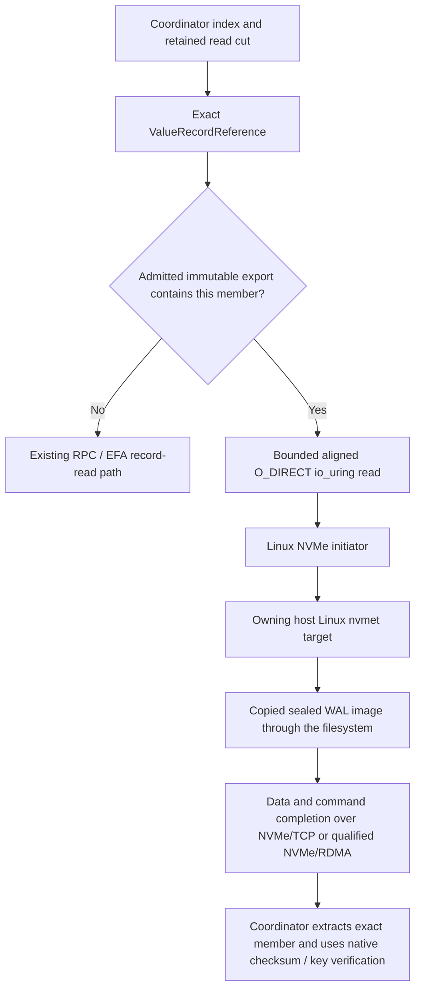

# Linux NVMe-oF sealed-WAL read backend

Date: 2026-10-31. Branch: `experiment/linux-nvmeof-wal-reads`.

## Decision and scope

Implemented an opt-in **Linux kernel NVMe-oF storage-read backend**. This implements the Linux alternative discussed in `CACHE_AWARE_NVME_OF_IMPLEMENTATION_PLAN_2026-10-31.md`; it does not implement that document's earlier SPDK/OCF candidate. No SPDK, OCF, VFIO, raw filesystem extent mapping, distributed filesystem, new authoritative WAL, or new runtime crate was added.

The branch starts at `348b6dca3e53e71c74af5fd04dea466e5052d7dc`. A fetched comparison with cloud-tested `c9b7e261021da042a53d71bd825d12804ffd75c1` found no differences in `tidehunter/`, `tidehunter-fabric/`, `benchmarks/`, or the root Cargo manifests/lockfile. Existing documentation changes and unrelated untracked files were preserved.

**Implemented and locally exercised:** NVMe/TCP reads through actual Linux block namespaces, from independently copied sealed native WAL files, through the distributed Sui storage adapter and the KV research runner. This was not a real Sui checkpoint replay or a cloud performance comparison.

**Not hardware-qualified:** NVMe/RDMA. The same Linux namespace reader accepts an explicitly selected `rdma` transport, but connection and device qualification must succeed on a compatible RDMA-CM/RC provider. Existing EFA/SRD messaging and registered-memory RMA do not establish compatibility with kernel NVMe/RDMA. Existing RPC/EFA paths remain separate.

## Data path



The existing coordinator index and WAL-reference representation remain authoritative. The image is a read source, not a replacement database. It preserves the complete original sealed file, its layout and offsets. It is copied and durably published before admission; normal application writes still use the existing owner WAL and acknowledgement path. New active-tail values and members absent from an admitted catalog use the existing record transport.

The checked file-relative member offset is:

`batch_address.offset % wal_file_bytes + 8 + descriptor.offset`

The eight-byte prefix is the native CRC frame header. Group offsets already resolved by the receipt must not be added twice. Reads round outward to the namespace's verified block size, check overflow and image bounds, and expose only the exact encoded member. Terminal CQ retirement permits moving the aligned allocation into `minibytes::Bytes` and slicing it without another member-data copy. `CompleteBatch::decode_record` still validates the native member checksum and expected key/keyspace/descriptor.

One member can require more aligned bytes than its application value. A batch is not promised to become one NVMe command; kernel splitting and merging also mean io_uring operation counts are not physical-command counts. Identical logical misses can use the existing coalescing path; general overlapping-block range merging is not claimed.

## Authority and lifetime: deliberate safety restriction

Startup metadata validation alone was insufficient: Linux kernel targets can survive an owner process, and direct reads would bypass subsequent owner fencing. The implementation therefore uses **durable all-owner epoch pins plus per-export leases**, not an unchecked manifest.

1. Pause local admissions at an idle boundary. The coordinator value cache must be configured to zero for this experiment.
2. Authenticate a setup-time epoch pin on **every configured owner**, including owners without exported records. Persist unique tokens before acknowledgement.
3. Validate every catalog reference through the existing authenticated owner control connection. Before granting an export lease, recheck a durable member of its exact source file under the authority-transition gate.
4. Validate the owner's local configfs namespace identity, UUID, source-image identity, geometry and protected manifest. Persist the export lease before acknowledgement.
5. Independently open and validate the actual initiator block namespace: UUID, NQN, NSID, transport, unique live controller, geometry, target Identify read-only bit, host block read-only state, and direct-I/O mode. Regular-file opening is test-only.
6. Keep request credits, index pins, buffers and namespace descriptors through terminal CQ retirement. Expiry/cancellation/shutdown starts a bounded drain watchdog; unresolved kernel ownership after the drain window fails the process rather than freeing live DMA memory.
7. Clear/shutdown closes admissions, drains work, closes namespace FDs, acknowledges all export releases, then releases all owner epoch pins. The final export release disables its target namespace. Only then may authority advance.

Fence, seal, retirement and terminal-poison publication are serialized against live or quarantined pins. **Authority transitions are refused while pins remain.** Ordinary writes within the current authority continue through the existing path.

**Availability limitation:** owner restart with orphan admissions is quarantined; a build without this feature also refuses to silently reopen such a directory. This first cold-read experiment does not implement an automatic revoke-notice/failover protocol. Operators must establish initiator retirement and resolve orphan capability state before recovery. Do not delete lease metadata or re-enable/reuse an endpoint as an unproved recovery shortcut. This restriction preserves safety; it is not a claim of native automatic-reopen availability parity.

Target disable alone is not proof that an initiator has consumed every completion or retired application results. The conservative pins avoid treating it as that proof. Unknown registration/release outcomes remain quarantined. Tokens are unique per installation and authority-scoped; a delayed release cannot remove a newer admission.

## Native properties kept

- No change to inherited WAL encoding, application value records, index lookup format, complete-batch placement, write durability barrier, replay, relocation or GC algorithm.
- No global physical WAL or new per-write replicated log.
- No external Sui repository modification. `distributed::sui::Db` gains optional backend-control/metrics methods; the actual Sui checkpoint pipeline is not claimed tested here.
- No original Tidehunter mutex was removed. New locks protect queue ownership, short statistics updates, installation/shutdown and durable authority transitions. No lock-free or zero-overhead claim is made.
- No new per-value metadata-validation RPC. Authority work is amortized at setup and teardown.
- No new cryptographic binding on each value. Native checksum verification remains. The existing authenticated control channel is retained.

The target opens a file O_RDWR because Linux nvmet requires it. Target namespace write protection and the initiator's read-only guard are separate, independently checked controls. The source image is immutable under the trusted-root operating model; root can undo protection, as root can modify native storage. NQN ACLs are not authentication and this is not a Byzantine boundary. Use an isolated trusted network.

## Source map

| File / symbol | Responsibility |
|---|---|
| `tidehunter/Cargo.toml`: `experimental-nvmeof` | Explicit optional Linux read feature; existing dependencies only. |
| `tidehunter/src/distributed/storage.rs`: `export_sealed_readset`, `nvmeof_record_location` | Durable sealed-source membership, exact file/offset provenance and pinned source plans. |
| `tidehunter/src/distributed/nvmeof/mod.rs`: `ExportManifest`, `publish_export` | Versioned bounded catalog; independent whole-file copy; fsync and no-overwrite publication. |
| `nvmeof/namespace.rs`: `open_namespace`, `verify_transport_at` | Actual block namespace and native-multipath validation; read-only and transport checks. |
| `nvmeof/reader.rs`: `NvmeofReader` | Aligned direct-I/O queue, bounded admission, submission/CQ ownership, cancellation/drain watchdog, exact member slices. |
| `nvmeof/lease.rs`: `ExportLeaseRegistry` | Durable typed owner epoch pins/export leases, token separation, quotas, namespace identity, final disable and crash quarantine. |
| `nvmeof/metrics.rs`: `NvmeofStats`, `NvmeofMetrics` | Raw nanosecond snapshots; standard Prometheus counters and seconds-based stage metrics; retired-source totals. |
| `distributed/tcp.rs`, `tcp/control.rs`, `tcp/inventory.rs` | Authenticated setup/release RPCs; source revalidation; authority/poison gates; restart and feature-downgrade protection. |
| `distributed/remote_db/pending_read.rs` | Multiple readers, eligibility/fallback, grouped order, credits/pins, all-owner setup pins and drain-before-release. |
| `distributed/remote_db.rs`, `distributed/sui.rs` | Public opt-in install/clear/statistics/Prometheus APIs. |
| `benchmarks/kv-research/src/backends/tidehunter.rs` | Explicit `tidehunter_nvme_tcp` / `tidehunter_nvme_rdma` identities and serialized bindings; no silent provider fallback. |
| `benchmarks/kv-research/src/config.rs`, `runner.rs` | `verify_existing_dataset` for sealed data; every key/payload verified without overwriting; bounded raw API samples and identity-preserving NVMe measurement deltas. |
| `benchmarks/kv-research/src/bin/nvmeof-check.rs` | Two real owner processes, sealed exports, actual-namespace handshake, ordered batch-32 checks, safe rebind and generic runner qualification. |
| `experiments/nvmeof/manage.py` | Root-scoped target setup, exact discovery/connect, protection, owned-only disconnect/cleanup. |
| `experiments/nvmeof/collect.py`, `trace.py` | Independent device/CPU intervals and bounded scoped target/block trace capture with loss/ambiguity evidence. |
| `experiments/kv-comparison/observability/campaign_exporter.py`, `campaign_monitor.py`, `dashboards/nvmeof.json` | Online/offline evidence ingestion and actual local/campaign dashboard provisioning. |

Paths in the middle rows are relative to `tidehunter/src/distributed/` unless fully qualified.

## Build and local operation

```sh
cargo build --locked -p kv-research --features nvmeof --bin nvmeof-check
cargo test --locked -p tidehunter --features experimental-nvmeof,test-utils --lib
```

Use the root-managed commands in `experiments/nvmeof/README.md`. The source owner and immutable image paths must have root-owned, non-group/world-writable ancestors. Never use a writable `/tmp` ancestor or expose a mounted native SSD as a raw namespace.

`nvmeof-check NEW_DIRECTORY NAMESPACE_HEX [KEYS=64] [VALUE_BYTES=256]` prepares a bounded dataset and emits `ready.json`. Supply atomically published `bindings.json` containing exactly one `{export_uuid, namespace_path, transport}` binding per export. After the first reader closes and releases, the driver emits `rebind-ready.json`: disconnect the old owned controllers, remove the owned targets, recreate/protect them, and publish fresh paths in `rebind-done.json`. A previous device pathname is not a valid identity proof.

The helper supplies a stable private host ID derived from the explicit host NQN. Reusing the machine's ambient host ID for a different NQN failed on this host with kernel `found same hostid ... but different hostnqn`; no `/etc/nvme` settings were changed. CLI failures now retain their actual stderr.

## Exercised local evidence

Evidence directory in the parent workspace:

`checkpoint-work/local-nvmeof-2026-10-31-b2a05c9f/`

Final cases: `case-1024-5c11bf3e`, `case-8192-6c2013f1`. This path is a local artifact, not a published GitHub result URL. Earlier failed startup evidence and the pre-metric-renaming qualification are retained separately inside it, not substituted for final results.

| Check | 1 KiB values | 8 KiB values |
|---|---:|---:|
| Real owner processes / namespace readers | 2 / 2 | 2 / 2 |
| Standalone scalar checks | 64 | 64 |
| Additional ordered batch with duplicates | 32 members | 32 members |
| Standalone direct-I/O submissions / completions | 86 / 86 | 86 / 86 |
| Generic measured API calls | 64 | 64 |
| Measured direct-I/O submissions / completions | 1081 / 1081 | 1081 / 1081 |
| Measured I/O errors / timeouts / ineligible fallbacks | 0 / 0 / 0 | 0 / 0 / 0 |
| Measured coordinator cache hits / owner record-read RPCs | 0 / 0 | 0 / 0 |

The generic workload mixes scalar reads and batch-32 reads; coalescing means member and physical-flight counts differ. Every returned value was compared with the deterministic prepared payload. Direct target mode and initiator O_DIRECT were used. Writable opens of the disposable namespaces were rejected; target write-protection Identify state and host read-only state were separately verified. Controller disconnect, target cleanup and absence of owned lease markers were checked after retrieval.

A separate low-level target tracing qualification (`trace-qual-2ae79b53`) captured 64 paired nvmet requests, 226 independent block pairs, and zero dropped, ambiguous or unmatched events. The device/CPU interval sampler also ran. These are different populations and windows: the block/device counters include unrelated host I/O and are not a per-API or NAND-latency distribution.

Local checks: full feature-enabled library suite **876 passed, 7 ignored**; KV research library **50 passed**; targeted post-fix queue/consumer regressions passed; feature-disabled orphan-startup regression passed; new operator/evidence Python suite **13 passed**; existing observability suite **92 passed**. Strict Clippy passed for the feature-enabled and ordinary benchmark builds. Actual final metrics passed `promtool check metrics` without lint failures. Grafana local/live/offline provisioning, datasource health and query paths were exercised, including browser inspection; no fabricated samples were used.

## Measurement meaning and next cluster gate

Raw API/scheduling/response samples, summary percentiles, measurement-boundary snapshots, metrics, exact bindings and protection receipts are saved. Nanosecond JSON stages cover alignment, admission, queueing, submit-to-CQ, member extraction and verification. Prometheus uses `_total` counters, observation totals, and seconds-based durations/maxima. Lifetime maxima are not measurement-window maxima; stage populations overlap and their sums/percentiles are not additive.

`submit_to_cq` includes initiator kernel, transport, target and backing-storage work. It is not pure network or device time. O_DIRECT bypasses the selected initiator/target page-cache paths, not controller/device caches. Neither this laptop run nor positive block counters establish physical-NAND service for each request.

No AWS resources were launched or changed. The laptop has one shared SSD and no qualified RDMA device, so these runs establish correctness and instrumentation only. A later approved cluster experiment must use independent owner disks, matched source/settings, explicit direct versus buffered cohorts, and same-window target/device evidence. Keep existing TCP/EFA/RMA controls, identify actual hardware/provider/transport, and include copy/setup/storage overhead. Do not claim that the existing AWS EFA path supplies kernel NVMe/RDMA without a successful compatible-provider connect/read/drain/teardown qualification.

## Primary references

- [Tidehunter v2](https://arxiv.org/html/2602.01873v2), value-WAL/index read path and retention/recovery design: preserve indexed native locations and verify native members rather than build another value store.
- [Linux v6.17 file target](https://git.kernel.org/pub/scm/linux/kernel/git/torvalds/linux.git/tree/drivers/nvme/target/io-cmd-file.c?h=v6.17): filesystem-managed image and direct/buffered target I/O.
- [Linux v6.17 namespace/configfs lifecycle](https://git.kernel.org/pub/scm/linux/kernel/git/torvalds/linux.git/tree/drivers/nvme/target/configfs.c?h=v6.17): explicit namespace/host/port objects; scope cleanup to owned identities.
- [Linux v6.17 admin commands](https://git.kernel.org/pub/scm/linux/kernel/git/torvalds/linux.git/tree/drivers/nvme/target/admin-cmd.c?h=v6.17): namespace write protection feature 0x84 and Identify read-only state. Configfs alone does not expose this protection state.
- [Linux v6.17 target core](https://git.kernel.org/pub/scm/linux/kernel/git/torvalds/linux.git/tree/drivers/nvme/target/core.c?h=v6.17), [TCP completion queueing](https://git.kernel.org/pub/scm/linux/kernel/git/torvalds/linux.git/tree/drivers/nvme/target/tcp.c?h=v6.17): target disable drains target namespace references, not proof of remote consumer retirement.
- [Linux v6.17 native multipath](https://github.com/torvalds/linux/blob/v6.17/drivers/nvme/host/multipath.c), [sysfs](https://github.com/torvalds/linux/blob/v6.17/drivers/nvme/host/sysfs.c): namespace-head identity differs from controller transport identity.
- [ntprof, NSDI 2025](https://www.usenix.org/conference/nsdi25/presentation/kang): keep initiator, target and device timing scopes distinct; basic tracing does not justify pure-network or physical-media claims.
- [Linux FIEMAP warning](https://docs.kernel.org/filesystems/fiemap.html): file extents are not safe authority to bypass a live mounted filesystem.
