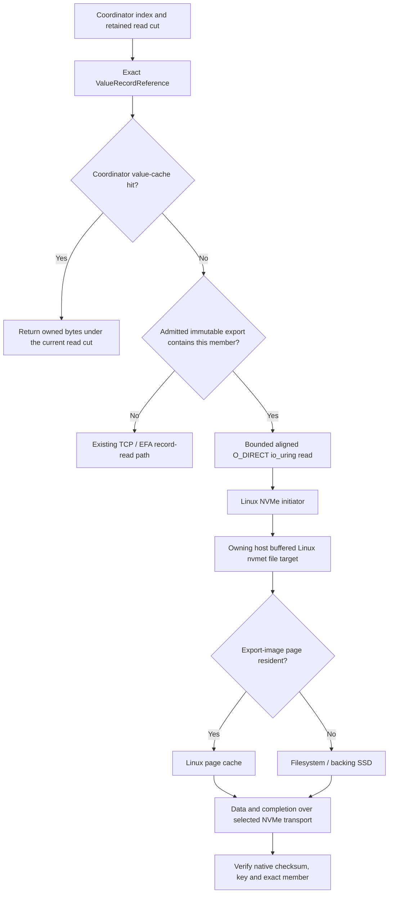

# Linux NVMe-oF sealed-WAL read backend

Origin: 2026-10-31, `experiment/linux-nvmeof-wal-reads`. Current local branch: `experiment/linux-pagecache-nvme-rdma`. The older local and cloud results below retain their original direct-target policy; they are not measurements of this buffered-target branch.

## Decision and scope

Implemented an opt-in **Linux kernel NVMe-oF storage-read backend**. This implements the Linux alternative discussed in `CACHE_AWARE_NVME_OF_IMPLEMENTATION_PLAN_2026-10-31.md`; it does not implement that document's earlier SPDK/OCF candidate. No SPDK, OCF, VFIO, raw filesystem extent mapping, distributed filesystem, new authoritative WAL, or new runtime crate was added.

The original NVMe experiment started at `348b6dca3e53e71c74af5fd04dea466e5052d7dc`. Its fetched comparison with cloud-tested `c9b7e261021da042a53d71bd825d12804ffd75c1` found no differences in `tidehunter/`, `tidehunter-fabric/`, `benchmarks/`, or the root Cargo manifests/lockfile. The current page-cache branch was created from the existing working branch, preserving its uncommitted changes.

**Current implementation:** owners use Linux page cache rather than an application value cache or long-lived registered-value grants. The coordinator value cache remains. File-backed NVMe targets require verified `buffered_io=1`; initiator reads remain `O_DIRECT`. The predecessor exercised real Linux NVMe/TCP namespaces. Current-branch checks exercise real owner processes and file-backed reader fixtures, not a new kernel namespace or hardware RDMA campaign.

**Not hardware-qualified on this branch:** NVMe/RDMA. The namespace reader and lifecycle tools select `tcp` or `rdma` explicitly and verify the actual connection. A compatible RDMA-CM/RC path is required. An active adapter, EFA/SRD messaging, or libfabric `FI_READ` support alone is not such proof. Ordinary TCP/EFA record messaging remains available; the engine no longer uses registered-value grants.

## Data path



The existing coordinator index and WAL-reference representation remain authoritative. The image is a read source, not a replacement database. It preserves the complete original sealed file, its layout and offsets. It is copied and durably published before admission; normal application writes still use the existing owner WAL and acknowledgement path. New active-tail values and members absent from an admitted catalog use the existing record transport.

The checked file-relative member offset is:

`batch_address.offset % wal_file_bytes + 8 + descriptor.offset`

The eight-byte prefix is the native CRC frame header. Group offsets already resolved by the receipt must not be added twice. Reads round outward to the namespace's verified block size, check overflow and image bounds, and expose only the exact encoded member. Terminal CQ retirement permits moving the aligned allocation into `minibytes::Bytes` and slicing it without another member-data copy. `CompleteBatch::decode_record` still validates the native member checksum and expected key/keyspace/descriptor.

One member can require more aligned bytes than its application value. A batch is not promised to become one NVMe command; kernel splitting and merging also mean io_uring operation counts are not physical-command counts. Identical logical misses can use the existing coalescing path; general overlapping-block range merging is not claimed.

## Authority and lifetime: deliberate safety restriction

Startup metadata validation alone was insufficient: Linux kernel targets can survive an owner process, and direct reads would bypass subsequent owner fencing. The implementation therefore uses **durable all-owner epoch pins plus per-export leases**, not an unchecked manifest.

1. Pause local admissions at an idle boundary. The coordinator cache may remain enabled; its entries still use exact immutable references, retained read cuts and fail-closed coordinator health checks.
2. Authenticate a setup-time epoch pin on **every configured owner**, including owners without exported records. Persist unique tokens before acknowledgement.
3. Validate every catalog reference through the existing authenticated owner control connection. Before granting an export lease, recheck a durable member of its exact source file under the authority-transition gate.
4. Validate the owner's actual configfs namespace identity, UUID, source-image identity, geometry, protected manifest and `buffered_io=1`. Persist the export lease before acknowledgement. A configured label is not sufficient.
5. Independently open and validate the actual initiator block namespace: UUID, NQN, NSID, transport, unique live controller, geometry, target Identify read-only bit, host block read-only state, and direct-I/O mode. Regular-file opening is test-only.
6. Keep request credits, index pins, buffers and namespace descriptors through terminal CQ retirement. Expiry/cancellation/shutdown starts a bounded drain watchdog; unresolved kernel ownership after the drain window fails the process rather than freeing live DMA memory.
7. Clear/shutdown closes admissions, drains work, closes namespace FDs, acknowledges all export releases, then releases all owner epoch pins. The final export release disables its target namespace. Only then may authority advance.

Fence, seal, retirement and terminal-poison publication are serialized against live or quarantined pins. **Authority transitions are refused while pins remain.** Ordinary writes within the current authority continue through the existing path.

Poison closes new owner reads and control mutations immediately through `poison_pending`. Final terminal-authority publication waits for live leases to drain; release requests remain possible. Removing the registered-value registry did not remove this failure gate.

**Availability limitation:** owner restart with orphan admissions is quarantined; a build without this feature also refuses to silently reopen such a directory. This first cold-read experiment does not implement an automatic revoke-notice/failover protocol. Operators must establish initiator retirement and resolve orphan capability state before recovery. Do not delete lease metadata or re-enable/reuse an endpoint as an unproved recovery shortcut. This restriction preserves safety; it is not a claim of native automatic-reopen availability parity.

Target disable alone is not proof that an initiator has consumed every completion or retired application results. The conservative pins avoid treating it as that proof. Unknown registration/release outcomes remain quarantined. Tokens are unique per installation and authority-scoped; a delayed release cannot remove a newer admission.

## Native properties kept

- No change to inherited WAL encoding, application value records, index lookup format, complete-batch placement, write durability barrier, replay, relocation or GC algorithm.
- No global physical WAL or new per-write replicated log.
- No external Sui repository modification. `distributed::sui::Db` gains optional backend-control/metrics methods; the actual Sui checkpoint pipeline is not claimed tested here.
- No original Tidehunter mutex was removed. New locks protect queue ownership, short statistics updates, installation/shutdown and durable authority transitions. No lock-free or zero-overhead claim is made.
- No new per-value metadata-validation RPC. Authority work is amortized at setup and teardown.
- No new cryptographic binding on each value. Native checksum verification remains. The existing authenticated control channel is retained.

The target opens a file O_RDWR because Linux nvmet requires it. Target namespace write protection and the initiator's read-only guard are separate, independently checked controls. The source image is immutable under the trusted-root operating model; root can undo protection, as root can modify native storage. NQN ACLs are not authentication and this is not a Byzantine boundary. Use an isolated trusted network.

## Source map

| File / symbol | Responsibility |
|---|---|
| `tidehunter/Cargo.toml`: `experimental-nvmeof` | Explicit optional Linux read feature; existing dependencies only. |
| `tidehunter/src/distributed/storage.rs`: `export_sealed_readset`, `nvmeof_record_location` | Durable sealed-source membership, exact file/offset provenance and pinned source plans. |
| `tidehunter/src/distributed/nvmeof/mod.rs`: `ExportManifest`, `publish_export` | Versioned bounded catalog; independent whole-file copy; fsync and no-overwrite publication. |
| `nvmeof/namespace.rs`: `open_namespace`, `verify_transport_at` | Actual block namespace and native-multipath validation; read-only and transport checks. |
| `nvmeof/reader.rs`: `NvmeofReader` | Aligned direct-I/O queue, bounded admission, submission/CQ ownership, cancellation/drain watchdog, exact member slices. |
| `nvmeof/lease.rs`: `ExportLeaseRegistry` | Durable typed owner epoch pins/export leases, token separation, quotas, namespace identity, final disable and crash quarantine. |
| `nvmeof/metrics.rs`: `NvmeofStats`, `NvmeofMetrics` | Raw nanosecond snapshots; standard Prometheus counters and seconds-based stage metrics; retired-source totals. |
| `distributed/tcp.rs`, `tcp/control.rs`, `tcp/inventory.rs` | Authenticated setup/release RPCs; source revalidation; authority/poison gates; restart and feature-downgrade protection. |
| `distributed/remote_db/pending_read.rs` | Multiple readers, eligibility/fallback, grouped order, credits/pins, all-owner setup pins and drain-before-release. |
| `distributed/remote_db.rs`, `distributed/sui.rs` | Public opt-in install/clear/statistics/Prometheus APIs. |
| `benchmarks/kv-research/src/backends/tidehunter.rs` | Explicit `tidehunter_nvme_tcp` / `tidehunter_nvme_rdma` identities and serialized bindings; no silent provider fallback. |
| `benchmarks/kv-research/src/config.rs`, `runner.rs` | `verify_existing_dataset` for sealed data; every key/payload verified without overwriting; bounded raw API samples and identity-preserving NVMe measurement deltas. |
| `benchmarks/kv-research/src/bin/nvmeof-check.rs` | Two real owner processes, sealed exports, actual-namespace handshake, ordered batch-32 checks, safe rebind and generic runner qualification. |
| `experiments/nvmeof/manage.py` | Root-scoped target setup, exact discovery/connect, protection, owned-only disconnect/cleanup. |
| `experiments/nvmeof/collect.py`, `trace.py` | Independent device/CPU intervals and bounded scoped target/block trace capture with loss/ambiguity evidence. |
| `experiments/kv-comparison/observability/campaign_exporter.py`, `campaign_monitor.py`, `dashboards/nvmeof.json` | Online/offline evidence ingestion and actual local/campaign dashboard provisioning. |
| `tidehunter/src/distributed/tcp/read_executor.rs` | Cacheless buffered WAL reads, bounded NOWAIT attempts, async fallback, response ownership and CQ retirement; no owner value-cache mutex or eviction table. |

Paths in the middle rows are relative to `tidehunter/src/distributed/` unless fully qualified.

## Build and local operation

```sh
cargo build --locked -p kv-research --features nvmeof --bin nvmeof-check
cargo test --locked -p tidehunter --features experimental-nvmeof,test-utils --lib
```

Use the root-managed commands in `experiments/nvmeof/README.md`. The source owner and immutable image paths must have root-owned, non-group/world-writable ancestors. Never use a writable `/tmp` ancestor or expose a mounted native SSD as a raw namespace.

`nvmeof-check NEW_DIRECTORY NAMESPACE_HEX [KEYS=64] [VALUE_BYTES=256]` prepares a bounded dataset and emits `ready.json`. Supply atomically published `bindings.json` containing exactly one `{export_uuid, namespace_path, transport}` binding per export. After the first reader closes and releases, the driver emits `rebind-ready.json`: disconnect the old owned controllers, remove the owned targets, recreate/protect them, and publish fresh paths in `rebind-done.json`. A previous device pathname is not a valid identity proof.

The helper supplies a stable private host ID derived from the explicit host NQN. Reusing the machine's ambient host ID for a different NQN failed on this host with kernel `found same hostid ... but different hostnqn`; no `/etc/nvme` settings were changed. CLI failures now retain their actual stderr.

### External campaign preparation

The feature-enabled `kv-research` binary supports `prepare-nvmeof-dataset RUN_CONFIG.json PREPARED.json` on the coordinator while external owners are running. It requires an explicit 16-byte `key_namespace_hex` and a fresh coordinator directory. Preparation keeps its explicit zero-cache control; subsequent read runs may use a bounded coordinator cache. It writes the deterministic seed, entropy, keys and values through the native owner WAL, then checkpoints and seals the epoch before publishing prepared JSON. Supported values are 64, 256, 1024, 8192 and 65536 bytes; the dataset is bounded to 65536 keys.

The source recipe `kv-research-native-sealed-batch-v2` writes contiguous logical IDs in whole native batches of up to 32 members; the final batch may be smaller. Before writing, it probes the native complete-batch encoder against the configured operation and encoded-byte limits and lowers the member bound if necessary. Every member remains an ordinary native WAL mutation, and export derives its exact receipt-relative reference. Prepared and owner-ready metadata record the recipe and effective member bound; older singleton sources are not interchangeable.

The existing `--prepare-external-case` input accepts optional `max_epochs` (1–1024, default 4). Set it before creating owners to accommodate preparation plus every coordinator reopen and recovery headroom. Both generated owner and coordinator inventories use the same limit; do not change it on an existing inventory.

New external-case inventories use a 3 MiB native complete-batch limit and a 4 MiB WAL fragment (group payload limited to 4 MiB minus the frame header), so an atomic batch of 32 64 KiB values fits without splitting. This changes generated storage geometry; existing inventories must not be rewritten to match.

After stopping every owner, run `export-nvmeof-dataset NODE_LAUNCH.yaml PREPARED.json OUTPUT_DIR` on each owner. The output directory must be new and its existing parent and all ancestors, as well as the owner root's ancestors, must be root-owned and not group/world writable. The tool takes the owner root lock, validates the durable owner inventory and sealed source epoch, rejects live or quarantined leases, checks the deterministic data, and publishes one export per source file. Each `ready.json` reports a local `members` count; the operator must require the sum across owners to equal the prepared key count. The per-file catalog budget is checked at 4096 bytes per member plus NQN and fixed overhead, bounded by the 65536-key dataset limit; the reader has a separate admission budget. Manifests are protected local artifacts, **not standalone authority**: restart owners, provision protected targets and install readers through the authenticated owner admission and pin protocol.

Export publication and owner lease admission share a 64 MiB maximum serialized-manifest size. This is distinct from both the exporter's per-member memory charge and the initiator reader's catalog/queue budget. The owner still opens the protected manifest without following symlinks and checks its file type, ownership, mode and binding provenance before issuing a lease.

Sampled NVMe flight timings run from coordinator flight admission through terminal completion and member verification. They are not owner RPC, pure-network or physical-device timing. Owner stages remain unavailable when a selected flight bypasses owner record-read RPCs.

### Paid-run diagnostic admission

`experiments/kv-comparison/ci_prepare.py` now runs the staged executable against five real local TCP owner processes before issuing READY. It preloads 256 keys, records 64 uncached read calls and up to 32 sampled remote flights, drains all owners, and admits the raw samples, runtime configuration, measurement evidence and read diagnostics through the production cloud consumers. The proof and its SHA-256 are part of the source/binary-bound qualification inventory. The manual MCP payload renderer requires the same proof; this does not bypass GitHub's clean-checkout admission.

The first cloud attempt on 2026-10-31 stopped at diagnostic case 0009: the Rust producer emitted `coverage.nvme_completed`, but the Python consumer's strict key set rejected it. The consumer now validates and exports that counter without inventing zeros for historical artifacts that lack it. Actual local NVMe evidence also exposed fractional stage means in nested read evidence; these now require finite, nonnegative measurements, while operation counters still require integers. The actual failed cloud artifact and all six retained local TCP/NVMe diagnostic artifacts passed the corrected consumer. No performance conclusion follows from this schema repair.

### Concurrent Linux namespace teardown

The replacement fleet `th-7b5bbd983fa7e383` completed NVMe/TCP cases 0018 and 0019, then stopped during case 0020 teardown. Concurrent host-disconnect helpers enumerated controllers while another helper removed `/sys/class/nvme/nvme3/subsysnqn`. The case's read phase completed, but its cleanup failed; it is not an admitted successful case. All six instances were independently confirmed terminated and their owned supporting resources removed before the workstation reboot.

`experiments/nvmeof/manage.py::controller_snapshot` now requires two matching complete sysfs inventories, including controller inode, NQN, transport and address. Transient ENOENT triggers a bounded rescan. Persistent incomplete identities, permission errors and other I/O failures remain fatal. Connection selection ignores unrelated controller churn and accepts a recycled name only with a new inode and the exact requested NQN and endpoint. Disconnect stays scoped to the recorded identity; a failed command is accepted only after a fresh stable inventory proves that neither its controller nor its NQN remains. `campaign_targets.py` retains its explicit drained-reader attestation. Sysfs absence is not evidence of application-buffer retirement.

Latest regression checks: **31 lifecycle tests run, 28 passed, 3 skipped**; **384 KV campaign tests run, 380 passed, 4 skipped**. The actual read-only inventory function also ran after reboot and found no controllers belonging to the interrupted fixture; neither `nvmet` nor `nvmet_tcp` was loaded.

The local hardware qualification recorded eight completed generations of five real protected NVMe/TCP namespaces: 40 verified direct reads and 40 parallel drained disconnects, with no owned controllers remaining after each recorded generation. The planned ten-generation run was interrupted during generation 8. Its artifact remains `status: running`, not passed; final cleanup was not recorded by that process. These were small kernel-lifecycle fixtures, not native WAL performance measurements. Archived EFI pstore confirms two general-protection faults in `__run_timers` followed by `Kernel panic - not syncing: Fatal exception in interrupt` on `6.17.9-76061709-generic`. The trace does not establish which component corrupted timer state. Do not repeat privileged hot-plug stress on this host, treat controller absence as proof of pre-crash DMA drain, or report ten generations as qualified. Preserve the interrupted artifact, fixture volume and pstore records; require an isolated, compatible-kernel lifecycle qualification before treating the experiment as hardware-ready. The interrupted artifact and separate read-only recovery record are under `checkpoint-work/local-nvmeof-cloudprep-20261031T192908Z-ca100224/` in the parent workspace.

Future bootstrap readiness receipts record the actual kernel release, kernel build version, machine architecture and boot ID on each host. These fields are provenance, not a declaration that a kernel is compatible or safe. The previous fleet did not preserve a usable kernel version; its EC2 `kernelId: null` is not a Linux release.

The admitted partial cloud timings, stage populations, cache-policy differences, missing cases and shutdown/cost evidence are in [`reports/2026-10-31-nvmeof-partial-comparison.md`](reports/2026-10-31-nvmeof-partial-comparison.md). That report is not the requested complete 125-case comparison.

### Contiguous shared-source planning

The isolated v4 fleet `th-8a20aa7414c7f555` recorded kernel `7.0.0-1014-aws` and unique boot IDs on all six hosts before activation. It completed all ten 1 KiB NVMe/TCP cases, including concurrency and batch-32 cases, then eight native controls. This is observed qualification of those cases on that cloud configuration, not a fix or safety claim for the laptop kernel panic.

The next RPC-TCP case failed with `FileExistsError`: the requested order placed native controls between NVMe/TCP and RPC-TCP. Entering a native control correctly ended the active owner-source block, while its immutable evidence directory remained. Re-entering that source was therefore invalid. `cloud_campaign.py::make_nvmeof_matrix` now emits the paired TCP-backed readers as one contiguous physical-source block, retaining their relative order. Native and other transports cannot split that block. Existing directory refusal, source ownership and cleanup guards remain unchanged; no stale source is reused or deleted to bypass the error.

The regression covers all 24 permutations of the four selected backends. A separate comparison with the frozen v4 planner verified the same 125 case populations, per-backend counts and all workload/measurement settings; only execution order and derived case IDs change.

## Historical exercised local evidence: direct target

Evidence directory in the parent workspace:

`checkpoint-work/local-nvmeof-2026-10-31-b2a05c9f/`

Final cases: `case-1024-5c11bf3e`, `case-8192-6c2013f1`. This path is a local artifact, not a published GitHub result URL. Earlier failed startup evidence and the pre-metric-renaming qualification are retained separately inside it, not substituted for final results.

| Check | 1 KiB values | 8 KiB values |
|---|---:|---:|
| Real owner processes / namespace readers | 2 / 2 | 2 / 2 |
| Standalone scalar checks | 64 | 64 |
| Additional ordered batch with duplicates | 32 members | 32 members |
| Standalone direct-I/O submissions / completions | 86 / 86 | 86 / 86 |
| Generic measured API calls | 64 | 64 |
| Measured direct-I/O submissions / completions | 1081 / 1081 | 1081 / 1081 |
| Measured I/O errors / timeouts / ineligible fallbacks | 0 / 0 / 0 | 0 / 0 / 0 |
| Measured coordinator cache hits / owner record-read RPCs | 0 / 0 | 0 / 0 |

The generic workload mixes scalar reads and batch-32 reads; coalescing means member and physical-flight counts differ. Every returned value was compared with the deterministic prepared payload. Direct target mode and initiator O_DIRECT were used. Writable opens of the disposable namespaces were rejected; target write-protection Identify state and host read-only state were separately verified. Controller disconnect, target cleanup and absence of owned lease markers were checked after retrieval.

A separate low-level target tracing qualification (`trace-qual-2ae79b53`) captured 64 paired nvmet requests, 226 independent block pairs, and zero dropped, ambiguous or unmatched events. The device/CPU interval sampler also ran. These are different populations and windows: the block/device counters include unrelated host I/O and are not a per-API or NAND-latency distribution.

Local checks: full feature-enabled library suite **876 passed, 7 ignored**; KV research library **50 passed**; targeted post-fix queue/consumer regressions passed; feature-disabled orphan-startup regression passed; new operator/evidence Python suite **13 passed**; existing observability suite **92 passed**. Strict Clippy passed for the feature-enabled and ordinary benchmark builds. Actual final metrics passed `promtool check metrics` without lint failures. Grafana local/live/offline provisioning, datasource health and query paths were exercised, including browser inspection; no fabricated samples were used.

## Measurement meaning and cloud qualification

Raw API/scheduling/response samples, summary percentiles, measurement-boundary snapshots, metrics, exact bindings and protection receipts are saved. Nanosecond JSON stages cover alignment, admission, queueing, submit-to-CQ, member extraction and verification. Prometheus uses `_total` counters, observation totals, and seconds-based durations/maxima. Lifetime maxima are not measurement-window maxima; stage populations overlap and their sums/percentiles are not additive.

Reader details in backend receipts contain namespace binding, source identity, geometry, limits, catalog count and a BLAKE2b-512 hash of the compact `ExportManifest` serialization, not another copy of its catalog. The admitted run configuration, including complete reader manifests, remains in the compactly serialized run manifest.

`measurement-read-evidence.json` preserves raw lifetime boundary snapshots and provides per-reader stage count/sum deltas and means for the drained measurement interval. Verification and warmup are excluded by subtraction. Changed or malformed reader identities, missing/decreasing/saturated counters, and invalid maxima make the affected evidence unavailable; zero observations have no mean. `measurement_max_ns` is unavailable, not a difference of lifetime maxima.

Focused initial-cold cases can opt into `phases.evict_mapped_wal_before_measurement`. With Linux `test-utils` on every participating binary, this runs once after warmup and aging drain and before the measurement gate; the controller can then drop OS page cache while the gate is held. Native uses its existing mapped-WAL evidence helper; remote owners use authenticated control to evict mappings for every retained epoch, requiring a disabled coordinator value cache. Results or errors are recorded in `pre-measurement-wal-eviction.json`; unsupported backends and failed evictions reject the run. This advisory initial state does not prove physical NAND access or prevent buffered reads warming the cache again.

`submit_to_cq` includes initiator kernel, transport, target and backing-storage work. It is not pure network or device time. On the current branch, initiator `O_DIRECT` bypasses initiator caching, **not** the buffered target's Linux page cache. The historical direct-target run also bypassed target page cache. Neither positive block counters nor a first-touch key sweep establish physical-NAND service for every request.

Local runs establish correctness and instrumentation only: the laptop has one shared SSD and no qualified RDMA device. The first 2026-10-31 cloud fleet (`th-79da9cae47c0914b`) used six independent `g6.8xlarge` hosts in a cluster placement group, but stopped on diagnostic admission before any NVMe/TCP comparison case. Its partial results were retrieved and all six instances and owned supporting resources were verified closed. A complete cloud comparison must keep matched source/settings, explicit direct versus buffered cohorts, same-window target/device evidence and unchanged write controls. Keep existing TCP/EFA/RMA controls, identify actual hardware/provider/transport, and include copy/setup/storage overhead. Do not claim that AWS EFA supplies kernel NVMe/RDMA without a compatible-provider connect/read/drain/teardown qualification.

## Completed cloud matrix and post-campaign monitoring repair

The v5 run `th-b1f973adbbdae436` completed and admitted all 125 requested cases on six independent `g6.8xlarge` hosts in mandatory cluster placement. The exact rebuilt release and archive were qualified locally before upload. All 675,840 offered API calls succeeded. All 26 NVMe intervals qualified with 786,207 completed direct I/O submissions and no measured fallback, record-read RPC, coordinator value-cache hit, I/O error or timeout. These are observed path/correctness results, not a performance improvement: Linux NVMe/TCP was slower than the owner-record paths in this matrix, particularly batch-32/C16 reads.

The original campaign remains `complete=false`, `monitoring_complete=false`. All 26 NVMe client cgroup intervals failed on anonymous `(unknown)` I/O-device rows. The saved Prometheus capture still covers all 125 cases, but it cannot restore missing process-resource qualification. All four NVMe diagnostic target/block trace sets also have losses; pure wire/device timing remains unavailable. Buffered native/TCP/EFA cohorts and direct NVMe cohorts must retain their distinct cache and storage semantics.

After archival, all six instances and run-owned supporting resources were verified closed through AWS MCP. Normal shutdown stalled; a scoped forced termination was needed after data were safe. The conservative v5 estimate is $19.45, not an AWS invoice; retained S3 storage remains chargeable.

Post-campaign Python-only changes preserve bounded malformed-I/O diagnostics and independently qualify CPU/memory after the final cgroup identity recheck. Partial rows now reach the Prometheus exporter and query inventory with core availability 1, I/O availability 0 and overall availability 0. They never fabricate I/O totals or upgrade the historical v5 artifacts. Comparison tooling passed 384 tests with 4 skipped; the separate observability suite passed 95 tests. A live read-only local cgroup capture and a temporary replay of the retained anonymous-I/O text through producer/interval/exporter both succeeded. No further local NVMe hotplug was attempted; the earlier laptop panic remains unexplained.

Full results, all independent API/scheduling/response statistics, component counters, read amplification, security/cache limits, source hashes, closure and costs: [v5 cloud comparison](reports/2026-11-01-nvmeof-cloud-th-b1f973adbbdae436/REPORT.md). No further fleet was launched to change a monitoring status flag.

## Current Linux page-cache branch

Owner encoded-value cache storage, lookup/fill/eviction code, persistent registered-value grants, associated controls and current-run metrics were removed. Coordinator value caching, bounded authority/reference metadata caches and transient transport buffers remain. Ordinary and profiled record reads share the same cacheless owner path. Native WAL encoding, complete-batch recovery, checksums and write acknowledgement are unchanged. Only distributed-layer cache locks were removed; inherited native Tidehunter locks were not changed.

This is a protocol/configuration cutover, not an alias layer. Protocol version 15 has no value-grant operations or owner-cache admission tags. Old node/TLS cache and grant settings are rejected. The point-versus-scan distinction remains local to coordinator lane ownership and cache policy; it no longer adds unused fields to remote read requests. Current producers omit retired cache/grant counters. Historical report readers retain those fields only when present in saved data.

For an eligible sealed image, one NVMe transport serves both target-page-cache hits and backing-file reads. There is no preceding per-value residency RPC. Active-tail and uncatalogued references still use ordinary record messaging; writes still append to the owner's native WAL. The independently copied export image has a different inode from its original WAL, so warming the original does not warm the image.

Setup receipts record the read-back transport and buffered policy. Owner lease admission checks the real attribute independently; the initiator checks its actual controller transport. Completed benchmark reports require hash-bound target receipts and matching measurement-boundary reader identities. Missing proof is not a completed qualified result. Standalone RDMA preflight separates local prerequisites from an unverified RC/route; setup/connect may attempt an explicit path only after prerequisites pass. AWS CI rejects NVMe/RDMA before allocating EFA-only hardware.

Focused `first_touch` cases request OS-cache eviction on all hosts after dataset verification and before releasing the measurement gate. This now includes buffered NVMe targets. Mapped-original-WAL eviction is a separate control for native/record transports, not proof of export-image eviction. `repeat_read` leaves caches intact. These are initial-state protocols, not pure RAM/NAND populations: target and device observations remain necessary. Warm-up or `io_uring` completion alone must not be labelled a physical SSD read.

Local validation used the rebuilt feature-enabled binaries, five real TCP owners and a separate software-OFI process scenario. Both exercised read verification, lost durable replies, abrupt coordinator exit, recovery, fencing and owner restart. The benchmark diagnostic proof contains 256 preload API calls, 64 measured uncached reads and up to 32 sampled remote flights, admitted by the production evidence consumers. This is functional evidence on one shared SSD, not a latency comparison.

The feature-enabled suites passed 868 engine tests, 57 KV library tests and the NVMe qualification batch test. Hardware-dependent engine cases remained ignored. The KV comparison suite ran 390 tests with four skips; observability passed 97 tests; the NVMe operator suite ran 34 tests with three skips. All affected Rust targets passed `cargo check`, strict Clippy and formatting. Actual local Prometheus and Grafana queries consumed the new TCP proof, and both local and NVMe dashboards were inspected in the browser. The NVMe dashboard correctly had no hardware observations. Temporary monitoring services were stopped and the prior result selection restored.

The sibling Sui checkout uses the same `experiment/linux-pagecache-nvme-rdma` branch name. Its only changed source file is `crates/typed-store/src/tidehunter_util.rs`: retired owner-cache/grant samples are removed; coordinator, native read and optional authority-metadata observations remain, with unavailable samples omitted rather than replaced by zero. Portable dependency manifests and lockfiles were not changed. Validation used temporary source overrides: all 35 native `typed-store` library tests passed; both sharded metrics tests passed under plain and fabric-enabled builds. The Sui replay harness ran 164 tests with one skip; its opt-in process check separately started current local and external-style generated Node/TLS configurations. Four actual local native/TCP warm controls completed with coordinator caching disabled and enabled; their TCP owner/counter evidence was admitted through the production consumer.

Current Sui replay build plans now declare wire protocol 15. An actual offline `build.py prepare --fabric` completed, resolved the staged engine in all three Cargo workspaces and created the hash-bound source plan; preparation does not build release executables. The final AWS orchestration/analysis suite ran 631 tests with four skips, without cloud operations. Historical schema selection is restricted to exact saved plans and frozen sources, not inferred from missing current observations. Offline admission of the unchanged saved cluster-RAM campaign completed with 126 API cases and 480 verified node archives; the saved stage-timing campaign completed with 68 API cases and 260 verified archives. These are historical-readability checks, not new performance measurements.

A full `typed-store --features sharded-wal` run without `SUI_SHARDED_WAL_CONFIG` passed 33 tests and failed three database-opening fixtures at the required configuration guard. Neither the guard nor those tests was weakened. This is not a complete distributed Sui test or checkpoint replay qualification; no full checkpoint replay was rerun for this branch. The small retained evidence and explicit validation boundaries are in `checkpoint-work/linux-pagecache-nvme-rdma-local-8927f23e/qualification-summary.json`.

This laptop has no visible active RDMA device; preflight reported missing `nvme_rdma`, `rdma_cm` and root execution as well. No privileged namespace/hotplug test, cloud launch or RDMA latency claim follows from these checks. The next hardware qualification needs a compatible RDMA-CM/RC fabric, isolated trusted networking, root-managed kernel NVMe targets/initiators, read-only protection and the existing drain/cleanup procedure. Run `nvmeof-check` to prove mixed coordinator hits, uncached ordered/duplicate batches with actual namespace completions, cached repeats, clear and rebind before measuring cluster latency.

## Primary references

- [Tidehunter v2](https://arxiv.org/html/2602.01873v2), value-WAL/index read path and retention/recovery design: preserve indexed native locations and verify native members rather than build another value store.
- [Linux v6.17 file target](https://git.kernel.org/pub/scm/linux/kernel/git/torvalds/linux.git/tree/drivers/nvme/target/io-cmd-file.c?h=v6.17): filesystem-managed image and direct/buffered target I/O.
- [Linux v6.17 namespace/configfs lifecycle](https://git.kernel.org/pub/scm/linux/kernel/git/torvalds/linux.git/tree/drivers/nvme/target/configfs.c?h=v6.17): explicit namespace/host/port objects; scope cleanup to owned identities.
- [Linux v6.17 admin commands](https://git.kernel.org/pub/scm/linux/kernel/git/torvalds/linux.git/tree/drivers/nvme/target/admin-cmd.c?h=v6.17): namespace write protection feature 0x84 and Identify read-only state. Configfs alone does not expose this protection state.
- [Linux v6.17 target core](https://git.kernel.org/pub/scm/linux/kernel/git/torvalds/linux.git/tree/drivers/nvme/target/core.c?h=v6.17), [TCP completion queueing](https://git.kernel.org/pub/scm/linux/kernel/git/torvalds/linux.git/tree/drivers/nvme/target/tcp.c?h=v6.17): target disable drains target namespace references, not proof of remote consumer retirement.
- [Linux v6.17 native multipath](https://github.com/torvalds/linux/blob/v6.17/drivers/nvme/host/multipath.c), [sysfs](https://github.com/torvalds/linux/blob/v6.17/drivers/nvme/host/sysfs.c): namespace-head identity differs from controller transport identity.
- [ntprof, NSDI 2025](https://www.usenix.org/conference/nsdi25/presentation/kang): keep initiator, target and device timing scopes distinct; basic tracing does not justify pure-network or physical-media claims.
- [Linux FIEMAP warning](https://docs.kernel.org/filesystems/fiemap.html): file extents are not safe authority to bypass a live mounted filesystem.
