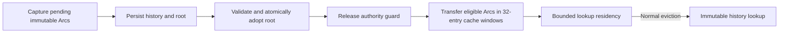

# Local metadata-residency and tail-latency implementation plan

## 1. Decision and scope

Written before implementation on `perf/spill-residency-batch-cache`, based on local HEAD `44a7effd2a4dea5589f9015b7c29dca39cd5d9b4` and measured cluster source `d34022d18aed2e1b7b029d595f43992868453b28`. The preceding audit verified equal contents for all 497 frozen source files before later documentation-only updates. Existing modified documents and unrelated untracked files are preserved. No commit or push is part of this task.

Implement two evidence-backed changes first:

1. Preserve eligible, already-validated immutable authority descriptors across successful history spill adoption, within the existing metadata budget.
2. Resolve coordinator batch-cache lookups in bounded windows rather than taking the same mutex once per member.

Keep the architecture: coordinator key index and visibility, whole atomic batch on one owner, owner-local Value WAL, existing durable receipts and sparse/dependency-respecting publication. No new global WAL, global sequencer, distributed LSM, replication protocol or transport rewrite. The old middleware remains archived and unused.

**Local work only. No AWS/GCP allocation, CI campaign dispatch or remote device changes.** This laptop has one shared SSD and no validated hardware RDMA. Local acceptance means correct behavior, bounded resource/lifetime management and matched local-relative measurements. Only a later user-authorized cluster comparison can establish distributed performance.

## 2. Measured evidence and priority order

Source: [completed campaign report](reports/2026-10-30-kv-comparison-41109588049/SUMMARY.md), [all metrics](reports/2026-10-30-kv-comparison-41109588049/METRICS.md), and [timing/source audit](reports/2026-10-30-kv-comparison-41109588049/STAGE_AUDIT.md). Run `41109588049` completed 196 cases on six c6id.32xlarge hosts in eu-west-1c with cluster placement; all resources were then removed. These are synthetic KV cases, not new Sui checkpoint results.

| Priority | Observed problem | Evidence | Action and scope |
|---|---|---|---|
| P0 | Incorrect attribution can motivate the wrong rewrite | Older G6/us-east-1 differs from current hardware/region; primary vs warm controls also differ in keys, warmup, lanes and resident-first | Preserve frozen cases/raw data, scopes and population labels; no causal whole-system claim |
| P1 | Useful authority metadata is discarded during spill | Primary EFA-native/TCP measured 1,937/1,936 history-load attempts while caches were well below 8,192-entry capacity | Retain eligible immutable descriptor Arcs after durable adoption; no extra value cache or foreground persistence |
| P2 | Bulk coordinator hits repeatedly contend on one cache mutex | Sampled 32-key cache-hit population: 8,192 acquisitions, 79,041,663 ns accumulated wait, mean 9.649 µs/acquisition | At most 32 consecutive slots per cache-lock window; release before routing/allocation/network |
| P3 | Improvements need isolated, reproducible local qualification | Warm-WAL case0157 reached zero loads and planning mean0.876 µs; old case had2,547 loads/22.738 µs, but other end-to-end settings/hardware confound | Same-binary-feature before/after local probes, fixed keys/settings, count/lifetime invariants, C1/C16/batch32 controls |
| P4 | Remaining remote/cold/write costs are not fully decomposed | Qualified registered C1 medians47–52 µs; FI_READ46.496 µs includes progress. Cold planning includes worker queue/load/handoff. Ready-group/caller distributions are missing | Instrument or isolate the missing boundary before changing workers, CQ scheduling or group commit; separate future step |
| P5 | No valid pure cold-NVMe API distribution yet | Eight distributed cold cases have6,998 actual block requests/window but wider windows; native nominal cold has1/0 matched reads | Fix measurement window/request/file attribution before a separate NVMe-oF comparison |

Numbers are single-repetition descriptive observations. API p50/p95/p99/p99.9 remain nearest-rank with sample-count warnings. Stage means use their own count/sum, may overlap, and are not additive latency fractions. A history lookup can hit Linux page cache; a WAL read does not prove physical NVMe I/O.

## 3. Papers, maintained code and applicability

QMD collection used: `tidehunter-papers`. Complete relevant text sections, not search snippets, are the mechanism references. Embedded base64 figures can truncate some QMD sections; truncated write/principle/tail sections are not relied on for unseen claims.

| Reference and inspected source | Adopt | Do not infer or copy |
|---|---|---|
| [Tidehunter v2](https://arxiv.org/html/2602.01873v2), QMD `tidehunter-2026-v2.md` §§3.2,3.4,4.2–4.4; local `papers/Tidehunter-2026-v2.pdf` | Direct index→Value-WAL positioning; distinguish value cache, index residency, OS cache and device reads; persist/capture/adopt while retaining later updates; retain read references through relocation/GC | Native does not always keep flushed indexes resident. §4.3 can unload after unmerge. Do not change WAL format, replay, relocation or ordering to make a cache faster |
| [KVell, SOSP2019](https://doi.org/10.1145/3341301.3359628), QMD `kvell-2019.md` §§5.3–5.4 | Predictable bounded cache work; avoid resizing/maintenance stalls; amortize work over bounded batches | KVell uses a B-tree for cache indexing and no commit log. It is not evidence to replace our preallocated cache or eliminate Tidehunter's WAL |
| [eRPC, NSDI2019](https://www.usenix.org/conference/nsdi19/presentation/kalia), [arXiv1806.00680v2](https://arxiv.org/abs/1806.00680v2), full processed LaTeX fetched through arXiv MCP; QMD `erpc-2019.md` §§3.1–3.3,4.2.2,7.2 | Bound short-path work; do not hold dispatch/progress behind long maintenance; retain buffers through actual completion | CX3/CX5 RAM-RPC results are not EFA/TLS/cold-WAL targets. Do not import unsignaled-completion assumptions or spin policy without measured need |
| [Valkey9.0.7 AOF lifecycle](https://github.com/valkey-io/valkey/blob/9.0.7/src/aof.c), `backgroundRewriteDoneHandler` | Preserve old authority until replacement persistence/adoption succeeds; keep maintenance separate from foreground acknowledgments | Valkey's RAM dataset and rewrite format are not our WAL-as-values storage. No source code is copied |
| [TiKV Raft Engine](https://github.com/tikv/raft-engine/blob/097c499a19fbb38754c73aa2f31532329df7c0c6/src/purge.rs), purge/barrier/live-reference checks | Reclamation respects live references and durable ordering | No new consensus log, unsafe barrier or equivalent-guarantee claim |
| [SPDK target guide](https://spdk.io/doc/nvmf.html), [current stable v26.09 release](https://github.com/spdk/spdk/releases/tag/v26.09), [Linux NVMe/RDMA](https://github.com/torvalds/linux/blob/v6.12/drivers/nvme/host/rdma.c), [FIEMAP rules](https://docs.kernel.org/filesystems/fiemap.html) | Separate storage experiment with verified provider, ownership, read-only and mapping gates | Hardware RMA support is not stock NVMe/RDMA compatibility; file offsets are not safe raw-device LBAs |

Native-code counterpart: `tidehunter/src/large_table.rs` around `2535–2625` retains loaded state only under specific policies; normal asynchronous flush completion can unload. The adapted principle is **budgeted useful residency independent of persistence**, not universal retention.

## 4. Codebase map and repository impact

Line ranges below refer to the pre-edit source; symbols remain the stable mapping.

| File / symbols | Current behavior | Planned modification |
|---|---|---|
| `tidehunter/src/distributed/reference_directory.rs`: `RegisteredBatch`, `MetadataCredit`, `AuthorityCache`, `lookup`, `start_background`, `persist_pending` | Core credit follows an immutable batch Arc; cold lookup cache includes entry overhead in its reservation; adoption drains pending descriptors | Separate cache-entry overhead ownership from descriptor core, carry eligible existing Arcs into bounded LRU after successful adoption |
| `tidehunter/src/distributed/storage/tests/history.rs` | Durable-root, replay, pressure, held-pin and corruption fixtures | Add post-spill first-touch/budget cases; keep deliberately cold tests cold via explicit eviction |
| `tidehunter/src/distributed/remote_db/pending_read/concurrent.rs`: `get_many_cut` | Index read guard protects cut/ref resolution; cache mutex acquired per live key | Consecutive windows of at most32 slots; use existing values array; no cache guard during route/group allocation or transport |
| `tidehunter/src/distributed/remote_db/read_cache.rs` | Existing preallocated set-associative cache, bounded history/admission and full-reference checking | Reuse unchanged; no new tree/hash/cache implementation |
| Existing `remote_db/pending_read`, `remote_db/concurrent` test modules | Mixed results, duplicate keys, snapshot cuts, grouped owners and read credits | Add behavior-focused mixed/duplicate boundary coverage beyond32 and stale/cut/pressure checks where missing |
| `tidehunter/src/distributed/read_profile*`, coordinator `ResolutionStage` consumers | Each stage carries its own count/sum/max | Preserve schema; document cache-lock-wait count as acquisitions/windows, not keys; measure total wait per selected API as well as per acquisition |
| `benchmarks/kv-research/src/main.rs`, `backends/tidehunter*`, existing comparison helpers | Real five-owner local TCP and software-provider paths, raw API samples and boundary evidence | Use existing CLI/orchestration and unchanged sample/percentile rules; no cloud workflow or default primary-policy change in this delivery |
| `tcp/reactor.rs`, `tcp/read_executor.rs`, `storage.rs`, `wal/mod.rs` | Resident planning, cold worker, async value I/O, fencing, DMA and file pins | Read for invariants; no speculative transport or device changes in P1/P2 |

**Repository changes:** only the distributed Tidehunter fork's internal cache/adoption/read-resolution code, its tests and documentation. No Sui edits; no middleware edits; no native on-disk format or API cutover. No new dependency, unsafe block or lock-free abstraction is required. No native mutex is removed. Heavy Sui changes are not necessary for these two bottlenecks.

## 5. P1: retain authority metadata after spill

### 5.1 Correct sequence

1. Keep history persistence, durable-frontier selection, failure poisoning and prefix identity checks unchanged.
2. Adopt the durable root and remove the exact captured pending prefix under the existing authority guard. Retain the already prepaid captured Arc vector; do not decode or copy descriptors.
3. Release authority before warming the cache. Consume captured Arcs in windows of at most32 entries under the existing cache mutex, with at most1,024 captured members in a background rewrite. No I/O, network, sleep or per-entry descriptor/Arc allocation under these guards. Existing LRU-node allocation is allowed and charged; it is not misreported as zero allocation.
4. Use the same retention helper for successful synchronous `persist_pending` adoption, including seal and already replayed recovery suffix. Do not read or prewarm existing immutable history during open.
5. Duplicate address: keep the existing cached value and release the redundant captured owner/credit. A concurrent reader can load during the adoption-to-warm interval; this is safe and must not be treated as an invariant failure.
6. At full entry capacity, normal bounded LRU eviction may free one entry; reserve only the additional entry overhead. If credit cannot fit, skip optional retention, promptly release that captured Arc, and continue. Persistence/admission must not fail merely because optional cache retention failed.
7. `wait_background` reports success only after that worker has finished retention and normal cleanup. Readers during warming may take the cold fallback; cache warmth is not part of publication correctness.

### 5.2 Accounting and locking

- `RegisteredBatch` owns only its descriptor/core `MetadataCredit`; its Arc and held read/CQ owners keep that credit alive.
- A cached entry additionally owns separate `CACHE_ENTRY_BYTES` credit, released on eviction even if another reader retains the descriptor Arc.
- Cold load reserves descriptor/core and, when possible, cache-entry overhead before allocation, splitting ownership without double counting. Duplicate cold/carry-over races release unused reservations.
- Existing cache trim policy can still track core+entry bytes; actual hard-budget use comes from the independently owned credits.
- Preserve history→authority→cache order where existing code nests them; retention itself holds only the cache guard after authority release. No cache-held history I/O or join.
- Captured descriptors remain charged while awaiting retention. Tight-budget concurrent cold reads can encounter existing Capacity/backpressure semantics; do not wait for those readers or create a lock cycle. All warming is bounded and terminates.

### 5.3 Acceptance

After successful spill completion and with sufficient budget, first access to captured records returns exact values/references with no history-load increment. Eviction and reopen remain valid cold fallbacks. Small budgets never exceed credits; eviction releases entry overhead while held reader/CQ pins retain core credit; drop releases all credits. Failed durable-root installation/prefix mismatch does not publish optional residency as authority. Forged refs, stale generation, failure/reopen, snapshots and retirement retain existing outcomes. Permanent tests cover these behaviors, not arbitrary cache defaults or implementation-wiring counts.

## 6. P2: bounded coordinator batch-cache access

1. Preserve validation of the captured cut and per-key reference resolution under the existing index read guard.
2. Traverse references in original slot order, in consecutive chunks no larger than32. Index misses and per-key errors need no cache access. Do not take one mutex for the complete256-key maximum.
3. For each chunk containing live references, acquire the cache once and clone cached `Bytes` into the existing result slots. Keep exact-reference validation, bounded admission/history and duplicate-key touch order in `ReadCache::get`.
4. Release the cache before routing misses, growing owner groups, pin preparation, waiting, copying response payloads or transport. Retain index→cache lock order and release index before remote work.
5. Resolve route errors in slot order after unlocking. Do not add an all-hit route pre-scan solely to preserve incidental LRU touches on a fatal invalid-index route; that adds avoidable hot-path work. Returned error precedence and per-key values remain unchanged.
6. Preserve disabled-cache hit/miss accounting through the existing bounded `get` calls rather than add a new configuration flag or bypass counters. Leave scalar `get` unchanged.
7. `CacheLockWait.count` becomes actual lock acquisitions, while `CacheLookup.count` remains actual member lookups. Existing count/sum/max schema remains; consumers must not normalize both by key count. Validate this through runtime benchmark evidence, not permanent tests that pin the implementation's exact acquisition count.

Acceptance: mixed hits/misses/errors, duplicates across chunk boundaries, >32 and up to256 slots, snapshots/stale generations, values, owner grouping, cache accounting, output ordering and pending pins remain correct. No guard survives into network/DMA waits. C1 control must remain bounded; batch hold/wait tradeoffs are measured rather than assumed.

## 7. Local qualification and comparison protocol

### 7.1 Before editing and after integration

- Freeze the existing all-adapter release and its SHA; record source baseline, hardware, compiler, feature set and environment. Rebuild the same all-adapter release after changes. Use five local owner processes, not ten.
- Reuse the current CLI external-owner preparation and fresh case paths. Fixed logical namespace, seed, key/value sequence, cache budgets, warmup, lanes, owner workers, resident-first, operation counts and instrumentation must match before/after; only paths, ports and code identity differ.
- Preserve native and TCP fallback behavior. Run software-provider functional read/fence cases separately; never label them EFA hardware latency.
- Record MemAvailable/swap and `pswpin/pswpout` before/after. No global cache drop or disk/device ownership change.

### 7.2 Focused cases

| Local case | Purpose | Required observations |
|---|---|---|
| Five-owner scalar first-touch, short nonsweeping warmup, explicit value caches off | P1 adoption-to-read residency | Successful spills/adoption, authority cache start/end loads/entries/credits, exact values, API/raw timings; baseline must actually demonstrate cold loads |
| Same settings with resident-first held fixed | Separate metadata fix from value-I/O policy | Do not silently switch the legacy primary path, lane count or full sweep to obtain a gain |
| Warm coordinator-hit1KiB scalar, C1 and C16 | Unchanged scalar fast path and tail guard | Qualified cache hits/misses and scheduling/API/response distributions |
| Coordinator-hit8KiB×32, C16, full fixed sweep | P2 contended batch lookup | Exact values, no unintended remote misses, selected API/member/acquisition counts, total/cache hold-wait evidence and raw timings |
| TCP >32 mixed/duplicate/snapshot behavior and software transport fixture | Chunk/lifetime correctness | Per-key results/cuts, owner grouping, capacity/fallback and clean owner exits |

Read cases retain8,192 measured calls; large batch32 retains2,048 calls/65,536 logical keys. Single independent run per case by default, no run-to-run bars or significance claim. Preserve raw API/scheduling/response samples, p50/p95/p99/p99.9, mean, population standard deviation, maximum, successful/offered/rejected counts and observed throughput exposure. Missing is not zero; do not pool baseline/profiled or different paths.

Before any uncertain/regression rerun, use a practical local investigation threshold of >10% median or >25% p99 change under the same case, with unchanged counter qualification. These are investigation triggers, not statistical tests or cluster success criteria. If rerunning a comparison, rerun both versions/settings, not only the preferred result. Single-run tails remain descriptive.

Run format, strict Clippy, distributed library and fabric/related tests once after integration; exercise the real CLI path, not just unit tests. Retain meaningful regression tests for accounting, transition and snapshot bugs. Remove temporary database trees only after owned processes have exited and raw evidence is saved. Do not remove previous user data or old reports.

## 8. Separate NVMe-oF experiment: decision and gates

**Investigate separately; do not implement or deploy it in this delivery.** It targets a potential cold-storage path, not coordinator cache locking, metadata first-touch loads or registered-RAM completion cost.

### 8.1 Transport and provider distinctions

- NVMe/TCP is a storage protocol over IP/TCP, not EFA SRD. A file/image-backed disposable target is the portable functional control.
- Stock Linux NVMe/RDMA uses `rdma_cm` and RC queue pairs (`IB_QPT_RC`); the inspected SPDK target uses connection management, registered buffers and CQ state. IB/RoCE compatibility requires actual provider/QP/CM validation.
- [AWS EFA](https://docs.aws.amazon.com/AWSEC2/latest/UserGuide/efa.html) uses SRD/libfabric. FI_READ/FI_WRITE availability does not establish stock NVMe/RDMA support. Treat compatibility as unverified until an exact supported implementation and actual connection/transfer test prove it. Do not force an emulated path and call it hardware RDMA.
- Current [SPDKv26.09](https://github.com/spdk/spdk/releases/tag/v26.09) adds RDMA initiator interrupt mode, explicit completion/teardown polling requirements, and NVMe KV namespace support. Its in-memory `bdev_kvmalloc` and passthrough KV commands do not implement Tidehunter's WAL/index/recovery semantics. They are not an automatic store replacement.

Inspected implementation anchors: [SPDK target QP setup](https://github.com/spdk/spdk/blob/v26.09/lib/nvmf/rdma.c#L1009-L1043), [CM listener](https://github.com/spdk/spdk/blob/v26.09/lib/nvmf/rdma.c#L2801-L2834), [CMA wrapper](https://github.com/spdk/spdk/blob/v26.09/lib/rdma_cm/rdma_cm_cma.c), [read-data RDMA WRITE](https://github.com/spdk/spdk/blob/v26.09/lib/nvmf/rdma.c#L1430-L1448), [request/transfer/completion state machine](https://github.com/spdk/spdk/blob/v26.09/lib/nvmf/rdma.c#L2168-L2265), and [RAM-only kvmalloc](https://github.com/spdk/spdk/blob/v26.09/module/bdev/kvmalloc/bdev_kvmalloc.c#L20-L60). These source paths establish protocol/lifetime requirements, not measured compatibility or performance on our laptop/AWS fleet.

### 8.2 What a remote storage read still does

With persistent connections established, an initiator sends a command capsule/LBA request; the target validates it and performs the bdev/NVMe read; data is transferred to registered initiator RAM; a completion capsule returns. SPDK's read path uses target-to-host RDMA WRITE for data, then completion SEND. These are work requests, not necessarily individual packets. It is one logical initiator↔target exchange plus target storage work, not a CPU RDMA instruction dereferencing NAND. No physical switch-hop count can be inferred from AWS cluster placement.

### 8.3 WAL safety and experiment isolation

`ValueRecordReference`/`PhysicalValueAddress` identify partition, segment generation and checked logical file/member offsets—not safe namespace LBAs. Extents can move, files can be retired/reused, and snapshot/cut/CQ owners can still hold them.

Never use FIEMAP to bypass a live mounted filesystem: [kernel guidance](https://docs.kernel.org/filesystems/fiemap.html) says direct block access from such mappings is undefined while mounted. Never bind a filesystem-owned NVMe PCI controller to SPDK/VFIO; other namespaces/mounts may be detached. Use a dedicated disposable device/namespace or independently constructed immutable image with exclusive ownership and verified read-only enforcement. A file backend that opens O_RDWR is not made read-only by intent.

Before integration require a sealed immutable segment manifest, logical-to-exported offset mapping, exact generation/authority/durable-frontier binding, bounds/member checksums, read/cut pins through completion, revocation/remote quiescence before reuse/GC, and stale/late-completion rejection. Keep active segments and unqualified mappings on the current file-aware owner RPC path. Preserve writer durability, recovery, publication and fallback.

### 8.4 Future experiment matrix and go/no-go

On the same verified hardware/device/CPU budget compare: local file/direct read; current file-aware RPC; NVMe/TCP; NVMe/RDMA only on proven IB/RoCE/provider support; registered-RAM RMA as a separate network/progress control. Fix source bytes, alignment, QD/C1/C16, data layout, security and polling/interrupt mode; count errors, CPU, block/NVMe completions, copies and bandwidth as well as latency.

First establish measurement-scoped actual misses and native actual-miss evidence. A direct-I/O request is not proof of NAND-media access if lower device caching is unknown. Export command/target queue, bdev submit→complete, transfer and initiator completion clocks with their own counts; do not add nested times. Define material effect threshold and matched repetitions before running. Include out-of-bounds, short/corrupt reads, stale generation, concurrent retirement, cancellation, disconnect and teardown fixtures. Stop if exclusive ownership, read-only enforcement or completion lifetime cannot be proved.

Pursue storage offload only if it materially improves correctly qualified end-to-end cold reads at acceptable CPU/security/lifecycle cost after P1/P2 and attribution fixes. A negative or inconclusive result is valid. No cited paper promises few-microsecond NAND reads.

## 9. Implementation and local evidence

P1/P2 and the local P3 qualification are implemented on `perf/spill-residency-batch-cache`. Two Rust implementer agents owned the independent code slices; a paper researcher checked QMD/arXiv and primary implementation sources. P4/P5 remain the explicitly scoped later attribution/hardware gates, not claimed completed features. No cloud resources were launched, no workflow was dispatched, and no commit/push was made.

### 9.1 Final code mapping

| File and stable symbol | Implemented behavior |
|---|---|
| `reference_directory.rs:124`, `CachedAuthority` | Separate cache-entry credit from the immutable descriptor Arc's core credit |
| `reference_directory.rs:610`, `retain_adopted` | Consume already captured Arcs in cache-lock windows of at most32 entries; skip optional retention when credit cannot fit; preserve a concurrent duplicate fill |
| `reference_directory.rs:635`, `lookup` | Reserve before decoding; split core/entry ownership; release unused duplicate reservations through normal ownership |
| `reference_directory.rs:1004`, `start_background`; `:1156`, `persist_pending` | Adopt the durable root first, release authority/history guards, then perform bounded warming; persistence and failure fencing stay authoritative |
| `remote_db/pending_read/concurrent.rs:93`, `get_many_cut`; window loop`:142` | One cache acquisition per eligible32-slot window; release before route/group growth; preserve scalar reads, index→cache order, cuts, pins, result ordering and remote grouping |
| `storage/tests/history.rs:477,509`, plus existing credit/recovery fixtures | Post-spill first touch without reload, bounded-pressure eviction, independent entry/core lifetimes, explicit cold eviction and failure/reopen checks |
| `remote_db/concurrent/tests.rs:625` |70-key mixed/duplicate/absent/malformed results across window boundaries and old/latest cuts |
| `local_db/tests/lifecycle.rs`, `bounded_windows_pins_compaction_retirement_and_exact_retries_survive_reopen` | Replace an obsolete immediate-eviction count assertion with the configured metadata-byte bound; retain retry/snapshot/GC behavior checks |
| `benchmarks/kv-research/ADAPTERS.md`, coordinator decomposition | Document acquisition versus member denominators and adoption-clock scope |

No native mutex, WAL format, write durability policy, publication rule, transport protocol or security mode was removed/changed. No dependency was added. No Sui or archived middleware modification was needed.

### 9.2 Correctness and executable validation

| Check | Observed result |
|---|---|
| `cargo +1.90 test --locked --offline -p tidehunter --features experimental-fabric,test-utils --lib` |867 passed,0 failed,45 ignored |
| `cargo +1.90 test --locked --offline -p kv-research --features fabric,tikv,cassandra,foundationdb,valkey-tcp --lib` |55 passed,0 failed |
| Explicit ignored software-provider cold-authority/hot-progress/fencing fixture |1 passed; software transport only, not hardware-RDMA evidence |
| Clippy for engine library/tests with`-D warnings` |Passed |
| `cargo +1.90 fmt --all -- --check` |Passed |
| Matching all-adapter release rebuild |Passed; SHA256`3f406bf95f8b95726559672a4779bebc42cd6498dff4b80a1893dd9dd8031b24` |
| Existing CLI, five fresh external owners per local case |16 cases,106,496 measured read calls;239,616 successful API calls including preload/warmup;0 wrong values/errors/rejections/timeouts |
| Owned process/data lifecycle |All80 owner processes exited cleanly; only fresh task-owned database/storage trees removed after evidence capture |

Initial integration exposed two new fixture receiver type errors, an old immediate-eviction assertion and a deliberately cold fixture racing background warming. These were fixed before the final checks. Cold fixtures now join the first spill before explicit eviction. The binary test target has0 tests; it is not counted as validation. Ignored hardware tests are not claimed passed.

### 9.3 Matched local observations

Raw configurations, CSV samples, boundaries, diagnostics, source hashes, frozen binaries, logs and full API/scheduling/response distributions are retained under workspace path`checkpoint-work/local-spill-batch-2026-10-30/`. See [full local measurements](../../../checkpoint-work/local-spill-batch-2026-10-30/MEASUREMENTS.md), [machine-readable comparison](../../../checkpoint-work/local-spill-batch-2026-10-30/local-comparison.json), and [verification](../../../checkpoint-work/local-spill-batch-2026-10-30/verification.json).

Baseline binary SHA256:`31b8e75d819f84af18bc3627aa824cf699d5fe9174b9b1f426a50e1cf343c24f`. Both versions used Rust1.90, the same all-adapter features, seed20261024, logical namespaces/keys, four read lanes, two owner workers, resident-first policy, budgets, warmup and per-case samples. Each original cell has one independent repetition. Profiled twins and unprofiled latency observations remain separate.

| Unprofiled local case | Before API p50 µs | After API p50 µs | Before API p99 µs | After API p99 µs |
|---|---|---|---|---|
| First-touch256B scalar,C16; explicit coordinator/owner value caches off |76.637|46.334|294.052|177.247|
| Coordinator-hit8KiB×32,C16 |37.239|30.875|269.257|112.610|
| Coordinator-hit1KiB scalar,C1 |0.743|0.592|1.391|1.416|
| Coordinator-hit1KiB scalar,C16 |0.893|1.127|3.591|2.288|

The first-touch interval's authority history-load attempts changed4,535→0. Its profiled twin changed4,579→0; sampled planning mean42.466→2.327µs, broad owner handler mean47.807→8.001µs. Both source versions recorded15 successful background spills in these first-touch owner lifetimes. Explicit value-cache hits were zero. All measured owner value reads completed through the resident NOWAIT WAL path, with zero async submissions. These are OS-resident WAL values, not qualified physical-NVMe misses.

The batch profile selected256 API calls/8,192 member lookups. Acquisitions changed8,192→256; accumulated lock wait63,342,350→8,328,132ns, or247.431→32.532µs per selected API. Per-acquisition means use different denominators. Selected-prefix clocks are not every call's latency, and nested owner/transport clocks must not be added.

Every coordinator-hit case was qualified by exact logical hit counts, zero cache misses and zero read RPCs; the batch interval has65,536 hits. No new native timing is presented here. Use the retained cloud campaign for previous native/store comparisons.

**Scalar uncertainty remains:** the predeclared triggers caused only matched scalar-control repeats, using both frozen versions and unchanged settings. C16 repeat p50 was1.018→1.116µs and p99 was2.172→4.203µs; the initial tail moved in the opposite direction. C1 median movement also reversed. The scalar implementation was unchanged, but that alone does not establish no regression. Do not claim a scalar speedup, tail non-regression, confidence interval or statistical insignificance from these observations. Full unpooled results are in [control-repeat comparison](../../../checkpoint-work/local-spill-batch-2026-10-30/control-repeat-comparison.json).

Read cases retain8,192 measured calls; batch32 retains2,048 calls. p99.9 has only8 or2 observations beyond its nearest-rank position. The full report preserves p50/p95/p99/p99.9, mean, population SD, maximum, throughput exposure and error/rejection counts; no zero substitutes or run-to-run error bars.

Host counters across the case windows recorded26 swap-in pages and0 swap-out pages; prior swap usage existed. Minimum boundary MemAvailable was20,552,676KiB. These are host-window observations, not proof of per-process peak memory or a generally swap-free machine. Previous benchmark datasets/reports were untouched.

### 9.4 What these results do and do not establish

The targeted residency and acquisition mechanisms work and improve the measured local first-touch/batch-tail cases. They do not establish cluster parity, hardware EFA performance, a pure network time, physical-NVMe latency or scalar tail stability.

Remaining qualification: matched native/TCP/EFA/EFA-direct hardware runs with frozen cases and explicit cache/path labels; P4 worker/flight/write-clock coverage; P5 measurement-scoped actual-miss/native attribution; and the isolated NVMe-oF matrix only after its safety/provider gates. Retained cache credits still participate in the existing budget-pressure spill heuristic, so high-occupancy/small-pending-tail settings also need qualification;15-spill local cases do not prove unchanged spill frequency for all workloads.

No benchmark-branch publication, AWS run or transport/storage rewrite is included in this local delivery. The project-referenced`kvstore-*` skill directory is absent, so no in-repo skill could be updated; the changed accounting/profiling rules are documented here and in`ADAPTERS.md`.
