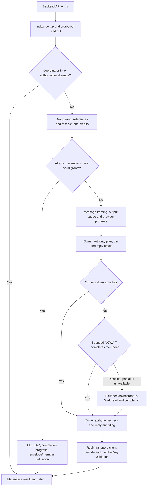

# Remote-read latency: transport attribution and implementation plan

Date: 29 October 2026. The measurements and source-line audit below describe that campaign. **Implementation update, 30 October: P0 observation and the P1–P3 remote-read mechanisms are implemented locally. Software-provider qualification is not EFA or independent-NVMe performance evidence; hardware performance gates remain open.**

The original task changed documentation only. Subsequent work added selected owner planning, executor, cache, NOWAIT and asynchronous WAL-completion clocks, owner-error profiles, per-partition attribution and benchmark/report/Prometheus/Grafana exports, then bounded resident continuations, mixed registered/message groups and completion-driven caller/actor progress. See the [implemented diagnostic contract](../../benchmarks/kv-research/ADAPTERS.md#measurement-phase-read-diagnostics). Protocol 13 requires a rebuilt client and owners; native WAL format, durability and integrity rules are unchanged. No AWS campaign is launched by this implementation.

Historical claims such as “not collected,” protocol 11, source revisions and line anchors below refer to the retained 29 October evidence, not the newly instrumented source. New diagnostic profiles cannot retroactively decompose that old run. Pure wire latency, physical-device service and stage percentiles remain unavailable; measured stage sums/counts/maxima retain their separate populations.

## 1. Decision and priorities

Keep one index/publication authority per logical database and independent native Value-WAL owners. Preserve whole-batch single-owner writes. Do not build a global physical WAL, remove durability checks, add another provider, or introduce NVMe-oF before the measured critical path justifies it.

The next work has two tracks:

1. **Remote resident reads:** collect the missing read-stage evidence, qualify the already implemented resident-first path, improve registered-grant reuse, and reduce measured group handoffs/copies.
2. **Write stalls and load coupling:** correlate admission, persistence, checkpoint progress and completion polling. Small-write medians are near native; long write tails and loaded response time remain poor.

The first practical changes should reuse the existing profiler and fast paths. A large new tracing framework is not a prerequisite to enabling a correctly qualified NOWAIT cohort. Add bounded per-request traces only where existing aggregate profiles cannot answer a decision.

### What the evidence establishes

- Coordinator-cache hits can complete in roughly one microsecond in the measured C1 cohort. Increasing coordinator cache capacity is not the main next optimization.
- The checked primary EFA-native scalar and batch cases use `wal_member_read: async`, **`read_resident_first: false`**, zero explicit owner-cache budget, and zero registered-memory limits on all five owners. Their timings are not a measurement of the fastest implemented resident path or of one-sided reads.
- Current primary read-stage timings were **not collected**. The runner captures read counters but only arms the write profiler. Therefore the current read latency cannot honestly be divided into an EFA-wire percentage and an owner-action percentage.
- The separate write diagnostic does identify local transport output, queue, append and persistence costs. Those are useful optimization leads, not a substitute read profile.
- Foreground checkpoint/admission waits and long client completion-poll gaps are concrete millisecond-scale candidates. Their relation to individual write tails is not yet established.

## 2. Source and evidence identity

| Item | Evidence cut |
|---|---|
| Measured engine | `ba3a6a0194cca6f171e5916649e7f4eeba65aeb0` |
| Inspected local branch / HEAD | `perf/async-authority-history` / `0bf11268d490b76d33bc37977b70be9af7b25172` |
| Runtime comparison | A task-time diff against the measured commit found no changes in `tidehunter/src`, `tidehunter/examples`, `tidehunter-fabric/src` or `benchmarks/kv-research/src` |
| Campaign | GitHub run `40848651463`, campaign `th-343ae02a3d9353ed` |
| Deployment | Six `g6.8xlarge`, `us-east-1a`, cluster placement; controller and five storage hosts |
| Scope | 258 synthetic cases, nine backend variants, RF1, one independent repetition per case; not the latest real-Sui replay |
| Raw evidence root | Workspace-relative `checkpoint-work/aws-ci-runs/2026-10-29-run-40848651463/aws-efa/validated-results` |

References to local source lines below describe this inspected source. Use the measured commit for frozen comparisons; do not treat an old filename date or a historical protocol comment as the current runtime version. The inspected transport constant is protocol 11 in `tcp.rs:65`; older v2/v7/v9 descriptions remain historical.

### Primary artifacts

- [Complete research report](../research/supervisor-report-2026-10-29/main.pdf), [all 453 population rows](../research/supervisor-report-2026-10-29/data/all-results.csv), [source provenance](../research/supervisor-report-2026-10-29/evidence-provenance.json), and [report verification](../research/supervisor-report-2026-10-29/validation.json).
- [Observed stage/resource evidence](../research/supervisor-report-2026-10-29/data/observability-evidence.json).
- [0063 scalar prepared owner configuration](../../../checkpoint-work/aws-ci-runs/2026-10-29-run-40848651463/aws-efa/validated-results/cases/0063-tidehunter_efa_native-1024-read-concurrent-primary_rf1-r0/prepared/external_owner_read_config.json) and [measurement read evidence](../../../checkpoint-work/aws-ci-runs/2026-10-29-run-40848651463/aws-efa/validated-results/cases/0063-tidehunter_efa_native-1024-read-concurrent-primary_rf1-r0/result/measurement-read-evidence.json).
- [0050 batch prepared owner configuration](../../../checkpoint-work/aws-ci-runs/2026-10-29-run-40848651463/aws-efa/validated-results/cases/0050-tidehunter_efa_native-8192-read-many32-primary_rf1-r0/prepared/external_owner_read_config.json) and [measurement read evidence](../../../checkpoint-work/aws-ci-runs/2026-10-29-run-40848651463/aws-efa/validated-results/cases/0050-tidehunter_efa_native-8192-read-many32-primary_rf1-r0/result/measurement-read-evidence.json).
- [0080 separately profiled writes](../../../checkpoint-work/aws-ci-runs/2026-10-29-run-40848651463/aws-efa/validated-results/cases/0080-tidehunter_efa_native-1024-write-concurrent-write_stage_diagnostics-r0/result/write-diagnostics.json).

Use the raw `result/samples.csv` and its exact producer aggregation for percentiles. The fixed-histogram quantiles in individual `result/summary.json` files are bucket bounds, not replacements for exact raw-sample quantiles.

### Which older plans still apply

[The 23 October remote-read plan](REMOTE_READ_PATH_PLAN_2026-10-23.md) remains a source for platform alternatives and historical workload corrections. Its statement that the then-audited launches enabled resident-first does **not** describe cases 0063/0050 above. [The one-sided implementation record](ONE_SIDED_WAL_IMPLEMENTATION_2026-10-23.md) remains relevant to grant and DMA safety. [The 28 October sparse-publication update](REFERENCE_DIRECTORY_DESIGN_2026-10-06.md#dependency-aware-sparse-publication-28-october-2026) remains the correctness authority. This plan updates the current performance interpretation and next work; it does not replace their safety obligations.

## 3. How much time is currently attributable?

### 3.1 Current scalar reads: a valid coarse budget

For the same successful calls, the harness records scheduled arrival, backend dispatch and response materialization on one monotonic client clock:

- scheduling = dispatch minus scheduled arrival;
- API = materialized response minus dispatch;
- response = materialized response minus scheduled arrival.

The **means** below can be added because counts and populations match and the durations add for each call. Their independently computed percentiles cannot be added or subtracted.

Primary 1 KiB scalar reads, C16, 8,192 successful calls per backend; all durations in microseconds:

| Backend | Mean pre-API scheduling | Mean backend API | Mean response | API p50 | API p99 |
|---|---:|---:|---:|---:|---:|
| Native Tidehunter | 11.594 | 2.006 | 13.599 | 1.920 | 3.500 |
| TH TCP | 17.786 | 275.770 | 293.556 | 206.764 | 726.976 |
| TH EFA | 14.177 | 137.326 | 151.503 | 120.153 | 398.000 |
| TH EFA-direct | 13.864 | 137.401 | 151.265 | 120.972 | 399.139 |
| TH EFA-native | 14.217 | 130.961 | 145.178 | 115.313 | 368.688 |

For EFA-native, pre-API scheduling accounts for **9.79% of the sum of response durations** in this population. The remaining 90.21% is inside the backend API, which contains coordinator work, internal queues, transport/progress, owner actions and validation. It is **not** a measured EFA-wire fraction.

The native 2.006 microsecond mean is the complete embedded API path, not a measurement of the distributed owner's work. In particular, `130.961 - 2.006` is not a valid EFA transport measurement.

These are single-repetition observations, not confidence estimates. The retained
analysis warns about p99 below 10,000 samples and p99.9 below 100,000 samples.
Keep those warnings for the 8,192-call cases and for smaller conditional cohorts.

### 3.2 Under load, the outer scheduling budget changes

Successful EFA-native calls in the separate 50,000 offered operations/s, C32 mixed case; durations in microseconds:

| Operation | Successful observations | Mean pre-API scheduling | Mean API | Mean response | Scheduling share of summed response time |
|---|---:|---:|---:|---:|---:|
| Read | 176,839 | 2,780.543 | 136.805 | 2,917.348 | 95.31% |
| Put | 75,599 | 2,815.283 | 2,174.451 | 4,989.733 | 56.42% |

Read API p99 is 426.679 microseconds; scheduling p99 is 37.155 milliseconds; response p99 is 37.294 milliseconds. These are separate quantiles, not subtractable components. There were 147,562 rejected arrivals out of 400,000 offered arrivals. Rejections have no fabricated API/dispatch observations.

The scheduling clock is **before backend dispatch**. Do not call it all coordinator queue time: it can include load-generator lateness and dispatch handoff. Instrument intended arrival, observed arrival/admission decision and dispatch separately before changing engine scheduling on this evidence.

#### Batch reads and cache-hit controls remain separate populations

Primary 8 KiB x 32 reads, C16, 2,048 successful calls per backend; milliseconds
**per batch**, not per key:

| Backend | Mean API | API p50 | API p99 |
|---|---:|---:|---:|
| Native Tidehunter | 0.138 | 0.134 | 0.260 |
| TH TCP | 4.243 | 4.289 | 5.940 |
| TH EFA-native | 2.791 | 2.850 | 4.121 |

The separate 256 B, C1 EFA-native coordinator-cache case had 8,192 hits, zero
misses and zero remote requests; API p50/p99 were **0.870/1.810 microseconds**.
The owner-cache C1 case instead measured 5,435 hits and 2,757 misses, with
48.001/141.273-microsecond API p50/p99. Those are different path mixtures and
concurrency settings from the primary C16 cases. They demonstrate a fast
coordinator-hit path, not a subtractable measurement of remote owner-cache work.

### 3.3 Read actions are counted, but not timed by stage

| Population | Observed action | Current timing conclusion |
|---|---|---|
| 0063, 1 KiB scalar | 8,162 logical owner WAL reads and 8,162 async submissions for 8,192 API calls | No owner read-service duration or physical-I/O latency is exported |
| 0050, 8 KiB x 32 | 57,021 logical WAL reads/async submissions and 10,210 client message requests for 2,048 API batches / 65,536 logical keys | API calls, owner groups, wire chunks and member reads have different units; do not divide all stage totals by one count |
| 0063 / 0050 | Resident-first disabled; zero NOWAIT attempts; registered-memory budgets zero | Zero attempts are not a measured zero-cost fast path |
| 0077, 256 B registered cohort | 2,372 RMA completions; 5,820 missing-grant/message fallbacks | Mixed API p50/p99 54.001/473.281 microseconds is not pure RMA latency |
| 0074, 8 KiB registered cohort | 2,361 RMA completions; 5,831 missing-grant/message fallbacks | Mixed API p50/p99 60.762/500.741 microseconds is not pure RMA latency |
| Owner-cache C1 cohorts | 5,435 hits and 2,757 misses per 8,192 lookups | Their roughly 66% hit ratio does not establish pure owner-RAM-hit service time |

The read snapshots are sequential, not globally atomic. A logical WAL read or `io_uring` submission does not prove that an NVMe device was accessed. All selected warm primary read resource intervals reported zero cgroup read bytes, but that scope is not a universal per-request cache-hit proof.

There is no retained per-connection read-phase clock export for these cases. The runner arms `write_profile_limit`, then captures before/after read counters. This is the central measurement gap to fix.

### 3.4 What the separate write diagnostic does tell us

Case 0080 is a **separate instrumented 1 KiB write population**, not the read case or the primary write latency population. It selects the first 256 append requests on each of five connections: 1,280 selected append requests. Connection/client aggregates also include control traffic and have their own counts.

The following are local elapsed-clock means. They are **not CPU time, wire RTT, an additive RPC budget or a decomposition of the primary p99**.

| Local scope | Retained sum, ns | Matching observations | Mean, microseconds | Interpretation |
|---|---:|---:|---:|---|
| Client request encode | 967,979 | 1,295 requests | 0.747 | Local encoding scope |
| Client exchange | 468,276,142 | 1,295 requests | 361.603 | Includes remote work and waiting; not transport alone |
| Client response decode | 1,278,565 | 1,295 requests | 0.987 | Local decoding scope |
| Owner request decode | 1,117,296 | 1,295 requests | 0.863 | Local decoding scope |
| Owner response encode | 1,402,920 | 1,295 requests | 1.083 | Local encoding scope |
| Owner control queue | 74,787,258 | 1,295 queue samples | 57.751 | Queue residence, not owner execution |
| Owner control execution | 330,327,450 | 1,295 samples | 255.079 | Appender/persistence service; contains nested work |
| Client output queue | 3,005,117 | 1,300 frames | 2.312 | Encoded enqueue to first successful plaintext write |
| Client output submission | 1,564,444 | 1,300 frames | 1.203 | First plaintext write to all bytes accepted; includes backpressure/progress residence, not just `fi_send` CPU |
| Client local retirement | 46,516,816 | 1,300 frames | 35.782 | Acceptance to local completion/observation; includes CQ scheduling/progress, not peer receipt |
| Owner output queue | 810,950 | 1,305 frames | 0.621 | Same output-queue definition |
| Owner output submission | 1,089,294 | 1,305 frames | 0.835 | Same local submission definition |
| Owner local retirement | 44,976,742 | 1,305 frames | 34.465 | Same local completion definition |
| Owner append total | 117,907,639 | 1,280 append calls | 92.115 | Contains the following append subphases |
| Owner append preflight/validation | 95,521,929 | 1,280 append calls | 74.627 | Broad schema/retry/metadata/capacity preparation phase, not just hashing |
| Owner native WAL-writer phase | 18,085,031 | 1,280 append calls | 14.129 | Includes native allocation/copy/wait; not a memcpy-only timer |
| Owner persistence total | 199,573,363 | 1,280 persistence calls | 155.917 | Includes file persistence and other nested work; 120 no-op persist calls are recorded |
| Owner WAL file persistence | 165,095,808 | 1,160 file-persist calls | 142.324 | Different denominator from total persistence |

Do not add the rows or attribute these write means to reads. In this sample, optimizing a roughly one-microsecond encoder alone cannot explain away the much larger service and queue clocks. Conversely, the roughly 35-microsecond local-retirement interval does not establish a 35-microsecond EFA wire latency.

The typed complete group is **already verified by its private constructor/decoder**. `storage.rs:1025-1029` explicitly avoids rehashing/copying every value under the admission lock. Do not propose that already-completed optimization again. Split the broad preflight phase into metadata lookups, capacity/reservation and preparation before choosing another change.

### 3.5 Two concrete millisecond-scale leads

| Observation in 0080 | Value | What it establishes / does not establish |
|---|---:|---|
| Foreground admission-pressure calls | 7 | `ensure_admission_pressure` calls, not seven pure manifest fsyncs |
| Their cumulative elapsed time | 71.799 ms | Mean 10.257 ms per pressure call; may include draining and waiting for background/new capture |
| Client maximum CQ gap with a local send outstanding | 10.575 ms | A local progress/scheduler gap while work is outstanding, not wire latency |
| Owner maximum CQ gap with a local send outstanding | 0.021 ms | Same local definition on the owner |
| General client / owner maximum CQ inter-poll gaps | 10.580 / 0.023 ms | Broader gap metric; not arrival-to-poll latency |
| Sampled client / owner frame-gate stalls | 0 / 0 | No observed frame-gate stalls in this write profile; not proof for bulk reads |

The similar checkpoint-pressure and client-gap scales are a **causal hypothesis**, not a paired observation. Trace checkpoint progress and outstanding operations together. The code can wait for a checkpoint result and durably adopt a manifest on the coordinator. Establish whether this pauses the progress needed by a particular request before changing it.

The same diagnostic records 1,854 receipt-publication-blocked batches, only one dependency-wait batch and 1,720 out-of-prefix publications. The blocked counter does not mean 1,854 requests waited for actual same-key dependencies, nor that all independent writes still wait for a global live prefix.

### 3.6 Explicitly unavailable quantities

The current artifacts do not establish:

- Current read time in request encoding, client actor queue, owner authority planning, NOWAIT/async completion, response recheck, response encoding or record verification separately.
- Pure EFA wire RTT, one-way transit or hardware-only FI_READ service time.
- A same-request critical-path percentage for EFA versus owner work.
- Per-operation physical NVMe latency or a common cache-hit ratio across all KV stores.

Do not fill these gaps with zero, native-local subtraction, conditional-cohort subtraction or an older campaign's timings.

## 4. Native baseline and current read route

[Native `Wal::read`:378-405](../../tidehunter/src/wal/mod.rs#L378) checks a suitable mapped frame's CRC and copies its payload into owned bytes; otherwise it uses an exact file read and validates the frame. Native is not an unchecked or universally zero-copy RAM lookup. Preserve its checksum contract in the control.

The distributed read differs: the coordinator resolves an exact owner/member reference, the owner proves membership and authority, and the client verifies the returned member. An immutable owner WAL is the durable authority; caches and registered envelopes are bounded derived data. A few-microsecond local native API is not a measurement of this extra protocol work.

This is the current all-members RMA decision. Selective mixed RMA/message groups are a proposed optimization, not the current diagram's behaviour. Caller-owned idle-lane progress exists for scalar misses; new grouped work currently enters the read reactor.

Important bounds in the inspected executor are four NOWAIT calls and 64 KiB per sweep, with a 16 KiB per-member attempt bound. Enabling resident-first does not guarantee every warm batch member avoids async I/O. A 64 KiB value's encoded member exceeds the attempt bound and is deferred directly to async, even if its pages are resident. An eligible smaller member can return a retained NOWAIT prefix and read its remaining suffix asynchronously. Record budget/size deferral separately from genuine cache unavailability; use encoded member length, not just application value length.

## 5. Correctness contract: non-negotiable

1. **Values remain in owner-native Value WALs.** Do not add a second mandatory value log or a global physical offset allocator.
2. **A complete atomic batch remains on one owner.** Aggregation may combine complete batches, not split one batch across owners. Later updates to a key may use another owner.
3. **Durable ACK remains durable.** Do not acknowledge before the required captured WAL/file/namespace barrier to improve a number. Native page-cache ACK stays a separately labelled weaker cohort.
4. **Independent live publication may pass unrelated gaps.** Same reduced-key and transitive dependencies, whole-batch visibility, stable checkpoint prefixes and frozen-cut exclusions/pins remain intact.
5. **Keep exact-reference and integrity checks.** Retain membership, bounds, generation, epoch, session, count, keyspace/key, tombstone and CRC/digest validation. No Byzantine tolerance is being added; these checks also prevent stale-pointer, corruption, retry and recovery errors.
6. **Do not bypass unhealthy authority on a cache/RMA hit.** Unknown outcomes and failed fencing remain fail-closed until recovery reconciles durable inventory.
7. **DMA and buffer lifetimes remain explicit.** No reuse or deregistration before the required completion, drain/quarantine and pin release. A local send completion is not a remote durability ACK.
8. **All queues, credits, caches, registered regions, trace buffers and retry loops remain bounded.** Do not replace bounded overload rejection with unbounded memory or delay.
9. **Do not remove native mutexes or CRC checks by default.** No global lock-free claim follows from this work. Preserve the native control unchanged unless a separately justified, consumer-visible fix is necessary.
10. **No return to the archived middleware.** It is not a dependency of this work.

Native foundations and source-backed invariants are mapped in [the current directory design](REFERENCE_DIRECTORY_DESIGN_2026-10-06.md#native-tidehunter-invariants-rechecked-through-qmd) and [Tidehunter v2](https://arxiv.org/html/2602.01873v2), especially §§2.3, 3.1-3.4 and 4.4. Native relocation exists; the distributed fork does not thereby gain live-value relocation or full physical-GC parity.

## 6. Source and repository impact map

All engine paths below are relative to `tidehunter-sharded-wal`.

| Area | Exact source entry points | Planned impact |
|---|---|---|
| Native read control | [wal/mod.rs:378-405](../../tidehunter/src/wal/mod.rs#L378) | Read-only baseline; no native lock/checksum removal |
| Scalar vs grouped resolution | [pending_read/concurrent.rs:44-165](../../tidehunter/src/distributed/remote_db/pending_read/concurrent.rs#L44) | Distributed-only path tagging and bounded group progress changes |
| Flights, credits, actor and waves | [pending_read.rs:45-213,589-805,1246-1624](../../tidehunter/src/distributed/remote_db/pending_read.rs#L45) | Existing profiler first; then measured handoff/refill/trace changes |
| Sui-compatible scalar/multi-get wrapper | [distributed/sui.rs:1290-1357](../../tidehunter/src/distributed/sui.rs#L1290) | Keep public result semantics and protected cuts |
| Client message/RMA and owner session | [tcp/reactor.rs:1825-2598,3470-3660,4167-4404](../../tidehunter/src/distributed/tcp/reactor.rs#L1825) | Grant-aware selection, optional mixed groups and request-local observation |
| Owner cache/NOWAIT/async executor | [tcp/read_executor.rs:662-1050](../../tidehunter/src/distributed/tcp/read_executor.rs#L662) | Qualify existing resident-first; tune only measured bounds/deferrals |
| Grant identity and accounting | [tcp/resident.rs](../../tidehunter/src/distributed/tcp/resident.rs) | Bounded coverage/lifetime metrics and policy; no raw unverified pointers |
| Existing profile meanings | [tcp/diagnostics.rs](../../tidehunter/src/distributed/tcp/diagnostics.rs), [tcp/fabric.rs:19-88](../../tidehunter/src/distributed/tcp/fabric.rs#L19) | Reuse fields; distinguish queue/submit/retire, nested scopes and unavailable fields |
| Payload and endpoint copies | [tcp/payload.rs](../../tidehunter/src/distributed/tcp/payload.rs), [fabric endpoint](../../tidehunter-fabric/src/endpoint.rs) | Reduce copies only with measured bytes/time and retained completion ownership |
| Append preflight/persistence | [storage.rs:1000-1228,1269-1414](../../tidehunter/src/distributed/storage.rs#L1000), [tcp/control.rs](../../tidehunter/src/distributed/tcp/control.rs) | Separate write track: targeted guard/queue/coalescing changes after attribution |
| Checkpoint pressure and adoption | [remote_db.rs:2092-2210](../../tidehunter/src/distributed/remote_db.rs#L2092), [checkpoint_lifecycle.rs:342-419](../../tidehunter/src/distributed/remote_db/checkpoint_lifecycle.rs#L342) | Separate drain/capture/adoption/cleanup; durable root-before-adoption remains |
| KV configuration and collection | [config.rs:145-151](../../benchmarks/kv-research/src/config.rs#L145), [runner.rs:145-218](../../benchmarks/kv-research/src/runner.rs#L145), [backend adapter](../../benchmarks/kv-research/src/backends/tidehunter.rs) | Add the missing read-profile lifecycle, effective-path receipts and optional trace export |
| Raw timing and analysis | [report.rs:23-38](../../benchmarks/kv-research/src/report.rs#L23), [analyze.py](../../experiments/kv-comparison/analyze.py), [plotting](../../experiments/kv-comparison/plot_cloud_comparison.py) | Preserve all raw clocks; add typed trace/path populations without pooling incompatible cases |
| Matrix and cloud execution | [campaign.py](../../experiments/kv-comparison/campaign.py), [cloud_layout.py](../../experiments/kv-comparison/cloud_layout.py), [cloud_controller.py](../../experiments/kv-comparison/cloud_controller.py), [AWS workflow](../../.github/workflows/aws-efa-benchmarks.yaml) | Plan cases/counts/deadlines and archive new diagnostics; retain backend selection and exact-owned teardown |
| Local adapter CI | [kv-comparison.yaml](../../.github/workflows/kv-comparison.yaml) | Exercise new configuration/evidence behaviour without AWS |
| Sui fork | `Loris-EPFL/sui-tidehunter-distributed`, `crates/typed-store/Cargo.toml` and lockfile | No large Sui redesign needed. Align and qualify its engine pin before a future checkpoint experiment; public storage API changes are not assumed |
| Legacy middleware | Archived repositories | No changes; never reintroduce |

The report inspected Sui commit `2fc8fa1eb529cdeaa8cf3906c46d0de5e0b32a19`, which pinned engine `9076518cb9e166e41b382d41bcc644db94aa332b`, not this campaign's engine. Recheck the actual checkout before future Sui work. Unsupported remote range tombstones and the native adapter's no-op range-delete branch are existing semantic caveats, not solved by a read-latency optimization.

## 7. Measurement design: answer transport versus actions first

### 7.1 Reuse the existing read profiler before creating new machinery

The engine already has finite `set_read_profile_limit` / `read_profile_monitor` support and `TcpReadProfile`, `ConnectionProfile`, `TransportProgressStats`, `ReadExecutorStats` and `ResidentReadStats`.

The KV runner's `DiagnosticsConfig` currently exposes only `write_profile_limit`. Add a **proposed** `read_profile_limit` and matching backend arm/drain/export lifecycle. Do not treat this new harness field as already implemented.

Requirements:

- Arm after preload/warmup and the measurement release gate; close/drain after measured calls settle.
- Export a versioned `read-stage-profile.json` beside the existing samples/read-count evidence, with selected/completed/failed/unsupported counts, source/settings and exact denominators.
- Keep connection-wide and control traffic clearly scoped. Separate scalar, grouped, inline, actor, RMA and message populations.
- Profiled protocol responses can change traffic. Treat this as an explicitly instrumented diagnostic case, not an unlabelled replacement for headline unprofiled timing.
- If a requested profile is not armed/exported or has incomplete expected owner coverage, fail the diagnostic qualification. Do not report empty objects as successful timing capture.
- First collect already available queue/handler/recheck/record and endpoint work fields. Extend tracing only for a remaining decision that these fields cannot answer.

### 7.2 Add lightweight per-operation path identity

Current aggregate counters cannot map a particular raw latency sample to RMA or fallback. Do not split old `samples.csv` retrospectively by global counter deltas.

A proposed observation records client-known path (`coordinator_hit`, `local_negative`, `rma`, `message`, `mixed`, `unknown`), owner/lane/chunk counts, coalescing and outcome. Owner cache/NOWAIT/async classification is available only through a qualified cohort or correctly joined owner observation; otherwise it remains unknown. For a shared flight, link to the physical child rather than counting the physical work once per waiter.

A path-only mode must not enable all stage clocks or additional wire exchanges. Prefer existing request/flight ownership and preallocated records. Keep production Sui result types unchanged. Any raw CSV/schema extension must update configuration validation, analysis, plotting and all readers together, with explicit unsupported/missing values.

### 7.3 Add bounded local event traces only where needed

Proposed configuration, not an existing API:

- finite sample/byte/event caps, selection seed and sampling policy;
- a default-off mode with no per-operation allocation, clock read, formatting, synchronous file I/O or global contended atomic counter;
- preallocated request/lane-owned records and post-measurement export;
- dropped/truncated/incomplete/cancelled/coalesced counts, with no backpressure from the trace collector into data serving;
- no keys, values, credentials, TLS secrets, remote memory keys or raw remote addresses in public trace artifacts.

Use a stable mixed request/session/lane identity or stratified selection, not simply every 128th global operation: periodic sampling can alias round-robin lanes. Verify coverage by owner, lane, operation and path. Bound the trace under cancellation and saturation; missing/truncated intervals remain unavailable.

Suggested client-local boundaries:

1. API entry.
2. Index/cache/cut resolution complete.
3. Credits/inline lane or actor admission established.
4. Actor enqueue/dequeue when applicable; retain these as child spans of the caller wait.
5. Request framing complete and output enqueued.
6. First output submission attempt and acceptance of the last request bytes.
7. Full response frame observed/materialized.
8. Exact-record/key/count validation and API return.

Suggested owner-local boundaries:

1. Complete request frame available and decode complete, separately.
2. Reader authority/reply credit acquired.
3. Plan ready, including resident versus cold-worker lookup.
4. Executor acceptance, `Full` retries and deferred residence.
5. Cache/NOWAIT attempt and result, or SQE submission and CQ-observed completion.
6. Completed records ready.
7. Authority recheck wait/execution complete.
8. Response encoding, enqueue, provider acceptance and local retirement, separately.

Record byte/member counts and actual path decisions. Async submit-to-CQ residence includes kernel and scheduler effects; it is not automatically physical disk service time. Keep per-member work sums distinct from the group's first-submit-to-last-completion wall span.

### 7.4 Correlation and residuals

Use a shared, non-secret identity such as `(run, negotiated session/connection identity, existing wire request ID, chunk)` **only after checking that both sides export the same unambiguous identity**. Do not match by timestamp proximity, owner index alone or unrelated local ordinals. If existing identities are insufficient, keep traces unjoined until an explicit correlation design is qualified; do not silently change the WAL or wire format to make an analysis appear complete.

For a single, correctly joined RPC, a client outer duration and an owner service duration can support a residual only after proving causal containment and compatible clock-rate accuracy. Choose boundaries before submission/enqueue visibility rather than assuming an after-send timestamp precedes remote receipt. A candidate owner interval is complete-request availability to before making the reply eligible for output; the client outer interval must enclose it.

Even then label the difference **transport + progress + unobserved scheduling residual**, not wire RTT. It can include output queues, provider work, segmentation, CQ observation delay and framing. Retain measured uncertainty and reject/flag inconsistent joins or negative residuals; never clamp them to zero. Never subtract absolute monotonic timestamps from different hosts, or p50 from p50 / p99 from p99 to manufacture a stage percentile.

For fanout, compute the parent and client-observed critical path/waves on the client clock. Show owner/child work sums separately. A shared flight can have several parents; several owners can run simultaneously. Summing owner service durations is not batch wall time.

For RMA there is no owner RPC handler per fast-path read. Record grant/destination wait, post attempts, post return, CQ observation and envelope/member verification. Registration/promotion/initial acquisition are separate costs, not zero costs omitted from every workload.

## 8. Existing controls to reuse

Do not build a fake KV implementation or call an empty response a successful store read. Existing controls already cover useful boundaries:

| Control | Existing source | Valid interpretation / required qualification |
|---|---|---|
| Trace recorder/local handoff | Existing actor/inline paths and proposed bounded recorder | Calibrates local diagnostic overhead; no network claim |
| Established-session status | `Client::status`, `tcp.rs:1583-1586` | Session/framing/control reference, not an empty read or a subtractable storage cost |
| Persistent RAM response | [sharded_wal_transport_bench.rs](../../tidehunter/examples/sharded_wal_transport_bench.rs) | Includes framing, reactor work and full client deterministic payload validation; not pure network or KV semantics |
| Owner-local real read | Reuse exact `PartitionLog`/reader-authority APIs in a labelled diagnostic harness | Same actual plans, bytes and validation without a network request; not the embedded native `Db` path |
| Verified owner-cache message read | Real stored references and current message path | Establish actual 100% measured owner hits for a pure-hit control; keep the normal mixed cohort too |
| Resident-first WAL read | Existing read executor, same data and security | Compare actual full/partial NOWAIT and async outcomes, not just the requested flag |
| Raw FI_READ control | [support/rma_probe.rs](../../tidehunter/examples/support/rma_probe.rs) | Existing raw endpoint baseline; explicitly not Session/RPC/WAL or pure wire RTT |
| End-to-end granted RMA | Current exact-reference/grant path | Includes application lookup/credits/envelope checks; qualify matching grants on the actual selected lanes |

The transport bench includes deterministic payload verification inside its timer, whereas KV `samples.csv` stops the API timer before full expected-value comparison. Export compatible named sub-boundaries or report the controls separately. Do not subtract their independent quantiles.

The raw RMA probe exports `completion_latency_ns` from **post return** to CQ observation and `api_validation_latency_ns` from before posting/retries through verification. Posting may overlap hardware progress. Neither field is hardware-only service time. Record both actual FI_READ bytes (payload plus its envelope/header) and application bytes, native/emulated capability, polling policy and retries. Its default polling/repetition settings are not automatically those of the KV campaign: select matching policy and **one development repetition explicitly**. Do not use its software provider as EFA hardware evidence.

No specifically named raw probe export was found in the retained 29 October campaign audit. These existing programs are proposed next controls, not measurements retroactively supplied by the current run.

## 9. Ordered implementation work packages

### P0. Effective-mode receipts and read-profile collection

**Change:** extend `DiagnosticsConfig`, the backend trait/adapter lifecycle, runner, cloud case generation, collector and analysis to arm/export the existing finite read profiler. Add requested/effective mode receipts for cache budgets, NOWAIT bounds, grants, lane counts, workers, polling, provider capabilities and actual path counts.

**Gate:** local real native/TCP/software-provider executions must produce correct values and nonempty correctly scoped diagnostic observations before cloud packaging. Unsupported observations are explicit; a requested hardware-RMA cohort cannot silently pass on zero budgets or emulated reads. Existing primary async-only cases remain immutable historical controls.

**Deliverable:** read profile plus raw samples/config/coverage, with no invented wire fraction. If aggregate profiles resolve the decision, do not add the more complex trace in §7.3 merely for completeness.

### P1. Qualify resident-first service without enlarging the coordinator cache

**Change:** add a separate matched cohort using the already implemented `read_resident_first: true` path. Keep coordinator/owner explicit cache budgets at zero when isolating kernel-resident WAL service. Retain async fallback for EAGAIN, unsupported/partial reads and budget deferral.

**Measure:** actual full/partial NOWAIT results, skipped/deferred reasons, async fallbacks, authority queue, CQ work, bytes, API and response statistics. Start with 256 B/1 KiB/8 KiB and then 64 KiB. Respect the current four-call/64-KiB-per-sweep and 16-KiB member attempt bounds.

**Optimization gate:** if warm batch members are being deferred by fairness bounds rather than cold data, evaluate bounded scheduling of remaining resident work across sweeps before simply raising every limit. Do not block a network reactor in native `Wal::read` or assume a mapped page cannot fault.

### P2. Improve confirmed-RMA coverage and reuse

**Change:** measure acquisition attempted/issued/denied by reason, first access versus previously granted reference, exact lane/session reuse, handle/source/destination occupancy, and grant expiry. Evaluate grant-aware lane selection only when it respects authority, capacity and fairness.

The current all-members requirement sends an entire group through message fallback if one grant is missing. If this is material in matched batches, partition eligible members into bounded RMA/message children and restore original order at one protected cut. Keep duplicate/coalesced references and error/cancellation handling correct.

**Gate:** establish separate pure-RMA and realistic mixed cohorts. A pure-RMA control prequalifies the same bounded reference set on the actual selected sessions and admits no unexplained message fallback during its measurement. A realistic cohort retains first accesses and fallback costs. Never shrink or warm only a small prefix of the normal random workload to manufacture a better production result.

### P3. Reduce measured batch scheduling and copy work

**Change candidates:** caller-owned progress for an idle owner-group lane, analogous to the existing scalar path; completion-driven refill rather than submission-order head-of-line delay; grouped decoding/shared-buffer handling; reduced copies where bytes/time show a material cost.

**Measure first:** parent/child waves, queue residence, group size and response chunks, sender/receiver copied bytes, endpoint posting and retirement, owner read completion and validation. Grouping by owner is already implemented; do not describe this as replacing one RPC per key.

**Gate:** preserve bounded credits, fairness, deadlines, protected cuts, caller order and buffer/lease lifetimes. Do not assume random references are adjacent disk extents. No copy is removed by releasing a buffer before its completion fence.

### P4. Remove measured write/checkpoint progress stalls

This track can proceed independently of read-path work after P0's observation contract is fixed.

**Measure:** append preflight metadata/capacity/reservation, per-owner queue kinds, captured persistence generation, no-op persists, admission-pressure trigger, drain, existing/new capture wait, manifest adoption/cleanup and client progress gaps with outstanding work. Correlate the 10-millisecond-scale candidates; do not assign them to primary p99 from aggregate clocks.

**Change candidates:** coalesce already queued compatible completions behind one captured barrier without a fixed batching delay; prepare work outside the serving owner where safe; move demonstrably blocking cleanup off the foreground owner; shorten measured state-guard residence with revalidation. Preserve FIFO control barriers, durable root-before-adoption/reclamation, append poisoning and exact retry receipts.

Do not weaken ACK durability, remove the persistence serialization guard blindly, or remove the stable prefix. Only one true dependency-wait batch was observed in this diagnostic; the old all-live-writes global-prefix explanation is not the current implementation.

### P5. Optimize progress/transport only on the measured residual

**Measure:** CQ polls/empty ratio, API time in provider calls, gaps with work outstanding, source/destination/slot pressure, frame-gate stalls, per-thread scheduler/throttling evidence and lane use. Distinguish general idle poll gaps from work-outstanding gaps.

**Change candidates:** progress ownership/fairness, unnecessary per-lane work, polling bursts/yields, copy or registration reuse, or frame/chunk handling. Adaptive is already enabled. Four cold-planning workers do not prove there are exactly four hot-path pollers.

**Gate:** retain manual progress and DMA lifetimes. Improve latency/throughput and report CPU tradeoffs; do not reduce CPU by silently starving completion progress. Do not increase lanes/slots until capacity is implicated, or ignore session-local grant dilution when adding lanes.

A provider change is considered only if matched endpoint and full-stack controls show an irreducible provider/platform limitation after these actions. NVMe-oF remains a separately scoped cold-path investigation only if attributed device service dominates; it is not a fix for resident-page queueing or missing grants.

### P6. Revalidate the real Sui path

After local qualification and a useful hardware diagnostic, freeze a compatible Sui checkout and engine pin, rebuild all affected binaries, and replay the same certified checkpoint fixture with state-equivalence checks and the same timing boundaries. Label fixture origin, checkpoint range and working set; do not call a private executed chain mainnet. Synthetic KV improvements alone do not establish checkpoint speedup.

No large Sui or archived-middleware refactor is assumed. If a public API or error-contract change becomes necessary, document the exact need and callsites separately before expanding scope.

## 10. Parallel work and integration order

| Slice | Ownership | Dependency / acceptance |
|---|---|---|
| Read observation and harness | One integration owner for config/runner/backend trait/export schema | P0 before interpreting new profiles; coordinate all schema readers |
| Resident-first and executor qualification | Distributed Rust implementation owner | Can run beside observation work using agreed path tags/fields; no duplicate profiler convention |
| Grant reuse / mixed groups | Distributed Rust implementation owner | P2 after per-lane causes are visible; coordinate shared reactor edits with the read owner |
| Write pressure/persistence | Separate Rust owner | Independent code slice; shared correlation/phase format from P0 |
| Offline analysis / plot validation | Analysis owner | Uses frozen samples and explicit populations; no inferred missing values |
| Future cloud lifecycle | Existing AWS operations agent and benchmark workflow | Only after local gates and separate launch request; one fleet, no manual competing campaign |

At integration time, review the full diff, update callers/docs, run the affected checks once after related edits settle, then exercise actual local native/TCP/software-provider cases. Do not run repeated builds/tests while sibling edits are in flight. Do not commit or push under authority of this documentation task.

## 11. Benchmark matrix and reporting rules

Keep all existing backends, transports, value sizes, operations, C1/C16/C32 levels, offered loads, data generation, key distribution, seeds, preload/warmup, correctness checks and per-case measurement counts. The measured primary examples use 4,096 workload keys; the backend configuration's `key_count: 1048576` is an engine sizing value and must not be misreported as the loaded workload.

Add explicitly named controls/cohorts rather than silently modifying existing primary cases:

- Coordinator hit at C1 and C16, with measured hits/misses.
- Owner explicit-cache hits versus the existing mixed owner-cache cohort.
- Async-only resident-WAL baseline versus resident-first enabled, with actual outcomes.
- Qualified granted RMA versus realistic RMA/message mixture.
- Existing cold-OS-cache cohort, retaining application-cache and device-attribution caveats.
- Focused stage-diagnostic variants and existing native/TCP/EFA modes; diagnostic controls are not ranked as KV backends.
- Small-write and mixed offered-load cases needed to explain write-induced backlog, not just reads in isolation.

Planning must update expected-case counts, estimated duration, deadline/leeway, artifact manifests, config validation, CI checks, aggregation and plotting. Backend selection must still work locally and through GitHub Actions. Keep a single campaign matrix/fleet; do not add continuation workflows or double the full campaign solely to obtain traces. A small explicitly budgeted diagnostic subset can share that matrix without replacing the unprofiled measurements.

Use one independent development repetition. Preserve raw API/scheduling/response samples for every operation and compute p50/p95/p99/p99.9/mean/SD/min/max, whole-case successful throughput, logical keys, payload bytes and rejections. Keep the original percentile definition and small-tail warnings. Show no run-to-run error bars or statistical-significance claim from one repetition.

For conditional RMA/message timings, export counts and warn about selection effects: a more frequently reused key can be more likely to have a grant. Use matched separate controls before claiming causal RMA speedup. Never pool cache paths, outcomes, concurrency, acknowledgment tiers or security modes.

Use historical matched repetitions where available. Rerun only uncertain/regressed configurations across **every backend involved in the claim**, on the same frozen sources/settings. Multiple repetitions remain appropriate for final publication/reproducibility, not a reason to relaunch the whole development suite.

## 12. Performance gates and stop conditions

The goal is a measured lower practical latency, not a predetermined claim that every remote read will be 5 microseconds.

Before a targeted rerun, use these proposed material-effect thresholds:

- at least 20% improvement in the targeted API p50 or p99, or at least 10% successful goodput improvement;
- no changed acknowledgment/security/correctness contract, larger hidden client resource allowance, suppressed rejection count or reduced measurement sample count;
- no material regression in coordinator hits, unrelated operations or matched batch/large-value cases;
- report CPU, memory and trace overhead, even when latency improves.

These are engineering decision thresholds, not significance tests or guaranteed outcomes. A smaller improvement may still be retained when it removes a proven avoidable cost without regression; document that decision rather than claiming a statistical win.

For instrumentation, start with a default-off path that adds no clock reads or per-operation allocation. Calibrate trace-on/off locally and on a small matched hardware subset; target overhead much smaller than the material effect (initial guardrail: 3% throughput and 5% central-latency change). Report variability and absolute nanoseconds/microseconds; noisy single runs cannot certify a tight overhead bound. If overhead is material, reduce sampling or keep the diagnostic separate from headline results.

Stop adding complexity when the remaining measured cost is necessary validation, attributable device service, or the established same-stack transport/progress reference within uncertainty. Revisit topology/provider only when those measurements identify a specific bottleneck. Do not treat a separate benchmark's median as a universal mathematical floor.

## 13. Local and future hardware verification

### Local, before any upload

- Exercise actual native/TCP and supported software-provider paths; a shared laptop SSD is useful for correctness and CPU-path checks, not independent-NVMe or hardware-RMA performance.
- Check trace-disabled results, bounded overflow/error/cancellation, joined-flight accounting, mixed-group order/duplicates, cut retention, stale/corrupt grants and exact response rechecks. Add permanent regression tests only for plausible consumer-visible boundary failures, not forwarding/wiring or source-text assertions.
- Verify NOWAIT full/partial/EAGAIN/unsupported and budget-deferred fallback, including real returned bytes. Do not use only a forced all-hit fixture.
- Exercise actual matrix planning and artifact export for selected backends; reject requested-but-unavailable modes and unsupported trace scopes rather than producing fabricated zero timings.
- Reuse [local adapter CI](../../.github/workflows/kv-comparison.yaml) and [cloud/local qualification guidance](CLOUD_AND_CI_TESTING.md); validate the real affected runtime paths, not just JSON generation.
- Rebuild native/distributed/transport/probe/adapter binaries with the intended features. Freeze source commit, lockfiles, features, toolchain and binary/archive hashes. A build from a previous campaign is not acceptable.

### Future AWS hardware run: not authorized or launched by this document

Use the existing protected [AWS benchmark workflow](../../.github/workflows/aws-efa-benchmarks.yaml), KV-comparison selection and AWS operations agent/MCP. Use the approved cost/capacity policy and cluster placement, with native/TCP/EFA variants on one sequentially reset fleet where possible. Do not change quotas, IAM or hardware merely to mask a software startup failure.

Record actual provider/device/read mode, negotiated capabilities, registered budgets, polling and effective flags. `require_device_read` must be true for a hardware-RMA claim; emulated reads or a zero-hit RMA cohort do not pass that claim. Preserve generic transport selection rather than hardcoding an EFA path into shared code.

Respect the editable weekly budget, cumulative ledger, planned deadline, independent termination safeguard and exact-owned resources. Collect raw samples, trace/profile scope, effective configs, counters, resource data and Prometheus/Grafana archives through durable S3 export with hashes. After verified export, terminate the entire owned fleet and owned auxiliary resources; verify closure independently. Deadline termination remains mandatory even if local download is delayed. Do not touch other users' resources or leave a permanent monitoring cluster.

## 14. Reference-to-fix map

| Reference | Mechanism to adapt | What it does not establish |
|---|---|---|
| [Tidehunter v2, §§2.3,3.1-3.4,4.4](https://arxiv.org/html/2602.01873v2) | Value WAL as long-term storage, direct reference lookup, local resident read, amortized background work and safe snapshot/reclaim boundaries | A globally ordered physical log is required; all reads are NVMe; ordinary page-cache ACK equals a persisted ACK |
| [eRPC, NSDI 2019](https://www.usenix.org/conference/nsdi19/presentation/kalia) | Session progress, bounded credits, ownership and copy/lifetime discipline; map to pending-read and endpoint code | Its measured latency applies to G6 EFA or durable WAL operations |
| [HERD, SIGCOMM 2014](https://pdl.cmu.edu/PDL-FTP/Storage/herd-sigcomm2014_abs.shtml) | Thin two-sided server actions can avoid multiple remote probes | One-sided is always faster; its in-memory result is a disk-read target |
| [FaRM, NSDI 2014](https://www.usenix.org/conference/nsdi14/technical-sessions/presentation/dragojevic) | Registered-object identity, incarnation and safe lifetimes | Current RF1 owner WAL gains FaRM replication/transactions |
| [TeRM, FAST 2024](https://www.usenix.org/conference/fast24/presentation/yang-zhe) | Distinguish resident RDMA from tier/fault work; account for both | FI_READ directly fetches arbitrary cold WAL disk blocks |
| [Valkey persistence](https://valkey.io/topics/persistence/) and [pipelining](https://valkey.io/topics/pipelining/) | Amortize queued persistence/commands without confusing pipelines with atomic batches | A RAM dataset plus AOF is the same storage/read architecture or failure contract |

The detailed [verified reference ledger](../research/supervisor-report-2026-10-29/data/reference-evidence.md) records paper sections, QMD document IDs and limits. These are design references, not evidence that their implementations were copied or that their hardware numbers are attainable here.

## 15. Completion checklist for the implementation campaign

- [x] P0 read-profile arm/drain/export and requested/effective mode receipts work in actual local executions.
- [x] Current read costs are reported by their real scope; transport/wire and physical-I/O unknowns remain explicit.
- [x] Local path identity supports honest RMA/message/owner-tier populations, with coalescing and mixed batches accounted for; hardware qualification remains separate.
- [x] Resident-first has matched local controls without changing old baselines or enlarging the coordinator cache to hide misses.
- [x] Grant acquisition/denial/occupancy evidence is collected; mixed RMA/message handling preserves view and DMA safety in local software-provider qualification.
- [ ] Any batch scheduling/copy change has correlated evidence and does not regress large values or caller order.
- [ ] Write-pressure/checkpoint and progress-gap candidates are correlated; durable ACK and recovery boundaries remain intact.
- [x] Sample/byte/event/queue bounds, cancellation and overflow have local checks; no synchronous hot-path logging or unbounded trace state is introduced.
- [x] Affected schemas, callers, matrix counts, CI checks, reports and plot eligibility are updated; missing observations remain unavailable.
- [x] Locally rebuilt frozen binaries and collection/teardown gates pass; this does not waive the unchecked performance or future hardware gates.
- [ ] Future cloud data is durably retrieved, the owned fleet is fully terminated, and actual real-Sui replay is separately qualified before making Sui performance claims.

### Local diagnostic qualification

The retained evidence is in workspace-relative
`checkpoint-work/local-read-diagnostics-2026-10-30/validation-summary.json`.
Eight final real-process cases used five owners and preserved 59,392 measured
API samples in total: async scalar, async batch32, mixed reads/writes, coordinator
hits, profiling disabled, resident-first, owner-cache hits and software-provider
registered reads. Owner I/O counts matched their aggregate; all forty final
owner processes exited successfully. This is local functional evidence on one
SSD, not EFA hardware or independent-NVMe performance.

Actual per-owner sum/mean/count/maximum series were checked in Prometheus and
the live Grafana table. A real TSDB archive was exported and replayed offline
with original timestamps; live and replay containers were stopped afterward.
The archive covers post-run terminal diagnostic presentation, not a captured
CPU/I/O timeline of the earlier workloads. Raw results, rebuilt binary hashes,
source archive, dashboard image and shutdown receipts remain with the evidence.

## 16. Native NVMe mechanism and distributed read implementation

### 16.1 Both values and index data use storage

The [native paper, §§3.1–3.4 and 4.1–4.3](https://arxiv.org/html/2602.01873v2#S3)
uses a Value WAL for long-term values, an append-only Index Store for persisted
cell indexes, and a Control Region for recovery metadata. The in-memory Large
Table does not mean the complete index or values must fit in RAM. Foreground
allocation/mmap-copy/index application is distinct from background stable
persistence. A fast WAL read can be a RAM/page-cache operation rather than a
physical NVMe command. Native `wal/mod.rs::Wal::read` keeps CRC validation and
its mapped/file read distinction.

The distributed coordinator's `native_index.rs::NativeIndex` stores typed
references, not a second application-value copy. Its dirty overlay and
immutable file-backed cell images adapt native indexing primitives; they are
an experimental format, not an unchanged native Index Store. Owner WALs hold
the actual values. Cold coordinator-index cost must therefore be qualified
separately from owner-value cost; do not assume the paper's exact optimistic
index-window algorithm has been reproduced merely because cells can unload.

Independent owner appends and asynchronous value reads can use several NVMe
drives concurrently. A single requested value still uses its referenced owner;
a global WAL counter would not make that one device read parallel across
all drives. Keep whole atomic batches on one owner and avoid a second full-value
log. Preserve publication, snapshots, protected cuts and reclamation pins.
No global physical WAL, native lock removal or NVMe-oF change was made here.

### 16.2 Implemented source map and safety boundary

| Source | Implementation | Reference mechanism |
|---|---|---|
| `tcp/read_executor.rs`, owner dispatch in `tcp/reactor.rs` | Prepared proven-warm work can continue across bounded sweeps; four-call/64-KiB sweep and 16-KiB member limits remain; cold/partial/unsupported work uses async fallback | [Tidehunter §3.2](https://arxiv.org/html/2602.01873v2#S3.SS2), [TeRM §4.3](https://www.usenix.org/conference/fast24/presentation/yang-zhe): distinguish resident file service from storage/fault work |
| `tcp/reactor.rs::{prepare_rma_read,progress_rma_read}` | Valid-grant members use FI_READ while missing members use messages concurrently; results merge at original slots, with duplicate/error/cancellation and accepted-DMA lifetimes preserved | [TeRM §4.1.2](https://www.usenix.org/conference/fast24/presentation/yang-zhe): separate resident and missing portions, not its modified-driver/magic-pattern ABI |
| `tcp/resident.rs`, fabric `endpoint/resources.rs` | Node/process limits remain; actual source metadata reservations replace maximum-connection dilution. Endpoint byte occupancy avoids a full source scan on promotion; newest-first lookup makes the usual reserve/register sequence constant-time. Uncertain-close quarantine remains charged | [eRPC §4.3.1](https://www.usenix.org/conference/nsdi19/presentation/kalia) bounded credits; [FaRM](https://www.usenix.org/conference/nsdi14/technical-sessions/presentation/dragojevic) incarnation/lifetime reasoning, not imported replication semantics |
| `remote_db/pending_read.rs` | Ready-owner retirement/refill, grant-aware idle-lane choice and shared caller/actor lane drivers; 64 empty caller sweeps hand accepted work back to the actor without releasing its buffers/credits | [eRPC §§3.2,4.2](https://www.usenix.org/conference/nsdi19/presentation/kalia): short progress ownership, bounded handoff and DMA-safe buffers |
| `distributed/sui.rs::Db::multi_get`, KV adapter | Borrowed `AsRef<[u8]>` keys avoid per-key `Vec<u8>` copies; existing order/error/cut behavior remains | Native exact-reference lookup and eRPC ownership/copy discipline; `Stage::run` was already synchronous, not a removed worker queue |
| KV config/workload/runner; `cloud_campaign.py`, controller, exporter and plotter | Explicit resident controls, complete-set/session qualification, grant boundary snapshots and no-fallback hardware plot gates; original cohorts/counts remain | Separate measured populations; no wire/device fraction inferred from aggregate stage clocks |

Three Rust implementation agents handled the independent executor, registered
transport and coordinator slices. A paper/source agent verified QMD sections
and pinned implementations; two read-only reviews found and helped correct a
scalar/coalesced-flight missed wake and an obsolete source-cap validation.
No foreign transport or kernel-driver code was copied.

The [pinned eRPC request implementation](https://github.com/erpc-io/eRPC/blob/de83dab3eab4a0fb19bfc4881c11d4a6b89ff17d/src/rpc_impl/rpc_req.cc#L82-L157)
distinguishes foreground packet ownership from copied background requests.
The [TeRM completion implementation](https://github.com/thustorage/TeRM/blob/a94d44a59238d8d51266a7a2ea8bbf2daf3151d9/libterm/ibverbs-pdp/qp.cc#L190-L270)
supports sparse missing-data recovery but synchronously waits under its own
message lock; that blocking mechanism was deliberately not copied.
[libfabric's asynchronous read lifetime](https://ofiwg.github.io/libfabric/v2.6.0/man/fi_rma.3.html)
does not permit releasing a destination or source simply because an application
request was cancelled.

QMD evidence: Tidehunter `#2a504a` §§3.2,4.1–4.4; eRPC `#f39b71`
§§3.2,4.2,4.3.1; TeRM `#7ccb34` §§4.1.2,4.3,4.4; FaRM `#13daf0`
§§3.3,3.5. Embedded-image interruptions in Tidehunter §§2.3/3.1 were checked
against the primary HTML. The indexed collection is reported by the service as
`tidehunter-papers`; `papers/parsed` holds its local Markdown sources.

### 16.3 Qualification is not a cluster-performance result

New controls preserve all 4,096 logical keys. Complete-set registered controls
use C1, one actual session lane per owner and explicit full-set warm-up, then
uniform random measurement. Mixed/first-access/C16 cases remain separate.
Source byte/region budgets are not silently expanded to cover the application
database. Runtime hardware claims require `require_device_read=true`; local
software emulation cannot pass the hardware plot gate.

The local campaign retains matched pre-change/current executables, raw samples,
per-owner profiles, configurations, binary identities and exact shutdown
receipts under `checkpoint-work/local-read-performance-2026-10-30`.
These are unoptimized development binaries on one shared SSD and loopback.
Local timings check software effects and regressions; they do not establish
independent-NVMe bandwidth, EFA latency or production parity. Some acquisition
and tail results remain worse or noisy; do not hide them behind pure-hit
controls or make a universal performance-win claim.

P4 write/checkpoint stall work and P6 real-Sui/hardware revalidation remain
separate. This read implementation did not modify the Sui repository, invoke
archived middleware, change native WAL integrity/durability or remove native
mutexes. The only Sui-facing API change is the borrowed-key generic method in
the Tidehunter fork's existing compatibility wrapper.

### 16.4 Final local evidence, 2026-10-30

The final executable is frozen as
`checkpoint-work/local-read-performance-2026-10-30/verified-kv-research`.
Its BLAKE2b-512 starts `0481913698265e95`; the full identity, configurations,
per-case raw-sample hashes, stage populations and shutdown receipts are in
`results.json` in that directory. `verified-source/source.zip` has SHA-256
`0cd423d04335e4fc0b162ca6371445a5041cbd83a69ae0b22c9568a6eea1b7a1`.
All 70 inherited non-distributed engine source files in the baseline snapshot
are byte-identical to this source. The source freeze preceded measurement;
this results subsection was added afterwards.

These are C16, uniform, coordinator-cache-disabled, owner-cache-disabled
software comparisons, not cluster results. TCP cases use 128 keys; mixed
software-OFI cases use 4,096 keys. Both sides of each row retain the same
keys, seed, value bytes, warm-up, operation count and workload. A batch latency
is for the complete 32-key API call, not one value. Baseline means the frozen
pre-change executable, not the best historical observation.

| Local case | Measured API calls | Baseline p50 µs | Final p50 µs | Baseline p99 µs | Final p99 µs |
|---|---:|---:|---:|---:|---:|
| TCP, 1 KiB scalar, async control | 8,192 | 348.31 | 345.83 | 1,198.69 | 1,126.53 |
| TCP, 1 KiB scalar, resident-first | 8,192 | 290.80 | 292.07 | 1,043.21 | 962.87 |
| TCP, 8 KiB × 32, async control | 2,048 | 4,120.59 | 3,434.32 | 8,540.28 | 9,897.07 |
| TCP, 8 KiB × 32, resident-first | 2,048 | 4,218.46 | 3,077.14 | 9,280.41 | 10,799.83 |
| TCP, 64 KiB scalar, resident-first | 8,192 | 731.09 | 716.54 | 4,053.19 | 4,061.42 |
| TCP, 256 B scalar, resident-first | 8,192 | 329.07 | 319.58 | 1,130.62 | 1,042.08 |
| Software OFI, 1 KiB scalar, mixed acquisition | 8,192 | 1,428.18 | 1,872.23 | 16,812.52 | 21,057.08 |
| Software OFI, 8 KiB × 32, mixed acquisition | 2,048 | 25,119.26 | 25,490.98 | 83,656.31 | 97,944.04 |

One repetition is descriptive, not a significance or confidence claim.
The predefined material-effect triggers were 15% at p50 or 25% at p99.
Only flagged uncertain/regressed configurations were checked again on both
frozen builds; no populations or intermediate code versions were pooled.
The last scalar mixed-acquisition paired check was **1,469.19 → 1,782.06 µs
p50**, a 21.3% regression. This remains an open performance gate, not a
claimed win. The batch TCP median improved, but its tail did not. All cases
retain the p99 sample-count warning below 10,000 calls and p99.9 warning below
100,000 calls. Full API, response and scheduling distributions, means,
population standard deviations, maxima, throughput and rejection counts are
in `results.json`; all underlying rows remain in `samples.csv`.

Final native references use the same seed, key namespace, dataset, workload,
warm-up, operation count and C16 as their corresponding remote cases. Native
API p50 is 7.80 µs for the 128-key/1-KiB case and 877.67 µs for the
128-key/8-KiB×32 case; at 4,096 keys it is 10.04 µs and 971.58 µs.
Native read profiling is disabled; distributed profiling samples the first
512 admitted physical flights. These references do not isolate profiling
overhead or imply production ratios. Four extra `verified-native-*` controls
are retained but excluded from these matched comparisons: the temporary
helper received numeric batch arguments where it expected a boolean and
therefore actually ran batch32, including its two scalar-looking labels.
Actual configurations and samples, not those labels, define their workload.

Two separate software-OFI controls prewarm all 4,096 keys using one actual
lane per owner at C1. Measurement proves 8,192/8,192 FI_READ posts/completions
for 1-KiB scalars and 65,282/65,282 for 8-KiB×32 batches; duplicate keys can
coalesce. Both have zero message reads, grant acquisitions, fallbacks,
coordinator/owner cache hits and owner WAL/async reads during measurement.
They qualify the registered-RAM software path only. Their
`require_device_read=false` prevents them entering hardware-EFA plots.
Mixed C16 cases remain separately visible, including their grant work.

The final mixed scalar interval issued 4,345 grants from 4,399 attempts,
reused 54, and recorded no grant denials. It posted/completed 3,059 FI_READs
and sent 5,111 message requests. Thus its regression is not explained by
the former connection-divided grant cap. Source acquisition/promotion and
software-provider progress remain costs to isolate; a registration-only
timer or hardware result is not available here.

For 512 sampled TCP resident-first scalar flights, owner NOWAIT service
averaged 2.54 µs, owner handler 37.83 µs, client exchange 233.27 µs,
verification 9.20 µs and decode 11.20 µs. For sampled batch flights,
owner NOWAIT calls averaged 3.07 µs and 25 async reads averaged 265.39 µs;
owner handler averaged 86.14 µs and exchange 1,483.96 µs. These are nested
scopes with different counts and overlap. They are not additive time shares;
exchange includes progress/queue/service time, not just wire time, and async
duration is not physical NVMe service time.

Verification: 455 distributed tests passed (39 ignored); 51 native-fabric
tests passed (2 ignored); 42 KV-research tests passed. The real software
provider profile passed 13 stream cases, 2 special native cases, 37 engine
cases, its raw-RMA executable and 20 Python raw-floor checks. Comparison
tests passed 274 cases, observability tests 84, and plotting tests 34.
Strict all-target Clippy and the default TCP feature check passed.
Actual final-sample figures are in `local-read-plots`; actual measurement
boundary evidence produced `verified-measurement-boundary.prom`.

Across retained source iterations and matched checks, 58 cases contain
321,536 successful measurement calls with zero rejections/failures.
All 230 owned node processes across 46 five-owner deployments exited with
code zero. No AWS fleet was launched. Raw samples, configurations, logs,
profiles and source identities are retained; only this campaign's disposable
databases and TLS keys are removed after collection.

## 17. Bounded timing and cache-tier qualification, 2026-10-30

This pass adds measurement coverage, not a new storage architecture. No AWS
fleet was launched. The inherited native engine, WAL format, authority ordering,
durability rules and DMA ownership rules remain unchanged. Seventy inherited
non-distributed source files match the retained section 16 source baseline.
No Sui repository change is required for this pass; the distributed Sui wrapper
exposes the coordinator snapshot.

### 17.1 Measurement scopes and implementation

| Code area | New observation | Population and limit |
|---|---|---|
| `tidehunter/src/distributed/remote_db/coordinator_profile.rs`, `concurrent.rs`, `pending_read.rs`, `remote_db.rs` | Index/cache lock waits and lookups; separate cut validation/capture, routing, pinning and batch construction | Independent first-N point/bulk API resolution attempts, including coordinator hits and index misses |
| `tidehunter/src/distributed/tcp.rs` and `tidehunter-fabric/src` | Grant lookup, reservation, envelope construction, actual `fi_mr_reg`, publication recheck, client grant installation and FI_READ completion | Selected remote flights and actual nested calls, with independent counts, sums, maxima and errors |
| Owner response path | Encoding, output queue, submission, retirement and abandoned output | Sampled node counters queried outside API timing; node-lifetime maxima are not interval maxima |
| `benchmarks/kv-research/src` | Normalized diagnostics, policy receipts and per-owner/per-lane snapshots | Complete measurement-boundary counters plus bounded timing prefixes; unavailable observations remain unavailable |
| `experiments/kv-comparison/cold_device_trace.py` | Bounded block-request identity and issue-to-completion intervals | Collector-window, block-device-wide observations; not per-API or NAND latency |
| `experiments/kv-comparison/observability` | Terminal exports and Grafana panels for coordinator, lanes, cache policies and device evidence | Explicit case, owner, lane, clock and population labels; original timestamps retained offline |

Coordinator samples are separate from the remote-flight prefix. A cache-only
case can therefore have a valid coordinator profile and zero selected remote
flights. Each stage retains its own denominator. Bulk index lookups count
members, not a mixture of members and bulk envelopes. Local execution found
and fixed that mixed-denominator error before final qualification.

| Final observed prefix | API attempts | Logical members | Index lookup calls | Selected remote flights |
|---|---:|---:|---:|---:|
| Coordinator-hit scalar | 128 | 128 | 128 | 0 |
| TCP C16, 8-KiB × 32 | 128 | 4,096 | 4,096 | 128 |

Elapsed scopes on different hosts need no clock subtraction. They are not
automatically additive: exchange includes progress, queueing and service;
FI_READ timing ends at locally observed completion; registration includes the
provider call but does not prove a fresh hardware pin. Async WAL duration is
not physical NVMe service. Post-output and API samples have different endpoints.
Existing bounded write diagnostics and all raw API/scheduling/response samples
remain available.

Wire protocol **14** is required. Rebuild clients and storage owners together;
do not mix the new profile schema with old binaries.

### 17.2 One-fleet diagnostic controls

The existing AWS workflow accepts `suite=kv-comparison`, `kv_mode=read-tier`.
Its offline plan has **258 cases**, including **90 C16 cases**, one independent
repetition per case, and paired baseline/profiled distributed cases. Standard
KV comparison remains **297 cases**. This mode uses one fleet with fresh
case state, sequential controls, the existing absolute deadline, result export
and termination ownership. It does not allocate a second fleet for cache-on
measurements. No workflow was dispatched during this local pass.

All application-cache-disabled remote controls run first. They set coordinator
value cache, owner value cache and registered-value budgets to zero. Linux page
cache is explicitly **not dropped** in those controls: “cache off” must not be
read as “every read reached NVMe.”

Later controls distinguish:

- Fully covered coordinator-value and owner-value cache hits, using explicit
  dataset-sized budgets and checked memory allowances.
- First-touch message reads without promotion versus first-touch grant
  acquisition, using matched data, unique-key sweeps and no value warm-up.
- Registered-RAM steady/reuse paths, qualified from actual completions and
  zero-message/fallback/WAL counters. C16 multi-lane cases remain labelled
  mixed acquisition/reuse unless their observed counters prove a pure path.
- Warm WAL reads, separately labelled 64-KiB asynchronous oversize fallback,
  native LRU-zero references, cold-protocol controls and bounded mixed caches.

Every receipt records requested/effective application-cache budgets, registered
budgets, Linux page-cache policy, concurrency, lanes and warm-up/sweep settings.
Backend-independent `data_id` keeps comparable key/value bytes matched;
`source_id` also identifies the backend and execution shape. No incompatible
cache populations or repetitions are pooled.

### 17.3 Physical-device evidence: useful but limited

The preferred collector uses BTF/raw tracepoints and request identity.
Outstanding requests, output bytes, CPU/perf-ring admission and lifetime are
bounded. Partial completions, requeues, lost events, truncation and incomplete
requests remain explicit. Sector/length matching in the tracefs fallback
produces **candidates only** and cannot qualify identity-matched intervals.
Cooperative stop and the TTL backstop remove only this run's collector.

Collectors start after the measurement-ready gate and cache drop, before
release; they stop after the completion gate. This brackets, but is wider
than, the API measurement window. Their device-wide intervals are therefore
not exact per-request measurement attribution. Cold-case API statistics are
retained, but pure measurement-device qualification is withheld. Repeated
keys, readahead and unrelated device activity also prevent claiming that
every cold-protocol API request performed physical I/O.

The real bpftrace 0.20.2 compiler accepted the generated program against this
laptop's kernel BTF in an isolated user namespace. Host attachment was not
possible without root. The actual denial and the independent bounded-tracefs
admission failure are retained, not replaced with zero I/O. Hardware EFA
registration/read latency and attached device traces still require cluster
validation.

### 17.4 Local proof and retained artifacts

The optimized final timing implementation completed **11 distributed cases,
8,960 successful measured calls and 55 clean owner exits**, plus a matched
1,024-call native reference. It exercised cache-only resolution, application
cache bypass, owner hits at 8/64 KiB, warm WAL, C16 batch reads, software grant
acquisition, pure software registered-RAM reuse and mixed multi-lane reads.
After the final formatting-only rebuild, three additional controls completed
2,304 calls and 15 clean owner exits with that exact optimized binary.

These are shared-SSD, loopback/software-provider checks, not cloud speed
claims. The baseline/profiled scalar pair is a single local calibration,
not evidence of negligible instrumentation cost or statistical significance.
Raw case statistics retain nearest-rank p50/p95/p99/p99.9, mean, population
standard deviation, maximum, throughput, rejections and tail-sample warnings.
Per-stage aggregates retain counts/sums/maxima, not invented stage quantiles.

Actual terminal exports also exposed a combined-selection size failure:
the richer scalar payload exceeded the old 256-KiB envelope. Aggregate
publication and reading now share a **1-MiB** cap, checked on actual serialized
bytes before atomic replacement. Individual diagnostic bounds remain intact.
The regression verifies rich-payload admission and rejection without replacing
the previous selection.

Final verification:

- Distributed Rust suite: **467 passed, 39 ignored**.
- KV-research: **47 passed**; native-fabric: **51 passed, 2 ignored**.
- Comparison Python: **315 passed**; observation Python: **92 passed**.
- Offline fleet lifecycle suite: **624 tests, 4 skipped**.
- Strict all-target Clippy, default TCP build and optimized benchmark build
  passed.
- Real Prometheus observed all eleven terminal cases; authenticated Grafana
  queries and the coordinator/lane panels worked. The exported TSDB archive
  replayed offline with the original timestamps and all 35 checked
  coordinator-panel series. All owned observation containers were stopped.

The observer check ingested completed real cases; it was not an in-run
resource-overhead calibration. Physical cold-media attribution and hardware
RDMA remain explicitly unvalidated locally.

Artifacts are under
`checkpoint-work/local-read-instrumentation-2026-10-30/` at the project root:
`final-validation.json`, raw case CSVs/configurations/profiles/boundaries,
optimized binary identities, source snapshots, matrix plans, compiler/denial
logs, shutdown receipts, screenshots and `observer-online.tar.gz`.
Earlier sampler revisions remain separately named and are excluded from the
final timing summary. Only task-owned disposable databases and TLS keys are
removed after collection.

### 17.5 Source anchors

- [Tidehunter, §§2–4](https://arxiv.org/html/2602.01873v2): separate index
  lookup from direct WAL-value access; RAM residency is not a disk read.
  Relevant read/cell/index sections were checked through QMD.
- [eRPC, NSDI 2019](https://www.usenix.org/conference/nsdi19/presentation/kalia):
  separate endpoint/progress work from end-to-end transport observations.
- [TeRM, FAST 2024](https://www.usenix.org/conference/fast24/presentation/yang-zhe)
  and [FaRM, NSDI 2014](https://www.usenix.org/conference/nsdi14/technical-sessions/presentation/dragojevic):
  distinguish cached/registered memory access from source acquisition and
  storage misses; no imported hardware-latency claim.
- [libfabric `fi_mr`, v2.6](https://ofiwg.github.io/libfabric/v2.6.0/man/fi_mr.3.html):
  observe actual registration calls and keep completion/lifetime boundaries.
- [Linux event tracing](https://docs.kernel.org/trace/events.html):
  retain event identity, clock/format precision, loss and collector scope.

### 17.6 Publication-gate fixes before allocating EC2

PR #31's required checks found three additional issues before cloud launch.
The source matched the local snapshot; these were feature/scheduling coverage
gaps, not an old executable being reused.

- The non-fabric branch of `tcp/reactor.rs::resident_grant_hits` had a needless
  explicit return. Both feature configurations now pass the exact CI lint
  profile; the transport behavior is unchanged.
- `competing_grouped_readers_share_one_credit_without_losing_members` assumed
  a fixed range of RPC counts across overlapping rounds. Completed immutable
  flights can still be shared by another reader, so that lower bound is not a
  correctness invariant. The regression retains exact result cardinality,
  every value, duplicate-key ordering and the miss; it does not repin another
  scheduling-dependent range.
- `OwnedLane::drop` placed an uncharged wake command in the same bounded
  channel as data requests. With one flight slot, a queued wake could reject
  the next valid request even after the previous request's credit was freed.
  `pending_read.rs` now reserves one control slot and coalesces wakes with an
  atomic flag. The bound is **F charged requests plus at most one queued wake**;
  request credits, pending-byte limits and DMA retention limits do not increase.
  A paused-reactor regression exercises the actual queued-wake transition.

The related inline completion path also releases producer-only ownership
before publishing readiness. Consumer references still retain their own
credits, and transport completion still precedes release. Deterministic gates
check completion visibility, inline coalescing and single-credit scan waves.
This is distinct from the queued-wake cause; actor completion already released
its producer credit before publishing readiness.

The exact local CI profiles then passed: distributed **861 passed, 7 ignored**;
fabric **863 passed, 45 ignored**; strict lint passed. A fresh optimized build
completed another **1,280 real CLI calls** across TCP C16/batch32 and software
registered-RAM controls, with ten clean owner exits. These checks remain local
shared-SSD/software-provider evidence, not hardware EFA measurements.

Publication diagnostics and the rebuilt executable identity are retained in
`checkpoint-work/aws-ci-runs/2026-10-30-read-tier-publication/`.

