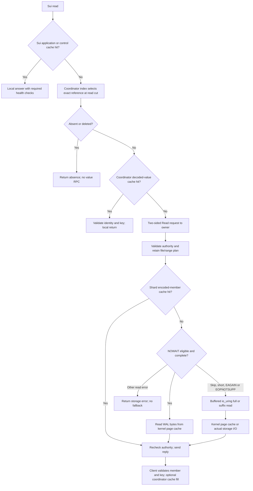
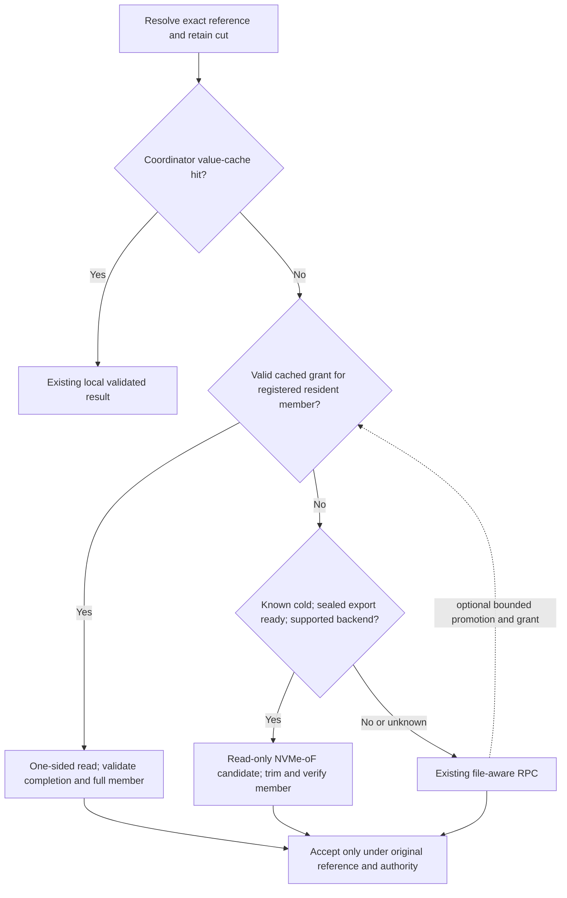

# Remote shard reads: EFA, registered RAM, UDP and selective NVMe-oF

Date: 23 October 2026. **Research and implementation plan only.** No runtime code, dependency, branch, benchmark or AWS resource was changed to produce this document.

## 1. Decision

**Keep the current distributed Value-WAL architecture and its committed source. Do not abandon it based on the reported 8 KiB/batch32 comparison.** That historical comparison changed the loaded dataset by a factor of ten. It does not isolate a source regression.

Separate three questions:

1. **Which bytes serve the read?** Coordinator RAM, shard-owned RAM, kernel page cache, or a physical device.
2. **How do bytes cross the network?** Current two-sided messages, proposed one-sided registered-memory reads, or an optional block-storage protocol.
3. **Which device/fabric supports that operation?** EFA/SRD and ConnectX with InfiniBand/RoCE are different platforms, not interchangeable provider labels.

Recommended scope:

- Preserve the existing coordinator index, complete-batch publication, shard-local physical WALs, durable acknowledgments and working TCP fallback.
- Correct workload matching and establish the CPU-buffer/provider latency before more broad tuning or full paid campaigns.
- Compare a thinner two-sided message path with a **bounded one-sided resident-memory path**. The latter is not implemented today.
- Keep ordinary file-aware RPC for unregistered page-cache hits, active WAL files, unknown residency and safe fallback.
- Evaluate **read-only file-backed NVMe-oF only for an explicitly eligible cold, sealed-file population**, after measuring local device service. It is optional, not the fallback for every coordinator cache miss.
- Keep EFA as the AWS baseline. Prepare a ConnectX/InfiniBand or RoCE comparison if EFA's measured native operation cannot meet the target or stock NVMe/RDMA is required.
- Do not add a production UDP transport by default. Userspace UDP/eRPC is a separate candidate, with ENA compatibility and reliable-RPC work that must be justified by measurements.

**Not established:** five-microsecond CPU-resident reads on the present EFA deployment, few-microsecond cold reads on its NVMe devices, native parity for every metric, or production readiness.

## 2. Source and evidence identity

| Item | Inspected identity |
|---|---|
| Engine checkout | `tidehunter-sharded-wal` |
| Current local branch | `fix/sui-cloud-node-deadline` |
| Local source | `405f3e3bc7304e089713f1e8b04e07aee8e92451` |
| Latest complete cloud campaign | [39877444431](https://github.com/Loris-EPFL/tidehunter-distributed/actions/runs/39877444431), run `th-5a518d12964cffb7` |
| Archived cloud engine source | `f83957aedd79ffb933af691cb3e1a00c1513b436` |
| Sui source | `6d4b704bb6b9af6e3d836e08ac3aa2161d443b2d` |
| Hardware | Six `g6.8xlarge`, Frankfurt `eu-central-1c`, cluster placement; five storage hosts plus controller |
| Storage executable SHA256 | `ef86f4dc64d7b34670bc9f45393572fa54acd3e70664a48be8d1077131847f06` |
| Raw/derived evidence | `project:checkpoint-work/native-wal-fastpath/aws-39877444431-analysis/` and sibling `aws-39877444431/artifacts/` |

`project:` means the parent of this engine checkout. Line anchors below describe the inspected source, not future APIs. Previous research verified the local runtime source against the archived source manifest; the latest campaign analysis preserves source/archive/binary identities separately. The current and recent partial campaign **all six packaged executable hashes are identical**, despite different source/archive manifest identities.

Chronology:

- [8 October cache/RDMA/NVMe-oF review](CACHE_RDMA_NVME_OF_DESIGN_2026-10-08.md): useful alternatives; its source and transport status are historical.
- [21 October one-sided design](ONE_SIDED_WAL_READS_2026-10-21.md): reuse its grant, fencing, DMA-quiescence and memory-accounting obligations. Its one-sided stages remain proposals. Its early Stage A hardware-status statements predate the completed campaign.
- This document updates path classification, workload comparability, platform feasibility and the next decision gates. It does not replace the native correctness inventory or relax the earlier grant rules.

## 3. Correcting the apparent 8 KiB regression

The actual command files, not case names, establish dataset size:

| Population | Load batches | Members/batch | Initial keys | Initial value payload | Random scalar samples | EFA scalar p50 |
|---|---:|---:|---:|---:|---:|---:|
| Older complete 39378783532 | 320 | 32 | 10,240 | 80 MiB | 4,096 | 60.924 us |
| Recent partial 39830242085 | 3,200 | 32 | 102,400 | 800 MiB | 4,096 | 113.233 us |
| Current complete, first clean repeat | 3,200 | 32 | 102,400 | 800 MiB | 4,096 | 111.206 us |
| Current smaller cold-family fixture, warm setup | 320 | 32 | 10,240 | 80 MiB | 4,096 | 55.052 us |

Sources: `project:checkpoint-work/aws-ci-runs/39378783532-1/controller-evidence/results/kv/storage-efa-current-v8192-b32-w32-r0-tcp-process.command.json:14-19`; current analysis `evidence-e3f8e665003153be/results/kv/` equivalent command; recent partial analysis `evidence/results/kv/` equivalent command. Oracle sizing is [benchmark:2188](../../tidehunter/examples/sharded_wal_bench.rs#L2188). The warm-footprint enlargement is in [checkpoint_kv.py:73](../../experiments/aws-sharded-wal/checkpoint_kv.py#L73).

The last row is the **pre-eviction `point_get`**, not `cache_evicted_get`, from current `cold-efa-current-v8192-b32-w32-r0`. It uses the same current executable/hardware as the enlarged row. It demonstrates substantial workload sensitivity without an older binary; phase/preparation differences still prevent attributing the entire difference to cardinality alone.

**Correction:** the previous generated report's historical matcher and “identical fixture” wording do not account for this load-count difference. Treat those rows as descriptive, not size-matched source-regression evidence. Do not use the reported percentage or normalization to select a rollback. Preserve the original evidence; a future analysis correction must add load cardinality, dataset bytes and command identity to matching.

Further confounders: Virginia versus Frankfurt, one versus three clean repetitions, different older source/lock/protocol identities, and `g6.16xlarge` in the recent partial run versus `g6.8xlarge` now. The current enlarged read latency is real; the cause of its working-set sensitivity is not isolated.

The diagnostic population is also different:

- Clean point reads use `mix(n) % oracle.len()` across the whole loaded oracle: [benchmark:1790–1857](../../tidehunter/examples/sharded_wal_bench.rs#L1790).
- Warm and reopened detailed reads take the first up-to-256 present keys sequentially, after earlier reads: [benchmark:1208–1278](../../tidehunter/examples/sharded_wal_bench.rs#L1208). The separate cache-evicted diagnostic uses pseudo-random queries and must be classified separately.
- Current diagnostics use 320 batches; the critical warm fixture uses 3,200.
- In the 8 KiB/batch32 EFA-native warm diagnostic, the 256 value RPCs visit only owners 1 and 4; the clean scalar interval visits all five.

A new component profile must match dataset size, key sequence, owner distribution, preceding phases and cache state. It must not substitute a small warmed prefix for the random workload.

**Branch disposition:** retain the committed implementation and evidence. Do not promote an unmeasured rewrite, but do not discard correct mechanisms because a different workload is slower. Future performance work should branch from the current compatible source, retain it as an A/B baseline, and use fresh matching datasets for older binaries. Experimental WAL/wire formats changed; never open new-format data with an older executable or revert isolated format files.

## 4. Exactly where current reads happen

### 4.1 Current route

The shard is **`PartitionLog` over native `Wal`**, not a complete native `Db` plus `LargeTable` index. It receives an exact reference; it does not perform a second key-to-value lookup. All owners use the same executable and algorithm with different database/partition/path configuration.

### 4.2 Distinct caches and what misses mean

| Layer | Stores | Hit/miss consequence |
|---|---|---|
| Sui execution/checkpoint caches | Objects, checkpoint summaries and selected control values/absence | Can bypass the storage adapter. Not counted as a Tidehunter coordinator-cache hit. |
| Coordinator `NativeIndex` | Versioned authoritative reference or absence | Chooses logical identity; its mapped base can itself fault. Not a value cache. |
| Coordinator `ReadCache` | Decoded member/key/value keyed by complete reference | Hit avoids value RPC. Zero budget disables only this cache. |
| Shard authority cache | Batch descriptors and complete-batch authority | Hit avoids cold metadata planning. Does not prove value residency. |
| Shard encoded-member cache | Encoded immutable member | Hit avoids member file I/O after authority planning. This cache was disabled in the audited cloud campaign. |
| Shard kernel page cache | File-backed WAL/metadata pages | Can satisfy NOWAIT or buffered async reads from RAM despite application caches being disabled. |
| Idle buffer pool | Reusable allocations | Buffer reuse is not a cached value. |
| Fabric registered slots | TX/RX packets | Not registered WAL, not a remotely accessible value cache. |

Coordinator absence comes from index/version selection, not a negative entry in its value cache. Sui has some separate cached-absence control slots.

### 4.3 Native versus distributed file reads

Native Tidehunter also uses RAM for many WAL reads. [Native `Wal::read`:377–415](../../tidehunter/src/wal/mod.rs#L377) reads a suitable mapping, checks the native frame CRC and copies payload; otherwise it performs a file syscall. Native `LargeTable` has its own value LRU and loaded/unloaded index paths. See [large_table.rs:547–659](../../tidehunter/src/large_table.rs#L547), [db.rs:453](../../tidehunter/src/db.rs#L453), and the paper's §3.2 [P1].

A file mapping or its `populated` flag does not permanently pin RAM. A mapped access can fault. A buffered syscall or `io_uring` read can hit page cache. Neither the word WAL, a mapping, nor an SQE proves physical NVMe I/O.

The audited launches and current deployment generator select `wal_member_read: async`, `read_resident_first: true`. Async is the policy default; resident-first is opt-in and defaults to false when omitted.

1. Authorize and pin the exact `RecordReadPlan`.
2. Try the shard encoded-member cache.
3. Try `preadv2(RWF_NOWAIT)` only within a per-owner-sweep bound: **four calls, 64 KiB requested bytes, 16 KiB maximum encoded member**.
4. Exact-length success returns initialized RAM-backed bytes without SQE/CQE.
5. Short success retains its initialized prefix and reads only the suffix asynchronously. `EAGAIN`/`EOPNOTSUPP` use an async full read. Other errors propagate.
6. An ineligible member or exhausted sweep budget goes directly async. A warm 32-member request can therefore submit many async reads without needing the SSD.
7. The file descriptors are buffered. Async completion may still be a page-cache hit; only physical-I/O evidence establishes device service.

The 8 KiB value's encoded member is 8,212 bytes, within the scalar bound. `mapped` and `positional` are separate synchronous worker policies; they are not one-sided memory or direct-device reads. Cache/resident-first configuration with a non-Async policy is rejected rather than silently converted.

## 5. What the five shards actually did

### 5.1 Configuration identity

All **860 KV owner launches** form 172 complete five-owner groups and use the same storage executable. All use two read workers, Async plus resident-first, zero shard value-cache budget, 32 in-flight requests, 64 MiB in-flight bytes, 128 logical asynchronous-read capacity and Adaptive polling. KV read-memory allowance is 512 MiB per owner.

Sui uses the same executable in **three namespace processes per host**, 15 across five hosts. Its source-bound constructor uses a 128 MiB allowance, different WAL geometry and an 8 MiB coordinator cache per namespace. The retained Sui receipts preserve command/process/config identities; not every namespace launch YAML body is retained. Do not present source-derived settings as independently recovered YAML for each process.

### 5.2 All-five-owner example

Current EFA-native, 8 KiB/batch32/window32, first clean repetition. Warm uses the enlarged dataset; cold uses the smaller cold fixture. All shard value-cache hits are zero.

| Owner | Warm WAL reads = NOWAIT successes | Cold WAL reads | Cold NOWAIT successes | Cold fallbacks = async submissions | Cold process physical-read delta |
|---|---:|---:|---:|---:|---:|
| 0 | 791 | 716 | 132 | 584 | 6,516,736 B |
| 1 | 834 | 849 | 152 | 697 | 7,692,288 B |
| 2 | 864 | 920 | 163 | 757 | 8,257,536 B |
| 3 | 794 | 785 | 135 | 650 | 7,122,944 B |
| 4 | 813 | 826 | 134 | 692 | 7,622,656 B |
| Total | 4,096 | 4,096 | 716 | 3,380 | 37,212,160 B |

Warm: coordinator 0 hits/4,096 misses, all members succeed NOWAIT, no async submissions. This is a remote **RAM/page-cache** value-read population. Warm physical-read brackets are not retained; label those process deltas unavailable rather than zero. Cold physical bytes are enclosing process totals, not per-request value-only bytes.

Sources: analysis `kv-read-path-deltas.csv`, `kv-read-io.csv`, raw `read_path_evidence.csv` and owner profiles. The cold phase is `cache_evicted_get`, not the preceding warm `point_get`.

### 5.3 Cache/cold labels are mixed populations

- All first-clean warm scalar shapes across four transports have 4,096 resident successes and zero async submissions.
- The 8 KiB/batch32 **cache-enabled** EFA-native scalar phase has only **321 coordinator hits and 3,775 remote misses**. Its phase latency is not a pure cache-hit latency. The budget is 8 MiB, not enough for its full value set.
- The 256 B/batch1 **cold-labeled** phase still has **4,062 resident successes and 34 async fallbacks**. The 8 KiB/batch1 cold phase has **3,776 successes and 320 fallbacks**. Advisory eviction does not make every sample disk-cold.
- A warm get-many example has deliberately deferred members submitted async. Do not label those submissions NVMe misses.
- Reopened diagnostics run after a full audit, clear the coordinator cache and leave shard pages warm. They do not establish cold-recovery read latency.

### 5.4 Real Sui fixture

The certified private-chain fixture is genesis through checkpoint 1775, not mainnet or a larger-than-RAM production dataset. All 16 Sui cells have zero process physical-read deltas across all five foreground-enclosing host brackets. Logical WAL reads and some async submissions still occur.

For first-clean EFA-native, cumulative foreground adapter observations are:

| Namespace | Coordinator hits / misses | Value RPCs | WAL members | Async submissions |
|---|---:|---:|---:|---:|
| `live/checkpoints` | 2,464 / 2,886 | 2,886 | 2,886 | 0 |
| `live/store/epoch_0` | 6,003 / 30 | 30 | 30 | 0 |
| `live/store/perpetual` | 3,886 / 301 | 25 | 301 | 224 |

These are cumulative adapter observations, not isolated per-call deltas. RPCs, members and cache probes have different units. Current Sui exports namespace sums of shard observations and **does not export per-owner NOWAIT outcomes**. Do not derive resident successes by subtracting async submissions from WAL reads. See [typed-store metric reduction](../../../sui/crates/typed-store/src/tidehunter_util.rs#L232).

**Consequence:** the current Sui fixture validates integration and resident/cache performance. It does not qualify the proposed cold NVMe-oF path. A cold path can have zero useful coverage on this replay; that must be reported, not hidden by a new backend label.

## 6. EFA versus ConnectX: what differs

EFA is an AWS network device using SRD; ConnectX is a NIC family supporting fabrics such as InfiniBand and RoCE. Compare an exact operation, platform and software stack, not brand names. [F1–F5]

| Aspect | EFA/SRD, especially current `efa-direct` | ConnectX with standard RC over IB/RoCE |
|---|---|---|
| Deployment | AWS-managed EC2 fabric; cluster placement affects topology | Requires a compatible NIC/fabric platform and network configuration |
| Loss/congestion | SRD multipathing and reliable delivery designed for shared cloud networks | Depends on transport, NIC generation and configured congestion/loss handling; RoCE operation is not simply an unmanaged UDP service |
| Operation order | Direct operations do not inherit generic RC ordering; explicit publication/completion rules are needed | RC supplies defined per-QP ordering; not arbitrary cross-QP ordering or full-object atomicity |
| Atomics | API capabilities can be emulated; do not assume native device atomics | Standard RC read/write/atomic operations are broadly available, subject to exact hardware/capability checks |
| One-sided read | Supported on eligible EFA hardware, including documented `g6.8xlarge`; not used by this implementation | Standard hardware RDMA-read path with matching registrations and keys |
| Software interface | Provider `efa`; fabrics `efa` and `efa-direct`; SRD driver QPs | Verbs/RC/RDMA CM integration with a broader stock RDMA application ecosystem |
| Current application | FI_MSG SEND/RECV; registered packet slots; frame/reorder/copy work | A future backend; not implemented or measured by this fork |
| Standard Linux/SPDK NVMe/RDMA | **Not compatible as-is:** their RC/RDMA-CM QPs differ from EFA SRD QPs | Appropriate platform class for stock NVMe/RDMA, after capability/configuration qualification |
| Small CPU-read latency here | Raw CPU-buffer provider baseline remains unmeasured | No matched same-workload current comparison exists |

Libfabric 2.6 distinguishes extra software protocols in fabric `efa` from more direct device operations in `efa-direct`. The current native-message mode already selects the latter. A provider name does not prove hardware RMA: future qualification must query read/write emulation, RMA size limits, registration modes and actual completions. [F2]

Published examples have important limits:

- eRPC's best CX5 number is a **32 B RPC over userspace Ethernet packet I/O**, not a RoCE remote-WAL read. [P2]
- UCCL's 2026 EFA guide discusses GPU communication and reports higher RTT experience; it does not supply the operation/load/statistic/version detail needed to declare a raw CPU hardware floor for our `g6` hosts. [F4]
- The DaMoN 2022 CPU study uses older c5n EFA versus separate ConnectX-5 hosts and reports average half-RTT. It is evidence that platform differences matter, not a current same-generation comparison. [F5]

**Decision rule:** do not declare EFA intrinsically bad from our 38 us Session RAM exchange. Also do not promise that SRD can reproduce a best-case ConnectX result. If warmed hardware `fi_read` or a minimal message exchange cannot fit the required budget on EFA, switch platform rather than spending further iterations on wrappers. Missing native atomics do not by themselves block read-only immutable WAL access.

## 7. UDP is a separate candidate, not an EFA layer

| Choice | What it means | Decision |
|---|---|---|
| Kernel UDP over ENA | Ordinary socket/IP path; no inherent RPC reliability, retry, deduplication or congestion policy | Optional read-only comparator, not an immediate replacement for the reliable storage protocol |
| Userspace UDP/eRPC over ENA | NIC polling and reliable RPC above packet I/O, not kernel UDP | Conditional experiment only after ENA queue-steering compatibility is proven |
| EFA `FI_EP_DGRAM` | Provider datagrams with separate limits/modes, not IP UDP sockets | Not a free low-latency replacement for reliable RDM; no default switch |
| EFA `FI_EP_RDM` / `efa-direct` | Current reliable SRD message path | Keep as AWS baseline and control/fallback for an RMA candidate |
| RoCEv2 | RDMA transport with UDP/IP encapsulation handled by the RDMA stack/NIC | Not equivalent to eRPC's application UDP protocol |
| TCP | Existing portable, explicit security-mode fallback | Keep usable on laptop and non-RDMA CI |

The ENA PMD supports userspace queues, RSS and low-latency TX queues. That does **not** prove eRPC's per-flow UDP-port-to-RX-queue requirements work unmodified on ENA. Its source installs specific flow rules and warns about missing NIC filtering. [U1–U3]

Do not stack UDP over EFA, silently downgrade a production EFA selection to software TCP, or treat an unreliable echo test as a reliable storage GET. An experimental UDP read must still validate request/response identity, full record identity and checksum, reject stale/duplicate replies, bound retries/timeouts, and preserve fallback/errors. No UDP WAL-write path is proposed.

ENA Express is a separate SRD-backed ENA feature, not EFA verbs; its eligibility and UDP settings must be recorded if tested. Do not attribute the previous `g6.8xlarge` EFA measurements to ENA Express. Use a separate ENA interface for userspace-driver experiments so that the management/export path is not detached. [U4]

## 8. Which paper mechanisms fit

These are source-backed mechanisms; transferring their latency numbers to AWS is not justified.

| Source | Published population | Adaptation here | Do not import |
|---|---|---|---|
| Tidehunter v2 [P1] | Local Value WAL, native cache/index and page-cache reads | Write once to long-term WAL position; resolve a reference then read member; preserve relocation/recovery rules | A claim that native warm latency is an SSD-device service time |
| eRPC [P2] | 32 B RPC median 2.3 us on CX5; low-load RAM Masstree GET median 2.7 us | Preallocated buffers, borrowed small messages, promptly polled exclusive endpoints, opportunistic batching, slow-worker separation | Its NIC-specific datapath as an EFA port; a universal latency constant; DRAM Raft results as SSD durability |
| HERD [P3] | RAM cache, approximately 5 us average at its reported high throughput | A single network round trip can still use the target CPU; avoid dependent remote-index reads | Old Mellanox UC/UD code or memory-arrival assumptions as EFA ordering guarantees |
| TeRM [P4] | 256 B mixed-residency p50 3.50 us / p99 30.07 us; fast Optane and 100 Gb/s IB | Resident one-sided access plus software miss service; buffered cache hits versus aligned direct-I/O misses | Modified Mellanox ODP/page tables; magic-pattern inference for arbitrary value bytes; treating its median as all-cold latency |
| CETOFS [P5] | Approximately 19 us single-threaded 4 KiB random read on Optane; cited passage does not identify a percentile | Cached location metadata, low-overhead target-side SSD command handling, preserve write-once intent | A belief that RNIC RDMA reads fetch files directly; a drop-in filesystem/storage backend |
| FaRM/FUSEE/F2 [P6–P8] | Registered/remote addresses, validation and reclamation mechanisms; differing RAM/persistence assumptions | Full reference plus incarnation, immutable publication, remote-reader lifetime and stale-location retry | New remote hash traversal when our coordinator already knows the address; unproved persistent-write guarantees |

TeRM is particularly relevant: it reads resident data one-sided, but a miss sends an RPC; the target reads into a registered bounce buffer and returns data. Its tiered I/O uses buffered reads for page-cache hits and direct I/O for uncached blocks. That is **not NVMe-oF**. CETOFS likewise still has target software issuing storage commands. [P4 §§4.1.2,4.3; P5 §3]

## 9. Proposed read dispatcher and eligibility

**All paths in this section are proposals except the existing local-cache and RPC branches.** Reuse the detailed resident-grant safety design [D1]; do not rewrite it as a bare address cache.

Do not interpret “no RMA grant” as “not in RAM.” Most current mandatory remote scalar reads are unregistered kernel-page-cache hits. An on-disk shortcut must not force them through the SSD.

An active WAL's committed member can use a separately valid immutable RAM grant; otherwise it remains on RPC. Only known-cold members in stable sealed exports enter the optional block path. A missing handle, stale export, oversize member, quota limit or unsupported transport returns to RPC at the original reference and cut; it is not NOT_FOUND.

Do not hide corruption or authority failure behind a successful retry, and do not expose active buffered/mapped files through a second block-write/visibility domain.

Initial resident layout: bounded preallocated host-memory regions containing immutable encoded members and a validated identity envelope. Reuse registrations across many reads; do not register the entire WAL or register each member on every get. Charge live, filling, revoking and quarantined regions, grants, handles, destination buffers and provider retention against explicit limits. A cache-evicted `Bytes` or local `Arc<File>` does not prove remote DMA stopped.

A cached grant can remove per-read control RPCs; a missing grant cannot honestly be described as a one-round-trip get. A bounded normal response may carry an optional handle. Publishing handles with append receipts is a later option only if it does not add mandatory registration/retirement latency to writes or violate publication/credit limits. Measure acquisition, renewal, eviction and reuse separately from handle hits.

For get-many, preserve one cut, duplicates, per-key errors and caller order. A complete batch API still waits for its slowest member; a fast individual RAM result does not imply a fast whole mixed hot/cold get-many. Keep cold work off the short network-owner path.

## 10. Selective NVMe-oF: exact scope and blockers

### 10.1 What the protocol does

An initiator sends an NVMe command to an exported namespace. The target handles the command, issues backing I/O, retains data buffers, and transfers data/completion back. Normal NVMe-oF is not an RNIC dereferencing a WAL file or executing arbitrary SSD reads without a target. “Zero-copy” can remove CPU copies while data still traverses registered host memory. [N1–N2]

A command/data exchange is not inherently fewer network exchanges than our current one-Read/Records RPC. Exact command/data/completion operations and CPU costs must be measured. Fabric switches/hops cannot be inferred from the logical protocol or cluster placement alone.

### 10.2 Standard RDMA transport does not run on EFA as-is

Linux `nvme-rdma` creates `IB_QPT_RC` queues through RDMA CM. SPDK's standard verbs provider uses `IBV_QPT_RC` and RDMA CM. EFA's SRD driver QPs do not supply that RC transport. Therefore:

- **NVMe/TCP over ENA** is a supported candidate on these EC2 hosts, separate from EFA.
- **Standard NVMe/RDMA** requires a compatible RC-capable platform such as an appropriate ConnectX/IB/RoCE setup.
- A custom EFA storage-command transport would be new target/initiator work, not stock NVMe-oF. Do not claim compatibility from `FI_READ` support or call a custom RPC “NVMe/RDMA.” [N1,N3–N5]

### 10.3 Narrow first experiment: existing sealed files, not raw filesystem blocks

A complete raw-block WAL redesign is not needed merely to study the idea. A **regular-file-backed, server-read-only SPDK AIO bdev**, exported with NVMe/TCP on AWS or NVMe/RDMA on a suitable platform, is a narrower candidate. SPDK AIO has an `O_RDONLY` option and rejects WRITE requests in its source. The Linux `nvmet` file backend inspected opens files `O_RDWR`; an initiator's read-only convention is not server write protection. [N6–N7]

This is a candidate, not a verified end-to-end configuration. Before use, pin a supported SPDK version and verify all modifying commands, not just WRITE: discard/unmap, write-zeroes, format and relevant administration must fail without changing the source file. Disable unsupported mutation capabilities and use read-only backing descriptors. Validate target failure and namespace teardown with in-flight reads.

Record the actual backing-FD flags. The inspected SPDK AIO open first tries `O_DIRECT` and can fall back to a buffered open; selecting AIO or NVMe-oF alone does not prove direct-device service. A cold-path qualification must verify the chosen mode and physical I/O, or classify buffered target-cache hits separately.

Eligibility contract:

1. The current authoritative index selects a complete committed member. Preserve full reference, original version, batch membership and exact byte bounds.
2. A real file-seal/rotation barrier proves no further writes, truncation or in-place replacement of the exported inode. An epoch label alone is insufficient.
3. Synchronize file contents and required namespace metadata before advertising an export. Never read active dirty mmap bytes through a second direct/block path.
4. Publish a bounded mapping `(boot/export generation, namespace identity, file identity, byte bounds, block geometry)` to the exact member range. File offsets are **not physical LBAs**. A file-backed namespace supplies its own block-to-file-offset abstraction.
5. Retain file/authority owners and an export grant through target I/O, network/DMA retirement and remote acceptance. Withdrawal/GC requires drain/revocation, not just timer expiry or path unlink.
6. Round aligned I/O safely, trim to the authoritative encoded member, and run the current member identity/checksum/key checks. Record actual bytes read versus value bytes returned; small or unaligned members can have substantial block amplification.
7. A stale mapping, unsupported alignment, unavailable namespace or capacity limit returns to the existing path at the **same** reference. Do not hide detected corruption or redefine the expected record to fit returned bytes.
8. Do not bind a device containing the mounted WAL filesystem to SPDK's userspace NVMe driver, export its live filesystem blocks as presumed stable extents, mount a non-cluster filesystem concurrently on multiple writers, or copy the entire Value WAL to another log just to make the test run.

Choose the reader through an explicit eligibility policy. Hints about residency are performance hints only; they can be stale. Unknown residency defaults to file-aware RPC. Export misses or zero eligible traffic must be visible in results.

A file-backed experiment preserves current file ownership and avoids a second durable Value WAL. Its filesystem/direct-I/O overhead may limit benefit. A later raw namespace/container backend would require new allocation, address mapping, rollover, crash recovery, export, GC and ownership rules; that is a separate architecture decision, not the default next step.

## 11. Correctness and security constraints

Reuse [D1 §§6–9] for the complete resident-grant protocol. Required for both bypass paths:

- Index/version selection, complete-batch publication and each shard's validated durable group frontier remain authoritative. Logical coordinator publication is separate from physical shard frontiers. A cached pointer, CRC or NIC completion does not establish either.
- No remote hash-table traversal, per-read global counter RPC, new global physical WAL, new consensus or replication guarantee is introduced.
- Preserve current full-reference, keyspace/full-key, bounds, tombstone, cancellation and error behavior. Retain logical cut pins independently of residency/export grants.
- New resident slots are immutable after publication. New namespaces retain stable immutable files. Reuse requires remote quiescence, not merely a local refcount reaching zero.
- One-sided reads bypass the current final target authority check. Add an explicit grant-revocation/fence barrier before acknowledging new authority or retirement. An unannounced poisoned target cannot be detected by reading a cached generation word alone.
- Late completions from an old boot, authority, grant, region, slot or namespace generation are rejected. Timeouts stop user delivery but do not release memory still reachable by hardware.
- If provider/MR/namespace teardown cannot prove safety, fail closed and quarantine bounded resources. The known libfabric-MR close/error caveat in [D1 §7.3] must not be worked around by reusing memory early.
- Preserve native recovery CRC and distributed member CRC, whole-batch authority and fsync/directory barriers. No read optimization acknowledges writes earlier.
- Keep named security modes explicit. Current trusted EFA-native is not application mTLS. A stock block namespace has different authorization granularity from a record RPC; restrict peer/namespace access and use the same declared trusted-peer scope, not an undeclared weakening. No BFT or per-read signatures are added.
- Recommend at-rest and in-transit protection for deployment, least-privilege namespace/IAM access and narrow security groups. Any intentionally unencrypted trusted performance comparison must be labeled separately, not reported as equivalent to mTLS. Export diagnostic/results data through the existing controlled path.

## 12. Exact source seams and repository impact

Paths are relative to this engine unless marked `project:`. These are existing seams, not a claim that proposed modules already exist.

| Existing source | Preserve / planned work |
|---|---|
| [remote_db.rs:2455](../../tidehunter/src/distributed/remote_db.rs#L2455), [pending_read/concurrent.rs:203](../../tidehunter/src/distributed/remote_db/pending_read/concurrent.rs#L203) | Keep logical index/cache resolution and public get/get-many behavior. Introduce bypass selection only after exact-reference resolution. |
| [remote_db/read_cache.rs:283](../../tidehunter/src/distributed/remote_db/read_cache.rs#L283) | Preserve cheap verified local hits. Bound any separate handle metadata; do not turn values into unversioned cache entries. |
| [pending_read.rs:1098](../../tidehunter/src/distributed/remote_db/pending_read.rs#L1098), [retention.rs:107](../../tidehunter/src/distributed/native_index/retention.rs#L107) | Retain caller-owned inline fallback, flight coalescing, admission and logical pins; add grant-aware completion ownership. |
| [storage.rs:1402](../../tidehunter/src/distributed/storage.rs#L1402), [reference_directory.rs:331](../../tidehunter/src/distributed/reference_directory.rs#L331) | Reuse exact authority, durable-frontier validation and pinned `RecordReadPlan`; metadata-cache misses are not value misses. |
| [read_executor.rs:404](../../tidehunter/src/distributed/tcp/read_executor.rs#L404), [read_executor.rs:618](../../tidehunter/src/distributed/tcp/read_executor.rs#L618) | Current shard cache/resident/async dispatcher. Instrument dispositions; preserve buffers and suffix ownership. Integrate bounded promotion without blocking the network owner. |
| [wal/mod.rs:458](../../tidehunter/src/wal/mod.rs#L458), [storage.rs:1729](../../tidehunter/src/distributed/storage.rs#L1729) | Existing file/range plans and retirement. Add only necessary seal/export/pin hooks; do not change native `Db` formats or assume file offsets are device LBAs. |
| [tcp/inventory.rs:75](../../tidehunter/src/distributed/tcp/inventory.rs#L75) | Extend admission/fencing with remote grant and export drains; existing local reader generation alone is insufficient. |
| [endpoint/resources.rs:140](../../tidehunter-fabric/src/endpoint/resources.rs#L140), [MR setup:375](../../tidehunter-fabric/src/endpoint/resources.rs#L375) | Negotiate real FI_RMA/FI_READ support; distinct owned source/destination registrations, RMA contexts/CQs, error and teardown semantics. Current registrations are SEND/RECV only. |
| [endpoint/efa_direct.rs:7](../../tidehunter-fabric/src/endpoint/efa_direct.rs#L7), [reactor.rs:129](../../tidehunter/src/distributed/tcp/reactor.rs#L129) | Compare packet/reassembly/copy layers and polling policy. Keep control credits and DMA lifetime; removing a fence requires a replacement proof, not just faster timing. |
| [codec.rs:460](../../tidehunter/src/distributed/codec.rs#L460), [types.rs:9](../../tidehunter/src/distributed/types.rs#L9) | Reuse complete checked members and references. New export/grant formats need explicit versioning, not aliases to old wire formats. |
| [sui.rs:946](../../tidehunter/src/distributed/sui.rs#L946), [sui.rs:983](../../tidehunter/src/distributed/sui.rs#L983) | Preserve Sui-facing API, authority checks, common cuts, caller order and per-key outcomes. No new Sui application/storage semantic change is required by this backend plan. |
| [typed-store metrics:232](../../../sui/crates/typed-store/src/tidehunter_util.rs#L232) | Small Sui instrumentation change may be necessary to retain per-owner disposition counters currently aggregated away. Pin/rebuild the linked engine; do not claim a sibling checkout is automatically used. |
| [benchmark profiles:1208](../../tidehunter/examples/sharded_wal_bench.rs#L1208), [clean reads:1790](../../tidehunter/examples/sharded_wal_bench.rs#L1790), [checkpoint_kv.py:73](../../experiments/aws-sharded-wal/checkpoint_kv.py#L73) | Correct cardinality/population matching, expose eligibility, use layered microbenchmarks and retain clean versus sampled-clock populations separately. |

Expected change footprint:

- **Distributed Tidehunter + fabric:** substantive read-backend/grant/ownership work; no claim of a trivial flag switch.
- **Inherited native engine:** only justified seal/pin/read hooks and the separately identified safety fix; retain original normal-read/write behavior.
- **Sui:** no new application API or checkpoint semantics. Possible narrow metrics export and engine dependency pin/build changes; document exact files if implemented.
- **Archived middleware:** no dependency, revival or edits.
- **Stock NVMe-oF:** an isolated external target/initiator experiment initially, not a new mandatory runtime dependency. Pin chosen versions and review license/unsafe ownership before integration.

## 13. Staged implementation and evidence gates

No stage below has been implemented or run as part of this document. Local software-provider checks can establish protocol/lifetime behavior, not EFA latency or independent-NVMe scaling.

The laptop has one shared SSD and no established EFA hardware. It can validate state transitions, real software-provider transfers and file/buffer lifetimes; it cannot rank inter-host NIC latency or independent-NVMe scaling.

### Stage 0 — repair comparability and safety prerequisites

1. Freeze the current committed source as baseline. Use a future dedicated performance branch from it; do not delete or overwrite the existing branch.
2. Add a workload identity including loaded batches, keys/value bytes, key sequence/seed, read order, cache budgets, value/member lengths, owner distribution, WAL geometry, polling, CPU/NUMA placement, feature/security/durability modes and exact binary hashes. A mismatch is “not comparable,” not a regression percentage.
3. Preserve both the historical small fixture and enlarged fixture as distinct named populations. Collect component samples for the same random full-oracle sequence and initial state as clean reads. Do not warm it with an earlier diagnostic pass.
4. Tag sampled operations with request/sample identity, namespace, owner, reference and actual cache/NOWAIT/deferred/async disposition. Keep clocks on one host or report unsynchronized spans independently. Do not invent one-way wire time from wall-clock subtraction.
5. Retain per-owner Sui counters and physical-I/O brackets. Measure authority metadata misses and value misses separately; isolate any background audit/recovery reads.
6. Review and resolve the native buffer safety issue in §15 before using affected cold/direct-I/O native paths as new controls. No paid performance qualification before changed-path correctness gates pass.

Clean timing runs keep detailed clocks/traces disabled. A bounded diagnostic twin uses the same cardinality, random key sequence, phase position and prepared state; measure its overhead separately. One-sided hits have no target-CPU handler span: mark that span not applicable, not zero. Do not use machine-wide cache dropping on shared hosts; advisory eviction must retain its measured residency/I/O qualification.

Exit: matching complete controls and source-bound trace coverage; all five owners and intended paths exercised, unsupported measurements explicitly unavailable.

### Stage 1 — qualify the hardware and latency budget

On a future approved small hardware run, compare the same warmed CPU buffers and operation sizes with fixed core/NUMA placement:

- Minimal provider message exchange, current direct-packet adapter, Session RAM exchange, and verified resident-WAL read.
- Adaptive versus Busy on **both ends**. Reserve progress cores; do not oversubscribe all namespace owners or starve I/O workers. Record CPU consumption as well as latency.
- Actual non-emulated hardware RDMA READ with queried caps/limits and proper source/destination registration. Use explicit data integrity and lifetime checks.
- Optional kernel UDP read-only comparison with equivalent payload/validation and declared reliability limits; userspace UDP only after its device requirements are established.

Record driver/firmware, instance/NIC, provider/fabric/API versions, message/RMA geometry, CQ/post behavior, registration/memlock use and completion scope. Compare full RTT/operation completion, not a tool's half-RTT printout against whole GET latency. Warm setup and idle-resume behavior are separate populations.

Exit: a measured provider/device budget. If raw EFA cannot fit the agreed resident target, stop repeating full Sui suites to tune unreachable wrappers. Qualify a ConnectX platform or explicitly revise the target; no automatic expensive instance upgrade.

### Stage 2 — thin two-sided resident messages

Apply only costs isolated in Stage 1: borrowed small RX handling, preallocated response storage, bounded message-aware buffers rather than unnecessary stream reassembly, opportunistic posts and prompt CQ progress. Exclusive owner and inline resident handling already exist; do not add them again under a new name. Keep cold metadata/I/O work on bounded workers.

Preserve corruption/error behavior, authority recheck, cancellation, credits and buffer retirement. Measure larger replies crossing the direct-message MTU and mixed hot/cold workloads. Resolve repeated resident work after late Full admission only with retained progress or a safe capacity reservation; keep unique logical completion and attempt counters distinct.

Exit: reproducible end-to-end improvement beyond variability on identical workloads, no hidden p99/throughput or byte-amplification loss, and no correctness regression. If it already meets the requirement, one-sided access is not mandatory.

### Stage 3 — bounded one-sided resident members

Implement the actual registration/post/CQ/error/teardown path first on a real software RMA provider for local correctness, then on qualified hardware. Reuse [D1] grant and authority barriers, not only its descriptor format. Keep unsupported operations explicit and the message fallback usable.

Cover handle acquisition and hit, missing/stale grants, capacity eviction, cancellation, partial/failed reads, reconnect, target/client failure, fencing and retirement. Quarantine uncertain teardown. Verify a returned native member against the original full reference; no hash/check bypass or shortened record.

Exit: correctness under failure and independent resident-hit performance with matched total memory budgets. Export handle-hit ratio and acquisition/revocation cost; do not hide these in warm-up or cache the whole dataset at the coordinator.

### Stage 4 — selective sealed-file cold reader, conditional

Proceed only when actual cold-I/O timing and eligibility show useful coverage and a plausible benefit over existing file-aware RPC.

1. Establish local sealed-member buffered and aligned direct-I/O service on the same files/device, plus the physical-I/O floor. Keep active-file reads on the existing path.
2. Verify a read-only file-backed target with no raw-device ownership conflict. Test all modifying commands and namespace/export failure/reuse behavior before any WAL use.
3. On AWS compare NVMe/TCP with current RPC; on a qualified RC platform compare NVMe/RDMA. A custom EFA NVMe transport is outside this initial scope.
4. Cache the stable export mapping under the existing reference/authority; retain file and grant lifetime through I/O and data-transfer completion. No per-read discovery RPC concealed from latency.
5. Report reads that truly used the backend, unaligned bytes, metadata/setup overhead, cold versus target-cache hits, CPU and failures. If eligible-path traffic is zero, the experiment does not qualify the design.

Exit: repeatable cold end-to-end gain with preserved semantics and acceptable tails, amplification, CPU, pinned memory and operating cost. Otherwise keep RPC as the cold path. Do not force a raw-block WAL rewrite to rescue a failed test.

### Stage 5 — one matched system matrix

Only after local correctness and the relevant hardware gates pass: one source-bound campaign with native, TCP, required EFA variants and the winning candidate, sequentially isolated on one fleet where supported. Rebuild all artifacts, retain full logs/results and verify exact-owned termination through the existing deadline/export/cleanup workflow.

Include 256 B/8 KiB and applicable larger sizes; scalar, grouped and concurrent reads; both historical/enlarged working sets; explicit coordinator hits, shard-cache hits, page-cache hits, registered hits, handle misses, true cold sealed reads, active-file fallback, skew/eviction churn and mixed hot/cold populations. Keep durable writes, batch atomicity, recovery and real Sui checkpoint full-state audits as regression gates. The short private Sui fixture alone cannot establish production cold-read behavior; a larger real trace is needed for that claim.

## 14. Targets and stop rules

These are proposed acceptance goals, not measured results or guarantees.

| Path | Goal / decision condition |
|---|---|
| 256 B/8 KiB coordinator value hit | Preserve sub-microsecond order and existing correctness; no network added |
| 256 B resident remote read | Target at most 5 us low-load p50 **only if** the measured native provider operation leaves room for lookup, verification and completion |
| 8 KiB resident remote read | Target at most 10 us low-load p50 on a qualified platform; account for negotiated RMA limits, transfer and integrity cost |
| Unregistered remote page-cache hit | Approach provider-RPC plus measured local member service; do not route to the SSD merely because no registered handle exists |
| Truly cold remote WAL read | Approach local aligned device-read service plus measured transport/command overhead; no universal 5 us promise |
| Batch/concurrent/loaded read | Report full API p50/p95/p99 and phase throughput together; no division of batch percentiles into fabricated per-key latency |
| Handle/export miss, reconnect and revoke | Explicit measured slow populations with bounded time/memory; no success-path-only claim |

Repeat clean runs with order rotation and independent controls; retain raw samples and enough observations for the reported tail. Treat target miss as a decision, not a reason to relabel buffered I/O as RDMA or remove safety. If the required raw EFA latency is unattainable, use an appropriate ConnectX fabric. If local NVMe service itself exceeds the desired cold-read budget, a network protocol cannot remove that service time.

Keep costs low: no campaign accompanies this plan. Future qualification starts small and bounded, not with repeated full replay fleets. Dedicated polling/target cores and registered RAM consume capacity; new backend administration adds maintenance cost. Use existing compatible hardware first, preserve the current weekly policy, export results before the absolute deadline, and terminate only exact-owned resources. Do not assume a larger GPU instance is a cheaper or lower-latency answer.

## 15. Static findings that must not be hidden

These findings were inspected, not reproduced by running code in this research task. No fix is applied here.

1. **Native buffer safety:** [file_reader.rs:20–34](../../tidehunter/src/file_reader.rs#L20) sets a `Vec<u8>` length before element initialization. Its direct-I/O branch adopts a 4096-aligned raw allocation into an ordinary `Vec<u8>` without preserving the matching deallocation layout or checking allocation failure. These violate the documented ownership/initialization requirements; review [Vec::from_raw_parts safety](https://doc.rust-lang.org/std/vec/struct.Vec.html#method.from_raw_parts). This predates the distributed optimization and is not evidence explaining its timing. Resolve before extending affected cold/direct-I/O controls; do not add a workaround around unsafe inherited code.
2. **Late Full can repeat resident work:** [read_executor.rs:638–787](../../tidehunter/src/distributed/tcp/read_executor.rs#L638) performs resident attempts before remaining async capacity checks. A later Full drops private partial progress; a retry can repeat it, especially with shard cache disabled. This is a source-backed performance risk under pressure, not an observed explanation of the scalar dataset comparison.
3. **Counter identity under pressure/errors:** attempt/success/deferred counters can advance before a Full/error while fallback counters advance only after async admission. Do not enforce `attempts = successes + fallbacks` as a universal live-snapshot invariant or count every successful attempt as a unique returned get.
4. **Measurement qualifications:** the historical matcher omits load cardinality; diagnostic key/fixture/owner populations differ; Sui loses per-owner resident detail; cold/reopened labels are not proof of physical device reads. Stage 0 corrects these before further claims.
5. **Documentation drift:** the old response-flush comment at [reactor.rs:2933](../../tidehunter/src/distributed/tcp/reactor.rs#L2933) describes an inventory-writer deferral no longer implemented. Use the actual short reader-authority recheck, not compatibility-zero clocks, for the design.

## References

- **[D1]** [One-sided registered resident WAL design, 21 October](ONE_SIDED_WAL_READS_2026-10-21.md), especially §§6–9. Later measured status is qualified in this document.
- **[P1]** [Tidehunter v2 paper](https://arxiv.org/abs/2602.01873v2), §§2.3,3.1–3.2,4.1–4.4; local [parsed paper](../../../papers/parsed/Tidehunter-2026-v2.md). QMD `#2a504a`.
- **[P2]** [eRPC, NSDI 2019](https://www.usenix.org/system/files/nsdi19-kalia.pdf), §§3–6,7.2; [pinned implementation](https://github.com/erpc-io/eRPC/tree/de83dab3eab4a0fb19bfc4881c11d4a6b89ff17d).
- **[P3]** [HERD, SIGCOMM 2014](https://istc-cc.cmu.edu/publications/papers/2014/herd_readable.pdf), §§3–5; QMD `#67e6a7`. Old reference code is design evidence, not an EFA-ready maintained service.
- **[P4]** [TeRM, FAST 2024](https://www.usenix.org/conference/fast24/presentation/yang-zhe), §§4.1.2,4.3–4.4,6.1–6.2; [implementation](https://github.com/thustorage/TeRM/tree/a94d44a59238d8d51266a7a2ea8bbf2daf3151d9). QMD `#7ccb34`.
- **[P5]** [CETOFS, FAST 2026](https://www.usenix.org/conference/fast26/presentation/jia), §§3–6; QMD `#cbbc59`. Public implementation availability was not established.
- **[P6]** [FaRM, NSDI 2014](https://www.usenix.org/system/files/conference/nsdi14/nsdi14-paper-dragojevic.pdf), registered-region addressing and lifetime rules; its loaded RAM lookup result is not a universal low-load bound.
- **[P7]** [FUSEE, FAST 2023](https://www.usenix.org/conference/fast23/presentation/shen), [code](https://github.com/dmemsys/FUSEE); stale-address/CRC/publication mechanisms have separate durability assumptions. QMD `#e69caa`.
- **[P8]** [F2, PVLDB 2025](https://doi.org/10.14778/3750601.3750615), [artifact family](https://github.com/microsoft/FASTER/tree/main/cc); log relocation/cache/truncation correctness, not an EFA performance result.
- **[F1]** [AWS EFA architecture and current instance capability table](https://docs.aws.amazon.com/AWSEC2/latest/UserGuide/efa.html).
- **[F2]** [Pinned libfabric 2.6 EFA provider manual](https://raw.githubusercontent.com/ofiwg/libfabric/v2.6.0/man/fi_efa.7.md); query actual hardware versus emulated operation support.
- **[F3]** [AWS SRD paper](https://ieeexplore.ieee.org/document/9167399); [NVIDIA RoCE documentation](https://networking-docs.nvidia.com/mlnxenswum/24040660/rdma-over-converged-ethernet-roce).
- **[F4]** [UCCL EFA programming guide, April 2026](https://uccl-project.github.io/posts/efa-programming/); [example](https://github.com/uccl-project/uccl/blob/main/experimental/misc/efa_rdma_write.cc). GPU-context RTT experience is not a matched raw CPU benchmark.
- **[F5]** [DaMoN 2022 EFA versus RDMA study](https://www.informatik.tu-darmstadt.de/media/systems/pdf_publications/DaMoN2022_EFAvsRDMA_extended.pdf). Older different platforms and half-RTT statistic.
- **[F6]** [AWS cluster placement groups](https://docs.aws.amazon.com/AWSEC2/latest/UserGuide/placement-groups.html).
- **[U1]** [DPDK ENA PMD](https://doc.dpdk.org/guides/nics/ena.html), queues/RSS/LLQ and userspace-driver prerequisites.
- **[U2]** [eRPC DPDK initialization](https://github.com/erpc-io/eRPC/blob/de83dab3eab4a0fb19bfc4881c11d4a6b89ff17d/src/transport_impl/dpdk/dpdk_init.cc).
- **[U3]** [eRPC UDP flow rules](https://github.com/erpc-io/eRPC/blob/de83dab3eab4a0fb19bfc4881c11d4a6b89ff17d/src/transport_impl/dpdk/dpdk_flow_rules.cc).
- **[U4]** [AWS ENA Express](https://docs.aws.amazon.com/AWSEC2/latest/UserGuide/ena-express.html), distinct from EFA.
- **[N1]** [SPDK NVMe-oF target guide](https://spdk.io/doc/nvmf.html), transports, host/target roles, core placement and security.
- **[N2]** [SPDK target programming guide](https://spdk.io/doc/nvmf_tgt_pg.html); [block-device guide](https://spdk.io/doc/bdev.html).
- **[N3]** [Linux NVMe/RDMA initiator](https://github.com/torvalds/linux/blob/master/drivers/nvme/host/rdma.c), RC/RDMA CM queue creation.
- **[N4]** [EFA kernel verbs implementation](https://github.com/amzn/amzn-drivers/blob/master/kernel/linux/efa/src/efa_verbs.c), supported QP types.
- **[N5]** [SPDK verbs provider](https://github.com/spdk/spdk/blob/master/lib/rdma_provider/rdma_provider_verbs.c), RC/RDMA CM queue creation.
- **[N6]** [SPDK AIO bdev](https://github.com/spdk/spdk/blob/master/module/bdev/aio/bdev_aio.c), read-only open, write rejection and file-backed I/O. Re-pin/review the selected version before integration.
- **[N7]** [Linux NVMe target file backend](https://github.com/torvalds/linux/blob/master/drivers/nvme/target/io-cmd-file.c), regular-file support and open mode.
