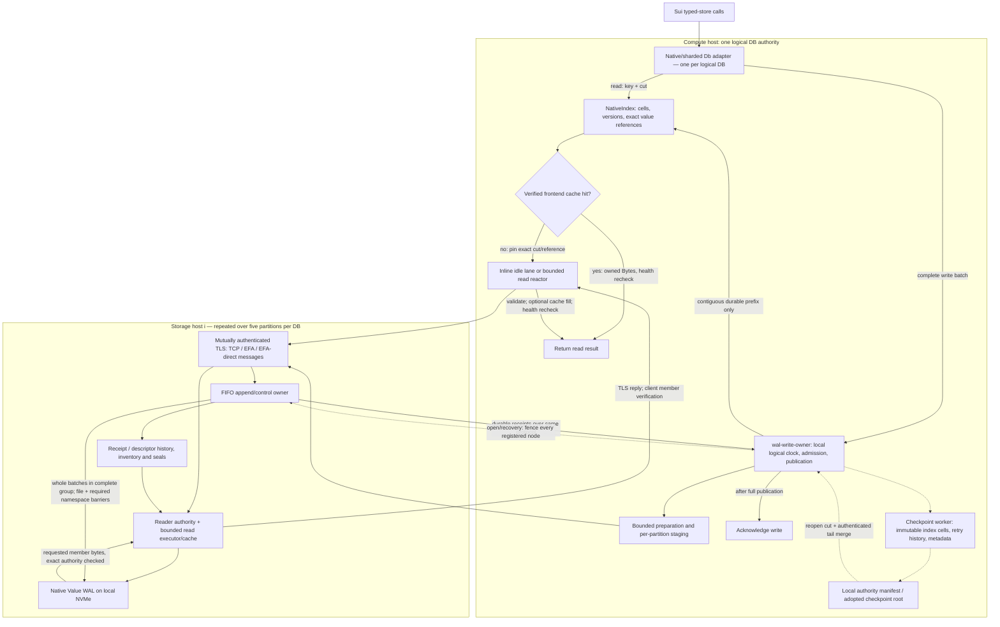

# Distributed Tidehunter — supervisor brief, 20 October 2026

**Meeting version: local, uncommitted briefing.** Source-inspected architecture, retained AWS measurements and newly completed hosted correctness checks are separate evidence. No new AWS campaign was launched for this work.

## 1. The two-minute pitch

We are testing **one logical Tidehunter database with a compute-local reference index and cache, backed by independent remote Value WAL partitions**. It is not a cluster of unchanged, complete native Tidehunter databases, and it is not one physical WAL shared by all machines.

- Sui uses a real typed-store adapter. Each logical database has one coordinator authority: it assigns logical batch versions, places complete batches on storage partitions, and publishes their references in order after durable receipts.
- A read resolves the key locally. A valid frontend-cache hit needs no network or Value WAL read. A miss carries the exact published reference to its owning storage partition; it does not first query a remote key index or broadcast to every partition.
- Each storage partition uses native Tidehunter `Wal`/`WalWriter` machinery on its own disk, plus receipt/descriptor authority and recovery metadata. It does **not** instantiate a complete native `Db`/`LargeTable`.
- Whole application batches are placed on **one** partition. Independent batches can persist concurrently on different partitions; one per-database contiguous publication prefix prevents a later completed batch from becoming visible/acknowledged past an unresolved earlier batch.
- The latest closed campaign shows useful parallel-storage behavior and near-native throughput in one large durable-write shape, but **remote resident misses remain tens of microseconds, not native sub-microsecond reads**. Cache hits already attain sub-microsecond KV service. Direct EFA is not uniformly faster than ordinary EFA.
- This remains **static RF1, one controlled authority per logical database**. There is no demonstrated data replication, consensus, coordinator election, automatic failover, or survival of lost instance-store values. Implemented retention can delete wholly unreachable older sealed WAL files; live-value copy relocation/packing remains absent.

**Architecture classification:** an **A-like centralized-primary design, substantially modified below the primary**. It retains A's central indexed/cached entry point, but replaces independent full-`Db` key shards with batch-placed Value WAL partitions and a coordinator-owned reference index. It is neither B's broadcast-on-read design nor C's coordinator-free design (§4).

## 2. Provenance, repository map and physical deployment

### Repository and publication cut

Published benchmark identities are immutable provenance for the results below. A later fix branch is not the source that ran in that campaign.

| Repository / local directory | Current local and published fix branch | Current fix-branch HEAD (verified on GitHub) | Published benchmark revision / status |
|---|---|---|---|
| Engine: `tidehunter-sharded-wal/`, origin `Loris-EPFL/tidehunter-distributed` | **`fix/ci-benchmark-retries-2026-10-20`** (formerly local `fix/ci-termination-reconciliation-2026-10-20`) | [`b7123d6653b2b690a72fe5db8fcbdfb0419784e2`](https://github.com/Loris-EPFL/tidehunter-distributed/commit/b7123d6653b2b690a72fe5db8fcbdfb0419784e2), GitHub author and committer `Loris-EPFL` | [`bench/aws-efa` at `b3ca2f03c5d7e3274f2aa22d7543b5b82bbefcee`](https://github.com/Loris-EPFL/tidehunter-distributed/tree/b3ca2f03c5d7e3274f2aa22d7543b5b82bbefcee). Runtime inspected from reviewed `8a8fa354…`; retained report records identical reviewed/published trees. The later three-file CI retry/integrity/guide change is **not** a new benchmark result. |
| Sui: `sui/`, origin `Loris-EPFL/sui-tidehunter-distributed` | **`fix/sui-cache-metrics-cardinality`** (formerly `refactor/distributed-nvme`) | [`6d4b704bb6b9af6e3d836e08ac3aa2161d443b2d`](https://github.com/Loris-EPFL/sui-tidehunter-distributed/commit/6d4b704bb6b9af6e3d836e08ac3aa2161d443b2d), GitHub author and committer `Loris-EPFL` | [Measured Sui `3261f3be974c941584014438159110140a2885a7`](https://github.com/Loris-EPFL/sui-tidehunter-distributed/tree/3261f3be974c941584014438159110140a2885a7). The separately published collector fix and focused hosted workflow are **not** included in these measurements. |
| Historical middleware: `archive/middleware-legacy/`, `archive/middleware-fabric-candidate/` | Archived comparison material only | No deployed archived source SHA established here | Not current dependencies or runtime paths. Do not use archive code as evidence for the new backend. |
| Papers / experiment evidence in the containing project | Not engine runtime repositories | Local retained source/evidence | `papers/parsed/`; `checkpoint-work/aws-ci-runs/39378783532-1/`. |

**The brief remains local; both source fixes are published.** No PR, protected benchmark-branch update, benchmark-variable change or AWS launch occurred. Both non-paid hosted checks completed **success**: engine run [39436028955](https://github.com/Loris-EPFL/tidehunter-distributed/actions/runs/39436028955), **7/7 jobs**, including 383 native library passes and 777 distributed library passes; Sui run [39435929645](https://github.com/Loris-EPFL/sui-tidehunter-distributed/actions/runs/39435929645), **34 tests passed**, none failed or ignored, and formatting passed. The engine suites retain their reported ignored cases; software-provider coverage is not EFA hardware coverage. Runtime source links in §11 remain pinned to measured revisions. The benchmark branch and its Sui pin remain `b3ca2f03…` / `3261f3be…`; publication does not alter old benchmark provenance.

### What runs where

The successful [workflow 39378783532](https://github.com/Loris-EPFL/tidehunter-distributed/actions/runs/39378783532) used six On-Demand `g6.8xlarge` hosts in `us-east-1a` with **cluster placement**:

1. **One controller/compute/native host:** orchestration, paired native control, Sui process and its distributed coordinator state. The native control selects native `Db` from the **same frozen fork/engine source**, not a freshly unmodified, separate MystenLabs checkout. Native/distributed cells are comparison populations, not a replicated pair.
2. **Five distinct storage hosts:** the deployment configures five partition endpoints **for each logical database**, with separate namespace/epoch partition logs and storage services sharing those hosts' selected NVMe. A host is not synonymous with one namespace, one partition-log instance or one process. The three Sui database authorities can use the same five hosts without sharing one logical order or one physical WAL namespace.
3. Each selected `/mnt/tidehunter` filesystem was verified as ext4 on `/dev/nvme1n1`, EC2 instance NVMe. This proves the selected disk, not striping over both advertised NVMe devices. Process swap and recorded host swap deltas were zero.

The fixture exercises three separate Tidehunter databases: `live/checkpoints`, `live/store/epoch_0`, and `live/store/perpetual`, containing **57 tables/keyspaces** in total. Exact canonical relative paths select their configurations; a missing namespace fails closed. Each has its own database identity, clock, index, manifest and publication history. There is **no single engine-wide logical counter across these Sui databases**.

**Placement groups are an AWS deployment property.** The application still needs explicit endpoint/inventory configuration and a selected transport; cluster placement does not create application-level replication or change the WAL protocol. All six hosts and the campaign-owned auxiliary resources were removed; this brief uses retained evidence, not a live fleet.

### One data/control-path diagram

Solid arrows are serving data/acknowledgment paths; dotted arrows are checkpoint/recovery control. The diagram expands one logical database and one representative storage partition. There is no shard-to-shard read broadcast, shared network allocation counter, one-sided WAL fetch, or second application-value database hidden behind the WAL.

## 3. Native Tidehunter baseline: what is preserved, what changed

The native paper's central principle is to keep values in their long-term WAL positions and manage small indices separately. In [the native paper](../../../papers/parsed/Tidehunter-2026-v2.md), §2.3 line 103 says **“The WAL remains shared (writes are serialized only at allocation), but index operations parallelize across shards.”** Those “shards” are native **index cells within one database**, not independent remote machines.

| Native mechanism | Inspected native implementation | Current distributed adaptation |
|---|---|---|
| Value WAL plus separate Index Store | Native `Db` owns `WalKind::Replay` and `WalKind::Index`, `LargeTable`, writers and control state. Atomic allocation reserves local physical bytes; mmap writes and guard tracking precede index completion. | Storage partitions retain native physical WAL machinery; the coordinator owns an **adapted** native-cell reference index, not unchanged `LargeTable` moved over a network. No duplicate long-term user-value store. |
| Tiered reads | Paper §3.2: value LRU, Bloom/index lookup, then Value WAL; persisted native cells support optimistic lookup. Native reads still use row locks. | Coordinator resolves the authoritative reference before its exact-reference cache lookup. Misses fetch one referenced member remotely. Native paper cache order is not copied verbatim. |
| Complete batch replay and frontiers | Paper §3.1 and native `wal_replay.rs`: complete batch framing; processed-position tracking is separate from allocation. | Complete canonical batches plus outer persistence groups; explicit authenticated durable receipts; separate dense logical durable/published prefixes. |
| Snapshots and suffix replay | Paper §§3.3–3.4: cell index positions and replay minimum, then suffix reconstruction. | Immutable reference-index images, pageable retry history and checkpoint roots; all-node fencing and logically merged sealed tails. |
| Relocation/GC | Paper §4.4: append retained live values at the tail, conditional index replacement, then file GC. | Stop-aware historical pruning, pinned floors and wholly unreachable older sealed-file retirement. **No current live-value copy/packing relocation.** |

Native paper §3.1 line 119 explicitly distinguishes page-cache/application-crash persistence from kernel-crash durability requiring explicit synchronization. The benchmark's native control is native `Db` selected from the **same frozen fork/engine source** as the distributed comparison, not an independently refreshed/unmodified upstream checkout. It adds foreground durability barriers (`TH_SYNC_WRITES`); ordinary native default writes and durable distributed writes must not be compared as if they had identical acknowledgment contracts by default. Paper §5's historical worker count is also not the current source's worker count.

## 4. A, B or C? Exact design-note comparison

The complete [49-line design note](../../../papers/parsed/Distributed-Tidehunter-2026-06-Design-Note.md) was read, including decoding and inspecting **both embedded diagrams** at lines 9 and 35. Line 9 shows Primary → Cache → Load Balancer → three Tidehunter nodes. Line 35 shows caches/dispatchers on each of three shards with inter-dispatcher paths. The large embedded image lines were not treated as omitted prose.

**Answer: qualified A-like hybrid, not a literal implementation of any option.** “Hybrid” here describes differences from A, not a claim that B/C routing is also implemented.

| Design-note statement | Mapping to current implementation |
|---|---|
| **A, line 11:** “each backed by its own standalone Tidehunter instance”; “single entry point”; “knows the full sharding scheme”; Primary operates a cache. | **Central entry point/index/cache: yes, per logical DB. Standalone full native shard databases: no.** Storage constructs `PartitionLog` with native `Wal`/`WalWriter`; coordinator `NativeIndex` maps keys/versions directly to full physical references. |
| **A load balancing, lines 15–19:** monitor shard load and adjust key-to-shard mapping; fragmentation motivates alternatives. | **Not implemented as described.** Static inventory deterministically hashes the original batch operation ID to a partition. No inspected load-aware migration, changing range map, or live repartitioning. The key-reference index itself remains central and must scale; removing the mutable range map does not eliminate index metadata. |
| **A atomicity, line 25:** “each batch is directed to a single shard”; this proposal “assumes keys are write-once”. | **Whole-batch placement: yes. Write-once requirement: no in current implementation.** Overwrites/deletes are logically versioned; a later batch may place the same key's new value on another partition. The central index selects the newer reference. Placement is not a per-key home shard or admission round-robin contract. |
| **A atomicity, line 27:** batch header/count, standalone keys tagged by ID, cross-shard recovery discards incomplete batches. | **Not the active format/protocol.** A whole application batch remains in one outer recovery group on one stream. Group “members” are whole batches for the same partition; they are not cross-shard commit participants. No split-batch counting protocol or cross-shard 2PC is established. |
| **B, line 31:** Primary “no longer knows which shard holds which key”; reads “broadcasts the request to all shards”; writes to least loaded shard. | **No.** Central index knows the exact current reference, and a miss targets its partition. Current placement is stable operation-ID hashing, not least-loaded selection. |
| **C, line 37:** “no central coordinator at all”; any shard can be an entry point. Lines 41/45/49: random write forwarding and read broadcast. | **No.** There is a controlled coordinator authority and local serving index. No random shard-to-shard forwarding or all-shard point-read broadcast. |

### Original middleware versus the current boundary

The archived original middleware demonstrates independent full native databases: `ReadShard` owns `Arc<Db>` and calls `Db::open` for each shard. `UniformPrefix`/`RoutingTable` choose a worker from the **user key**, and clients/gateways forward to that worker. Each native shard therefore owns its own key index, Value WAL, Index Store and native lifecycle. Some later archived managed participants also open separate user-data and metadata native databases; the entire archive was not merely a thin router.

**Now local at each storage host:** physical Value WAL allocation, append framing, file persistence, descriptor/receipt authority, local read/cache/I/O execution and sealed-stream ownership.

**Now coordinated across the logical DB:** logical versions, key-to-value references spanning partitions, ordered durable publication, exact retry decisions, checkpoint cuts, recovery merge, retention floor and global retained-reference reachability. The global reference index is a distinct experimental format using native cell routing, pending transactions and sorted-search primitives. The native `LargeTable`/index formats remain separate and unchanged by this adaptation.

This trades a cluster of independent key-owning stores for **centralized logical index/control plus distributed physical value persistence**. It does not remove the coordinator scaling/failure boundary.

## 5. Addressing, ordering and WAL namespaces

The distinction is operationally important: a logical position does not say where bytes live, and allocation does not prove durability or publication.

| Domain | Actual type / fields | Meaning and scope |
|---|---|---|
| Operation identity | `BatchId { database: [u8;16], operation: [u8;16] }` | Stable original identity for exact retries. |
| Current writer authorization | `RequestAuthority { epoch: u64 }` | Current fenced epoch, separate from the original mutation version; database/partition are supplied by the enclosing registered authority. |
| Logical batch order | `BatchVersion { epoch: u64, sequence: u64 }` | Order **within one database**; unrelated databases are unordered. The serialized authority plans versions from `submission_next()`; `admit_prepared()` checks that next version, then checks `self.clock.allocate()` agrees (`remote_db.rs:1407–1416,1463–1469`). Thus `LogicalClock` is wired local checked-`AtomicU64` bookkeeping, not an independent network sequencer, consensus, distributed atomic counter or persistent durability frontier. |
| Within-batch order | `MutationVersion { batch, operation_index: u32 }` | Resolves repeated-key mutations within a complete batch. |
| Physical batch address | `PhysicalValueAddress { partition: u32, segment_generation: u64, offset: u64, len: u32 }` | Names a physical complete-batch frame in the enclosing database's inventory. RemoteDb uses `segment_generation = epoch`; an epoch stream can contain many native WAL files. |
| Native physical position | `WalPosition { offset: u64, len: u32 }` | Unchanged native local-WAL address. It carries no database/partition identity. Offsets from different partitions are **not comparable logical order**. |
| Serving reference | `ValueRecordReference { batch_id, batch_version, batch_digest, batch_address, descriptor }` | Exact published member; descriptor includes operation index, keyspace ID, bounds and member digest. A reference alone proves neither durability nor a retention lease. |
| Progress | `DurableBatchPrefix`, `PublishedBatchPrefix` | Separate database/epoch-bound exclusive `next_sequence` frontiers. They are not physical offsets. |

### What is physically stored

- **Native single-host Db:** one Value WAL namespace (`WalKind::Replay`, native `wal_<file-id>` files) and a separate native Index Store (`WalKind::Index`), plus control metadata. Shared native allocation is local to this Db.
- **Remote storage partition:** database/partition registration, epoch directory (`epoch_<hex>/`), native WAL files, partition registration/seal, descriptor/reference authority and exact receipts. The current node inventory is `tcp-node-inventory-v1`; storage metadata includes `storage-history-root-v1` and `storage-history-v1/{nodes,receipts,descriptors,retired}.pages`, plus file-inventory witnesses.
- **Coordinator directory:** `tcp-database-authority-v1`, checkpoint metadata, reference-index roots/immutable `.cells` containers, and `receipt-history-v2`. This is index/control/retry authority, **not a second full-value WAL**.
- The canonical application batch in the storage Value WAL contains original identity/order, operations and digest. Its inner complete-batch frame is enclosed by the complete group frame. Receipt addresses identify that inner frame; member offsets then identify independently readable records within it. Inner valid bytes alone do not authorize recovery.

“Globally ordered” below always means **database-wide logical order across that database's partition streams**, not one physical cluster WAL or one order across all Sui namespaces.

## 6. Implemented serving paths

### Read: local cache hit

1. Typed-store resolves the exact database namespace and calls `distributed::sui::Db` → `ConcurrentRemoteDatabase`.
2. Check the authority/read-service failure state. Under a short `index.read()` guard, resolve the requested key and cut to an authoritative `ValueRecordReference`; absence can return locally.
3. Under the frontend cache mutex, look up the **entire exact reference**, then verify requested keyspace/key association. A scalar hit retains the value's `Bytes` owner and needs no allocated retention pin for asynchronous work.
4. Release guards, recheck observed health, return. **No network, Value WAL read, disk read or persistence is required by this hit.** This is still lock-based: index read guard plus short cache mutex. It is not a bypass around reference authority.

The cache is bounded and derivative, private to an open authority, and starts empty after replay. It can fill from verified reads and eligible post-publication writes; Sui has a specific protected `certified_checkpoints` policy and excludes some producer-metadata warming. It is not a write-back durability mechanism. Local health validation observes known failures; it is not a remote liveness/corruption probe on every hit.

Sui also has an **application-level** checkpoint sequence-summary demand cache and control/watermark cache. Sequence-cache lookup releases its short lock before typed-store loading, uses refill tokens, checks pruning eligibility and validates the backend before returning cached results. Do not combine this cache with frontend exact-reference cache, shard encoded-member cache, mmap residency or the OS page cache in one “cache hit” statistic.

### Read: cache miss

1. Pin the resolved logical cut/reference while still under index authority. Release index/cache guards **before** any network wait.
2. Map `reference.batch_address.partition` to its configured endpoint. Scalar blocking gets first try caller-owned progress on an idle lane; otherwise bounded reactor lanes/credits, deadlines and singleflight handle the request. This is not one new connection/thread per get.
3. The storage service checks active epoch/reader authority and exact descriptor membership, pins the underlying log/file ownership, and plans the member read. It can use the shard cache/resident WAL service or bounded asynchronous I/O; mapped/positional paths also exist. A logical WAL read does not necessarily issue NVMe I/O.
4. Before queuing the reply, the server rechecks captured reader authority; fencing/poison invalidates the response. Client decoding checks the member's bounds, digest and decoded descriptor; mTLS authentication and integrity digests have different jobs. Unkeyed digest agreement alone is not caller authorization.
5. After successful completion, recheck health and requested key association, fill the bounded exact-reference cache when admitted, then return. Uncertain/fatal serving failures poison the authority instead of serving around them from stale cache.

Bulk gets resolve **up to 256 keys per bounded window** and group misses per partition. Large multigets retain one protected published cut across windows, preserve caller order and per-key errors. Iterators use pinned cuts and bounded pages; hash-keyspace enumeration is reduced-key order, not a promise of arbitrary application-key range order.

### Write, durability, publication and acknowledgment

1. The adapter builds a complete batch. Its local operation identity counter is separate from the authority's logical version clock. Bounded request/byte credits cover queued ownership through publication; admitted payload ownership is detached from potentially oversized caller allocations.
2. The single `wal-write-owner` validates/prepares the batch and reserves capacity. Versions are planned from `submission_next()` under serialized authority/admission; `admit_prepared()` validates the exact next epoch/sequence and calls `self.clock.allocate()` as its checked local allocation step. Placement hashes all 16 original operation-ID bytes with the stable FNV-style rule into the static partition vector. **Every mutation follows that one selected partition**, regardless of key/cell/keyspace. Overwriting a key in a later batch can therefore change its owning physical partition.
3. Bounded preparation and per-endpoint client workers overlap independent work. Ready whole batches for the **same partition** can share a `CompleteGroup` and barrier. One group occupies one native allocation in one fragment. It is not striped across the five hosts, and group members are not distributed-transaction participants.
4. On the network storage node, `value-wal-control` is the FIFO append/control owner. It validates current epoch/inventory and every member's partition, appends through `PartitionLog`'s native writer, then persists the exact group. Only **one unpersisted group per physical stream** is permitted: later durable work must not sit behind an earlier potentially torn group on that stream.
5. The persistence path validates exact receipts, synchronizes the actual containing WAL file (`sync_data`), establishes required exact-file namespace/witness persistence (`sync_all` for directories), then release-publishes the durable physical end. Mmap copy, dropping a native processed guard, successful enqueue, EFA send completion or returned physical allocation is **not** a durable acknowledgment.
6. Authenticated durable receipts may arrive from partitions out of logical order. `PublicationTracker` advances only the contiguous durable prefix. Under **one `index.write()` guard**, prepared native transactions install each complete batch's member references, commit/promote them, and advance ordered publication. Post-publication cache warming occurs afterward.
7. The concurrent owner replies only once the batch is below the published prefix (or an exact recovered older outcome is known). A later shard cannot acknowledge past a gap. Timeout/lost reply is **unknown**, not an abort; preserve identity and recover exact outcomes rather than reuse the version or skip the hole.

### Exactly what “atomic visibility” means here

The implementation protects all mutations of **one complete application batch**, including multiple native index cells/keyspaces, with one native transaction and the outer index write guard. A concurrent single read or cut capture cannot observe cell-by-cell partial publication. A bounded multiget's one guarded resolution, or a longer multiget/iterator's pinned cut, gives a coherent supported read cut.

This does **not** turn arbitrary separate scalar gets into one snapshot; two calls may straddle publication. It does not provide cross-database transactions, arbitrary multi-batch atomicity across partitions, serializable application transactions, or a cross-shard commit/replication protocol. A key previously living on another partition does not make its new whole-batch write a split cross-shard transaction. Native paper batch **recovery** atomicity, storage group completeness and live publication atomicity are related but distinct claims.

## 7. Recovery, checkpoints, retention and fencing

### Reopen and failure handling

- Acquire the coordinator authority-directory lock, validate schema/inventory and connect all required endpoints. The lock uses local path/process exclusion and `fcntl`; it is **not a distributed lease** authorizing concurrent copied coordinator directories.
- Durably reserve an **inactive fresh epoch before fencing any node**. Fence every registered endpoint, require old epochs sealed and the new epoch active. Only after all fences can checkpoint/tail reconstruction activate the authority and instantiate its new clock/tracker. A partial fence consumes the reserved epoch; a later reopen advances again.
- Node restart does not resume the previous counter: preparing epochs become abandoned and old active/sealed logs undergo sealed recovery. Complete outer groups from registered fragment boundaries are recovered; incomplete groups are not authorized by valid inner frames. Complete surviving but unacknowledged groups can be retained and later resolved as successful exact retries.
- Validate checkpoint metadata/index digests, cut, cell-file inventory, retry root and fresh per-shard proofs; perform bounded per-node tail paging and a K-way merge by logical version, rejecting conflicting identities/versions. A missing RF1 partition prevents complete recovery.
- Fresh file-inventory witnesses detect a missing acknowledged suffix file. This is detection/fail-closed behavior, not data repair. The torn-tail fault model does **not** claim repair of arbitrary corrupted durable data.

### Live checkpoint versus durable recovery checkpoint

`checkpoint()` creates a protected logical read cut; it is not itself a backup or a newly durable recovery image. `flush_index()`/checkpoint lifecycle perform durable capture → persistence → adoption:

1. Freeze an exact published cut and reserve filenames with a durable staging intent.
2. Background work persists exact retry history, per-stream receipt-prefix proofs, immutable index cells/root and checkpoint metadata.
3. The owner persists the new authority-manifest root **before** adopting the image/releasing covered state or cleaning files. Exact captured-reference unmerge preserves writes/deletes/new cells that arrived after the cut.

Admission bounds the uncheckpointed tail to **1,024 batches / 64 MiB**, with earlier background triggers and metadata-pressure backpressure. These are tail/resident bounds, not a claim that lifetime disk history is bounded. Physical value bytes remain in partition WALs; a coordinator directory copy alone is not a valid distributed backup.

### Actual GC: more than “no GC”, less than full relocation

Current code supersedes older blanket “no GC” descriptions:

1. Sui `start_relocation()` scans **retained historical puts**, including overwritten Stop values, to find the earliest `StopRelocation` batch. It emits durable tombstones for eligible current `Remove` rows and applies per-cell compaction decisions.
2. It protects the **entire** Stop batch, computes a supported-history floor, and hands retirement to the drained authority owner. Reader pins clamp the floor; newly requested already-expired/conflicting cuts fail rather than silently reading reclaimed history.
3. Compacted index images retain an anchor at/before the floor (including tombstones) and all later versions. Reachability examines all retained Put references, including destroyed keyspaces, not merely latest heads.
4. Only wholly unreachable native files in **older sealed epochs** are eligible. The node requires current authority, sealed-stream status and complete rooted receipt proof; retirement is durably recorded before unlink. Existing mapped/file owners remain pinned, and recovery can finish interrupted authorized unlink.

**Implemented:** supported-history retention, immutable index/metadata compaction, obsolete checkpoint cleanup and whole-unreachable-sealed-file GC. **Not implemented in this path:** copying still-live values into replacement/packed WAL files, rebinding their physical references through a relocation protocol, active-epoch file GC, address reuse, reclamation of append-only authority-history pages, or recycling retained epoch history. A mixed live/dead file can remain indefinitely.

Finite `max_epochs` is explicit (configuration bound 1–1,024); reopening is not unlimited. RF1 cannot reconstruct data lost with a storage host's instance NVMe. Coordinator election, replicated logs/quorums, failover and live repartitioning are not supplied by the current recovery protocol. Test-only `model`/`group_model` states are not runtime replication/relocation implementations.

## 8. Coordinator/worker roles, serialization and lock-free reality

| Role | Real work / remaining serialization |
|---|---|
| Per-Db authority owner (`wal-write-owner`) | Admission, local logical versions, staging, receipt harvesting, dense durable/publication prefixes, checkpoint adoption and acknowledgments. One owner and ordered prefix remain a head-of-line boundary. |
| Preparation/client workers | Bounded preparation and one bounded client worker per endpoint overlap independent partition work. TLS/client state has per-stream mutex ownership. |
| Read reactor / inline caller | Committed reads do not borrow the write owner. Idle-lane scalar progress and bounded reactor lanes overlap misses without holding serving index/cache guards across waits. |
| Storage append/control owner (`value-wal-control`) | One bounded FIFO executor per storage service handles append/persist/control. Inventory/control work remains serialized; it is separate from reader authority/I/O. |
| Storage read machinery | Separate reader-authority `RwLock`, bounded read pool/executor, node-wide cache/credits and file pins. Cold planning/device work does not require holding the coordinator index. |
| Native WAL workers | Local allocation, processed guards/tracker, mapper, syncer and unlink ownership. These are local physical-stream mechanisms, not a distributed sequencer. |
| Checkpoint worker / authority | Artifact I/O runs in the background; authoritative freeze/adoption/retirement decisions remain with the owner and can backpressure admissions. |

**Do not confuse executors:** `GroupCommitWorker` is wired into the separate local experimental `LocalDatabase`. The current remote node path is **ClientWorker → ControlOwner → PartitionLog**, not that local worker implementation.

**Still locked:** coordinator `Arc<RwLock<NativeIndex>>`; frontend cache mutex; admission mutex/condition variable; per-lane client/scheduling locks; node inventory mutex and separate reader-authority lock; partition append-state mutex, persistence mutex and read-admission lock; native row-sharded mutexes and cell-directory locks. Sui maintenance uses an exclusive adapter write gate, while ordinary acknowledged writes hold shared gates to overlap.

**Some atomic/lock-free pieces are not a lock-free database:** local WAL allocation uses atomic compare/exchange; logical allocation uses a local atomic; native map-registry snapshots use atomic pointer publication. Native pending transactions share commit state. None implies lock-free reads/writes end to end, no contention, or wait-free progress. Native relocation can hold row guards while loading/merging/flushing; the paper's conditional relocation update is not proof that every current relocation path is nonblocking.

**Still centralized/sequential:** all key-reference authority for one logical DB, logical admission/publication, ordered-prefix stalls, checkpoint root adoption and all-node reopen/fence coordination. Storage/file persistence is sequential per stream but independent partitions can run concurrently. No supported operation removes the compute-host index-memory/metadata/failure boundary.

## 9. Latest native/TCP/EFA/direct measurements — one closed campaign

Primary evidence: [RESULTS-39378783532.md](../../../checkpoint-work/aws-ci-runs/39378783532-1/RESULTS-39378783532.md), [Sui JSON](../../../checkpoint-work/aws-ci-runs/39378783532-1/analysis-sui.json), [KV JSON](../../../checkpoint-work/aws-ci-runs/39378783532-1/analysis-kv.json), and retained raw controller evidence. Use this successful run, **not older red run 39366964056 or older dated benchmark tables**.

Scope: **certified PRIVATE-chain fixture**, genesis through checkpoint **1775** (1,776 certified checkpoints), digest `EhUPyfwLGDEKH5Ssg3nFbVAHwi4XA87xNKvnFEo3ZJb6`; **not mainnet**. Six Sui cells; 51 paired KV specifications / 102 executions (39 clean / 12 diagnostic), 1,122 CSVs, 4,065,411 raw samples and 255 verified node archives. These sample counts do not create independent repeated campaigns.

### Sui clean populations

| Transport | Native replay s | Distributed replay s | Distributed/native |
|---|---:|---:|---:|
| TCP | 6.525971 | 10.436087 | 1.599162× |
| EFA | 6.533577 | 9.491106 | 1.452666× |
| EFA-direct | 6.257471 | 9.341432 | 1.492845× |

Clean profiling limits were zero; diagnostic limits were 128 and form a **different** population, not a clean repeat. Diagnostic distributed replay was TCP 10.690827 s, EFA 9.390839 s, direct 9.381090 s against their respective paired native controls. Replay timers include startup/replay but not all later background work: clean direct native RPC-index catch-up added 0.275075543 s afterward. One sequential observation per transport/population does not isolate causality or statistical significance.

Clean typed-store wrapper means, **native / distributed, µs**:

| Operation | TCP | EFA | EFA-direct | Interpretation |
|---|---:|---:|---:|---|
| Certified-checkpoint get | 19.792 / 28.154 | 18.890 / 20.603 | 18.720 / 22.016 | 1,777 calls per distributed cell; mixed hit/miss population. |
| Shared-version multiget | 3.140 / 7.208 | 3.017 / 6.163 | 3.120 / 5.572 | 1,775 calls; each remote population has **4,258 cache hits / 0 misses**. Not remote NVMe service. |
| Perpetual DB batch commit | 651.281 / 1243.105 | 649.407 / 1008.004 | 639.677 / 1020.560 | 5,329 calls; complete DB batch commit, not per-object latency. |

Inherited `rocksdb_*` names are wrapper names for both backends. Histogram quantiles are **bucket intervals**, not exact sample quantiles: remote certified-checkpoint p99 TCP 200–300 µs versus EFA/direct 50–100 µs; shared-version remote p99 10–50 µs. Object-wrapper means are mostly empty fallbacks, not fetched-object latency. Marker-v2 has zero final rows and zero cache hits/misses, so this replay does not exercise fetched-marker service.

All six exact final audits match: **3 Tidehunter namespaces, 57 tables, 167,858 rows**, plus three retained RocksDB comparison groups per cell; 28,657 objects, four shared-version rows and zero marker-v2 rows. This is final retained-state evidence, not proof of unexercised APIs, arbitrary crashes or production availability.

### KV scalar reads: exact sampled API p50

Batch 1 / window 1, **native / distributed, µs**:

| Population | TCP | EFA | EFA-direct |
|---|---:|---:|---:|
| 256 B, frontend cache disabled, warm | 0.360 / 135.208 | 0.350 / 45.093 | 0.350 / 45.483 |
| 256 B, cache-hot | 0.150 / 0.510 | 0.149 / 0.510 | 0.150 / 0.500 |
| 8 KiB, frontend cache disabled, warm | 1.240 / 165.980 | 1.220 / 61.364 | 1.211 / 62.864 |
| 8 KiB, cache-hot | 0.220 / 0.570 | 0.210 / 0.550 | 0.210 / 0.570 |

Batch-1 cache-hot cases have 4,096 frontend hits and zero misses. Warm-uncached disables the frontend cache, **not** kernel page cache; these shard reads used resident/page-cache WAL service with zero fallback/asynchronous submissions. Therefore 45–166 µs is not measured NVMe-device latency. Larger 8 KiB B32/W32 “cache” populations have only 306–309 hits and 3,787–3,790 misses; their high medians are not hit latency.

### Complete get-many and durable-write shapes

| Metric / shape | TCP native / distributed | EFA native / distributed | EFA-direct native / distributed |
|---|---:|---:|---:|
| Warm uncached 8 KiB B32/W32 complete get-many p50, µs | 91.036 / 685.920 | 92.095 / 472.168 | 92.095 / 419.085 |
| Evicted-interval same get-many p50, µs | 2638.757 / 860.981 | 2834.568 / 560.253 | 2875.410 / 702.791 |
| Warm durable 8 KiB B32/W32 logical-key throughput, ops/s | 47,714.264 / 46,991.735 | 47,940.065 / 49,309.545 | 50,243.735 / 42,069.046 |
| Warm durable 256 B B1/W1 logical-key throughput, ops/s | 13,064.540 / 3,191.322 | 12,600.065 / 5,111.736 | 11,946.046 / 5,156.848 |

A get-many sample is a **complete call of up to 32 keys**, not per-key latency. Durable windows require all their batches durable before return; throughput is logical keys/s, not WAL IOPS. The evicted 8 KiB B32 scalar intervals recorded 43,397,120 native physical-read bytes versus 37,335,040 across five remote processes: real interval I/O, not proof every timed read hit NVMe. Faster evicted get-many is an observed cluster advantage, not a device-scaling curve against an optimized parallel single-device baseline.

### Remaining bottlenecks and attribution limits

- Diagnostic 256 B B1 whole / exchange / server-handler means were TCP **133.850 / 132.179 / 11.581 µs**, EFA **47.851 / 46.466 / 4.377 µs**, direct **48.880 / 47.488 / 4.336 µs**. Exchange dominates, but contains client/server/software work; differences of these means are not pure-wire or one-way latency.
- Diagnostic Sui checkpoint-read exchanges averaged TCP **214.342**, EFA **92.222**, direct **90.256 µs** (128 successful profiles each); server-record-read means **28.308 / 12.239 / 13.781 µs**. Charged foreground/enclosing physical-read deltas were **zero** despite logical WAL reads. These are not NVMe service times.
- Diagnostic perpetual-write exchanges averaged **821.808 / 663.903 / 685.014 µs**; WAL-file persistence **442.154 / 476.363 / 488.074 µs** over 640 file calls. Native barrier means **427.409 / 421.050 / 439.777 µs** have 128 samples each: different populations, not interchangeable phases. Nested/concurrent totals are not additive wall-time shares.
- Fresh/reopen transport setup is distinct from established reads. In the 8 KiB B32/W32 warm shape, distributed reopen was TCP **17.309 ms**, EFA **50.832 ms**, direct **37.571 ms**, each one lifecycle sample; reused transport was approximately **13.901 / 12.818 / 12.583 ms**. No lifecycle p99 follows from one sample.
- EFA/provider/mode and host-wide traffic proofs passed. **`one_sided_wal_reads=false`.** EFA/direct are message transports beneath the authenticated stream, not NVMe-oF or one-sided WAL reading. The standalone transport-floor control was **not executed** in this campaign.
- This campaign's new changes were orchestration, not a new Rust runtime architecture. Do not credit differences from source-equivalent earlier runs to an unimplemented optimization. No statistically established speedup, production scaling, security or novelty claim is made.

**Bottom line:** cache-hot KV scalar p50 is sub-microsecond, while the specific cache-supported Sui shared-version multiget wrapper means are 5.572–7.208 µs. These are **different operations/populations**, not one interchangeable “5 µs storage” result. Obligatory remote misses do not reach native parity. Persistence and ordered/checkpoint control remain important for writes; client/provider/exchange progress remains the measured warm-read target. Direct EFA is a comparison mode, not a guaranteed win.

## 10. Guarantees, exercised evidence, published fix and planned work

| Status | Supported statement | What it does not establish |
|---|---|---|
| **Implemented, source-traced** | Whole-batch one-partition WAL placement; exact durable receipts; complete-batch recovery; per-Db ordered publication; guarded all-member visibility; explicit/pinned cuts; bounded admissions; fail-closed epoch fencing; immutable checkpoint adoption; retained exact retries; Stop-aware older sealed-file retirement. | Distributed transactions across databases, automatic failover, replication, loss recovery for destroyed RF1 NVMe, unlimited epochs/history, live-value copy relocation or active-file packing. |
| **Existing regression assertions in source** | Publication ordering/unknown gaps; multicell transaction visibility; torn outer frames and inner-frame rejection; missing acknowledged suffix detection; all-shard fence requirement; checkpoint adoption/crash cuts; reader-pin/Stop retention; interrupted authorized unlink. See §11 and current hosted CI evidence. | Ignored cases are not executed coverage. Fault injection and passing suites are not proof against arbitrary hardware faults. |
| **Latest campaign exercised** | Matched native/TCP/EFA/direct API samples, private-chain replay, exact final-state audits and recorded closure/provenance; concrete cache/device populations above. | Mainnet behavior, large live-state capacity, multi-campaign significance, node/AZ loss availability, zero ERROR logs or all possible iterator/marker paths. |
| **Published Sui collector fix, not AWS-replayed** | `AdapterCollector::collect` now zips actual gauges with `&counters[..gauges.len()]`; fixed counter storage includes undeclared keyspace IDs. Source location: `sui/crates/typed-store/src/tidehunter_util.rs:270–281`; gauge construction is bounded at `314–330`. Published on `fix/sui-cache-metrics-cardinality` at `6d4b704bb6b9af6e3d836e08ac3aa2161d443b2d`. | Not part of measured Sui `3261…`; cannot retroactively remove logging overhead from the campaign. Focused hosted correctness and formatting passed, but no post-fix AWS checkpoint replay was run. |
| **Planning, not runtime proof** | The [18 October implementation plan](IMPLEMENTATION_PLAN_CHECKPOINT_AND_FABRIC_2026-10-18.md), lines 1–5, explicitly says planned/not implemented. It motivates better checkpoint/admission attribution and measured message-path work before architecture replacement. | A dated design/plan does not prove every proposed optimization exists. No global full-value WAL, one-sided RDMA protocol or NVMe-oF system is supplied by the plan. |

The retained campaign has **605 remote ERROR lines versus zero native**, attributed to `zip_debug_eq` logging a shorter gauge iterator against the fixed-length counter vector. This is metrics-collector cardinality, **not a RocksDB/Tidehunter value-iterator mismatch**. Final exact state audits passed, but logging overhead was not isolated; clean profile-limit zero does not mean error-free logs. The published two-line correction matches the intended gauge population and preserves equality checking; it does not suppress logging globally or change storage semantics. Local validation passed **34 typed-store tests, strict Clippy and formatting**, plus a temporary 0/1/57/256-keyspace production-loop exercise, removed afterward. The same 34 library tests and formatting also passed on GitHub. **No new checkpoint replay has demonstrated its effect on elapsed time or performance.**

The parallel GitHub fix preserves the successful prepare job's artifact name and digest across **same-run partial retries**, without reusing the consumer's incremented attempt as the build identity. It is published at engine `b7123d6653b2b690a72fe5db8fcbdfb0419784e2`. Local checks passed **11 input/admission tests** and checked **24 workflow shell blocks**. Hosted engine CI passed all seven jobs, including 451 AWS-harness cases (3 skipped) and 106 checkpoint-harness cases; suites overlap and must not be summed as unique coverage. Full logs and final source-bound run metadata are retained in [the local CI evidence directory](../../../checkpoint-work/github-metrics-and-retry-2026-10-20/). No paid benchmark partial retry was executed. Neither fix is merged into the protected benchmark branch, and an old run cannot acquire changed workflow/source by rerunning it.

## 11. Concrete code map — exact inspected line ranges and pinned links

Paths are repository-relative in each row. Engine runtime links use measured `b3ca2f03…`; Sui runtime links use measured `3261f3be…`. The published collector-fix link uses its **new fix SHA**, explicitly separate from the benchmark. Line ranges below come from current source inspection; pinning a SHA avoids a moving-branch citation.

### Current distributed serving and control

| Repository | File / symbols / exact lines | Why open it |
|---|---|---|
| Engine | [`tidehunter/src/distributed/types.rs:8–93`](https://github.com/Loris-EPFL/tidehunter-distributed/blob/b3ca2f03c5d7e3274f2aa22d7543b5b82bbefcee/tidehunter/src/distributed/types.rs#L8-L93): `BatchId`, `RequestAuthority`, `BatchVersion`, `MutationVersion`, `PhysicalValueAddress`, `ValueRecordReference`; [`sequence.rs:11–44`](https://github.com/Loris-EPFL/tidehunter-distributed/blob/b3ca2f03c5d7e3274f2aa22d7543b5b82bbefcee/tidehunter/src/distributed/sequence.rs#L11-L44): `LogicalClock` | Separate identity, authorization, logical order and physical addressing; local clock. |
| Engine | [`distributed/storage.rs:42–83`](https://github.com/Loris-EPFL/tidehunter-distributed/blob/b3ca2f03c5d7e3274f2aa22d7543b5b82bbefcee/tidehunter/src/distributed/storage.rs#L42-L83): `StaticInventory::partition_for_validated`; [`group.rs:1–15,85–127`](https://github.com/Loris-EPFL/tidehunter-distributed/blob/b3ca2f03c5d7e3274f2aa22d7543b5b82bbefcee/tidehunter/src/distributed/group.rs#L85-L127): `CompleteGroup::new` | Whole-batch operation-ID placement and same-stream complete-group framing, not key striping. |
| Engine | [`distributed/remote_db.rs:606–650`](https://github.com/Loris-EPFL/tidehunter-distributed/blob/b3ca2f03c5d7e3274f2aa22d7543b5b82bbefcee/tidehunter/src/distributed/remote_db.rs#L606-L650): `RemoteDatabase`; [`remote_db/concurrent.rs:127–196`](https://github.com/Loris-EPFL/tidehunter-distributed/blob/b3ca2f03c5d7e3274f2aa22d7543b5b82bbefcee/tidehunter/src/distributed/remote_db/concurrent.rs#L127-L196): `ConcurrentRemoteDatabase::new` | One per-Db clock/index/publication owner; actual bounded owner thread. |
| Engine | [`remote_db/pending_read/concurrent.rs:46–65,202–228`](https://github.com/Loris-EPFL/tidehunter-distributed/blob/b3ca2f03c5d7e3274f2aa22d7543b5b82bbefcee/tidehunter/src/distributed/remote_db/pending_read/concurrent.rs#L202-L228): `get`, `resolve_concurrent_get`; [`249–350`](https://github.com/Loris-EPFL/tidehunter-distributed/blob/b3ca2f03c5d7e3274f2aa22d7543b5b82bbefcee/tidehunter/src/distributed/remote_db/pending_read/concurrent.rs#L249-L350): miss preparation/completion | Exact-reference cache hit, pin-before-wait, inline/deferred miss and verified fill. |
| Engine | [`remote_db/read_cache.rs:261–301,353–361,406–437`](https://github.com/Loris-EPFL/tidehunter-distributed/blob/b3ca2f03c5d7e3274f2aa22d7543b5b82bbefcee/tidehunter/src/distributed/remote_db/read_cache.rs#L261-L301): `get_point`, `prepare_verified`, `prepare_post_publish`, policy | Actual bounded cache behavior; it is neither authoritative storage nor a lock-free lookup. |
| Engine | [`remote_db/pending_read/concurrent.rs:87–180`](https://github.com/Loris-EPFL/tidehunter-distributed/blob/b3ca2f03c5d7e3274f2aa22d7543b5b82bbefcee/tidehunter/src/distributed/remote_db/pending_read/concurrent.rs#L87-L180): `get_many_cut`; [`pending_read.rs:948–995,1101–1162`](https://github.com/Loris-EPFL/tidehunter-distributed/blob/b3ca2f03c5d7e3274f2aa22d7543b5b82bbefcee/tidehunter/src/distributed/remote_db/pending_read.rs#L948-L995): reactor/lane construction and `read_inline` | Grouped misses, bounded reactor, idle-lane scalar progress. |
| Engine | [`distributed/native_index.rs:120–143,466–545`](https://github.com/Loris-EPFL/tidehunter-distributed/blob/b3ca2f03c5d7e3274f2aa22d7543b5b82bbefcee/tidehunter/src/distributed/native_index.rs#L120-L143): `NativeIndex`, `promote_committed`, `get`; [`native_publication.rs:112–163`](https://github.com/Loris-EPFL/tidehunter-distributed/blob/b3ca2f03c5d7e3274f2aa22d7543b5b82bbefcee/tidehunter/src/distributed/native_publication.rs#L112-L163): `publish_authenticated` | Adapted native-cell reference index and shared batch transaction, not a value map/full native Db. |
| Engine | [`distributed/remote_db.rs:1351–1499,1758–1858`](https://github.com/Loris-EPFL/tidehunter-distributed/blob/b3ca2f03c5d7e3274f2aa22d7543b5b82bbefcee/tidehunter/src/distributed/remote_db.rs#L1758-L1858): `admit_prepared`, `publish_completed`; [`publication.rs:204–282`](https://github.com/Loris-EPFL/tidehunter-distributed/blob/b3ca2f03c5d7e3274f2aa22d7543b5b82bbefcee/tidehunter/src/distributed/publication.rs#L204-L282): receipt/prefix/publication | Admission versus durability versus index publication. Outer write guard excludes partial multicell observations. |
| Engine | [`distributed/storage.rs:509–641`](https://github.com/Loris-EPFL/tidehunter-distributed/blob/b3ca2f03c5d7e3274f2aa22d7543b5b82bbefcee/tidehunter/src/distributed/storage.rs#L509-L641): `PartitionLog`, `create`; [`931–1107,1143–1275`](https://github.com/Loris-EPFL/tidehunter-distributed/blob/b3ca2f03c5d7e3274f2aa22d7543b5b82bbefcee/tidehunter/src/distributed/storage.rs#L1143-L1275): append and `persist_receipts` | Native `Wal` construction, one pending group, exact barriers and durable frontier. |
| Engine | [`distributed/tcp/control.rs:22–116,259–387`](https://github.com/Loris-EPFL/tidehunter-distributed/blob/b3ca2f03c5d7e3274f2aa22d7543b5b82bbefcee/tidehunter/src/distributed/tcp/control.rs#L259-L387): `ControlOwner`, `ControlContext::handle_profiled`; [`remote_db.rs:2867–3033`](https://github.com/Loris-EPFL/tidehunter-distributed/blob/b3ca2f03c5d7e3274f2aa22d7543b5b82bbefcee/tidehunter/src/distributed/remote_db.rs#L2867-L3033): `ClientWorker` | Actual remote append executor/client ownership; do not substitute local `GroupCommitWorker`. |
| Engine | [`distributed/tcp/reactor.rs:1288–1323,2024–2091`](https://github.com/Loris-EPFL/tidehunter-distributed/blob/b3ca2f03c5d7e3274f2aa22d7543b5b82bbefcee/tidehunter/src/distributed/tcp/reactor.rs#L2024-L2091): read planning and `flush_responses`; [`codec.rs:478–500,644–681`](https://github.com/Loris-EPFL/tidehunter-distributed/blob/b3ca2f03c5d7e3274f2aa22d7543b5b82bbefcee/tidehunter/src/distributed/codec.rs#L478-L500): member decoding | Server authority recheck and client member integrity/association, outside central serving guards. |
| Engine | [`distributed/tcp/fabric.rs:211–283`](https://github.com/Loris-EPFL/tidehunter-distributed/blob/b3ca2f03c5d7e3274f2aa22d7543b5b82bbefcee/tidehunter/src/distributed/tcp/fabric.rs#L211-L283): `Transport`, endpoint opening/bootstrap; `tcp.rs:55`: protocol 8 | TCP/EFA/direct identity, preserved authenticated TLS stream; not one-sided storage access. |
| Engine | [`distributed/sui.rs:543–595,870–930,1013–1046`](https://github.com/Loris-EPFL/tidehunter-distributed/blob/b3ca2f03c5d7e3274f2aa22d7543b5b82bbefcee/tidehunter/src/distributed/sui.rs#L870-L930): open adapter, write gates, `get`, `multi_get`, `commit_remote`, `flush` | Actual Sui-to-engine call path and cut/flush contracts. |
| Sui | [`crates/typed-store/src/tidehunter_util.rs:37–71,74–132`](https://github.com/Loris-EPFL/sui-tidehunter-distributed/blob/3261f3be974c941584014438159110140a2885a7/crates/typed-store/src/tidehunter_util.rs#L74-L132): `open`, namespace config, `open_backend` | One exact configuration per canonical database path; no missing-namespace native fallback. |
| Sui | [`crates/sui-core/src/checkpoints/mod.rs:618–700`](https://github.com/Loris-EPFL/sui-tidehunter-distributed/blob/3261f3be974c941584014438159110140a2885a7/crates/sui-core/src/checkpoints/mod.rs#L618-L700): sequence-number getter/refill; `520–577`: control validation/pruning invalidation | Separate application cache; no sequence-cache guard over backend load. |

### Recovery, snapshots, retention and native/legacy comparison

| Repository | File / symbols / exact lines | Why open it |
|---|---|---|
| Engine | [`distributed/remote_db.rs:772–1103,2378–2481,2534–2700`](https://github.com/Loris-EPFL/tidehunter-distributed/blob/b3ca2f03c5d7e3274f2aa22d7543b5b82bbefcee/tidehunter/src/distributed/remote_db.rs#L888-L970): `open_inner`, `replay_history`, `load_checkpoint`; [`tcp/inventory.rs:152–273,314–423`](https://github.com/Loris-EPFL/tidehunter-distributed/blob/b3ca2f03c5d7e3274f2aa22d7543b5b82bbefcee/tidehunter/src/distributed/tcp/inventory.rs#L314-L423): reopen/fence/active | Fresh durable epoch reservation, complete fencing, sealed-tail merge and node authority. |
| Engine | [`distributed/remote_db/checkpoint_lifecycle.rs:63–304,316–384`](https://github.com/Loris-EPFL/tidehunter-distributed/blob/b3ca2f03c5d7e3274f2aa22d7543b5b82bbefcee/tidehunter/src/distributed/remote_db/checkpoint_lifecycle.rs#L316-L384): capture/background persistence/adoption; [`native_index.rs:699–776`](https://github.com/Loris-EPFL/tidehunter-distributed/blob/b3ca2f03c5d7e3274f2aa22d7543b5b82bbefcee/tidehunter/src/distributed/native_index.rs#L699-L776): image preparation/install | Persist-before-adopt, immutable images and exact unmerge of captured references. |
| Engine | [`distributed/remote_db/receipt_history.rs:91–139,359–417`](https://github.com/Loris-EPFL/tidehunter-distributed/blob/b3ca2f03c5d7e3274f2aa22d7543b5b82bbefcee/tidehunter/src/distributed/remote_db/receipt_history.rs#L359-L417): pageable history open/append/sync; [`storage/history.rs:263–393`](https://github.com/Loris-EPFL/tidehunter-distributed/blob/b3ca2f03c5d7e3274f2aa22d7543b5b82bbefcee/tidehunter/src/distributed/storage/history.rs#L263-L393): history append/retire | Exact retry/descriptor authority and rooted retirement, not a second application-value log. |
| Engine | [`distributed/sui.rs:1115–1269`](https://github.com/Loris-EPFL/tidehunter-distributed/blob/b3ca2f03c5d7e3274f2aa22d7543b5b82bbefcee/tidehunter/src/distributed/sui.rs#L1115-L1269): `start_relocation`; [`checkpoint_lifecycle.rs:406–499`](https://github.com/Loris-EPFL/tidehunter-distributed/blob/b3ca2f03c5d7e3274f2aa22d7543b5b82bbefcee/tidehunter/src/distributed/remote_db/checkpoint_lifecycle.rs#L406-L499): retire floor/files | Real Stop-aware pruning-to-file-retirement handoff; no live copy relocation. |
| Engine | [`distributed/native_index/retention.rs:69–81,111–171`](https://github.com/Loris-EPFL/tidehunter-distributed/blob/b3ca2f03c5d7e3274f2aa22d7543b5b82bbefcee/tidehunter/src/distributed/native_index/retention.rs#L111-L171): validation/pins/capture lease; [`native_index.rs:820–860`](https://github.com/Loris-EPFL/tidehunter-distributed/blob/b3ca2f03c5d7e3274f2aa22d7543b5b82bbefcee/tidehunter/src/distributed/native_index.rs#L820-L860): retained WAL reachability; [`storage.rs:1699–1745`](https://github.com/Loris-EPFL/tidehunter-distributed/blob/b3ca2f03c5d7e3274f2aa22d7543b5b82bbefcee/tidehunter/src/distributed/storage.rs#L1699-L1745): `retire_files` | Pins and all retained references gate durable-before-unlink whole-file GC. |
| Engine, native | [`tidehunter/src/db.rs:43–67,76–130,178–202`](https://github.com/Loris-EPFL/tidehunter-distributed/blob/b3ca2f03c5d7e3274f2aa22d7543b5b82bbefcee/tidehunter/src/db.rs#L43-L130): `Db`, `open`; [`wal/position.rs:8–12`](https://github.com/Loris-EPFL/tidehunter-distributed/blob/b3ca2f03c5d7e3274f2aa22d7543b5b82bbefcee/tidehunter/src/wal/position.rs#L8-L12): `WalPosition`; [`wal/allocator.rs:32–61`](https://github.com/Loris-EPFL/tidehunter-distributed/blob/b3ca2f03c5d7e3274f2aa22d7543b5b82bbefcee/tidehunter/src/wal/allocator.rs#L32-L61): allocation | Full native database ownership versus storage partition; unchanged local physical position. |
| Engine, native | [`large_table.rs:356–423,547–611,1044–1120`](https://github.com/Loris-EPFL/tidehunter-distributed/blob/b3ca2f03c5d7e3274f2aa22d7543b5b82bbefcee/tidehunter/src/large_table.rs#L547-L611): mutations/read/snapshot; [`db.rs:1383–1490`](https://github.com/Loris-EPFL/tidehunter-distributed/blob/b3ca2f03c5d7e3274f2aa22d7543b5b82bbefcee/tidehunter/src/db.rs#L1383-L1490): control rebuild/index writes; [`wal_replay.rs:40–201`](https://github.com/Loris-EPFL/tidehunter-distributed/blob/b3ca2f03c5d7e3274f2aa22d7543b5b82bbefcee/tidehunter/src/wal_replay.rs#L40-L201) | Native lock/cell/index-store/control/replay mechanisms behind the paper comparison. |
| Engine, native | [`relocation/mod.rs:198–443,465–493`](https://github.com/Loris-EPFL/tidehunter-distributed/blob/b3ca2f03c5d7e3274f2aa22d7543b5b82bbefcee/tidehunter/src/relocation/mod.rs#L198-L443); [`large_table.rs:970–1026`](https://github.com/Loris-EPFL/tidehunter-distributed/blob/b3ca2f03c5d7e3274f2aa22d7543b5b82bbefcee/tidehunter/src/large_table.rs#L970-L1026); [`primitives/sharded_mutex.rs:7–26`](https://github.com/Loris-EPFL/tidehunter-distributed/blob/b3ca2f03c5d7e3274f2aa22d7543b5b82bbefcee/tidehunter/src/primitives/sharded_mutex.rs#L7-L26) | Native live-value relocation and actual row locks; not an end-to-end lock-free engine. |
| Archived middleware, **local historical references only** | `archive/middleware-legacy/crates/worker/src/local.rs:28–84,130–190`: `ReadShard`/native opens and operations; `crates/protocol/src/routing.rs:82–98,311–320`: `UniformPrefix`, `RoutingTable::route`; `crates/client/src/lib.rs:127–145`; `crates/client/src/gateway.rs:75–94` | Executable evidence of key routing to independent full native Dbs. No historical deployed SHA/permalink asserted. |
| Archived middleware, historical qualification | `archive/middleware-legacy/crates/worker/src/storage.rs:194–219,1356–1458`: managed participant and user/meta opens; candidate `archive/middleware-fabric-candidate/crates/worker/src/local.rs:28–84`, `storage.rs:193–218,1393–1400,1429–1436` | Archive includes later managed variants too. Its referenced sibling native checkout is absent, so exact old deployed native internals are not inferred. |
| Sui, **published fix, not measured source** | [`crates/typed-store/src/tidehunter_util.rs:270–281,314–330`](https://github.com/Loris-EPFL/sui-tidehunter-distributed/blob/6d4b704bb6b9af6e3d836e08ac3aa2161d443b2d/crates/typed-store/src/tidehunter_util.rs#L270-L281): collector and bounded gauges; [measured pre-fix collector](https://github.com/Loris-EPFL/sui-tidehunter-distributed/blob/3261f3be974c941584014438159110140a2885a7/crates/typed-store/src/tidehunter_util.rs#L270-L329) | Distinguish published cardinality repair from frozen campaign code. |

Representative **existing test source**, not newly run: `distributed/publication.rs:559–636,671–730` (ordered/unknown/error/panic); `native_publication.rs:522–663` (multicell transaction/publication); `storage/crash_tests.rs:90–294` (outer/inner frames and duplicate order); `remote_db/pipeline_tests.rs:306–357,776–878` (later durability behind prefix); `remote_db/tests.rs:128–276,348–451` (all-node fences, bounded replay and retirement); `remote_db/concurrent/tests.rs:145–185` (lost durable response fences cache/absent/detached reads, exact reopen outcome); `native_index/tests/owners.rs:44–115` and `storage/tests/history.rs:59–202` (retained reachability, durable retirement, old owners).

## 12. Supervisor questions and decisions

1. **What is the target contribution?** Confirm that the next evaluation targets compute-local indexed/cached service with sharded value persistence, rather than treating a global physical WAL or coordinator-free design as already selected. This brief establishes a concrete architecture, not a novelty claim.
2. **Which contract must survive a machine loss?** RF1 is a performance/correctness comparison mode. Production requirements for storage-node loss, coordinator loss, recovery time and availability must precede a replication/failover design. Instance-store persistence barriers cannot satisfy lost-device durability.
3. **Which atomicity is required by Sui?** Is whole-batch same-partition placement plus per-Db publication/cuts sufficient, or are cross-database/multi-batch transactions required? Those are different requirements and currently unsupported.
4. **What capacity/retention target matters?** Quantify central reference-index/metadata limits, mixed-live-file retention and finite epochs. Stop-aware whole-file GC is real, but it does not solve indefinite live-state growth or packed-value relocation.
5. **Which performance population is the priority?** Cache-hit latency is already in the requested order. Choose among mandatory warm misses, durable small batches, checkpoint/admission tails, scans/reopen or large-value throughput rather than asking a cache hit to prove remote NVMe speed.

### Honest next steps

- Both published fix branches passed their non-paid hosted correctness workflows. Keep this brief local and the historical campaign's engine/Sui SHAs and raw logs unchanged. Any future benchmark-branch integration, Sui pin update or paid campaign is separate from these completed checks; do not run EC2 merely to validate the retry workflow change.
- Use existing local diagnostics and the unused transport-floor control to separate client/provider/progress/verification costs. Keep clean and diagnostic populations separate; do not estimate pure wire time by subtracting unrelated spans or quantiles.
- For checkpoint/admission work, correlate exact slow windows with capture/adoption stages and distinguish background lifetime from enclosing foreground wait. Preserve complete frames, one pending group per stream, durable-before-publication, fencing and pin/reachability rules.
- Decide capacity/availability and transaction requirements before adding copy relocation, replication, a distributed sequencer, one-sided access or NVMe-oF. None is justified solely by warm resident-read latency.
- Only after these local fixes and explicit authorization, design a repeated, matched campaign with source pins, cache/device evidence, real relevant checkpoint populations and an appropriate parallel native control. **No new AWS run is authorized or required to finish the present task.**
