# GitHub AWS distributed-KV comparison — 25 October 2026

## Outcome

**The fleet is closed. The full campaign failed on its control plane, not on the overall benchmark deadline.** Run `th-e4a783f03101a780`, GitHub [40226403293, attempt 1](https://github.com/Loris-EPFL/tidehunter-distributed/actions/runs/40226403293), source commit `c61c9e295708e5b4354dae43538e900f3515df4d`.

The retained archive validates **509 completed cases, one failed case and 174 not run**, out of 684. All eight backend variants completed repetitions 0 and 1: **456 matched executions**, including **384 matched primary executions**. EFA and FoundationDB have additional third-repetition data; those extra observations remain in the CSV and are not pooled into matched plots.

This is a synthetic full-value KV comparison, **not Sui checkpoint replay**. The selected suite is `kv-comparison`. It tests four KV engines through eight variants: embedded native Tidehunter; distributed Tidehunter TCP, EFA, EFA-direct and EFA-native; TiKV; Cassandra; FoundationDB.

- [All matched numeric tables](TABLES.md).
- [Every exported numeric row](all-results.csv): 1,104 rows, unchanged bytes; API mean/min/stddev/p50/p95/p99/p999/max, response/scheduling quantiles, counts, exposure, goodput, errors and unrun cases.
- [Exact graph inputs and coverage](plots.json), [per-observation graph CSV](plot-data.csv).
- [Qualified historical comparison](historical-comparison.csv).
- [Historical variability and selective-rerun policy](VARIABILITY.md): predeclared material thresholds, separate input histories and no automatic follow-up runs.
- [Lifecycle, integrity, monitoring and cost evidence](EVIDENCE.md).

## Setup and comparison limits

Six `g6.8xlarge` On-Demand instances in **us-east-1a**, cluster placement group `th-e4a783f03101a780`: one controller/client, five storage hosts. Stores run sequentially on the same fleet. Each uses a local instance-store NVMe filesystem. Distinct guest/device identities do not establish dedicated physical-host tenancy.

Storage-process ceilings are **8 CPU / 16 GiB per host**. Native/Tidehunter/Cassandra clients have an **8-CPU / 16-GiB** ceiling. Actual TiKV client budget is **7 CPU / 15 GiB**; actual FoundationDB client budget is **7 CPU / 10 GiB**, with their control services sharing the controller host. Quotas are not CPU pinning or observed consumption. Embedded native uses one process, not the aggregate resources of five storage machines; it is a local lower-bound reference, not an equal-hardware scale-out deployment.

Observed versions: Tidehunter/adapter 0.1.0; TiKV/PD 8.5.4, tikv-client 0.4.0; Cassandra release string 5.0.9, Scylla Rust CQL driver 1.9.0; FoundationDB 7.3.77, Rust bindings 0.11.0, C API 730. CQL release identification alone is not vendor attestation.

Primary cases use 4,096 keys and values of 64 B, 256 B, 1 KiB, 8 KiB and 64 KiB. The largest primary logical value set is 256 MiB. Workloads cover c16 point reads/writes/get-many32, c1 mixed operations, c32 offered load at 1k/10k/50k arrivals/s, Zipf reads, explicit cache controls, registered-RAM controls and an 8-GiB cold-OS-cache set. These are finite-operation experiments, not long steady-state or paper-scale capacity trials. Backend order is shuffled once per repetition; primary workload order is matched within that repetition.

Full preload matches logical contents, not physical age. TiKV/Cassandra/FoundationDB services persist across their backend block; native/distributed Tidehunter use case-scoped storage. Engine caches and compaction histories therefore differ. Cold OS cache does not mean an isolated physical-NVMe read: engine caches remain and the reported API includes routing, scheduling and transport.

### Contracts are not identical

- Native primary writes explicitly persist registered Value-WAL files and their directory after mutation. Ordinary native page-cache acknowledgement is a separate cohort.
- Distributed Tidehunter has one application-local authoritative NativeIndex/coordinator and five owner-local PartitionLogs. Complete atomic batches go to one owner. RF1 acknowledgement includes that owner's Value-WAL persistence; there is no replication or failover in these cases. Native relocation/physical WAL GC is enabled; distributed physical WAL GC is reported disabled.
- TCP, ordinary EFA and EFA-direct report mutual TLS; EFA-native reports trusted-network/no-TLS. These security contracts differ. EFA-direct is a distinct message path, not a promise of one-sided hardware reads for all calls.
- The separate EFA-native registered-RAM cohort requires hardware read capability, but measured calls include registration/lease/cache misses and message fallback. It is **not isolated RDMA latency**.
- TiKV uses RawKV, not its transactional API. Cassandra uses prepared CQL; batch32 fans out independent requests with a bound of 16. FoundationDB uses serializable transactions; its batch32 adapter performs **32 sequential gets**, not an optimized parallel FoundationDB batch.
- RF1 alone does not equalize persistence, atomicity, consistency, security or transaction semantics. There is no common atomic PUT-batch comparison because TiKV RawKV does not support that contract.

## Timing and aggregation

API time is dispatch through full result materialization. Independent value validation follows that timer. Response time is scheduled arrival through completion; scheduling is arrival through dispatch. **Sub-microsecond coordinator-cache API hits do not imply sub-microsecond response latency.** The cache graph and numeric appendix retain both.

Plots use matched repetitions **0 and 1**. A plotted value is the median of the two corresponding per-repetition statistics, not a pooled percentile. Whiskers are observed min/max, not confidence intervals. p99/p999 are descriptive for these small populations. Batch latency is per complete 32-key call. Logical payload MiB/s is not NIC or physical-disk throughput. Cumulative path counters include preload/warmup/qualification; they are not measurement-only hit rates or stage-time fractions.

Across the 384 matched primary cases: **9,741,312 offered calls; 6,554,876 successful and 3,186,436 rejected**. Successful-latency populations do not hide rejections: offered-load plots retain the full denominator. A population present in only one repetition has no two-run table statistic, not an invented zero. Every matched case has its planned measurement row count.

## Interpretation

- Coordinator-cache API hits reach the local microsecond class in this finite working set. Scheduling and the surrounding driver remain visible in response time. This is not evidence that an arbitrarily large sharded database fits in the coordinator cache.
- The EFA variants reduce remote-read medians relative to the TCP variant in the representative primary sizes, but remote reads and batch32 remain far slower than embedded warm native reads. These are full API results, not a measurement of the hardware fabric's minimum latency.
- Distributed Tidehunter is competitive with several external clients for primary read medians and some batch workloads. FoundationDB's serial transaction-get implementation and different guarantees prevent interpreting that result as a general engine ranking.
- Concurrent-write API p50 alone does not explain case goodput or high tails. The CSV retains means, maxima, response, scheduling, acceptance and elapsed exposure. This campaign does not isolate CPU, TLS, WAL persistence and network contributions well enough for a percentage-of-time causal claim.
- The cold-OS cohort has matched data for all eight systems. Its single failed third EFA execution is a missing measurement caused by control-plane failure, not a slow value assigned to the graph.

## Comparison with the previous campaign

The previous report is [the retained earlier run](../2026-10-25-kv-comparison/REPORT.md), `th-7dea3c080cb44d48`. The historical CSV joins matching workload/backend/operation/outcome cells and repetitions 0/1 and reports new/old scalar ratios.

**These ratios are descriptive, not causal improvements/regressions of the storage architecture.** The old resource ceilings were 4 CPU / 8 GiB; the new ceilings are 8 CPU / 16 GiB. Client splits changed, closed-loop scheduling was corrected, and normal-read presence validation is stronger. Old normal-read success rows cannot retrospectively certify that every requested value was present. Separate runs also have different cloud hosts and physical histories. The original older evidence is unchanged.

## Graphs

Every figure has a PNG, vector PDF and auditable per-repetition values. Failed/unrun data are not zeros. See the captions for exact populations and guarantees.

### primary-read-concurrent

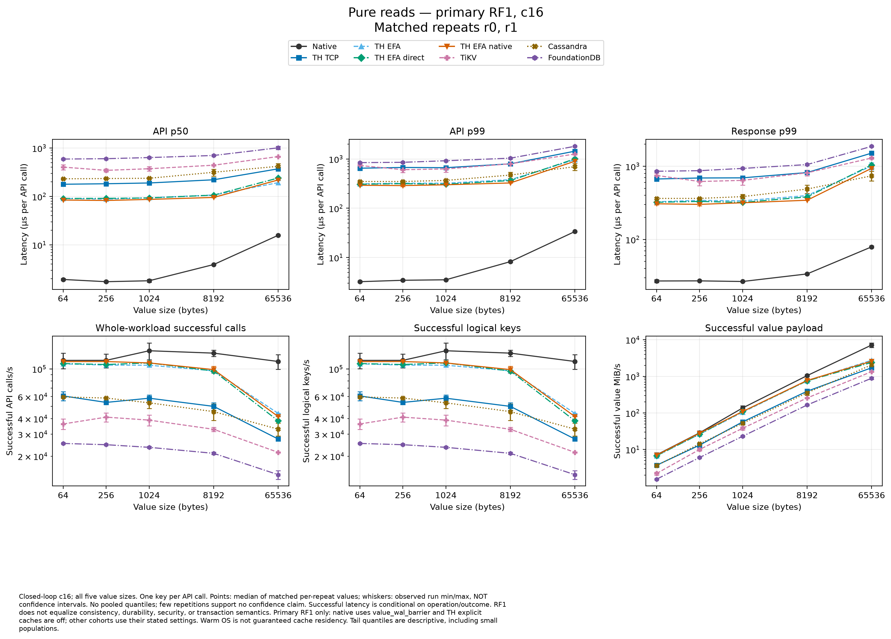

[Vector PDF](primary-read-concurrent.pdf). Closed-loop c16; all five value sizes. One key per API call. Points: median of matched per-repeat values; whiskers: observed run min/max, NOT confidence intervals. No pooled quantiles; few repetitions support no confidence claim. Successful latency is conditional on operation/outcome. RF1 does not equalize consistency, durability, security, or transaction semantics. Primary RF1 only: native uses value_wal_barrier and TH explicit caches are off; other cohorts use their stated settings. Warm OS is not guaranteed cache residency. Tail quantiles are descriptive, including small populations.

### primary-write-concurrent

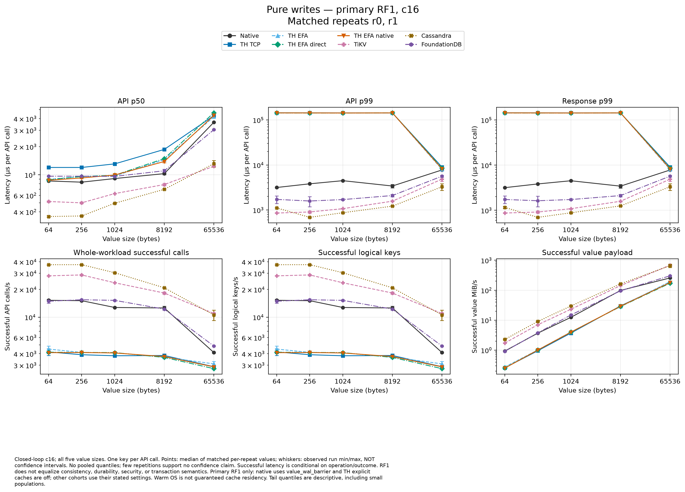

[Vector PDF](primary-write-concurrent.pdf). Closed-loop c16; all five value sizes. One key per API call. Points: median of matched per-repeat values; whiskers: observed run min/max, NOT confidence intervals. No pooled quantiles; few repetitions support no confidence claim. Successful latency is conditional on operation/outcome. RF1 does not equalize consistency, durability, security, or transaction semantics. Primary RF1 only: native uses value_wal_barrier and TH explicit caches are off; other cohorts use their stated settings. Warm OS is not guaranteed cache residency. Tail quantiles are descriptive, including small populations.

### primary-read-many32

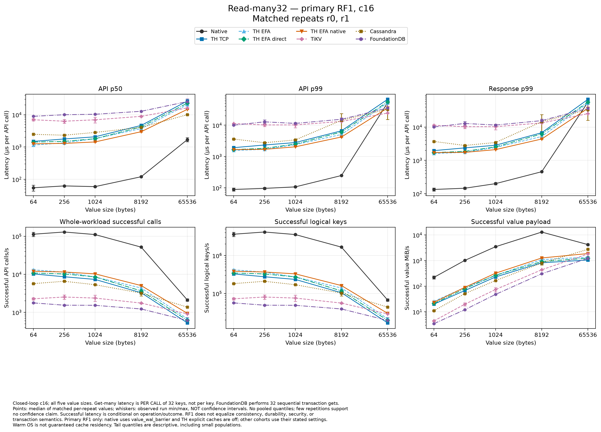

[Vector PDF](primary-read-many32.pdf). Closed-loop c16; all five value sizes. Get-many latency is PER CALL of 32 keys, not per key. FoundationDB performs 32 sequential transaction gets. Points: median of matched per-repeat values; whiskers: observed run min/max, NOT confidence intervals. No pooled quantiles; few repetitions support no confidence claim. Successful latency is conditional on operation/outcome. RF1 does not equalize consistency, durability, security, or transaction semantics. Primary RF1 only: native uses value_wal_barrier and TH explicit caches are off; other cohorts use their stated settings. Warm OS is not guaranteed cache residency. Tail quantiles are descriptive, including small populations.

### primary-point-mixed-latency

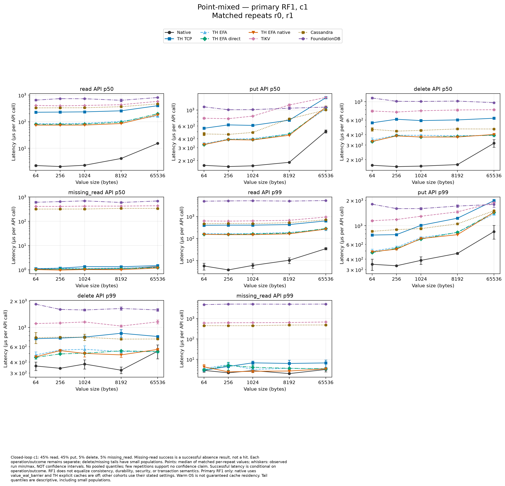

[Vector PDF](primary-point-mixed-latency.pdf). Closed-loop c1: 45% read, 45% put, 5% delete, 5% missing_read. Missing-read success is a successful absence result, not a hit. Each operation/outcome remains separate; delete/missing tails have small populations. Points: median of matched per-repeat values; whiskers: observed run min/max, NOT confidence intervals. No pooled quantiles; few repetitions support no confidence claim. Successful latency is conditional on operation/outcome. RF1 does not equalize consistency, durability, security, or transaction semantics. Primary RF1 only: native uses value_wal_barrier and TH explicit caches are off; other cohorts use their stated settings. Warm OS is not guaranteed cache residency. Tail quantiles are descriptive, including small populations.

### primary-point-mixed-goodput

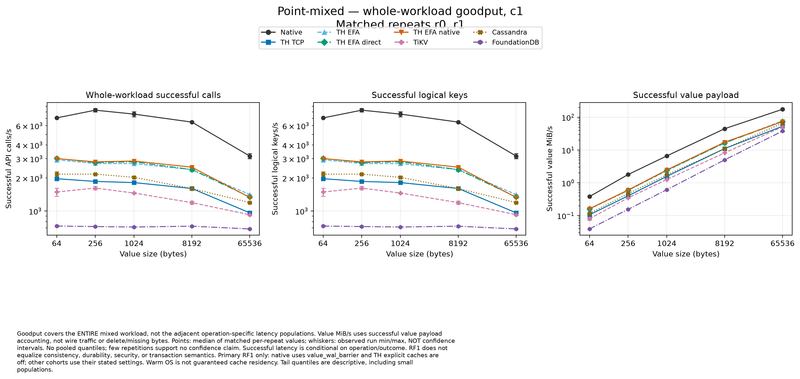

[Vector PDF](primary-point-mixed-goodput.pdf). Goodput covers the ENTIRE mixed workload, not the adjacent operation-specific latency populations. Value MiB/s uses successful value payload accounting, not wire traffic or delete/missing bytes. Points: median of matched per-repeat values; whiskers: observed run min/max, NOT confidence intervals. No pooled quantiles; few repetitions support no confidence claim. Successful latency is conditional on operation/outcome. RF1 does not equalize consistency, durability, security, or transaction semantics. Primary RF1 only: native uses value_wal_barrier and TH explicit caches are off; other cohorts use their stated settings. Warm OS is not guaranteed cache residency. Tail quantiles are descriptive, including small populations.

### offered-load-accounting

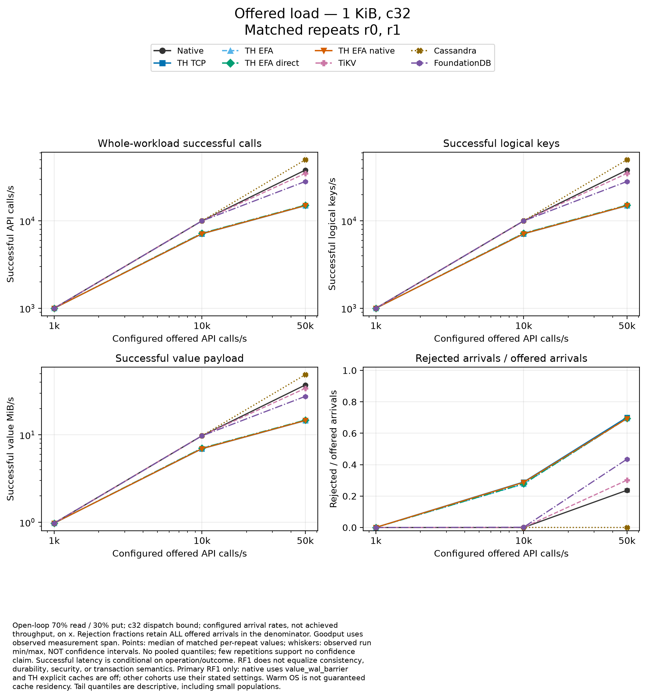

[Vector PDF](offered-load-accounting.pdf). Open-loop 70% read / 30% put; c32 dispatch bound; configured arrival rates, not achieved throughput, on x. Rejection fractions retain ALL offered arrivals in the denominator. Goodput uses observed measurement span. Points: median of matched per-repeat values; whiskers: observed run min/max, NOT confidence intervals. No pooled quantiles; few repetitions support no confidence claim. Successful latency is conditional on operation/outcome. RF1 does not equalize consistency, durability, security, or transaction semantics. Primary RF1 only: native uses value_wal_barrier and TH explicit caches are off; other cohorts use their stated settings. Warm OS is not guaranteed cache residency. Tail quantiles are descriptive, including small populations.

### offered-load-tails

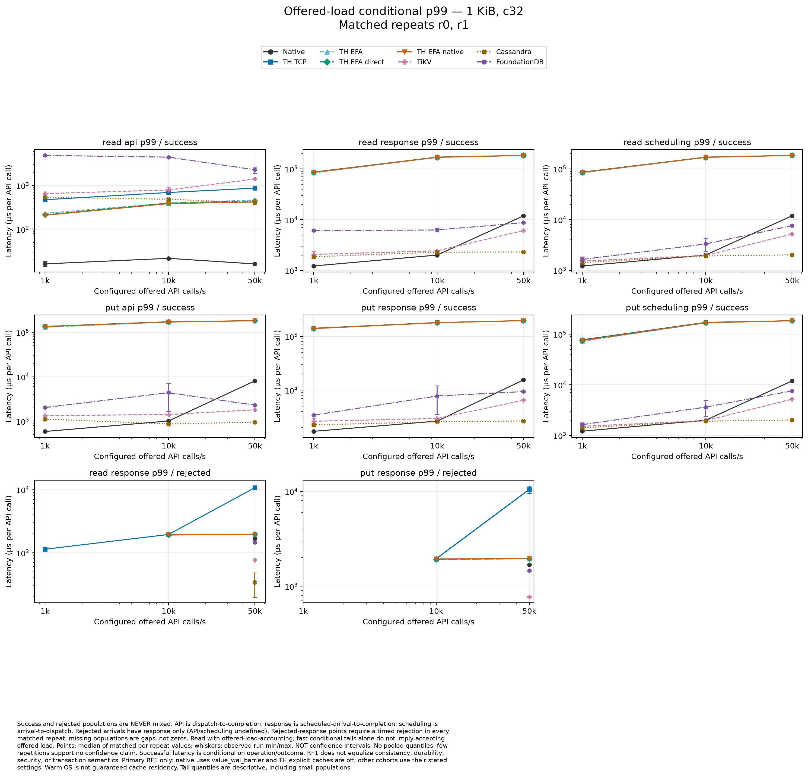

[Vector PDF](offered-load-tails.pdf). Success and rejected populations are NEVER mixed. API is dispatch-to-completion; response is scheduled-arrival-to-completion; scheduling is arrival-to-dispatch. Rejected arrivals have response only (API/scheduling undefined). Rejected-response points require a timed rejection in every matched repeat; missing populations are gaps, not zeros. Read with offered-load-accounting; fast conditional tails alone do not imply accepting offered load. Points: median of matched per-repeat values; whiskers: observed run min/max, NOT confidence intervals. No pooled quantiles; few repetitions support no confidence claim. Successful latency is conditional on operation/outcome. RF1 does not equalize consistency, durability, security, or transaction semantics. Primary RF1 only: native uses value_wal_barrier and TH explicit caches are off; other cohorts use their stated settings. Warm OS is not guaranteed cache residency. Tail quantiles are descriptive, including small populations.

### zipf-versus-uniform

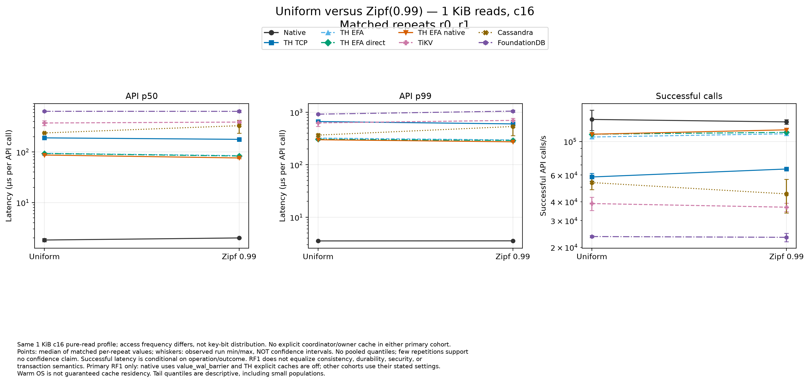

[Vector PDF](zipf-versus-uniform.pdf). Same 1 KiB c16 pure-read profile; access frequency differs, not key-bit distribution. No explicit coordinator/owner cache in either primary cohort. Points: median of matched per-repeat values; whiskers: observed run min/max, NOT confidence intervals. No pooled quantiles; few repetitions support no confidence claim. Successful latency is conditional on operation/outcome. RF1 does not equalize consistency, durability, security, or transaction semantics. Primary RF1 only: native uses value_wal_barrier and TH explicit caches are off; other cohorts use their stated settings. Warm OS is not guaranteed cache residency. Tail quantiles are descriptive, including small populations.

### cache-cohorts

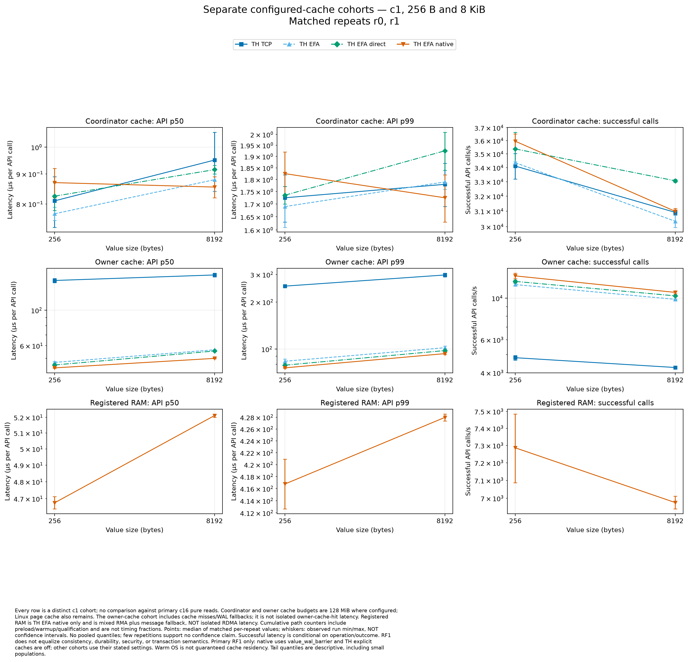

[Vector PDF](cache-cohorts.pdf). Every row is a distinct c1 cohort; no comparison against primary c16 pure reads. Coordinator and owner cache budgets are 128 MiB where configured; Linux page cache also remains. The owner-cache cohort includes cache misses/WAL fallbacks; it is not isolated owner-cache-hit latency. Registered RAM is TH EFA native only and is mixed RMA plus message fallback, NOT isolated RDMA latency. Cumulative path counters include preload/warmup/qualification and are not timing fractions. Points: median of matched per-repeat values; whiskers: observed run min/max, NOT confidence intervals. No pooled quantiles; few repetitions support no confidence claim. Successful latency is conditional on operation/outcome. RF1 does not equalize consistency, durability, security, or transaction semantics. Primary RF1 only: native uses value_wal_barrier and TH explicit caches are off; other cohorts use their stated settings. Warm OS is not guaranteed cache residency. Tail quantiles are descriptive, including small populations.

### cold-os-cache

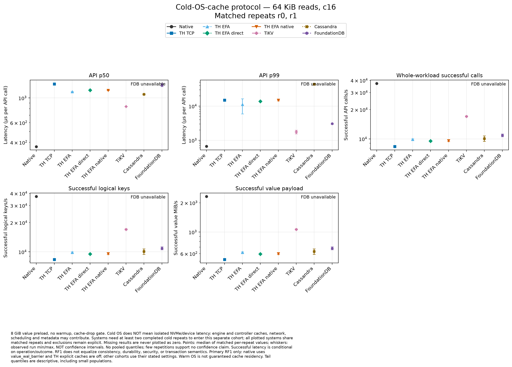

[Vector PDF](cold-os-cache.pdf). 8 GiB value preload, no warmup, cache-drop gate. Cold OS does NOT mean isolated NVMe/device latency: engine and controller caches, network, scheduling and metadata may contribute. Systems need at least two completed cold repeats to enter this separate cohort; all plotted systems share matched repeats and exclusions remain explicit. Missing results are never plotted as zero. Points: median of matched per-repeat values; whiskers: observed run min/max, NOT confidence intervals. No pooled quantiles; few repetitions support no confidence claim. Successful latency is conditional on operation/outcome. RF1 does not equalize consistency, durability, security, or transaction semantics. Primary RF1 only: native uses value_wal_barrier and TH explicit caches are off; other cohorts use their stated settings. Warm OS is not guaranteed cache residency. Tail quantiles are descriptive, including small populations.

### native-pagecache-latency

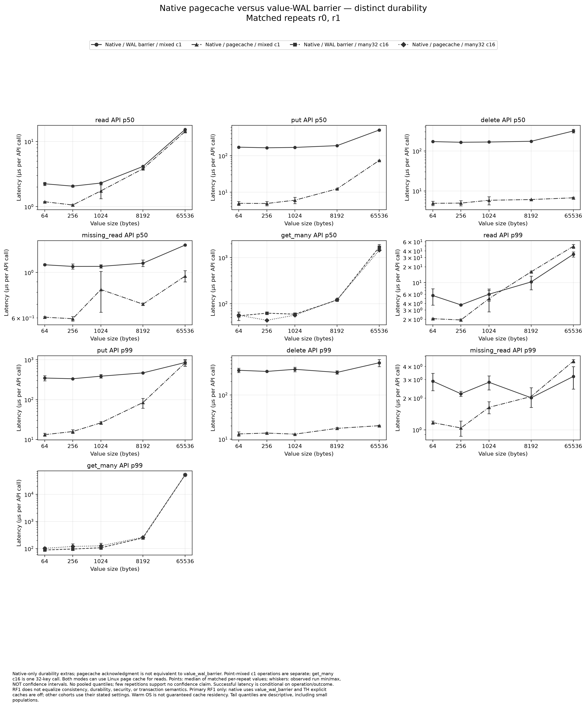

[Vector PDF](native-pagecache-latency.pdf). Native-only durability extras; pagecache acknowledgment is not equivalent to value_wal_barrier. Point-mixed c1 operations are separate; get_many c16 is one 32-key call. Both modes can use Linux page cache for reads. Points: median of matched per-repeat values; whiskers: observed run min/max, NOT confidence intervals. No pooled quantiles; few repetitions support no confidence claim. Successful latency is conditional on operation/outcome. RF1 does not equalize consistency, durability, security, or transaction semantics. Primary RF1 only: native uses value_wal_barrier and TH explicit caches are off; other cohorts use their stated settings. Warm OS is not guaranteed cache residency. Tail quantiles are descriptive, including small populations.

### native-pagecache-goodput

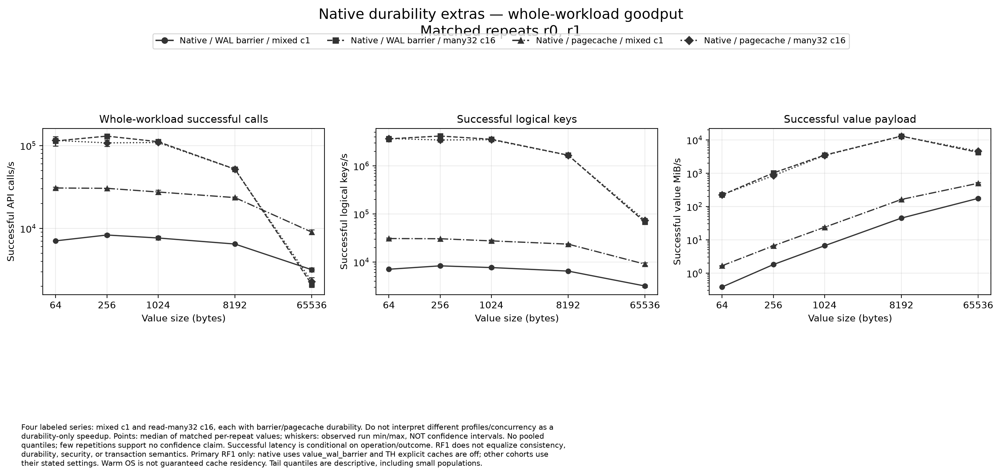

[Vector PDF](native-pagecache-goodput.pdf). Four labeled series: mixed c1 and read-many32 c16, each with barrier/pagecache durability. Do not interpret different profiles/concurrency as a durability-only speedup. Points: median of matched per-repeat values; whiskers: observed run min/max, NOT confidence intervals. No pooled quantiles; few repetitions support no confidence claim. Successful latency is conditional on operation/outcome. RF1 does not equalize consistency, durability, security, or transaction semantics. Primary RF1 only: native uses value_wal_barrier and TH explicit caches are off; other cohorts use their stated settings. Warm OS is not guaranteed cache residency. Tail quantiles are descriptive, including small populations.

### Campaign coverage

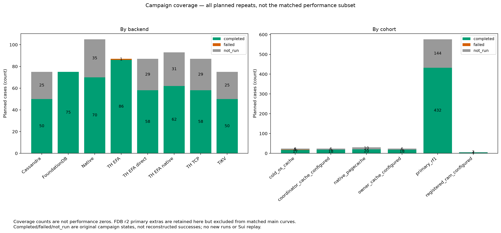

[Vector PDF](coverage.pdf). Coverage is not a performance result.

## Control-plane failure and monitoring limits

At 21:47:29 UTC, SSM `SendCommand` for a premeasurement cache-drop/snapshot on storage-2 lost its HTTP response: `ConnectionClosedError`. The caller could not know whether the command was accepted. It correctly did not blindly repeat a cache drop that could invalidate the measurement. The case has no admitted summary or samples. The run stopped at case index 509, exported raw evidence and terminated the fleet. This was **not the 22:31:35 work cutoff**.

The exact deterministic S3 response key was later absent (`NoSuchKey`), which does not prove the command was never accepted. A reliable retry needs operation-level idempotency/reconciliation, not a blind rerun of this destructive gate operation. No retry fleet was launched.

Prometheus/Grafana online readiness is retained: Grafana database/dashboard healthy, Prometheus identified, and per-case terminal scrape barriers captured. A SHA-verified TSDB snapshot including head was exported. However full monitoring verification failed with `ValueError`; the actual local offline replay reproduces **`JSON evidence exceeds size bound`**, with the current 16-MiB evidence bound. The archive therefore remains marked incomplete and has no retained query hashes. Do not claim a fully verified online/offline dashboard or calibrated zero monitoring overhead. Failed replay containers were cleaned up; source data and gaps were not rewritten to force success.

## What remains

The full 684-case/three-repetition acceptance criterion is **not met**. Before another paid run: make SSM control operations safely idempotent/reconcilable; keep verification evidence bounded for a full matrix while preserving the snapshot and original gaps; complete local failure-path validation. A longer deadline alone would not fix this run's actual failure. This recovery did not modify engine code, retry measurements, push the benchmark branch or launch a replacement fleet.
