# AWS distributed-KV comparison — 25 October 2026

## Result and scope

**The experiment produced a useful two-repetition comparison, not a complete campaign or a same-guarantee ranking.** Distributed Tidehunter has a fast local coordinator-cache path and competitive remote-read medians against the tested external-store clients. Its concurrent-write tails, write goodput and gap to embedded native reads remain substantial. Winners change with value size, workload and percentile.

Run: `th-7dea3c080cb44d48`. **478 completed, 3 failed, 203 not run out of 684 planned executions.** All eight systems completed the same 24 primary configurations in repetitions 0 and 1: **384 matched primary executions**. FoundationDB's 24 completed primary repetition-2 cases are retained separately, not mixed into comparisons.

This is an **opaque full-value synthetic KV experiment**, not Sui checkpoint replay. There are no new AWS runs behind this report. The fleet is terminated and its run-owned EBS volumes, network interfaces and temporary control resources were removed. Private S3 results remain stored.

### Reading order

1. This report: methods, graphs, explanations and limits.
2. [Complete numeric appendix](TABLES.md): every measured workload, value size, conditional population and planned-case coverage status.
3. [Original numeric CSV](all-results.csv): all 1,084 original rows, including per-repetition API mean/min/stddev/p50/p95/p99/p999/max, response/scheduling quantiles, counts, status and errors. The copy preserves the original bytes.
4. [Original detailed JSON](../../../../checkpoint-work/kv-comparison/cloud-ops/th-7dea3c080cb44d48/received/comparison.json): exact contracts, counters and evidence paths; retained outside this compact report bundle.

## Experimental setup

- Six `g6.8xlarge` EC2 instances, `us-east-1a`, **cluster placement**: one controller/client and five storage instances. Storage uses separate instance-store NVMe guest volumes. Distinct guests and device serials do not prove dedicated physical-host tenancy.
- Backends execute sequentially on that fleet; this is not a simultaneous multi-store interference experiment.
- Five storage processes for each distributed system; RF1. Native Tidehunter is an embedded, one-process reference, not an equivalent five-server deployment.
- Each storage process has a 4-CPU / 8-GiB ceiling. The controller host allows 4 CPU / 8 GiB in total, including a competitor's control service. These are quotas, not pinned dedicated cores or measured CPU consumption.
- Native/Tidehunter/Cassandra clients receive the controller allowance. TiKV splits it between client 3 CPU / 7 GiB and PD 1 CPU / 1 GiB. **The measured FoundationDB split was client 3 CPU / 6 GiB, control service 1 CPU / 2 GiB**. The later memory correction is not substituted into these results.
- Thus the nominal application/process ceiling is 24 CPU / 48 GiB for each five-storage deployment versus 4 CPU / 8 GiB for the embedded reference. This is an application comparison plus a local lower-bound reference, **not equal aggregate resources or a scale-out speedup measurement**.
- Runtime, effective server settings, device identities, placement and launch/export/cleanup evidence are retained with the source artifacts.

Observed versions: Tidehunter/adapter `0.1.0` with exact frozen hashes below;
**TiKV 8.5.4 / PD 8.5.4 / tikv-client 0.4.0**;
**Cassandra 5.0.9 / Scylla Rust CQL driver 1.9.0**;
**FoundationDB 7.3.77 / Rust bindings 0.11.0 / C API 730**.
The CQL adapter conservatively identifies its protocol vendor as unverified;
a release-version string alone is not vendor attestation.

### Workloads and phases

Logical keys are 32-byte binary identities; FoundationDB encodes them into 33 physical bytes to avoid its reserved key domain. Values are complete replacements, not field-level updates. Preload, API qualification, warm-up and measured calls are separate phases.

The generator uses entropy parameter **1.0**: a 16-byte identity header followed
by seeded pseudorandom bytes, not a zero-filled remainder. The same key has
deterministic value content; overwrites do not introduce a new random payload.
This is not a changing-content or compressible-document workload.

| Workload | Concurrency | Sizes / load | Per-repetition measurement |
| --- | ---: | --- | --- |
| Uniform point reads | 16 | 64 B, 256 B, 1 KiB, 8 KiB, 64 KiB | 8,192 calls |
| Uniform point writes | 16 | All five sizes | 4,096 calls |
| Ordered read-many32 | 16 | All five sizes | 2,048 complete 32-key calls |
| Point-mixed | 1 | All five sizes; read 45%, put 45%, delete 5%, missing-read 5% | 8,192 calls |
| Offered-load mixed | 32 | 1 KiB; read 70%, put 30%; 1k/10k/50k arrivals/s | Eight-second offered interval; bounded admission |
| Zipf read | 16 | 1 KiB; exponent 0.99 | 8,192 calls |
| Coordinator/owner-cache controls | 1 | 256 B, 8 KiB | 8,192 calls |
| Registered-RAM control | 1 | 256 B, 8 KiB; EFA-native | 8,192 calls |
| Cold-OS-cache | 16 | 131,072 × 64 KiB = 8 GiB values | 4,096 reads; no warm-up |

Primary datasets have 4,096 keys. Even the largest primary value dataset is only 256 MiB before history/metadata overhead. These are finite, mostly warm-working-set experiments, not a reproduction of the Tidehunter paper's 1-TB / ten-minute trials.

**Physical history is not identical:** TiKV/Cassandra/FoundationDB services
persist across a backend/repetition block, whereas native and distributed
Tidehunter open case-scoped storage. Full preload matches logical contents, not
compaction age, cache history or occupied space. Some primary measurements span
only tens of milliseconds; fixed operation counts are not steady-state trials.
There is no common atomic PUT-batch comparison because TiKV RawKV does not
support that contract.

### What each API call does

| Backend | Read / batch boundary | Write / guarantee caveat |
| --- | --- | --- |
| Native Tidehunter | In-process `Db::get`; batch32 performs ordered scalar gets and retains returned `Bytes` without copying | Primary mode adds explicit persistence of registered Value-WAL files and directory after the native mutation. Ordinary page-cache acknowledgement is a separate cohort. |
| Tidehunter TCP | Application-local coordinator/index, remote owner-local Value WAL; grouped ordered reads | Owner persistence and authoritative publication remain in the distributed path. This is RF1, not HA. |
| Tidehunter EFA | EFA/libfabric message path; not a TCP fallback result | TLS/security and distributed publication remain part of the API. |
| Tidehunter EFA-direct | Separate direct EFA message path | The word `direct` does not mean every call is a one-sided registered-memory read. |
| Tidehunter EFA-native | Trusted plaintext EFA path; registered-memory capability in its separate configured cohort | Security contract differs from the TLS Tidehunter paths. |
| TiKV | RawKV client API; native RawKV `batch_get` | RawKV is not the transactional TiKV API; effective RF1/log settings are recorded, not assumed equivalent to every other engine. |
| Cassandra | Prepared CQL point operations; batch32 uses independent requests with fanout bounded at 16 | No serializable multi-key read transaction is added. Consistency and commit-log policy remain part of its recorded contract. |
| FoundationDB | Serializable transaction API; batch32 performs **32 sequential gets within one transaction** | Commit/read-version and transaction-system work are included. Its batch32 adapter is not a claim of optimal FoundationDB batching. |

See [comparison protocol](../../KV_COMPARISON_PROTOCOL.md), [native adapter](../../../../benchmarks/kv-research/src/backends/native.rs#L90-L170) and [backend implementations](../../../../benchmarks/kv-research/src/backends).

## Timing and aggregation

- **API latency** runs from dispatch until the backend has materialized the complete result. Independent value validation occurs after this timer.
- **Scheduling delay** runs from scheduled arrival to dispatch. **Response latency** runs from scheduled arrival to terminal outcome. These are distinct recorded populations.
- Each comparable plotted value uses **repetitions 0 and 1 only**, unless a caption explicitly identifies a separate population. The plotted estimator is the median of corresponding per-repetition statistics. A median of two p99s is **not a pooled p99**.
- Any displayed observed run range is descriptive, **not a confidence interval**. Two run repetitions do not support a strong uncertainty claim. p99 is descriptive below 10,000 calls per population; p999 is descriptive below 100,000. All original higher-tail values remain available in the CSV.
- A batch latency is per complete 32-key call. Calls/s, logical keys/s and value MiB/s have different denominators. Value MiB/s is logical application payload, **not NIC bandwidth or physical device throughput**.
- Failed/missing cells are unavailable, not zero. FoundationDB repetition 2 does not improve its sample count on an eight-system chart.
- Read/write latencies are conditional on successful calls. Rejected arrivals stay in offered-load counts and plots. Across the balanced primary set: 9,741,312 offered, 6,197,442 successful, 3,543,870 rejected. No other retained measurement outcome is present; failures during preload are separate.

## Comparison graphs

All plots use the original cloud data. Whiskers show observed variation between
matched repetitions, **not confidence intervals**. Axes explicitly identify
latency units, API calls, logical keys or value payload. Native is an embedded
reference with a different resource/boundary contract. Full-resolution PNG and
vector PDF versions are supplied.

### Uniform reads, writes and batch32

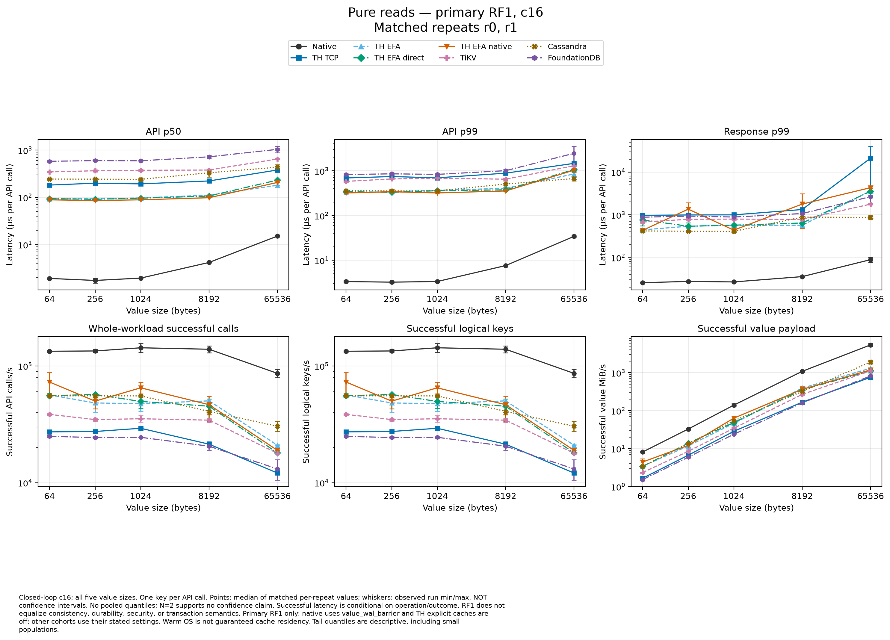

[Read graph — PDF](figures/primary-read-concurrent.pdf).

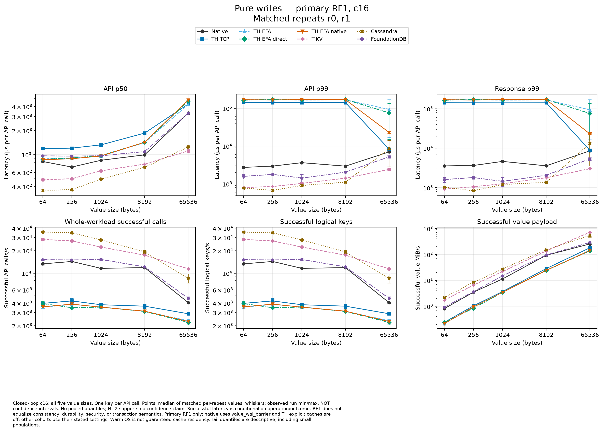

[Write graph — PDF](figures/primary-write-concurrent.pdf).

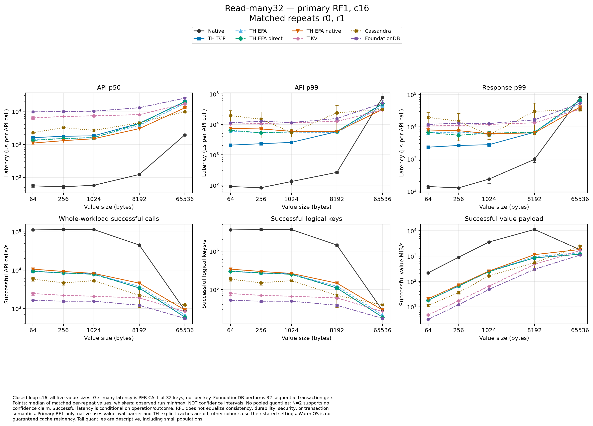

[Batch32 graph — PDF](figures/primary-read-many32.pdf).

### Concurrency-1 mixed operations

The latency panels retain each operation separately; the goodput panels cover
the entire workload. Missing-read success means a correct absence result.

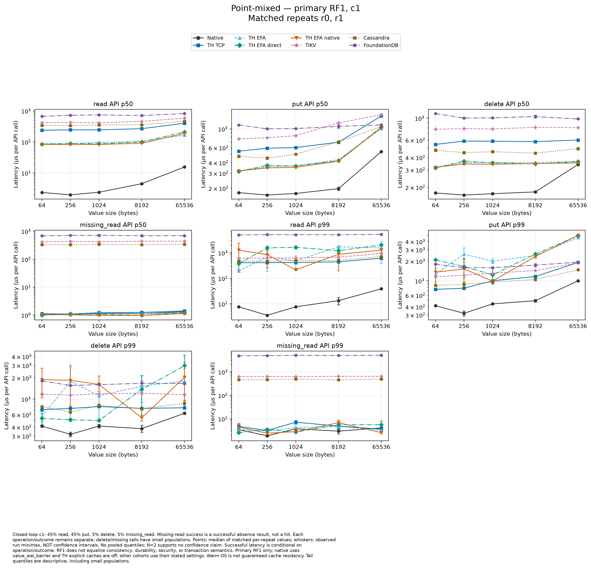

[Mixed latency — PDF](figures/primary-point-mixed-latency.pdf).

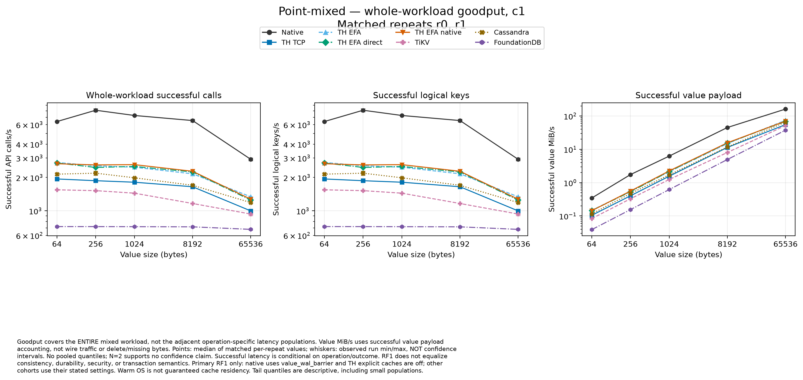

[Mixed goodput — PDF](figures/primary-point-mixed-goodput.pdf).

### Offered load: delivered work, rejection and scheduling

Read these two figures together. A successful-request p99 excludes rejected
arrivals and cannot establish that the store accepted the offered rate.

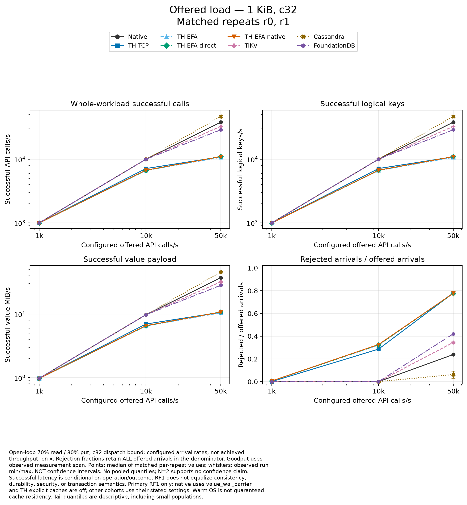

[Offered-load accounting — PDF](figures/offered-load-accounting.pdf).

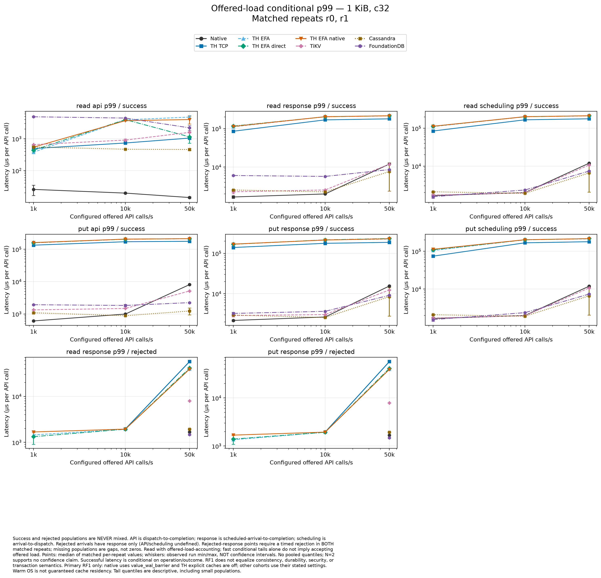

[Offered-load tails — PDF](figures/offered-load-tails.pdf).

### Skew, explicit caches and OS-cache eviction

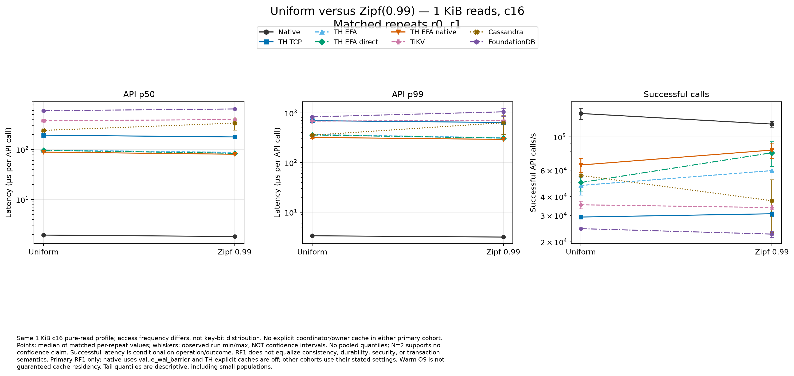

[Skew graph — PDF](figures/zipf-versus-uniform.pdf).

The following cache rows are separate concurrency-1 configurations. Owner-cache
and registered-memory rows are **mixed paths**, not isolated hit/RDMA latency.

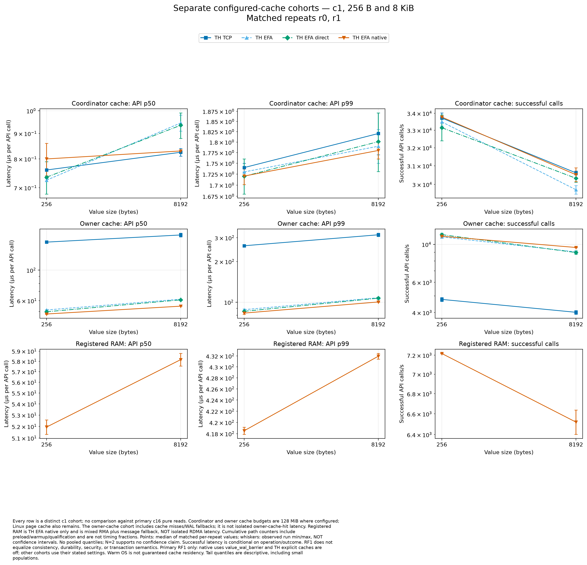

[Cache cohorts — PDF](figures/cache-cohorts.pdf).

FoundationDB has no admitted cold result. The next figure is an OS-cache-drop
protocol with engine caches retained, not a pure physical-NVMe benchmark.

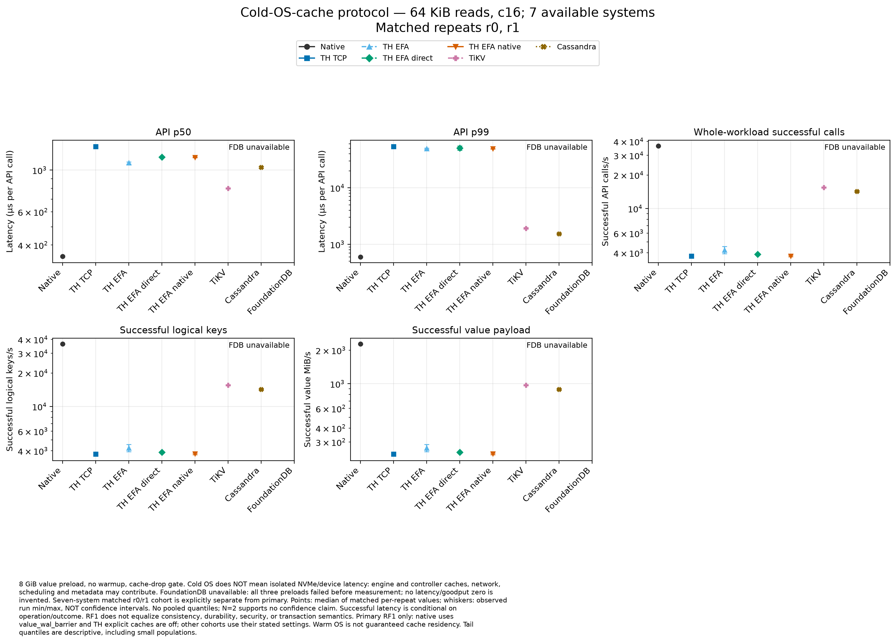

[Cold-OS-cache graph — PDF](figures/cold-os-cache.pdf).

### Native durability controls

These controls must not be mixed into the primary ranking. Read-many32 has
concurrency 16; point-mixed has concurrency 1.

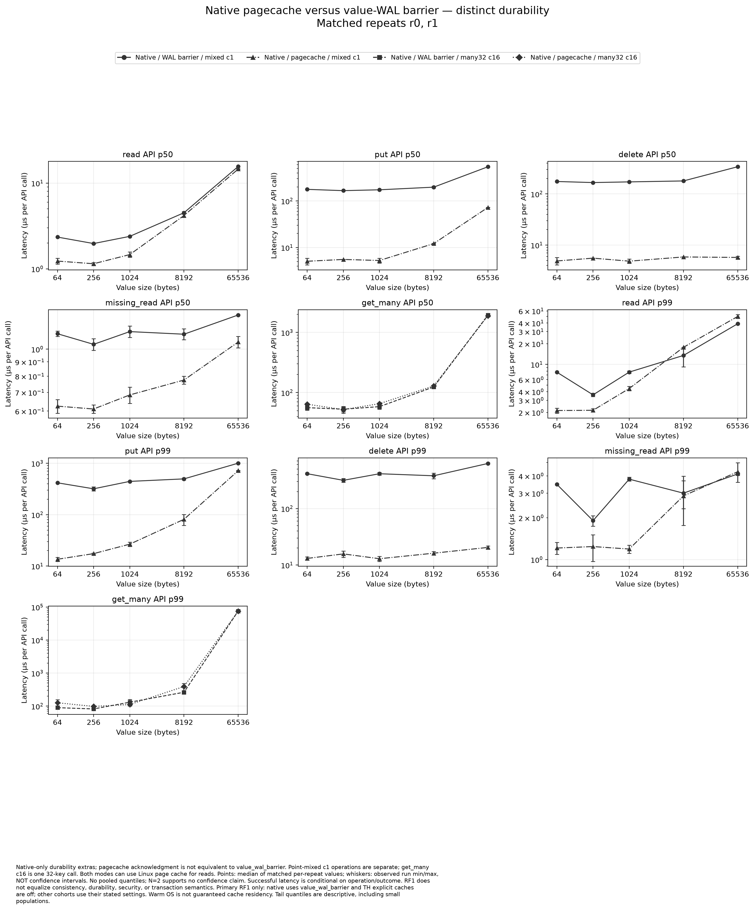

[Native durability latency — PDF](figures/native-pagecache-latency.pdf).

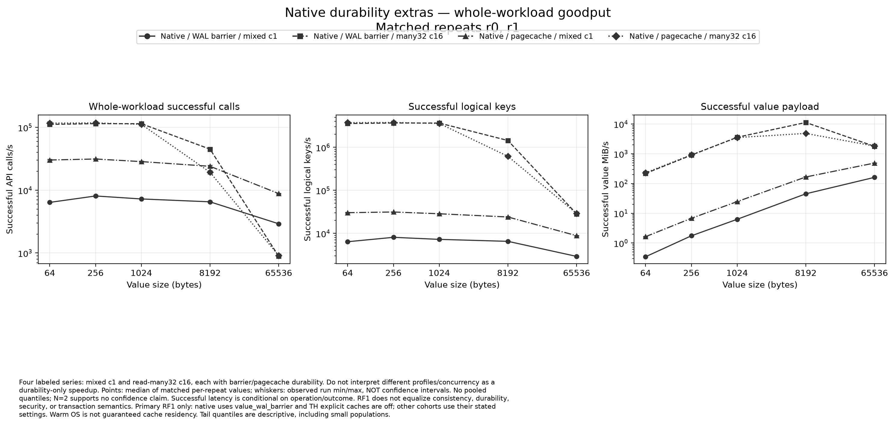

[Native durability goodput — PDF](figures/native-pagecache-goodput.pdf).

### Campaign coverage

Every planned case remains accounted for. The 24 extra FoundationDB primary
repetition-2 results are in [the numeric appendix](TABLES.md#foundationdb-repetition-2--separate-raw-results),
not given extra weight in any eight-system curve.

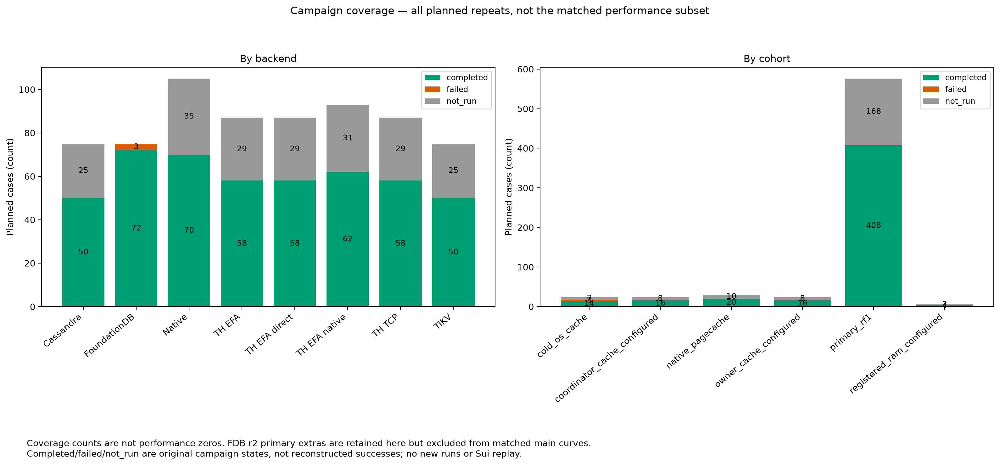

[Coverage — PDF](figures/coverage.pdf).

## Instrumentation: what was and was not measured

**No measurement-phase stage breakdown exists for distributed WAL persistence,
coordinator publication, TLS or provider progress in this campaign.**
All **236** completed r0/r1 distributed cases with counter evidence have
`effective_configuration.client.write_profile_limit=0`. Read exports contain
lifetime counters and passive owner snapshots, not phase-isolated latency
histograms. Timing structs in source do not mean the benchmark exported them.

Native does export internal histograms, but they cover the adapter lifetime,
including preload/warm-up/qualification, and exclude the subsequent
adapter-added persistence barrier. For example, one native write case has
`db_op_count{op="insert"}=8710`, not the timed phase's 4096 puts.

The actual per-call evidence is **API, response and scheduling time**. Owner
`wal_reads` are logical reads; `io_uring` submissions are not physical IOPS.
Completed client RMA reads are distinct counters. Host I/O spans a broader
gate-to-exit interval; some post-exit client cgroup fields are unavailable.
See [the detailed source/artifact audit](EVIDENCE.md#2-what-stage-timing-evidence-actually-exists).

## Why the results look this way

The explanations below distinguish **observation**, a **mechanism present in source/configuration**, **[INFERENCE]**, and an **unmeasured cause**. A graph is not a component trace. No percentage of latency is attributed to network, TLS, locks, fsync or coordination unless the experiment measured that scope.

### 1. Native warm reads versus remote reads

**Observation:** embedded native reads and coordinator-cache hits operate in a different latency class from coordinator misses served by remote owners. Larger values increase native read cost too. EFA improves the tested remote small-value read medians over TCP, but does not produce native read latency.

**Mechanism:** native can return a local cached `Bytes` or consult its local index and WAL mapping. A distributed cache miss must consult the coordinator's authoritative reference, dispatch to the owner or use an eligible registered-memory grant, materialize/validate the result and return it. A WAL lookup can be satisfied from an application cache or the Linux page cache; it need not read the SSD.

The [Tidehunter paper, §3.1–3.2](../../../../../papers/parsed/Tidehunter-2026-v2.md) explicitly separates foreground mapped-WAL work from asynchronous fsync and describes a tiered value-cache/index/WAL read path. Therefore the native microsecond numbers are **not a universal NVMe read-service-time target**.

**[INFERENCE]:** the relatively small latency growth across the smallest payload sizes is consistent with substantial fixed dispatch/protocol work. This run does not establish how much is physical network transit, provider progress, validation, scheduling or coordinator/owner work. It is incorrect to call the complete remote API time “the network RTT.”

### 2. Coordinator-cache hits and owner-cache hits

**Observation:** every completed configured coordinator-cache case records cumulative local hits and zero read RPCs. The configured owner-cache cohorts are much slower despite avoiding some owner WAL work.

**Mechanism:** a coordinator hit skips the remote exchange; an owner hit does not. The owner-cache cohorts also contain fallback logical WAL reads. Their label describes a configuration, not proof that every measured call hit that cache.

This establishes a fast bounded local path. It does **not** show that the entire production dataset can be cached or that arbitrary remote misses have that latency.

**Missing-key results are another local fast path.** The coordinator's
authoritative index can establish absence without fetching an owner value;
only present, uncached references enter remote read groups
([read resolution](../../../../tidehunter/src/distributed/remote_db/pending_read/concurrent.rs#L105-L139)).
The very small `missing_read` times in the mixed graph are therefore not
evidence of a microsecond remote value fetch. Competitor adapters still cross
their network API to establish absence.

### 3. Registered memory is not the whole measured workload

**Observation:** hardware RMA hits are present, with zero recorded RMA errors, but missing-grant/message fallbacks dominate the four registered-RAM cases. Reported API distributions combine those paths.

**Mechanism:** the one-sided path requires an eligible, retained registered-memory grant. An owner-resident value without such a grant can still use a message path. [AWS EFA documentation](https://docs.aws.amazon.com/AWSEC2/latest/UserGuide/efa.html) distinguishes OS-bypass libfabric/SRD communication from hardware RDMA capabilities; attaching EFA does not turn every application lookup into an RDMA read.

There is no isolated RMA-only latency distribution here. The registered-RAM cohort cannot prove a hardware latency floor or NVMe-over-Fabrics performance.

### 4. Writes: durability mode, coordination and long tails

**Observation:** distributed concurrent writes have much larger p99 than p50 across TCP and EFA variants, and lower goodput than the tested competitor clients. The tail is not equally severe at every size: the 64-KiB TCP case differs markedly from its small-value cases.

**Mechanism:** the primary native adapter deliberately adds a foreground Value-WAL persistence barrier. Native's ordinary asynchronous-durability path is separate. For the **same 1-KiB, concurrency-1 point-mixed workload**, the page-cache control and barrier control have very different put medians; the numeric appendix preserves both. This mode difference is why the paper's ordinary native write rates cannot be compared directly to these foreground-persistence results.

Distributed writes additionally carry owner-side work and coordinator authority/publication ordering. RF1 removes replica-quorum waiting, not those mechanisms. The fact that mature clients achieve different rates under their own commit contracts is useful, but does not establish identical disk-acknowledgement semantics.

The native barrier syncs all registered WAL files and directory; distributed
owner persistence uses the relevant frame/file path. This asymmetry is part of
the comparison, so their whole latency difference cannot be called network
overhead. Ordered coordinator publication can also hold later completed writes
behind an earlier unresolved prefix. [Source audit](EVIDENCE.md#3-write-tail-evidence-and-defensible-interpretation).

One EFA-native 1-KiB write repetition records **80 of 4096 writes above 100 ms**.
That observed minority explains why its p99 is very different from its median.
It does not identify which stage stalled. Checkpoint limits and notification
timeouts exist in code, but neither is proven to have caused these samples.

**[INFERENCE]:** large tails shared by several transports are consistent with a bottleneck beyond median packet transfer alone. This campaign does not isolate whether the dominant stall is shared-frontier publication, an owner persistence queue, synchronization, CPU scheduling or another stage. It does not justify attributing the whole tail to EFA or to the NVMe device.

### 5. Why faster EFA medians do not guarantee better tails or goodput

**Observation:** EFA variants improve many small-read medians, while TCP has better tails in some batch/write cells. Ordinary EFA beats EFA-native/direct on the 64-KiB point-read median. There is no universal transport winner.

**Mechanism:** each transport still serves the full application path. Native/plaintext, direct-message and TLS paths have different protocol/security work. Completion progress, request grouping, shared queues and payload copying can affect loaded behavior even when the network supports OS bypass.

**[INFERENCE]:** these software-path differences are plausible contributors. They were not independently ablated here. Do not claim measured TLS cost by subtracting unrelated medians, or conclude that EFA hardware is slower from a conditional application p99. There is no matched, isolated, steady-state fabric microbenchmark in this dataset.

### 6. Batch32 and large-value reversals

**Observation:** batching changes rankings. The tested Tidehunter grouped-read medians beat the tested external adapters at several sizes, but remain behind native. At 64 KiB, native has a much better median yet a worse p99 and lower calls/s than some distributed rows.

**Mechanism:** a 32 × 64-KiB call materializes **2 MiB** before API completion, then validates values outside that timer. Native uses local scalar gets; distributed Tidehunter groups by owner; TiKV uses its native batch API; Cassandra fans out independent calls; FoundationDB serializes gets within a transaction. These are different batching implementations, not merely different storage engines.

In both native 64-KiB many32 repetitions, API p99 is near 76 ms and scheduling
p99 near 78 ms. The common runner generates a full 2-MiB expected payload
**before** API timing and compares returned values **after** it. These costs,
plus the measured API tail, explain why a low median does not imply reciprocal
goodput; their individual CPU/time shares were not captured. Exact per-repeat
figures remain in the CSV, not a fabricated component breakdown.

**[INFERENCE]:** message grouping, allocation/copying, validation CPU and scheduling are plausible contributors as payload grows. The native large-batch tail is an observed regression within this workload, not evidence by itself of SSD service time or a specific cache eviction. No paired component trace establishes its exact cause.

### 7. TiKV, Cassandra and FoundationDB

**TiKV:** the RawKV API includes remote request routing and the actual Raft/storage implementation; it is not an embedded RocksDB call. Its [configuration reference](https://docs.pingcap.com/tidb/stable/tikv-configuration-file/) documents API and storage/log options, but actual retained settings govern this run. Good concurrent writes do not prove the absence of replication/state-machine or synchronization overhead; RF1 is not a production HA result.

**Cassandra:** the [documented storage engine](https://cassandra.apache.org/doc/5.0/cassandra/architecture/storage-engine.html) appends a commit log and updates memtables, with later flush and compaction. It can serve recent data from memory. The observed good write rates are compatible with that design, but this short experiment does not measure sustainable compaction cost. Its non-transactional batch-read fanout is not equivalent to FoundationDB's single serializable transaction.

The retained Cassandra deployment YAML sets **`commitlog_sync: batch`** and
startup logs show no commit-log compression. This is stronger configuration
evidence than the adapter's conservative “not observed” label. It does not
independently certify device power-loss persistence or reveal the fsync share
of each call. Table/SSTable compression was not captured.

**FoundationDB:** its [transaction architecture](https://apple.github.io/foundationdb/architecture.html) includes read-version, storage-server and commit/log roles. Those mechanisms and this client's transaction policy are included in the measured boundary. The linked documentation contains historical engine descriptions; it is used here for the transaction-role model, not to identify the measured storage engine. Sequential batch32 gets penalize this adapter relative to a pipelined implementation. **These figures must not be presented as FoundationDB's best achievable batch performance.**

For every engine, the plots show this version, configuration and client strategy. They do not establish an intrinsic universal ranking of WAL versus LSM versus B-tree designs.

### 8. Offered load, scheduling and why throughput is not concurrency / p50

**Observation:** high offered loads produce substantial bounded-admission rejection. Native can also show excellent successful API medians without delivering the reciprocal of those medians as workload goodput.

**Mechanism:** calls/s uses the observed raw measurement span. The runner also produces requests, dispatches them, moves results, validates returned bytes and records outcomes. These costs and scheduling delay are not all inside the backend API timer. A percentile is not a mean; closed-loop concurrency is a bound, not proof that every slot continuously executes the timed API.

The offered-load plots therefore show goodput and rejection alongside successful API/response/scheduling tails. Dropping rejected arrivals or using only successful latency would hide overload. These eight-second points are not a long-run sustainable-capacity curve.

### 9. Zipf access and cold-OS-cache reads

Zipf changes access frequency, not the key's bit distribution. A hot subset can benefit from application/engine/OS caches, but most primary datasets fit in memory already. A weak or variable skew benefit is not proof that a store lacks a useful cache.

The cold cohort drops OS caches but records **`engine_caches_evicted=false`**. Its 8-GiB total value dataset does not exceed aggregate distributed engine RAM. The host observation interval runs from gate release through process exit, including post-workload checks and drain. Device counters can establish that I/O occurred during that interval; they cannot assign every request to pure NVMe service or identify exact per-read I/O time.

No engine's cold-OS-cache median is labeled “raw NVMe latency.” This experiment does not compare RDMA-RAM with a deployed NVMe-oF path.

### 10. FoundationDB cold-preload failure

All three attempted cold cases have direct control-server logs showing **`ERROR: Out of memory`, exit code 20, `Running=false`, `OOMKilled=false`**, roughly 5.5–7.1 seconds into preload. The process exited itself; this is not a recorded kernel cgroup OOM kill. Subsequent client preload timeouts and the final campaign deadline are consequences of service loss, not cold-read figures.

The measured control container had 2 GiB, with a 1,536-MiB server self-limit and 512-MiB cache. [FoundationDB configuration documentation](https://apple.github.io/foundationdb/configuration.html) describes `memory` as a hard self-termination bound, not an allocation target.

**Post-campaign local correction:** reserve 6 GiB for control roles and 2 GiB for the client within the same total 8 GiB; server self-limit 4,608 MiB, cache 512 MiB; reject smaller host allowances. A real local run completed all **131,072 × 64-KiB preload puts plus 64 reads**, with zero other outcomes and all six servers alive. Owned services/data were removed afterward. [Qualification evidence](../../../../checkpoint-work/kv-comparison/fdbbulk-3eac9a194513/qualification.json).

That verifies this bounded scenario on one shared SSD, with server memory caps but without a locally cgroup-capped client. It is **not cloud revalidation**, general production sizing or replacement FoundationDB performance data. The original cloud numbers remain unchanged.

### 11. Entropy, compression and value separation

Equal logical bytes do not mean equal physical paths. Native's selected
`Config::small()` has no optional batch codec or compressed-batch cache.
TiKV's actual retained effective configuration has **Titan enabled**, a
**32-KiB blob threshold**, **Zstd blob compression**, RocksDB per-level
compression and **2-GiB shared block cache per storage process**. This evidence
comes from runtime exports, despite the adapter's deliberately conservative
“not queried” wording.

**[INFERENCE]:** crossing the configured Titan threshold may change TiKV's
64-KiB path. There is no measured compression ratio, blob-residency or codec-CPU
breakdown; its ranking must not be attributed solely to compression or
transport. Cassandra table compression and FoundationDB codec configuration
are unavailable, not assumed disabled.

Sources: [value generator](../../../../benchmarks/kv-research/src/workload.rs#L59-L72),
[native configuration](../../../../tidehunter/src/config.rs#L171-L195),
[TiKV r0 runtime export](../../../../checkpoint-work/kv-comparison/cloud-ops/th-7dea3c080cb44d48/received/deployments/tikv-stop-2630/host-0-export.json),
[TiKV r1 runtime export](../../../../checkpoint-work/kv-comparison/cloud-ops/th-7dea3c080cb44d48/received/deployments/tikv-stop-4790/host-0-export.json).
The relevant JSON fields are
`evidence.receipts["deployment.json"].effective_config.rocksdb.titan` and
`rocksdb.defaultcf.titan`.

## What the experiment cannot establish

- A same-guarantee production ranking, HA, failover correctness, serializable behavior for non-transactional clients, or crash recovery correctness.
- Publication-quality confidence bounds from two repetitions, especially at unsupported tail sample counts.
- Sustainable storage capacity or long-term maintenance costs: current distributed Tidehunter retains history and does not reclaim physical Value-WAL space.
- Pure network time, exact lock/fsync/provider/coordination percentages, pure hardware RDMA latency, or per-request physical NVMe service time.
- Scaling with shard count: the fleet size was fixed; native has a different resource/topology boundary.
- Optimal TiKV/Cassandra/FoundationDB tuning or batch APIs; compression, caches, transaction boundaries and workload entropy must be retained with claims.
- Real Sui behavior. These generic adapters are not Sui storage integrations and this campaign did not replay checkpoints.
- Different physical aging and conservative/incomplete compression telemetry prevent an optimal storage-engine ranking.
- The mixed-workload read oracle validates returned bytes but permits absent values; it is not a linearizability/presence oracle. All 160 matched pure read/many32 cases have the expected aggregate full-value byte counts, but that is not a concurrent-history correctness proof.

## Reproducing the report figures

The offline plotting tool is
[`experiments/kv-comparison/plot_cloud_comparison.py`](../../../../experiments/kv-comparison/plot_cloud_comparison.py).
It uses standard-library parsing/statistics and the project's existing
Matplotlib plotting convention. This report was rendered with **Matplotlib
3.11.2**, using the noninteractive Agg backend. It does not build benchmark
binaries, open database services or contact AWS.

From the repository root, in a Python environment containing Matplotlib:

```bash
python3 experiments/kv-comparison/plot_cloud_comparison.py \
  --input checkpoint-work/kv-comparison/cloud-ops/th-7dea3c080cb44d48/received/comparison.json \
  --output docs/distributed/reports/2026-10-25-kv-comparison/figures
```

If needed, install the already-used plotting dependency into a dedicated
environment with `python3 -m pip install 'matplotlib==3.11.2'`.

[Plot manifest](figures/plots.json) records the input SHA-256, selected repeat
identities, every plotted observation, unavailable populations and exclusions.
[Plot data](figures/plot-data.csv) retains exact per-repeat values, medians and
observed ranges; latency remains in original nanoseconds there. It is a
different export from the untouched [all-results CSV](all-results.csv).
Failure/coverage tests reject unbalanced repeats, mixed operation/outcome
populations, disguised duplicate cases and wrong observed adapter contracts.

Verification of this report passed **143 analysis-tool tests** and independently
matched **1,727 plotted points / 3,454 original observations** to the immutable
JSON. Every completed r0/r1 case is represented: **454**, including separate
non-primary controls. The other 24 completed cases are FoundationDB r2 and stay
in the numeric appendix. All 13 PNG/PDF pairs were produced; chart layouts
were visually inspected. [Verification record](verification.json).


## Source identity and artifact integrity

| Item | SHA-256 |
| --- | --- |
| Executed source ZIP | `ca25db97b64b9906100b0453ed3d383d293b6f2835a849ba0e6135b3d49ed713` |
| Executed binary | `749372b1126b614bb27560649443b99483b5abea36848c1fc5e1711f53d02cef` |
| Original comparison JSON | `4d71203e8c760ff40446644a274acb12145a9451cb4c0d26a92ddabcaa2405b2` |
| Original / copied CSV | `dfe591140fd9a0897b11ac0c609bf0d5627e0eb8bda28753a66592c732a91bf1` |
| Retrieved controller archive | `531f6d6340074f1daf4fe7b77826d5e3239dd5a8bbe90f59ea9728ce68d80b82` |

Measured source branch: `feat/cloud-kv-comparison`; base `b70d83b7a02fc2de79ce1782898b68fb2535d924` plus recorded dirty sources. A branch name or base commit alone does not identify this experiment. The archive has 27,535 verified files, 1,576,403,836 uncompressed bytes. [Integrity proof](../../../../checkpoint-work/kv-comparison/cloud-ops/th-7dea3c080cb44d48/artifact-verification.json).

## Cost and shutdown

| Scope | Conservative estimated USD |
| --- | ---: |
| Measured fleet | 31.4539 |
| Earlier five failed startup attempts that day | 16.9333 |
| Daily total, 2026-10-25 UTC | 48.3872 |
| Weekly total, 2026-10-19 through 2026-10-25 UTC | 137.5959 |
| October recorded total | 137.5959 |
| Recorded ledger-lifetime total | 137.5959 |

These are conservative ledger estimates, **not an AWS invoice**. Ancillary S3/transfer/shared-watchdog use, discounts and taxes are excluded. Compute is bounded by first observed termination, not merely the termination request. The fleet was first observed fully terminated at **11:04:24.804 UTC**. Temporary storage/network/control resources were confirmed absent; a later MCP query found zero nonterminal instances across all six attempts. Private S3 artifacts remain and have small continuing storage/request costs.

[Closure proof](../../../../checkpoint-work/kv-comparison/cloud-ops/th-7dea3c080cb44d48/closure-record.json) · [final all-attempt inventory](../../../../checkpoint-work/kv-comparison/cloud-ops/th-7dea3c080cb44d48/all-attempts-final-inventory.json) · [cost ledger report](../../../../checkpoint-work/kv-comparison/cloud-ops/th-7dea3c080cb44d48/branch-cost-report.json).
