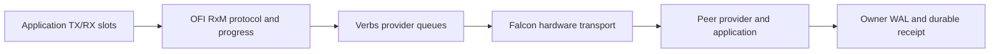

# Cloud benchmark anomaly audit, 3 November 2026

## Scope and conclusions

This audit concerns supervisor Figure 3: **scalar writes at concurrency 16**, not batch reads. Each plotted point contains 4,096 measured writes and one independent repetition. Figure 4 contains single-value reads. Historical samples and comparison JSON were not changed, censored, smoothed or replaced.

Three different effects must not be conflated:

1. Native's 64 KiB median rises roughly in proportion to value bytes. The benchmark also uses a small native WAL layout and a stronger foreground acknowledgement than the paper's usual write. A controlled local intervention confirms substantial file-barrier amplification in this configuration; it does not quantify a cloud speedup.
2. TiKV's 1 KiB rate includes a real, approximately 400 ms client-observed completion pause. Ordinary p99 hides the 16 affected calls. A short, single repetition cannot establish a general size-dependent throughput curve.
3. Similar complete durable-write rates do not establish similar network latency. The selected Tidehunter RDMA implementation uses `verbs;ofi_rxm`, not direct application-to-QP calls. The historical data does not establish receive-buffer exhaustion. New application-slot and device-counter collection makes that hypothesis testable.

No cloud resources were allocated for this audit. Local filesystem measurements below are excluded from the supervisor paper.

## 1. Frozen evidence and provenance

- Campaign: `bench-b35a62e24b47faaf`, six `z4m-highmem-16` hosts, `us-central1-a`, compact placement with maximum distance 3.
- Measured source archive SHA-256: `98cc1eb67e1d2c269294a391acf0bcdfc9ef029813ef348a89e92939f10d6c0a`.
- Measured executable SHA-256: `34bb9d91cf9bf3c2e343827cd20ee8b1526cdcd764bc16800c4c54476de1c065`.
- Comparison: parent workspace `checkpoint-work/gcp-kv-comparison-2026-11-03-b35a62e24b47faaf/input/comparison.json`.
- Original samples: `checkpoint-work/gcp-manual-run-b35a62e24b47faaf/{incremental-cases,results/case-checkpoints}/CASE.tar.gz`, member `result/samples.csv`.
- Authoritative final export receipt: `priority-exports/nofile-recovery-2/receipt.json`; 273/273 complete, archive SHA-256 `1d5fa9c1f6f1b75ca721861d9f2a718932b89f672280710503297c1ff824417d`.
- Exact measured code: `checkpoint-work/gcp-manual-qualified-b35a62e24b47faaf/package/source/`.
- New derived evidence: `checkpoint-work/benchmark-anomaly-audit-20261103/`.

Some physical guest hostnames remain `bench-fa1260058c577ebf-*`. `upgrade-plan.json` and `fleet.json` record an in-place source upgrade on the same six physical instance IDs before measurement. Case manifests identify the b35 executable, namespace and mount. Those names are not evidence of stale benchmark samples.

The final export archive retains historical inner controller receipts from an earlier interrupted pass. The adjacent final export receipt, its archive digest, and individual case receipts establish completion; an old inner `progress.json` is not the final campaign outcome.

## 2. Native Tidehunter: 64 KiB is not one outlier

| Value payload | Cloud put API p50, µs | Whole-case successful calls/s | Derived successful value MiB/s |
|---:|---:|---:|---:|
| 1 KiB | 189.344 | 72,551 | 70.85 |
| 8 KiB | 337.753 | 42,053 | 328.54 |
| 64 KiB | 2,652.295 | 5,738 | 358.65 |

The last column is successful scalar calls/s multiplied by configured value bytes, divided by 2^20; it excludes key and protocol bytes. Between 8 and 64 KiB, payload grows 8× and median latency grows **7.85×**. Payload bandwidth increases rather than decreases. The 64 KiB first and last dispatch-order quarter medians are 2,683.395 and 2,573.641 µs. A single long request does not explain the median.

### Paper and benchmark do not have the same write contract

The full [Tidehunter v2 paper](https://arxiv.org/abs/2602.01873v2), also retained as `papers/parsed/Tidehunter-2026-v2.md`, describes normal foreground writes completing without waiting for fsync and asynchronous map finalization. Explicit flush provides stronger persistence. Its reported 830K writes/s uses 1 KB values, a 1 TB fill, ten-minute cooldown and measurement phases, and an OpenMetal system with 24 physical cores, 256 GB RAM and 6.4 TB NVMe.

Our plotted native arm instead waits for `value_wal_barrier` **after every scalar put**. It uses 4,096 keys, 512 warmup operations, 4,096 measured puts, and a GCP VM. The paper does not provide a matching 64 KiB/per-put-barrier result. Therefore these numbers neither reproduce nor contradict the paper's throughput result.

Measured source anchors:

- `benchmarks/kv-research/src/backends/native.rs:80–107,198–202`: small configuration and foreground barrier.
- `tidehunter/src/config.rs:170–187`: small preset, including 1 MiB fragments and 4 MiB files.
- `tidehunter/src/wal/mod.rs:746–759`: synchronize every registered Value-WAL file, then the directory.
- `benchmarks/kv-research/src/workload.rs:40–71,124–165`: exact payload lengths, identity inside the value, scalar puts. A configuration batch size of 32 does not turn this workload into batch writes.

The distributed owner uses 4 MiB fragments and 1 GiB files. This is an important layout difference, even when both arms provide durable acknowledgements.

### Local mechanism check, not cloud performance

The unchanged historical executable was run locally with the same counts, seed, C16, payloads and Value-WAL barrier; gates were removed and profiling enabled. The first 256 selected barriers performed **2.00, 10.14 and 79.91 file synchronizations per barrier** at 1, 8 and 64 KiB. This confirms the source-level fan-out mechanism on a shared laptop SSD, not its exact contribution to the cloud median.

A separate, predeclared 64 KiB experiment used one rebuilt executable (`ed790dce2037f9b6399311092a026d7828896991330e5a4526332c79fc5f8ed0`), fresh databases, unchanged phases and acknowledgement, and order small / large_files / large_files / small. The material-effect threshold was a 20% median reduction without correctness or acknowledgement changes.

| Local execution order | Native geometry | API p50, ms | API p99, ms | Selected file synchronizations/barrier |
|---:|---|---:|---:|---:|
| 1 | small | 156.306 | 234.644 | 79.92 |
| 2 | large_files | 3.225 | 6.205 | 1.00 |
| 3 | large_files | 7.432 | 13.060 | 1.00 |
| 4 | small | 156.187 | 1,011.529 | 79.91 |

Both larger-file observations exceed that threshold, despite substantial laptop variation. No observations were pooled and no significance claim follows from two executions per layout. Start/end logical file lengths are equal across layouts; registry counts differ from 78→146 versus 1→1. Logical lengths are not physical allocated or synced bytes.

### Implemented control

`native_wal_geometry` is now explicit and normalized:

- `small`: unchanged default, 1 MiB fragments / 4 MiB files.
- `large_files`: same fragment size and other native-small settings, 1 GiB file limit. It is a file-limit intervention, not a new durability mode.
- `owner_matched`: 4 MiB fragments / 1 GiB files. This additionally changes fragment-derived relocation and map-byte limits and is not a file-limit-only experiment.

These settings apply to native value and index WAL geometry. Comparisons must use fresh paths and separate labels. The benchmark open path checks its geometry witness under the existing database lock; ordinary `Db::open` semantics are unchanged. No storage mutex was removed and no barrier was weakened.

The new diagnostic records actual layout, boundary inventory, and selected-barrier registry minima/maxima. It does not silently replace the historical native point or claim that the GCP curve has been fixed.

## 3. TiKV: p99 hides a short-run completion pause

| Value payload | Cloud case span, ms | Successful puts/s | API p50, µs | API p99, µs | API p99.9, µs |
|---:|---:|---:|---:|---:|---:|
| 64 B | 55.843 | 73,349 | 200.925 | 349.564 | 742.519 |
| 256 B | 60.443 | 67,766 | 217.861 | 371.403 | 838.487 |
| 1 KiB | 477.855 | 8,572 | 277.439 | 549.912 | 404,694.462 |
| 8 KiB | 85.637 | 47,830 | 301.930 | 608.513 | 877.029 |
| 64 KiB | 175.429 | 23,348 | 568.134 | 1,709.473 | 2,553.242 |

Case `0164-tikv-1024-write-concurrent-primary_rf1-r0` contains exactly 16 calls longer than 100 ms, lasting 398.610–406.012 ms. They occupy the C16 worker population. The largest gap between recorded completions is **398.357 ms**. They represent 0.39% of 4,096 calls, so p99 remains below them while p99.9 exposes them. Every recorded put succeeded.

The analyzer correctly computes whole-case throughput as successful calls divided by `max(completed_ns) - min(scheduled_ns)`. Removing the pause or dividing by median latency would change the estimand and hide observed behavior. All plotted primary write exposures are only **26.4–713.8 ms**. They are finite tests, not sustained capacity measurements.

A retained node-2 log reports five `async write on_applied callback is dropped` events at 03:52:03.213 UTC. Full stacks show `raw_put → async_write → send_command_impl → handle_send_error`: these callbacks were dropped while a **Raft router send failed**. The [pinned router](https://github.com/tikv/tikv/blob/4855bdccc64e7a8551d30ebbbd5be75a42929265/components/raftstore/src/router.rs#L105-L118) distinguishes a full queue from a disconnected region route, but the retained stacks do not reveal which occurred.

The original summary supplies the client wall-clock anchor `1793677915.3147187`; the measured runner reads wall time immediately before its `Instant` origin. Adding raw monotonic offsets places the 16 slow dispatches at approximately 03:52:02.810569–02.815432 and their replies at 03:52:03.213781–03.216580 UTC. Reply resumption closely coincides with the logged failures. Unknown cross-host skew and the unmeasured anchor-read interval prevent a bounded sub-millisecond alignment claim. Without request/region identifiers or retry counts, this is strong temporal evidence of a router event near recovery, not proof of queue saturation, region movement, or what caused the preceding pause. The derivation is retained in `tikv-pause-wall-clock.json`; bounded log tails cannot rule out other events.

Deployment admission did observe 24 single-peer regions covering all five stores, a whole-keyspace voter rule of one, and persist-before-apply settings. Evidence is `priority-exports/original/controller.tar.gz:deployments/tikv-2755/proofs.json`; measured validation is `cloud_layout.py:578–623`. This is positive admission evidence, not merely a configured replica ceiling or a per-operation/power-loss proof. [Pinned Raft Engine write code](https://github.com/tikv/tikv/blob/4855bdccc64e7a8551d30ebbbd5be75a42929265/components/raftstore/src/store/async_io/write.rs#L905-L948) synchronizes before persisted callbacks.

### Implemented correction and coverage

- `analyze.measurement_timeline` reports exact exposure, largest all-outcome completion gap, 32 bounded completion windows, slowest 16 calls sorted by API duration rather than CSV completion order, threshold counts and observed API occupancy. Missing dispatch observations do not become zero-duration APIs.
- `cloud_campaign.summarize_case` includes this offline calculation from the admitted raw samples. Percentiles, operation counts and the throughput denominator are unchanged.
- TiKV before/end host frames now capture bounded relevant metrics, PD replication/region evidence, timestamped server log intervals and explicit missing retry observations. These run outside timed operations.
- Figures now expose p99.9, maxima, durations and value bandwidth separately. The TiKV dip remains in the plot and is explained rather than smoothed away.

A targeted repetition must freeze code/settings for every backend being compared, preserve counts, and predeclare a material-effect threshold. The present data does not justify changing TiKV persistence, apply ordering or retry policy to improve its ranking.

## 4. RDMA versus TCP: identify the boundary before tuning

| Cloud 1 KiB operation, C16 | Tidehunter TCP p50, µs | Tidehunter verbs p50, µs | What is measured |
|---|---:|---:|---|
| Single-value read | 66.72 | 38.63 | Complete API, coordinator cache disabled |
| Scalar durable write | 357.686 | 337.951 | Complete API through receipt/publication |

RDMA already improves the recorded point-read median substantially. The write difference is smaller. These are complete implementations: Tidehunter TCP uses mutual TLS, whereas the verbs arm uses trusted-network transport without TLS. This is not a controlled experiment that changes only the NIC primitive.

Both Valkey arms actually observed AOF enabled with `appendfsync=always` and no skipped fsync on rewrite. Valkey's write advantage must not be attributed to disabled persistence. RAM-resident values are relevant to its read path.

A faster transport does not remove common application work or force a lower complete-operation p99 in every finite repetition. No additive time decomposition is inferred from nested clocks, overlapping work or differently sampled populations. In particular, API latency minus an average owner handler is not a measured network RTT.

### Shared admission pressure is a stronger observed lead than buffer speculation

Separate 1 KiB write-profile cases record seven foreground admission-pressure invocations in each Tidehunter transport. Their aggregate spans are 56.304 ms (verbs) and 50.665 ms (TCP), or 8.043 and 7.238 ms per invocation. These handlers can drain work, wait for an existing capture or start/wait for a new capture; they are **not seven independent fsync measurements**. This is a plausible shared contributor at the same scale as the primary write tails, not a proven per-request cause.

The measured owner path could block on `db.submit` admission pressure. The current local refactor already defers one prepared FIFO head, progresses the write pipeline and delivers completed durable replies, and starts background capture at quarter rather than half of the unchanged hard limits. Current direct/synchronous paths can still wait. The earlier local zero-foreground sample does not prove that current GCP tails are eliminated.

Source anchors: measured `remote_db/concurrent.rs:824–825`, `remote_db.rs:2077–2184,2274–2293`, `checkpoint_lifecycle.rs:40–48`; current `remote_db/concurrent.rs` deferred-head paths and `checkpoint_lifecycle.rs`. New counters must be collected from the current source before blaming the NIC or removing recovery bounds.

## 5. Receive buffers, credits and progress



The measured Tidehunter provider is `verbs;ofi_rxm`. Four 64 KiB application TX slots and four RX slots do **not** imply four hardware receive WQEs. Requested application CQ capacity is `8 + RMA slots`; actual hardware QP/CQ capacities were not recorded. Ordinary verbs OFI queue capacities are provider-selected rather than assigned from the application slot count.

The [RxM manual](https://ofiwg.github.io/libfabric/main/man/fi_rxm.7.html) distinguishes eager, segmentation/reassembly and rendezvous protocols, requires CQ progress, and documents separate RxM and underlying MSG queue controls. Its current documented defaults are not proof of the installed campaign settings. A 64 KiB value plus framing may traverse more than one application message.

The supervisor's buffer hypothesis is valid: insufficient receives, delayed reposting, exhausted credits or completion capacity can cause stalls. These resources require different diagnoses:

| Resource | Required evidence | Correct response if correlated with tails |
|---|---|---|
| Application send slots | Pending-slot samples, post `EAGAIN`, retirement/progress gaps | Test a bounded application-ring/credit change with exact registered-byte accounting |
| Application receive reuse | No-posted/unread-slot samples, repost timing | Fix delayed consumption/reposting before increasing memory |
| RxM/provider receive credits | Effective provider settings and supported device/provider counters | Tune that layer, not an unrelated application array |
| Hardware CQ/RNR | Supported NIC counters and actual queue geometry | Investigate queue sizing, posting and polling; missing counters stay unavailable |
| Shared coordinator pressure | Per-request admission/pressure cause and checkpoint generation | Preserve durable/recovery bounds while keeping independent progress live |

[Google's PSM3 tuning guide](https://docs.cloud.google.com/compute/docs/hpc/mpi-psm3-tuning) explicitly discusses buffer/CQ exhaustion and burst backpressure. Its 32,767 receive-WQE and 65,536-CQE settings are for **PSM3 UD on H4D**, not a justified configuration for our Z4M RC/RxM path. Blindly copying those values can waste memory or worsen oversubscription.

### Implemented collection

- Opt-in CQ-poll-weighted TX-all-pending, RX-no-recorded-posted, and RX-unread application-slot samples, plus post-would-block counts.
- End-to-end engine read/write profile JSON and Sui timing-metric visitor; the campaign exporter now exposes the new samples and same-population denominators to Prometheus. These are counts of sampled states, not durations or hardware credits.
- Setup evidence identifies the selected OFI provider and available OFI geometry of the append DATA clients: the so-called owner-monitor handles alias those exact client objects. It does not attest every separate read lane or server endpoint. Unknown hardware QP WQEs/CQ capacity remain `null`.
- Every host's before/end frames now retain bounded read-only sysfs `counters` and `hw_counters`, per-field availability, device identity, UTC/monotonic receipts and truncation. They are device-wide gate-window observations, not per-request attribution or a live hardware-RNR time series.
- No buffer-size increase, queue-bound removal or new transport architecture was justified by historical evidence.

The serialized connection profile changed, so transport protocol/ALPN is **16**, formerly 15. Both clients and owners must be rebuilt together. Previous sealed packages cannot be used for this diagnostic run.

These are changes to Tidehunter's internal Sui adapter, not to the Sui repository. Any Sui client built against the former protocol must also be rebuilt against a compatible engine before a later Sui campaign.

### External comparisons and search scope

[eRPC](https://www.usenix.org/conference/nsdi19/presentation/kalia) reports roughly 2.3 µs RPC versus 2.0 µs RDMA-read medians for 32-byte operations on CX5 Ethernet under the same ToR. [HERD](https://pdl.cmu.edu/PDL-FTP/Storage/herd-sigcomm2014.pdf), [FaSST](https://www.usenix.org/conference/osdi16/technical-sessions/presentation/kalia), [DrTM](https://ipads.se.sjtu.edu.cn/_media/publications/drtm-sosp15.pdf) and [TeRM](https://www.usenix.org/conference/fast24/presentation/yang-zhe) differ in transport, load, memory residency and persistence assumptions. Their microsecond results are not per-put SSD-durable WAL baselines.

The mounted tool set did not expose QMD MCP. The research agent used the installed QMD CLI: current `qmd status` lists `tidehunter-papers` with 106 Markdown files. The recorded multi-paper query returned one secondary match; the five primary studies were read from available parsed texts, with eRPC additionally checked through arXiv MCP. The full native Tidehunter v2 source was obtained through arXiv MCP. Parsed text can omit material; no claim is made that a search snippet alone established a paper's design.

## 6. Code map and validation contract

| Change | Files |
|---|---|
| Explicit native geometry and layout/inventory JSON | `benchmarks/kv-research/src/backends/native.rs`, `backends/tidehunter.rs`, `main.rs`, `NATIVE.md` |
| Profile-only registry evidence and benchmark-safe open | `tidehunter/src/wal/mod.rs`, `tidehunter/src/db.rs` |
| Raw temporal diagnostics and report integration | `experiments/kv-comparison/analyze.py`, `cloud_campaign.py`, `test_evidence.py` |
| TiKV and hardware boundary collection | `cloud_controller.py`, `rdma_diagnostics.py`, corresponding tests, `cloud_package.py`, `README.md` |
| Application-slot/provider evidence and wire version | `tidehunter-fabric/src/endpoint{.rs,/resources.rs}`, `distributed/tcp{.rs,/fabric.rs}`, `remote_db/{pending_read.rs,concurrent.rs}`, `distributed/sui.rs`, benchmark backend |
| Prometheus counters and inventory availability | `observability/campaign_exporter.py`, `test_campaign_exporter.py` |
| Clarified plots and cloud-only brief | `docs/research/supervisor-brief/{plot_evidence.py,main.tex}` |

The raw-cloud timeline calculation was exercised against all ten native/TiKV write archives and reproduces every recorded exposure exactly. Sample bytes were checked against their original receipt hashes. Rust engine/adapter/fabric tests, the real local software-provider profile path, strict lint, Python comparison/observer/GCP checks and document validation are recorded with their actual results in the audit artifacts; hardware validation is not implied.

## 7. Contradictor decisions and next experiment

The independent reviewer rejected or narrowed these claims:

- Guest hostname carry-over was not stale-data evidence; physical IDs and the source upgrade reconcile it.
- Missing peer details in `BackendInfo` did not mean missing TiKV RF1 admission proof; the separate deployment proof exists.
- Valkey writes were not memory-only acknowledgements.
- Seven foreground-pressure invocations were not seven pure checkpoint/fsync durations.
- New benchmark phase workers did not recreate Tidehunter connections: clients and ordinary status exchanges are database-owned and persistent.
- Four application slots were not four hardware receive WQEs.
- A global production `Db::open` geometry restriction was too broad; the guard is confined to the benchmark-specific open path.

Before an authorized cloud experiment, rebuild and seal current sources, qualify protocol-16 peers and capture provider identity. Keep the original small-layout cases as historical controls; run fresh, explicitly labeled native geometry cases. Repeat only comparisons whose short-run spread can change the conclusion, under the same frozen sources and settings for every compared arm, with an effect threshold declared first. Collect software pressure, supported device counters, TiKV events and current coordinator admission evidence in the same experiment. Do not remove a real pause to obtain a smooth curve, weaken acknowledgement, or advertise laptop gains as cloud gains.

## 8. Local verification and retained limits

- Engine: 891 passed, 21 ignored. Adapter: 76 passed. Fabric: 52 passed, two ignored.
- The normally ignored real software-provider profile/serialization fixture was explicitly exercised and passed; it is not hardware RDMA.
- Comparison Python: 429 passed, four skipped. Observability: 109 passed. GCP safety: 189 passed.
- Formatting, scoped engine and adapter Clippy with `-D warnings`, and the release rebuild passed. An initially over-complex provider-evidence tuple was replaced with the named `FabricProviderEvidence` type rather than suppressing the lint.
- Real native diagnostic JSON passed the cached Prometheus parser/cardinality check. New inventory metrics keep file counts and logical bytes in separate families. This is not a claim that optional legacy full-style lint passes.
- Original cloud sample hashes, all 50 table numbers and all 600 plotted panel values were checked. The three figures contain 150 case records from 100 unique cases.
- Seven local diagnostic runs retained all 28,672 measured successful puts, configuration and raw timing files. Only the seven newly created database directories were deleted afterward.
- No cloud launch, source commit or push occurred. The seven-page supervisor brief contains cloud performance only. Previous source-bound cloud packages are superseded; a later launch needs a new seal and compatible protocol-16 peers.

## 9. Follow-up fixes for local work and the next cloud campaign

This section records changes made after the initial audit. Sections 1–8 and their cloud figures remain historical evidence. No new cloud experiment, source commit or push was performed for these fixes.

### 9.1 Native: correct the performance preset and expose both acknowledgement boundaries

The error was using the functional `Config::small()` preset as the implicit native performance control. Its 4 MiB files amplify the sync-all-files durability barrier, and it also changes index, snapshot and relocation policies. Matching only WAL file size would leave those other functional-test thresholds in the performance arm. The earlier file-limit intervention establishes file-barrier amplification locally; it does not isolate the effect of the additional preset correction below or establish a cloud speedup.

| Native setting | Former functional preset | Current production default |
|---|---:|---:|
| WAL fragment size | 1 MiB | 128 MiB |
| WAL file limit | 4 MiB | 10 GiB |
| Configured Value-WAL mapping window, not resident RAM | 16 MiB | 2 GiB |
| Dirty-key threshold | 32 | 16,384 |
| Snapshot-written threshold | 128 MiB | 128 GiB |
| Snapshot-unload threshold | 256 MiB | 64 GiB |
| Unload jitter | 10% | 30% |
| Maximum relocation reclaim fraction | 100% | 5% |

The native benchmark now starts from `Config::default()` and overrides only the explicitly selected WAL fragment/file geometry. `BackendInfo` records the production base and effective maintenance settings. The dirty-key limit is a threshold, not a per-cell preallocation, although it can change memory growth under larger workloads. Current `small` means small **WAL geometry**, not the former full `Config::small()` policy; an exact historical functional-preset control uses its frozen executable. The original engine's `Config::small()` and native write implementation were not changed.

`cloud_campaign.make_matrix` now records `native_wal_geometry=native_default` on generated native jobs. `make_run_config` installs the planned geometry and acknowledgement and rejects conflicting runtime options. New primary native writes retain `value_wal_barrier`: no durability was removed to improve their score. Native now uses its own production geometry instead of forcing the research owner's smaller fragment/mapping window. Explicit `small`, `large_files` and `owner_matched` geometries remain controlled interventions. Native opens still use a fresh case-owned database and the existing benchmark geometry guard.

`campaign.run_config` also selects `native_default` for local performance and explicitly selects `small` geometry for local API qualification. Standalone native opens default to `native_default`. The local performance campaign keeps its existing `page_cache` acknowledgement; local and cloud primary results therefore must not be equated merely because native geometry now matches.

Five new `native_async_write` reference cases per repetition, one per value size, measure ordinary foreground native puts without an added Value-WAL barrier. They retain the primary pure-write workload, concurrency, preload, warmup and operation counts. These jobs are appended after the existing matrix populations rather than renumbering historical cases. Their plots are separate from the durable primary comparison. They demonstrate the acknowledgement boundary used by native's fast path; they are not evidence of operating-system-crash durability or a reproduction of the paper's complete experiment.

The [available v2 paper](https://arxiv.org/abs/2602.01873v2), §6.1, explicitly attributes its standalone KV evaluation to a 24-physical-core/48-thread OpenMetal Medium v4 host with 256 GB RAM and 6.4 TB NVMe, a 1 TB fill and ten-minute cooldown and measurement phases. Section 6.4 describes a separate 150-host Sui deployment. It does not identify the cloud provider in that passage. An AWS deployment of Sui does not make the standalone 830K-write/s figure a per-put-fsync baseline. Native should be checked against its actual foreground path on our host, but neither the paper nor our configuration change guarantees that an unmatched GCP VM will reproduce its throughput.

Adding the five cases required a bounded raw-export allowance of 33 GiB and matching storage reservation; the GCP per-object collection ceiling is 34 GiB. These are artifact safety limits, not VM allocations or relaxed deadlines. No existing benchmark samples, backends, phases or repetitions were reduced.

### 9.2 TiKV: do not time a deployment that is still being rearranged

The old readiness check required healthy peers, leaders, versions and the requested replica layout. Cloud initialization also requested region splitting and scattering. However, observing leaders on all five stores did not prove that PD's running and waiting operators had finished. Measurement could therefore begin while the harness's own placement work was still active.

The shared `local.TikvSteadyAdmission` gate now requires empty running and waiting operator lists and an unchanged routing topology across at least five seconds of successful observations. The signature includes region IDs, key ranges, epochs, peers and leaders. A topology transition, observed operator or probe failure restarts the window. Both `local.ready` and the coordinator branch of `cloud_layout.probe` use the gate under their existing deadlines. First/last successful observations and the latest failed attempt are retained outside the timed workload.

This fixes a benchmark admission defect. It does **not** establish that unfinished scattering caused the historical 400 ms pause. The retained Raft-router callback stacks remain ambiguous between queue-full and disconnected-route failures. No TiKV source, persistence policy, scheduler policy, queue capacity or client retry policy was changed. Later scheduling remains possible: the gate is sampled evidence, not an atomic guarantee that production background work will stop. A future pause must remain in the raw timings and be correlated with the new server evidence.

Primary implementation references are the pinned [PD v8.5.4 operator API](https://github.com/tikv/pd/blob/v8.5.4/server/api/operator.go) and [TiKV v8.5.4 router failure handling](https://github.com/tikv/tikv/blob/4855bdccc64e7a8551d30ebbbd5be75a42929265/components/raftstore/src/router.rs). The readiness change is in our harness, not an asserted upstream server bug fix.

### 9.3 Shared write tails: move checkpoint filesystem maintenance off the write owner

A concrete shared software stall was found. The coordinator already persisted checkpoint images in a worker, but `progress_checkpoint` still adopted the root manifest synchronously on the serving owner. It then unlinked obsolete artifacts, synchronized the directory and persisted the cleared cleanup intent on that same owner. While those filesystem operations blocked, the owner could not deliver newly published replies or progress independent commands. TCP and RDMA both pass through this code, so improving the transport cannot remove this stall.

The same bounded checkpoint worker now executes both persistence phases:

```mermaid
sequenceDiagram
    participant O as Write owner
    participant W as Checkpoint worker
    participant D as Coordinator filesystem
    W->>D: Persist image and adopt durable root
    W-->>O: Adopted image
    O->>O: Install captured image; retain later updates
    O-->>W: Authorize obsolete cleanup
    Note over O: Continue independent durable writes and replies
    W->>D: Unlink obsolete artifacts; sync directory
    W->>D: Persist cleared cleanup intent
    W-->>O: Cleaned manifest
```

One checkpoint remains in flight through cleanup, so a later capture cannot replace its root. The owner authorizes deletion only after live installation. Cancellation closes the authorization channel before joining the worker. Errors fence serving; reopening uses the durable root, cleanup intent and owner Value-WAL suffix. `wait(false)` does not wait for the next phase; `wait(true)` drains adoption and cleanup. Progress is bounded to two phase results. The existing 1,024-batch/64-MiB replay limits, value-WAL persistence, publication dependencies, immutable read cuts and retry identities are unchanged. No production mutex was removed.

This follows native Tidehunter's separation of foreground publication from background index maintenance, including the exact-captured-entry removal in `large_table.rs`: installing a captured image must not discard newer updates. The [paper's §§3.1–3.4 and 4.3](https://arxiv.org/abs/2602.01873v2) motivate this separation, not weaker acknowledgement.

The change removes source-proven blocking maintenance from the owner; historical aggregate clocks cannot prove how much of the old cloud p99 it caused. Capture/sorting, live installation, retry-history misses, checkpoint RPC contention and unavoidable admission backpressure remain possible contributors. This is not a claim that all shared write stalls are eliminated.

`root_adoption_ns` and its own count now identify the worker's root synchronization. `owner_adoption_ns` covers live installation/accounting only; `obsolete_cleanup_ns` covers worker cleanup. Their new meanings are not interchangeable with older records. Root/owner/cleanup/index-preparation sum/count deltas reach the KV diagnostic JSON and Prometheus exporter; Sui's local metric visitor and analysis also expose the new root phase. A checkpoint phase is charged when that checkpoint completes, so a boundary delta may include work begun before profile arm and omit work still pending at the end. These are not per-request causal spans or additive fractions of API latency. They do not estimate network time.

The real local run also exposed a diagnostic activation bug: the benchmark deliberately opened with profiling disabled, but dynamic append-profile arming did not create the checkpoint diagnostic ring. Consequently its checkpoint-phase zero counts meant unavailable instrumentation, not zero cost. Arming now drains writes, completes any pre-existing checkpoint outside timing, and enables/reuses the bounded ring with fresh summaries. Disabling clears availability and stale phase data; rearming preserves monotonically increasing record cursors. The KV artifact carries explicit checkpoint availability, and the Prometheus exporter omits unavailable phase clocks instead of publishing apparent zero-time measurements. Ordinary unprofiled primary cases still perform no new diagnostic collection.

The added field is coordinator-local diagnostic JSON, not a peer payload. Transport protocol remains 16; no additional protocol bump is required for this follow-up.

### 9.4 Why faster RDMA did not remove the old write tails

Historical cloud scalar-write cases at C16, one repetition; native uses the old small-file layout:

| Backend and value size | API p50, µs | API p99, µs |
|---|---:|---:|
| Native, 1 KiB | 189.344 | 304.788 |
| Tidehunter TCP, 1 KiB | 357.686 | 8,411.261 |
| Tidehunter Falcon/verbs, 1 KiB | 337.951 | 8,824.484 |
| Native, 64 KiB | 2,652.295 | 3,901.058 |

RDMA's observed write median is 19.735 µs lower, about 5.5%, not identical. The complete operation still waits for the owner's durable WAL receipt and coordinator publication. Shared checkpoint maintenance can delay either transport at millisecond scale. A mutex is not the only way to block: synchronous filesystem calls on the single serving owner are sufficient. The same blocking code was present in both transports.

Native did have a much smaller 1 KiB tail in this campaign, but native's 64 KiB durable p99 was already millisecond-scale. The paper gives no matching per-put-durable API p99 bound. It is therefore incorrect both to dismiss our distributed tail as inevitable network cost and to assume every native operation has a microsecond-only tail. The fix must remove avoidable owner stalls without removing the requested persistence.

Historical hardware receive-credit/RNR evidence is still absent. The buffer hypothesis remains testable through the instrumentation from §5; these coordinator fixes do not establish that queues were adequate. RDMA provider tuning or a new transport must be evaluated separately from shared owner progress, with matched cases and unchanged acknowledgement.

### 9.5 Follow-up code map and review corrections

| Responsibility | Files and symbols |
|---|---|
| Intentional native performance layout; explicit async reference | `benchmarks/kv-research/src/backends/native.rs`: `NativeWalGeometry`, native construction and layout witness; `experiments/kv-comparison/{cloud_campaign.py,campaign.py}`: `make_matrix`, `make_run_config`, `run_config`; `benchmarks/kv-research/NATIVE.md` |
| Stable TiKV deployment admission | `experiments/kv-comparison/local.py`: `TikvSteadyAdmission`, `ready`; `cloud_layout.py`: `probe`; `test_tikv_readiness.py` |
| Root persistence, authorization and asynchronous cleanup | `tidehunter/src/distributed/remote_db/checkpoint_lifecycle.rs`: `BackgroundCheckpoint`, `CheckpointMessage`, `start_checkpoint_with_floor`, `progress_checkpoint`; `remote_db.rs`: `cleanup_checkpoint_artifacts` |
| Independent progress and recovery boundaries | `remote_db/concurrent/tests.rs`: paused-adoption and paused-cleanup durable-suffix tests; `remote_db/lifecycle_tests.rs`: checkpoint interruption stages; `remote_db/tests.rs`: bounded replay and exact refill/acknowledged-retry checks |
| Completion-charged phase evidence | `remote_db.rs`: `CheckpointDiagnostic`, `CheckpointDiagnosticSummary`; `distributed/sui.rs`; `benchmarks/kv-research/src/backends/tidehunter.rs`; `experiments/kv-comparison/observability/campaign_exporter.py`; `experiments/sui-checkpoint/analyze.py` |
| Comparable plots, without suppressing implementation differences | `plot_cloud_comparison.py`: `Dataset`, separate native acknowledgement figure; corresponding generated-matrix regressions |
| Extra-case artifact bounds | `experiments/kv-comparison/{ci-config.json,ci_campaign.py}`, `experiments/gcp-rdma/gcp_campaign.py`; the shared AWS lifecycle is unchanged |

Independent reviewers found two integration defects before delivery. A paused-cleanup regression could hang during failure teardown; pause senders and held connection guards now drop before the owner that joins their workers. The plotting validator also treated backend-only geometry/residency options as cross-backend workload changes. It now retains those options in evidence, compares them within each backend across repetitions, and excludes only those implementation fields from cross-backend workload equality. A regression uses actual generated native/TCP/TiKV jobs and still rejects geometry drift within a backend or changes to concurrency. No measured pause was deleted to make a plot pass.


### 9.6 Local verification, measured effects and unresolved limits

The final release executable is retained at `checkpoint-work/native-tikv-write-tail-fix-20261103/kv-research-final`, SHA-256 `d9f01d46568b669b3dc60eeef38f64e9abe742d0b8cbedd84a9a6a913e73c76e`. The earlier executable `kv-research-current` in that directory is an **intermediate**, owner-matched-geometry build, not the final native-default build. Neither executable was uploaded. Historical cloud data and the cloud-only supervisor PDF remain unchanged.

Verification completed locally:

- Engine: 895 passed, 21 ignored. KV adapter: 75 passed. Core and adapter Clippy checks passed with warnings denied; release compilation passed. Local Docker needed `seccomp=unconfined` for `io_uring`; the initial container restriction was not an engine defect.
- Python suites: comparison 444 run / 4 skipped; observability 110 passed; GCP safety 189 passed; Sui harness 165 run / 1 skipped.
- A real local PD/TiKV deployment completed API qualification and cleanup. It had one store, RF1, five regions and a 5.241-second stable admission window with no running/waiting operators. This was qualification, **not a measured TiKV performance case**. Its owned Docker resources were verified absent afterward. Five-host balancing and the historical 400 ms callback/backoff cause remain unqualified.
- Twelve final local invocations retained all raw samples, manifests and summaries; each completed 4,096 measured calls successfully. This includes distinct diagnostic and targeted variability checks, not twelve interchangeable repetitions. No observations were discarded or pooled.

The scalar-write checks use C16, 4,096 keys, 512 warm-up calls and 4,096 measured calls per invocation, on one laptop SSD (`/dev/nvme0n1p3`, ext4). The old/new TCP comparison preserves acknowledgement and workload settings; profiling is disabled in both primary implementations.

| Local 1 KiB durable TCP write check | Old p50, µs | New p50, µs | Old p99, µs | New p99, µs |
|---|---:|---:|---:|---:|
| First pair, old then new | 6,875.205 | 2,441.202 | 29,462.828 | 9,116.832 |
| Reversed-order repeat, new then old | 8,658.667 | 30,925.989 | 33,076.114 | 140,028.967 |
| Explicit filesystem drain before **each** process, old then new | 2,474.416 | 2,255.506 | 10,015.849 | 8,368.415 |

The repeat changed the conclusion, so both frozen implementations were checked again with outstanding filesystem writes drained before each process. This preparation is a **separate protocol**, not a replacement for the earlier observations: it does not drop caches or change the case's sample counts, warm-up or durability. Its p99 reduction is 16.45%, below the 20% material-effect threshold declared before the targeted reruns. Shared-filesystem carry-over is a plausible contributor to the undrained reversal, **not a proven exclusive cause**. These data do not support a robust overall speedup, a significance claim, or a cloud-performance claim. The new code removes identified serving-thread filesystem work; its effect under independent cloud NVMe drives remains to be measured.

The separate, dynamically armed diagnostic run captured five append connections and 1,280 sampled append groups. Checkpoint availability was true. Eight completed checkpoints contributed 26.779 ms of root adoption, 50.714 ms of obsolete cleanup, 4.055 ms of live owner installation and 4.598 ms of index preparation, each with its own count. Root persistence and cleanup now run on the worker. These are completion-charged, overlapping phase populations, **not additive fractions of request latency**. One in-flight/uncompleted phase need not appear in those eight records. Raw exporter availability regressions passed, and actual emitted Prometheus exposition passed a `promtool` parse/cardinality check with lint disabled; no online Grafana or hardware-RDMA qualification is implied.

Native's final manifests confirm the full default configuration: 128 MiB Value-WAL fragments, 10 GiB files, 16 maps, dirty-key threshold 16,384 and the default snapshot/relocation policies.

| Local native scalar-write boundary | Value | API p50, µs | API p99, µs | API maximum, µs |
|---|---:|---:|---:|---:|
| Per-call Value-WAL persistence | 1 KiB | 2,827.575 | 7,030.104 | 10,046.095 |
| Page-cache acknowledgement | 1 KiB | 4.052 | 130.586 | 427.041 |
| Per-call Value-WAL persistence | 64 KiB | 7,721.262 | 12,983.209 | 16,765.835 |
| Page-cache acknowledgement | 64 KiB | 135.973 | 686.063 | 1,704,986.572 |

**The rare native 64 KiB tail has not disappeared.** The page-cache case contained 32 measured calls above one second. Its lifetime metrics recorded 48,096 writable-map wait iterations and zero snapshot-written bytes. `WalWriter::get_writeable_map` waits in 1 ms steps when lookahead is unavailable; `WalMapperThread::run` replenishes that lookahead, and `WalMaps::map` uses `MAP_POPULATE` for writable fragments. A separate syscall-instrumented invocation retained `mmap` calls taking up to 301 ms, with measured API maximum 140.628 ms. Tracing changes execution and this is not the same outlier: it demonstrates an expensive mapping path, not an exact attribution of the earlier 1.705-second calls. Lifetime counters include preparation and shutdown, not only measurement.

The native benchmark configuration and acknowledgement comparison are corrected; **native mapping stalls and TiKV's historical long pause are not declared solved**. No native allocator, mapper lookahead, fsync, relocation or snapshot algorithm was changed to make its curve look better. The paper's long, large-dataset experiment and its asynchronous write boundary cannot be reproduced by asserting a target number on this short laptop case. The next cloud matrix keeps the durable primary, adds the explicitly weaker native async write references, admits TiKV only after stable topology observations, and carries the shared checkpoint fix plus available phase clocks. Hardware receive-credit/RNR, owner WAL persistence and remaining live installation/capture costs still require matched cloud evidence.

`validation.json`, `final-results.json`, `targeted-repeat-results.json`, `filesystem-drained-results.json`, `phase-and-native-mapper-evidence.json`, the syscall log and all case directories under the artifact root retain the evidence. Every invocation has one repetition; no run-to-run error bars or statistical-significance claims are appropriate. The raw p99.9 values are retained, but 4,096 samples do not give a stable extreme-tail estimate.

No AWS/GCP campaign, commit or push was performed in this follow-up. No repository skills were made stale: the referenced `skills/` directory is absent; the affected benchmark and checkpoint documentation was updated instead.

## 10. TCP/RDMA attribution follow-up

**Status update:** §§10–11 retain the state and evidence from those earlier follow-ups. Section 12 implements the pre-completion-gate snapshot and removes the checkpoint client's ownership blockage, including serialization of other shared-session controls. Section 13 now implements and exercises the full caller/batch/envelope timeline; it does not retrospectively identify causes in historical runs that lacked that evidence.

No new cloud run is included here. Two independent source reviews followed the established transport, append-worker, checkpoint and benchmark paths. The selected verbs path carries application data over OFI; TCP remains for bootstrap/health checks, not silent application-data fallback. `tidehunter_verbs_native` is trusted/unencrypted, while ordinary TCP uses mutual TLS. Comparing those complete implementations is useful, but is not a NIC-only experiment.

### 10.1 What the existing cloud component clocks show

The following are means from the **separate** 1 KiB C16 diagnostic cases `0126` (verbs) and `0240` (TCP), not a decomposition of the unprofiled p50/p99. Each row uses its own sum and count. Mixed connection counts include checkpoint controls.

| Observed stage | TCP count | TCP mean, µs | Verbs count | Verbs mean, µs |
|---|---:|---:|---:|---:|
| Client mixed-request exchange | 1,294 | 130.921 | 1,295 | 107.148 |
| Server mixed-control queue | 1,294 | 14.426 | 1,295 | 12.307 |
| Server mixed-control execution | 1,294 | 79.205 | 1,295 | 76.090 |
| Owner WAL-stage contribution per append invocation | 1,280 | 4.197 | 1,280 | 4.141 |
| Owner WAL file persistence | 1,189 | 27.794 | 1,209 | 28.492 |
| Foreground coordinator admission pressure | 7 | 7,237.863 | 7 | 8,043.396 |

The transport-facing exchange is lower with verbs, while common owner work is similar. The millisecond admission-pressure spans are an observed shared lead. These rows overlap, have different populations and cannot be added, subtracted from API p99, or described as network-time percentages. No observed cgroup throttling occurred in the retained client/five-owner gate intervals for either diagnostic case. RDMA owners used roughly four CPU cores on average over those broad intervals; polling activity is consistent with that cost, but it is not proof of the tail cause.

### 10.2 A shared client mutex remains an unmeasured interference mechanism

The append worker and checkpoint worker use the **same** `Arc<Mutex<Client>>`, not just the same destination:

1. `remote_db.rs::ClientWorker::start` creates the client mutex and locks it before draining commands, submitting appends and forwarding completed receipts.
2. `checkpoint_lifecycle.rs::start_checkpoint_with_floor` clones that client into each endpoint job. The checkpoint job holds its guard across all retained-stream checkpoint RPCs and local prefix verification.
3. While that guard is held, the append worker cannot submit commands or forward completions. The checkpoint exchange itself continues protocol progress and may decode append responses into `append_ready`. A durable reply can therefore be received yet wait for the append worker to regain ownership and deliver it.
4. Server checkpoint controls also obey session ordering and a node-wide flusher barrier. These protect exact captured-prefix proofs; removing those rules or blindly moving controls to a new connection is not a safe diagnostic fix.

This blocking mechanism is proven by source, **not proven to have caused a particular historical p99 sample**. Moving root persistence/cleanup off the serving owner (§9) does not remove this separate client ownership interaction.

Existing `node_prefix_wait_ns` includes endpoint scheduling, client acquisition, all checkpoint RPCs and local verification. It is not a per-client lock-wait measurement. Existing connection profiles mix checkpoint and append requests. The raw API CSV has no join to owner envelope IDs/checkpoint generations. More textual logging alone would not resolve this attribution gap.

### 10.3 Do not misread provider counters

`Resources::poll_with_timeout` records two distinct maxima:

- `cq_poll_gap_max_ns`: all timed interpoll gaps, including fully idle periods. The historical client maximum was 6.3564 ms.
- `cq_max_poll_gap_ns`: gaps while a local send remains outstanding; the first new send resets its baseline. The historical client maximum was 13.812 µs. This is not the entire pending-RPC/receive-wait population.

An idle append worker blocks on its command receiver. The 6.3564 ms value consequently does not prove an active-request stall. Also, zero `fi_send` post-would-block counts do not exclude an application TX-slot wait: an operation can be rejected before attempting the provider post. The currently added slot-state samples must be collected on hardware with their timed-poll denominators.

The pinned [RxM implementation](https://github.com/ofiwg/libfabric/blob/v2.6.0/prov/rxm/src/rxm_msg.c) selects eager/SAR/rendezvous by effective thresholds. The [2.6 endpoint defaults](https://github.com/ofiwg/libfabric/blob/v2.6.0/prov/rxm/src/rxm_ep.c) derive a default SAR limit eight times the eager limit; ordinary 16 KiB eager / 128 KiB SAR limits do not make a 64 KiB application chunk inherently rendezvous. Capture deployed settings rather than inferring them from current [manual defaults](https://ofiwg.github.io/libfabric/main/man/fi_rxm.7.html).

### 10.4 Diagnostic corrections implemented in this follow-up

- The KV adapter no longer exports four unattributable multiplexed receive/send/header/body legacy zeros as stage samples. They are explicitly unsupported. The peer wire format/protocol remains unchanged.
- Cloud reports now render write-component sums/counts and means from the correct populations. Failed/unavailable profiles and missing denominators do not become zero-time measurements. Historical source data remain unchanged.
- `ADAPTERS.md` distinguishes idle versus pending-TX gaps, mixed checkpoint/append requests, independent diagnostic populations and the different preparation caused by diagnostic arming.

These are reporting/availability corrections, **not a claimed RDMA speedup or completed per-request tracing implementation**.

### 10.5 Controlled cluster experiment: prerequisites and sequence

Before allocating another fleet, add and locally qualify bounded, opt-in coordinator-local ownership records:

- Append-client contended acquisition count/sum/max, with attempted/acquired offsets, configured partition and known local pending/queued counts. A queue not yet drained cannot be called empty.
- Checkpoint-client attempted/acquired/released offsets, checkpoint generation, partition, retained-stream count and RPC intervals.
- A diagnostic-only sidecar must first map `(phase, stable caller/sample ID)` to `BatchId.operation`/`BatchVersion`, then to partition and envelope membership for every member of a grouped append. Existing raw `Sample` has no request ID, worker-pool IDs are discarded at completion, and `sui::commit_remote` generates operation IDs internally. Lower-layer envelopes alone cannot join an API p99 row. Link that mapping to command enqueue, successful submit, response decoded into `append_ready`, worker completion consumption and coordinator delivery. Use one local monotonic origin; never subtract monotonic timestamps from different hosts.
- Bound storage, report dropped records, export after timing and keep request IDs out of Prometheus labels. Ordinary unprofiled writes must not gain new diagnostic timestamps, tracing locks or synchronous log output. First-N summaries alone are not sufficient to explain arbitrary p99 calls.

- Latch an opt-in local coordinator snapshot immediately after measured requests drain, **before** the completion gate, if exact measurement-boundary attribution is required. Current `finish_write_profile` takes its end snapshot after that gate; its delta can include background checkpoint work during external observation. The updated metadata documents this wider window; the pre-gate snapshot latch is not implemented here.

Then use **one fleet**, with unchanged hardware/NVMe placement, source hashes, workload history and persistence boundaries:

1. Qualify hardware/provider identity and collect effective RxM/device settings and supported counter availability on data endpoints.
2. Run the existing `sharded_wal_transport_bench` storage-free RAM-response control at C1 and its separate `--rma-probe --require-device-read` floor. The latter is one-sided RAM access, not a durable WAL write or two-sided RPC. Both auxiliary executables need source-bound rebuild/qualification.
3. Compare TCP mutual TLS, verbs mutual TLS and trusted verbs as separate populations. The first pair controls application security; trusted verbs shows the current faster-security-policy deployment.
4. Run matched scalar reads/writes at C1/C16 and the existing 8 KiB batch32 and 64 KiB cases, preserving each selected case's operation/sample counts, preload, warm-up and correctness checks. The current RAM-response harness is C1 and reply-heavy; it must not be advertised as a C16 upload/write control.
5. Keep unprofiled primary and separately clocked cases. Set diagnostic caps to cover the measured request population and retain actual completion/drop counts. Capture cache/residency state, storage barriers, CPU scheduling/throttling, CQ/slot state and available RNR/error counters. Missing hardware counters remain unavailable.
6. Correlate slow calls with the ownership timeline. If the checkpoint RPC itself is long, add separate server-local checkpoint versus append queue/barrier/execution records rather than drawing conclusions from mixed totals.

This is a **preparation plan, not an already-wired/full-qualified diagnostic campaign**. Use the existing bounded lifecycle and one 90-minute total deadline with at least ten minutes reserved for export/termination, subject to a local plan/deadline check before launch. Retrieve full and partial artifacts, terminate all owned hosts/disks, verify cleanup, then analyze. No broad all-store campaign is needed to answer this transport question. Use one development repetition; rerun only conclusions changed by uncertainty, with frozen matched arms and the effect threshold declared beforehand.

### 10.6 Exercised verification

The reporting/availability changes passed 446 comparison tests (four skipped), 75 Rust adapter tests, adapter Clippy with warnings denied, Rust formatting and a release rebuild. The actual historical cloud JSON was run through the new component report; its original bytes were not changed.

The final local diagnostic-only run completed 4,096 measured writes with all raw samples retained. Setting the append cap to 4,096 captured 2,265 append invocations, exactly matching the coordinator's 2,265 dispatched append requests, across five captured connections. This demonstrates complete append-prefix coverage in **that local case**, not API-to-owner event correlation or hardware RDMA qualification. The four unsupported zero clocks were absent from its exported stages and explicitly declared unavailable. Its real artifact passed cloud diagnostic admission and its real Prometheus diagnostic export passed `promtool` parse/cardinality validation with lint disabled. An earlier 4,096-call qualification with 2,246 append invocations is retained separately; neither is a performance comparison.

Evidence is in `checkpoint-work/rdma-tcp-attribution-20261103/`: historical component means/report, raw local results, exported Prometheus text, validation and cleanup records. The final rebuilt local executable `kv-research-final` has SHA-256 `039281181b9bf147e7c25e4d69cac5f3b6e328f35165547223512e8380b92e1d`; the intermediate `kv-research` executable is retained separately. Newly generated database data were removed after validation; raw observations and both executables remain. Nothing was uploaded, committed or run on a cloud fleet. The bounded shared-client ownership/request timeline and exact pre-gate snapshot latch in §10.5 remain prerequisites, not implemented features.

## 11. Three-path NVMe/RDMA comparison integration

The local campaign now accepts native as a reference plus three distinct distributed read paths:

| Backend ID | Timed data path | Important boundary |
|---|---|---|
| `tidehunter_tcp` | Owner-record RPC over TCP/mutual TLS | Owner userspace validates and reads the WAL record |
| `tidehunter_verbs_native` | Owner-record RPC over trusted verbs/RxM | Still a request/reply handler; no application TLS |
| `tidehunter_nvme_rdma` | Linux NVMe/RDMA namespace reads through `io_uring` | Verified, pinned **sealed export**, not a mutable live-WAL writer |

`tidehunter_verbs` remains selectable for mutual-TLS verbs RPC, and `tidehunter_nvme_tcp` is an optional block-transport control. The TCP/verbs mutual-TLS pair is the appropriate security-matched RPC comparison. Trusted verbs and the trusted-root NVMe experiment have explicitly different security boundaries; no NIC-only inference follows from comparing them with TCP/TLS.

### 11.1 Selection, source identity and qualification

The real local GCP input CLI was exercised successfully:

```sh
python experiments/gcp-rdma/workflow_input.py spec \
  --suite kv --mode nvmeof-focused \
  --backends native,tidehunter_tcp,tidehunter_verbs_native,tidehunter_nvme_rdma \
  --output /tmp/gcp-three-path-spec.json
```

This creates a plan; it launches nothing. The focused plan has **125 cases**: native 29, RPC TCP 35, RPC verbs 35 and NVMe/RDMA 26. Adding NVMe/TCP gives 151. All five value sizes remain (64 B, 256 B, 1 KiB, 8 KiB and 64 KiB), with the existing scalar/batch32, C1/C16, first-touch/repeat and diagnostic populations. Per-case sample counts, correctness checks and one development repetition are unchanged.

NVMe arms are **read-only comparisons**. The write-regression controls still use native or the existing owner-WAL RPC transports; no write series is fabricated for NVMe/RDMA.

The matrix now distinguishes logical `data_id` from physical `source_id`. Native, TCP/NVMe and verbs source blocks share deterministic keys/values but have distinct physical identities where required. TCP RPC and NVMe readers remain contiguous so the frozen TCP owner source is not incorrectly recreated after a transport switch. An export image and the original WAL have independent Linux page caches: first-touch/repeat labels do not establish identical RAM residency or per-call NAND access.

Selected NVMe/RDMA requires image module evidence, runtime kernel/configfs prerequisites, successful peer connection, the exact namespace identity, verified read-only protection and owner epoch/export admission. It never silently becomes NVMe/TCP. A pure-NVMe result additionally requires zero coordinator-cache hits and zero read RPCs, not only zero per-reader fallback counters. Uncertain setup/disconnect cannot authorize reuse of a potentially live source.

### 11.2 Reused implementation and CPU overhead reductions

No new storage/RDMA dependency was added. Data transport uses Linux `nvme_rdma`/`nvmet_rdma`; Rust uses the existing `io-uring` and `smallvec` dependencies.

- `NvmeofReader::submit` now retains each already checked aligned range for SQE construction, removing two repeated catalog lookups per eligible member.
- Range descriptors, temporary SQEs and prepared-operation metadata stay inline for scalar/batch32 submissions, removing two temporary heap allocations in addition to avoiding a range-vector allocation. Larger admitted batches retain bounded heap spill.
- Payload buffers remain heap-backed and owned until terminal CQEs and the resulting returned bytes release them. The optimization does not move DMA memory onto a temporary stack or copy values to permit unsafe reuse.
- Namespace/reference checks, CRC/member validation, capacity limits, cancellation, short-read handling, lease/epoch pins and zero-copy member slicing are retained. Native engine algorithms and the peer wire protocol are unchanged.

These are source-level reductions, not measured hardware speedups. NVMe block alignment can transfer more bytes than a small value requires; kernel/queue costs also remain. NVMe/RDMA is not guaranteed to beat a warm userspace RPC path. Its relative value for cold reads, kernel-page-cache reads and batches must be measured on the same fleet.

### 11.3 Why the earlier TCP/RDMA statements sounded contradictory

They referred to different operations and timing populations. The unprofiled primary 1 KiB C16 cases actually show:

| Operation | TCP API p50, µs | Verbs API p50, µs | TCP API p99, µs | Verbs API p99, µs |
|---|---:|---:|---:|---:|
| Scalar read; 8,192 calls per case | 66.717 | 38.629 | 269.743 | 180.803 |
| Scalar durable write; 4,096 calls per case | 357.686 | 337.951 | 8,411.261 | 8,824.484 |

Thus complete reads are materially different; complete write tails are close. The similar approximately 8 µs owner read-handler and approximately 28 µs owner file-persistence means are **shared storage work**, not measurements of transport latency. The separate first-256 read diagnostic's 61.27/29.56 µs exchange means are not the primary API medians above. None of these values is a measured pure-wire interval.

The write-tail problem remains real. Historical admission-pressure episodes and the shared checkpoint/append client mutex (§10.2) are concrete leads affecting both transports, not proof that the NIC has millisecond latency. At this integration stage, exact per-call attribution still required the ownership/request sidecar in §10.5. Section 13 subsequently implements that tracing; it does not invent missing traces for these historical cloud observations.

Plot labels now distinguish RPC TCP/TLS, RPC verbs/TLS, trusted RPC verbs and sealed NVMe transports. Plot validation accepts legitimate I/O-method differences while retaining per-backend configuration consistency, rejects mismatched logical datasets/workloads, and preserves physical source identities. The actual generated matrix exposed two reporting defects that were fixed: eviction/directness fields were wrongly treated as identical-workload requirements, and the sealed plot builder rejected existing `put_batch` controls. A regression exercises all 125 generated jobs, verifies each read series keeps its own values and prevents fake NVMe write series.

### 11.4 Source map and exercised local qualification

| Responsibility | Source |
|---|---|
| Aligned range reuse, inline scratch storage, DMA ownership | `tidehunter/src/distributed/nvmeof/reader.rs`; real direct-I/O batch/order/forged-reference regression in `distributed/storage/tests.rs` |
| Portable focused matrix and shared/distinct source blocks | `experiments/kv-comparison/cloud_campaign.py`, `cloud_controller.py`, corresponding cloud/NVMe integration tests |
| GCP selection, module admission, runtime prerequisites and safe worker dispatch | `experiments/gcp-rdma/{gcp_campaign.py,gcp_image.py,gcp_image_qualify.py,gcp_runtime.py,gcp_worker.py}` and tests; `.github/workflows/gcp-rdma-benchmarks.yaml` |
| Distinct methods, source contracts and unchanged per-case observations in figures | `experiments/kv-comparison/{plot_cloud_comparison.py,test_plot_cloud_comparison.py}` |
| Operational prerequisites and usage | `experiments/nvmeof/README.md`, `experiments/gcp-rdma/setup.md` |

Final local checks: engine **895 passed / 21 ignored**; adapter **75 passed**; comparison **450 run / 4 skipped**; GCP **193 passed**; NVMe management **34 run / 3 skipped**. Core/adapter Clippy with warnings denied and final Rust formatting passed. Both `kv-research` and `nvmeof-check` were rebuilt. The latter's real CLI started successfully. Two independent reviewers found no remaining evidence-backed safety/campaign blocker.

Qualification also caught stale GCP queue/lifecycle fixtures that omitted the newly required valid campaign spec; the fixtures now use generated specs rather than weakening runtime admission. The Rust nested range-return type was named to satisfy strict Clippy, rather than suppressing the lint.

The actual historical cloud document was rendered with the corrected labels into 13 figure pairs; its data were not changed and no NVMe/RDMA performance point was invented. Evidence, executable hashes, the generated plans and local preflight are retained under `checkpoint-work/three-path-nvme-rdma-20261103/`.

**Hardware limit:** the laptop's non-mutating NVMe/RDMA preflight failed as expected: no active RDMA port, missing local `nvme_rdma`/`rdma_cm` prerequisites, and no root qualification. The retained two-host GCP image records do contain the selected modules; this is not fresh image/route/namespace I/O qualification. Real NVMe/RDMA transport and performance remain untested in this follow-up. No cloud resources, IAM changes, commits, pushes or uploads were made.

## 12. Checkpoint control and scalar durable-write progress

### 12.1 Decision and correctness boundary

Section 10.2 identified a source-proven ownership problem, not the cause of any particular historical cloud p99. The background checkpoint held the same client mutex needed by the append worker over blocking checkpoint exchanges and local receipt-prefix verification. Although the exchange could decode append responses, their forwarding could wait for the checkpoint to release the client. Moving checkpoint root persistence off the owner did not remove this interaction.

The checkpoint now submits control through the existing bounded `ClientWorker` queue and single correlated control slot on the **same ordered session**. While the control is pending, the worker progresses the existing multiplexer and forwards completed durable appends; checkpoint receipt-history verification runs outside the client mutex. Cold evidence, profile and retirement controls also enter the bounded worker FIFO rather than competing for the occupied control slot. Scalar writes use the worker while a background checkpoint exists; the non-pipelined direct path remains available when it does not. No new connection, dependency, protocol change or relaxed acknowledgement is required.

The existing server ordering and node flusher barrier remain essential. `checkpoint_lifecycle.rs` still requires the returned prefix to equal the captured count, retained count to cover it, and digest to match `history.prefix` before persisting the image and adopting the root. An acknowledged post-cut suffix remains WAL-backed and recoverable. A global allocated position or a later retained suffix is not a substitute for the exact captured-prefix proof.

This changes distributed control progress, not native Tidehunter's storage algorithms or its use of the Value WAL as long-term value storage. The [Tidehunter v2 paper](https://arxiv.org/abs/2602.01873v2), §§3.1, 3.3–3.4 and 4.3 (QMD `tidehunter-papers/tidehunter-2026-v2.md`), distinguishes page-cache foreground completion from asynchronous fsync and explicit flush; its snapshots and background index flushes preserve the WAL replay boundary and later updates. The benchmark's native `value_wal_barrier` is an additional per-call persistence barrier, not the paper's ordinary page-cache acknowledgement. Neither contract was weakened to produce a comparison.

The [Tokio shared-I/O guidance](https://docs.rs/tokio/latest/tokio/sync/struct.Mutex.html) recommends a resource-owning task and message passing as an option; it is conceptual guidance, not a new dependency. Maintained Valkey 8.1 [background save](https://github.com/valkey-io/valkey/blob/8.1/src/rdb.c) and [replication pipe handlers](https://github.com/valkey-io/valkey/blob/8.1/src/replication.c) illustrate background work and readiness-driven partial-response progress, not an equivalent durable prefix protocol. [FASTER](https://doi.org/10.1145/3183713.3196898), §§3.3 and 6.5 (QMD `tidehunter-papers/faster-2018.md`), uses fuzzy index checkpointing with replay and permits loss of an unflushed tail; transplanting that recovery contract would not preserve this fork's acknowledged-write and exact-proof guarantees.

### 12.2 Source and regression map

| Responsibility | Current source |
|---|---|
| Bounded queue, checkpoint submission, append completion forwarding and cold control handles | `tidehunter/src/distributed/remote_db.rs`: `ClientWorker`, `Command::Checkpoint`, `ControlHandle` |
| Correlated checkpoint submit/take and response identity validation | `tidehunter/src/distributed/tcp/checkpoint.rs`: `submit_checkpoint`, `take_checkpoint`, `validate_checkpoint_response`; `tcp/reactor.rs`: control slot and append progress |
| Captured receipts, prefix/digest verification, image and root installation | `remote_db/checkpoint_lifecycle.rs`: `start_checkpoint_with_floor` |
| Controlled progress and recovery | `remote_db/concurrent/tests.rs`: `durable_suffix_completes_while_checkpoint_prefix_is_pending`; `remote_db/lifecycle_tests.rs`: scalar progress, cancelled reply, shutdown and mismatched-digest cases |
| Pending control with earlier durable append | `tcp/tests.rs`: `pending_checkpoint_does_not_hide_prior_durable_append_completion` |
| Opt-in pre-gate snapshot and qualification | `benchmarks/kv-research/src/runner.rs`, `backends/tidehunter.rs`; `experiments/kv-comparison/cloud_campaign.py` and `observability/campaign_exporter.py` |

The saved old-path regression executable entered the deterministic gate after the proof was returned but before local verification; the suffix write failed to complete within five seconds, then the fixture was released and joined cleanly before the assertion failed. Its executable, digest and result are retained in `checkpoint-work/checkpoint-write-progress-20261103/before-proof-{engine-tests,executable.json,regression-result.json}` in the parent workspace. The new regression requires completion before release and checks reopened values and acknowledged retry identity. The separate mTLS test holds proof lookup while a previously accepted append persists, verifies its completion while the proof remains pending, and then validates the prefix digest. Tests also cover failed proof, shutdown and competing control paths.

### 12.3 Local observations, not historical cloud attribution

The predeclared local comparison used fresh databases, one shared SSD, TCP durable scalar writes, 1 KiB values, C16, 4,096 preload keys, 512 warmups and 4,096 measured calls per case. Diagnostics were disabled in these primary observations. The initial old/new pair exceeded the predeclared 20% material-effect threshold, triggering the reversed new/old pair; all four had 4,096 successful calls. No quantiles were pooled.

| Execution order | Binary | API p50, µs | API p99, µs | Calls/s |
|---:|---|---:|---:|---:|
| 1 | Old | 2,476.014 | 8,703.057 | 5,600.757 |
| 2 | New | 7,755.790 | 21,450.859 | 1,915.291 |
| 3 | New, reverse-order repeat | 2,508.601 | 8,972.574 | 5,447.069 |
| 4 | Old, reverse-order repeat | 2,390.079 | 8,206.474 | 5,734.350 |

The initial slow new observation is retained; its cause is not established. The reverse pair differs by about 4.96% in p50 and 9.34% in p99, with the new observation higher. These few shared-device runs do not establish a robust speedup, explain all tails, or predict independent-NVMe/cloud performance. They do not alter the separate historical cloud 1 KiB C16 observations in §11.3.

In a separate opt-in diagnostic run, the real CLI reached the completion gate while live, was released and exited successfully; measurement drained and the pre-gate coordinator snapshot was available. Its five connection profiles reported 65 sampled checkpoint submissions and 65 terminal completions, 152,268,167 ns aggregate submit-to-terminal wait, 74 append completions while sampled controls were pending, and zero observed admission stalls. These are sampled control/overlap counts, not per-call API latency attribution; terminal outcomes include errors, and counts/stalls are charged at admission while completion/wait/overlap are charged at terminal progress. The profile cap can defer later appends until pending control retires for profile stop. Unprofiled `write_profile_limit=0` runs add no diagnostic clocks or locks. The pre-gate snapshot is a non-destructive coordinator cumulative snapshot, not an atomic per-request cut; post-gate profiles can include background work during the gate. Failed measurement drains are not qualified as means, and independent populations must not be added or subtracted from API percentiles.

An earlier gated diagnostic attempt timed out because its external observer waited for `CLOSE_WRITE` while the ready file descriptor stayed open until gate exit. The observer was corrected to use `IN_MODIFY`; the failed run and raw profile remain separately retained and are not represented as the successful gated result. Evidence, raw samples, plans and executable hashes are under parent workspace `checkpoint-work/checkpoint-write-progress-20261103/`, including `matched-local-results.json` and `after-diagnostic-live/write-diagnostics.json`. Final `kv-research` SHA-256 is `a127f0610b778c81e19612517b6dfdfe3fe5999621532f9ce97630c10ef6f1f7`.

Final parent-run local checks: TCP-only library test compilation; engine **906 passed / 21 ignored**; adapter **78 passed**; comparison **454 run / 4 skipped**; observability **113 passed**; GCP tooling **193 passed**; NVMe management **34 run / 3 skipped**; core and adapter Clippy with warnings denied and both release binaries built. These are local software checks, not cloud operations or hardware RDMA validation. Native `db.rs`, `config.rs` and the native benchmark backend hashes were unchanged in the retained preservation record. No new cloud performance equivalence is claimed.

The successful live diagnostic's actual Prometheus export also passed `promtool check metrics --lint=none --extended`; this validates exposition and cardinality, not an online Grafana deployment or cloud scrape. Six disposable databases created by this follow-up were removed after verification (743,460,864 allocated bytes); all raw observations, including the failed gate attempt and slow primary case, were retained. No cloud resources, uploads, commits or pushes were made. No repository skills were made stale: the referenced `skills/` directory remains absent, and the affected experiment documentation was updated.

## 13. Request-linked write regression investigation

### 13.1 What the new measurements establish

The slow new observation in §12.3 remains a real observation. It has no request-linked storage trace, so this follow-up cannot retrospectively attribute its 7,755.790 µs median to a checkpoint, transport, device or scheduler. The later faster observations do not erase it.

The new diagnostic follows each selected measurement call through the coordinator and joins it to its actual owner/envelope. The first complete trace contains 4,096 successful scalar writes and 2,270 distinct owner envelopes, with all five owner connections captured, no missing joins, no dropped events and no incomplete calls. Several callers can share one envelope; storage observations are counted once per envelope, not once per caller.

This was a laptop run: five owner logs share one SSD. Values are 1 KiB, concurrency is 16, the dataset has 4,096 keys, warm-up has 512 calls, and measurement has 4,096 calls. It is neither a cloud result nor a measurement of hardware RDMA. The trace executable was subsequently rebuilt from frozen sources and produced the identical SHA-256, `2c8f1521dd30c4aeac0537645e7d2570fa591ed3646169874aa99812f2332ef4`.

| Measured elapsed interval | Population | p50, µs | p99, µs |
|---|---|---:|---:|
| Shared gate acquisition | 4,096 callers | 0.250 | 2.481 |
| Coordinator owner-command queue and handoff | 4,096 callers | 13.343 | 153.157 |
| Preparation | 4,096 callers | 16.182 | 42.946 |
| Prepared to admitted | 4,096 callers | 4.310 | 10.766 |
| Admitted to append enqueue | 4,096 callers | 345.942 | 3,765.695 |
| Append enqueue to worker dequeue | 4,096 callers | 2.168 | 19.773 |
| Worker dequeue to local reactor TX queue | 4,096 callers | 2.115 | 12.568 |
| Local TX queue to completion harvest, including remote work | 4,096 callers | 2,062.252 | 6,830.489 |
| Durable observation to publication | 4,096 callers | 12.224 | 41.808 |
| Owner appender queue | 2,270 envelopes | 6.765 | 148.888 |
| Owner flusher queue | 2,270 envelopes | 684.075 | 3,854.599 |
| Owner native WAL append | 2,270 envelopes | 65.905 | 1,293.575 |
| Owner persistence invocation | 2,270 envelopes | 1,081.124 | 4,709.956 |
| Owner WAL-file persistence work | 2,242 observed file-persist spans | 1,059.106 | 4,700.159 |

These percentile columns must not be added. Owner intervals are nested within the client exchange; persistence includes file-persistence work. They measure elapsed residence, including waits, not CPU cycles or a pure `fsync` syscall. The TX marker denotes local reactor queuing, not NIC transmission. No clock timestamps from different hosts are subtracted, and no unexplained remainder is called network latency. The sidecar and analysis retain the other adjacent coordinator intervals, raw API/scheduling/response samples, unavailable reasons, errors and checkpoint events.

Caller 3603 shows why the missing interval mattered. Of its 20.317911 ms API call, 13.362252 ms elapsed between admission and append enqueue. Two earlier frames for owner 2 remained outstanding for almost that entire wait; dispatch followed their harvest. The subsequent dispatched request interval was 6.830489 ms, and its owner record reported 6.141209 ms of WAL-file persistence. No checkpoint event occurred in the admission-to-enqueue interval or within ten milliseconds of it. This identifies a specific owner-credit wait, not evidence that a network packet took twenty milliseconds.

### 13.2 The Valkey mechanism adapted here

The reference is maintained [Valkey 9.1.3](https://github.com/valkey-io/valkey/releases/tag/9.1.3), not an assumption that every Valkey acknowledgement is disk durable.

| Reference mechanism | Applicable change or constraint |
|---|---|
| [`networking.c`: `processInputBuffer`](https://github.com/valkey-io/valkey/blob/9.1.3/src/networking.c) processes available commands; `handleClientsWithPendingWrites` drains bounded output work | Drain already-admitted work at the coordinator's explicit tail-flush boundary, without a timer waiting for future requests. Retain per-owner fairness and admission bounds. |
| [`server.c`: `beforeSleep`](https://github.com/valkey-io/valkey/blob/9.1.3/src/server.c) places AOF flushing before pending reply writes; [`aof.c`: `flushAppendOnlyFile`](https://github.com/valkey-io/valkey/blob/9.1.3/src/aof.c) implements `AOF_FSYNC_ALWAYS` | Preserve the existing durable owner receipt before acknowledgement/publication. Do not substitute Valkey's memory-only or periodic-fsync modes for the selected Tidehunter barrier contract. |
| [`bio.c`](https://github.com/valkey-io/valkey/blob/9.1.3/src/bio.c) uses resource-owning background queues, including mutex-protected job queues | Use explicit ownership, bounded work and progress; no claim that removing every mutex solves synchronous persistence latency. |

An owner-side ready-input burst was considered and rejected as the main fix for this case: only 50 of 2,270 append boundaries, 2.2%, had another same-epoch append already ready. Merging queued flusher commands would also not automatically remove file persistence: the existing persistence operation already captures the whole appended frontier, and later covered receipts can be no-ops.

The implemented dispatch change instead targets the measured coordinator wait. Previously, even `flush_tails=true` held a small group behind two outstanding groups until enough data accumulated or an earlier receipt arrived. Tail flushing now dispatches already-ready groups in bounded fair rounds. Each owner has at most 31 coordinator outstanding append commands, including commands queued to its worker; the value derives from the existing 32-request transport window and leaves one slot for ordered control. Byte credits remain independent. Early non-tail coalescing remains available.

The hard bound also applies to the old large-group bypass; it is a deliberate bound, not a promise of unchanged throughput for every possible large-load configuration. The matched 8 KiB batch32 control below checks the exercised large-batch case. No extra connection, background sleep, relaxed receipt validation, split atomic batch, replacement WAL, native engine algorithm change or weakened recovery rule is part of this intervention.

### 13.3 Source map and diagnostic contract

| Responsibility | Source |
|---|---|
| Bounded records, generation-safe caller handles, explicit incomplete/error states | `tidehunter/src/distributed/write_timeline.rs` |
| Shared-gate/caller boundaries and traced batch entry | `distributed/sui.rs`; `remote_db/concurrent.rs` |
| Admission, fair bounded owner dispatch, worker queue and completion events | `distributed/remote_db.rs`: `progress_pipeline`, `ClientWorker`, `WorkerDiagnostics` |
| Authenticated connection-local arm/fetch, ingress/appender/flusher/response spans | `distributed/tcp.rs`, `tcp/control.rs`, `tcp/reactor.rs`, `tcp/types.rs` |
| Actual per-invocation persistence capture under existing storage locks | `distributed/storage.rs`; no-op calls clear a previous capture |
| Measurement-only caller IDs and independent opt-in selection | `benchmarks/kv-research/src/{config,backend,runner,report,backends/tidehunter}.rs` |
| Raw joins, distinct-envelope summaries and adjacent-stage unavailable reasons | `experiments/kv-comparison/analyze.py`, `analyze_write_timeline.py`, `test_evidence.py` |
| Real WAL progress, paused persistence, bounded control ordering and reopen recovery | `distributed/remote_db/pipeline_tests.rs` |
| Staged engine protocol identity rather than stale Python literal | `experiments/sui-checkpoint/build.py`, `test_harness.py`, `README.md` |

`diagnostics.write_timeline_limit` is independent of `write_profile_limit`, defaults to zero, and is bounded at 65,536 calls. The sampled cohort uses the new limit with the old profile limit zero; reaching the sample cap does not pause or drain subsequent arrivals. Normal operation bypasses timeline clocks, allocations and diagnostic locks. Sampled observations remain a separate cohort, not an unprofiled primary result.

Owner export uses bounded frame-sized pages and an absolute finalization deadline. A later fetch failure retains earlier pages, marks incomplete coverage and fails qualification; it does not replace missing observations with zero. Finalization runs off the async executor so a stalled synchronous control cannot prevent terminal artifacts. Snapshot generations prevent an older call from altering a rearmed capture.

The diagnostic controls change the wire format to protocol 17. All clients and owners must be rebuilt together. The Sui source-freezing builder previously stamped protocol 15 independently of the compiled engine; it now derives the version from the exact staged source whose Cargo graph and archive hashes it verifies. Historical manifests are not relabelled.

The analysis deliberately leaves captured-group deltas unavailable unless absence of intervening unobserved captures can be proven. A per-RPC batch count is not the number of groups covered by a file persistence operation.

### 13.4 Frozen local before/after results and tradeoffs

The baseline below already contains the checkpoint-control correction and the disabled-by-default timeline implementation. It is **not** the older pre-checkpoint binary in §12.3. The candidate adds bounded ready-tail dispatch. Both were built with the retained Rust 1.90 toolchain and identical CPU/build settings; their frozen Rust input manifests and executable hashes are retained separately.

Primary diagnostics are zero. Each row is one fresh case with 4,096 successful measured calls, identical value bytes/seed/namespace input and phase counts for its matched workload. Batch32 is one API call affecting 32 keys; its latency is not divided by 32. Calls/s is successful measurement calls divided by the raw first-scheduled to last-completed interval. No percentile populations are pooled.

| Workload and order | Variant | API p50, µs | API p99, µs | Calls/s |
|---|---|---:|---:|---:|
| 1 KiB scalar, forward | Baseline | 2,297.707 | 8,232.893 | 6,026.377 |
| 1 KiB scalar, forward | Candidate | 1,766.863 | 8,995.276 | 7,146.691 |
| 1 KiB scalar, reverse | Candidate | 1,847.417 | 10,522.015 | 6,777.417 |
| 1 KiB scalar, reverse | Baseline | 2,458.135 | 8,785.026 | 5,599.500 |
| 8 KiB batch32, forward | Baseline | 13,396.778 | 205,554.670 | 538.282 |
| 8 KiB batch32, forward | Candidate | 12,093.830 | 230,459.954 | 639.174 |

The two observed scalar median reductions are 23.1% and 24.8%; throughput increases are 18.6% and 21.0%. **The p99 tradeoff is worse**, increasing 9.3% and 19.8%. The large-batch observation has a 9.7% lower median and an 18.7% higher throughput, but a 12.1% higher p99. This is not a tail-latency fix or a universal performance improvement. The 20% material-effect threshold was recorded before candidate measurements; small/uncertain or regressed diagnostic configurations were repeated in reversed order across both frozen variants, not only the candidate. Two scalar observations per variant do not establish statistical confidence.

The diagnostic cohorts must also be retained, including their much slower observations:

| Diagnostic workload/order | Variant | API p50, µs | API p99, µs |
|---|---|---:|---:|
| 1 KiB scalar, forward | Baseline | 2,658.532 | 8,923.490 |
| 1 KiB scalar, forward | Candidate | 5,158.213 | 11,879.682 |
| 1 KiB scalar, reverse | Candidate | 1,710.582 | 9,698.860 |
| 1 KiB scalar, reverse | Baseline | 29,584.965 | 135,808.078 |
| 8 KiB batch32, forward | Baseline | 11,621.561 | 31,900.517 |
| 8 KiB batch32, forward | Candidate | 37,488.037 | 257,028.558 |
| 8 KiB batch32, reverse | Candidate | 14,633.730 | 68,662.194 |
| 8 KiB batch32, reverse | Baseline | 19,951.940 | 341,766.721 |

All eight diagnostic cohorts captured all 4,096 callers and all five owner connections with no incomplete caller records. Their slow cases contain directly observed long owner persistence spans: the forward candidate batch32 run has a 17.286 ms median and 111.820 ms maximum WAL-file span; the reversed baseline scalar run has a 16.067 ms median and 187.133 ms maximum. This demonstrates storage-path residence in those cases, not a pure-device latency measurement or a cause assignment to the unprofiled cases. Instrumented and unprofiled executions remain different cohorts; the effects of instrumentation and shared-SSD state were not isolated.

The targeted coordinator wait does fall in both candidate scalar diagnostics: admitted-to-enqueue p50/p99 is 26.234/195.112 µs forward and 20.813/228.309 µs in reverse. The deterministic paused-persistence regression separately proves the dispatch mechanism. Neither finding permits transferring sampled owner durations to a primary p99 request or declaring the original untraced regression explained.

### 13.5 Verification, preserved evidence and remaining limits

The old dispatch algorithm, combined with the new real-WAL regression, fails because the third group cannot reach the owner while persistence is held. The candidate passes that behavior and the reserved-window/control test. Both assert that acknowledgements and publication remain held until persistence; the progress test also reopens the database and verifies acknowledged values. Full final engine execution reports **916 passed / 21 ignored**, and adapter execution reports **85 passed**. TCP-only test compilation, core/adapter Clippy with warnings denied and Rust formatting passed. Both release binaries were rebuilt from the final frozen source.

The comparison Python suite reports **460 run / 4 skipped**; Sui tooling **166 run / 1 skipped**; observability **113 passed**; GCP safety tooling **193 passed**; NVMe management **34 run / 3 skipped**. The actual candidate's 252-series Prometheus export passes `promtool check metrics --lint=none --extended`. This is an exposition check, not an online Grafana/cloud scrape.

Local/cloud campaign receipts now retain a compact integrity binding for `write-timeline.json`; requested successful captures require real caller joins and complete owner coverage. Missing, tampered, wrong-limit/scope/backend and ambiguous data fail admission. Failed partial exports remain partial rather than disappearing. The actual 4,096-call baseline trace passed this admission path, in addition to the fixture tests. Generic result archives already retain JSON sidecars. Existing campaign defaults and matrix counts are unchanged; request-linked collection is opt-in.

Qualification caught and corrected a stale exact invocation-count assertion after an intentional no-op persist was added to its test; receipt/frontier, actual barrier and reopen checks remain. Worker diagnostic arguments now travel in one cold `WorkerDiagnostics` context rather than suppressing Clippy's argument-count warning. A stale Cargo result after switching source overlays was rejected; freshly timestamped immutable inputs forced compilation before the passing-after check. These qualification failures are not represented as candidate performance observations.

The 14 targeted comparison/diagnostic cases and every slow observation are retained under parent-workspace `checkpoint-work/write-regression-causality-20261103/`. `matched-dispatch-results.json` binds raw artifacts, configuration and executable identities and preserves per-case p50, p95, p99, p99.9, mean, population standard deviation, maximum, throughput and outcomes. Each case has 4,096 successful calls and no rejected measurement calls; the raw CSVs remain authoritative. Extreme-tail warnings remain: roughly four observations support the numerical p99.9, not a stable tail claim. Failed and successful syscall-profiling attempts remain separate diagnostic evidence and are not used as primary timings.

The measured candidate `kv-research` SHA-256 is `439362484e40a12c2aedcd328b9e33c4c42f55b995d3e64df0681879f3d6f78f`; `dispatch-source-stage-4.json` records its compiled Rust file hashes. After correcting two ordinary comment lines describing the early-dispatch soft limit, the final source was rebuilt again: final executable SHA-256 `511ef8442dc1ca2635a02516415769cfa86c9278a6d4077c57167cb71fce7405`, source manifest `final-source-stage-5.json`. No Rust tokens changed in that last step, but executable bytes differed, so its actual acceptance runs are separately retained below. Native `db.rs`, `config.rs` and `backends/native.rs` remain byte-identical to the earlier preservation record. No native lock, persistence, atomic-batch or recovery rule was weakened; no new dependency or unsafe block was added.

The remaining conclusions are deliberately narrow: the two-group dispatch restriction is removed at an explicitly bounded boundary; scalar local medians and throughput improved in both observed orderings; write tails remain worse in the primary observations and need further work. The original untraced slow median remains unexplained. These measurements do not establish cloud performance, NIC-only latency, native parity or superiority over Valkey. No AWS/GCP resource, upload, commit or push was made in this follow-up. The repository's referenced `skills/` directory remains absent; the relevant existing experiment documentation is updated instead.

The existing campaign `verify_timing_result` consumer accepted all 16 actual CSVs with unchanged preload/warm-up/measurement counts. The cloud receipt-admission function also accepted the actual measured candidate trace in a fresh local Python process; no provider API was called. After verification, 20 disposable databases from this investigation were removed, accounting for 10,476,744,704 allocated bytes. The newest final executable's database remains; raw observations, failed profiling attempts, source snapshots, executables and their hashes were retained.

The exact final executable completed two additional **unpaired acceptance cases**, preserving the same 4,096 measurement calls rather than reducing coverage: scalar 1 KiB API p50/p99 **1,810.133/8,306.263 µs**; 8 KiB batch32 **35,171.554/266,008.703 µs**. These are not substitutions for the frozen paired observations. The slow final batch case is retained and is further evidence that large-case performance is not settled; neither a speedup nor a code-regression cause can be established from that unpaired observation. Its raw output and identity are in `final-executable-qualification.json`, `final-executable-raw-integrity.json` and `final-binaries.json`. `final-source-identity-v5.json` verifies all 167 compiled Rust input files against the current tree.


## 14. Full p99 cohort and native-path audit, 4 November

### 14.1 Scope and correction to the previous emphasis

This is a read-only implementation investigation and reanalysis of retained local observations, not another benchmark campaign. No engine, benchmark, configuration, branch or cloud resource was changed. Two independent agents examined native reuse and distributed tail mechanisms.

The new analysis reconstructs **all 41 successful calls at or above each case's nearest-rank p99**, from each 4,096-call diagnostic population. The ordinary report presents only the slowest 20 calls; its presentation list is not the complete p99 cohort. The checked join was reused in 20-call chunks against the original full sidecars. All 15 adjacent coordinator intervals form an exact per-call partition, with zero nanosecond accounting discrepancy; owner intervals remain nested and are deduplicated by owner/envelope.

The principal batch-tail bottleneck is **checkpoint-limited admission and coordinator intake head-of-line blocking**, not simply slow RPC. In the four batch diagnostic cohorts, coordinator-command queueing is the largest component in 35–38 of the 41 tail calls. It accounts for 63–79% of summed coordinator elapsed time across those tail calls. This is a conditional elapsed-time share, not a CPU-utilization share or a sum of unrelated p99s.

The separate unprofiled primary requests still have no internal timelines. This investigation identifies concrete mechanisms in the sampled cases; it cannot assign exact percentages of the primary's 9–20% p99 increase to those mechanisms.

### 14.2 Exact p99-ranked requests

Every row below is one actual request whose API duration equals its cohort's nearest-rank p99. Values are milliseconds. “Exchange” includes owner queueing and work, response and local processing; it is not network-only latency. “Other” contains the remaining adjacent stages and API-boundary residence. These are diagnostic cohorts, not the primary rows in §13.4.

| Cohort | Caller | API | Coordinator queue | Admission | Staged | Exchange | Publication | Other |
|---|---:|---:|---:|---:|---:|---:|---:|---:|
| Baseline scalar, forward | 152 | 8.923490 | 0.074555 | 0.003719 | 4.985525 | 3.778162 | 0.023594 | 0.057935 |
| Candidate scalar, forward | 641 | 11.879682 | 0.008769 | 0.004088 | 0.001197 | 11.812127 | 0.012253 | 0.041248 |
| Candidate scalar, reverse | 726 | 9.698860 | 0.087187 | 0.004541 | 0.007381 | 9.439611 | 0.034670 | 0.125470 |
| Baseline batch32, forward | 3968 | 31.900517 | 21.423342 | 0.009130 | 4.458054 | 4.892300 | 0.443031 | 0.674660 |
| Candidate batch32, forward | 1408 | 257.028558 | 185.949173 | 0.013812 | 3.453633 | 65.400964 | 0.926818 | 1.284158 |
| Candidate batch32, reverse | 1640 | 68.662194 | 51.409076 | 0.008919 | 4.564610 | 11.321689 | 0.701507 | 0.656393 |

The sampled scalar scheduling tradeoff is concrete. Client-observed peak outstanding envelopes per owner rise from two to seven/eight; scalar RPC envelopes rise from 2,270 to 2,715, reducing mean calls per envelope from 1.804 to 1.509. Append-triggered file-persist calls fall from 2,242 to 1,615, because captured frontiers cover later requests. Those counts exclude unobserved checkpoint I/O and are not device queue depth. More downstream occupancy and less frontend staging can improve medians while exposing slow persistence and longer flusher queues; the new window does not eliminate the work.

For scalar caller 641, the owner records 0.922401 ms appender queue, 2.174613 ms flusher queue, 2.545705 ms native-WAL append and 6.099129 ms file-persistence work; its total response-ready span is 11.768587 ms within the 11.812127 ms client exchange. No remainder is labelled pure wire time. Reverse scalar caller 726 instead waits 9.276858 ms in the flusher queue and invokes no file persistence itself; the missing file span is not zero physical I/O, because an earlier barrier can make its receipt durable.

The old two-group gate never applied universally: batch32's encoded 263,648-byte batch already exceeded the old 32 KiB bypass threshold. The change cannot therefore be described as raising batch32 concurrency from two to 31. Observed batch peaks are three/four before and four/five after; their main tail mechanism is the admission convoy below.

### 14.3 The replay-budget admission convoy

Source predicates are in `distributed/remote_db.rs:2099–2125,2294–2336,3732–3736`; constants remain **1,024 post-checkpoint batches / 64 MiB encoded bytes**. The counters increment at admission, are not released by ordinary publication, and are reduced only during live checkpoint adoption (`remote_db/checkpoint_lifecycle.rs:552–571`).

For forward candidate batch caller 1550, logical version 6159, the previous durable root's exact owner prefixes sum to 5905. All 254 intervening versions are present and admitted, and every measured batch has 263,648 encoded bytes:

- 254 batches consume 66,966,592 bytes, below 67,108,864 bytes.
- Admitting the next would consume 67,230,240 bytes, above the hard limit.

The head is prepared at 7,115,112,810 ns; a pending checkpoint's adopted marker arrives at 7,348,958,063 ns; admission completes at 7,367,449,025 ns. The 252.336215 ms head wait is therefore source/data-matched to the exact byte limit. Reverse batch caller 3792 reproduces the same 254-batch boundary from root prefix 8153 to version 8407. Reverse scalar caller 1620 instead reaches the exact count limit: version 6236 minus prior root prefix 5212 equals 1,024.

While that prepared head is deferred, `concurrent.rs:1044–1048,1120–1170` deliberately stops `receiver.try_recv()` for subsequent writes. The loop can still harvest and reply to already accepted writes; this is an **intake convoy**, not proof that the entire actor sleeps or holds one mutex for the whole interval. Across the four batch tails, 92–97% of summed coordinator-command-queue time overlaps long prepared-head admission spans. Reverse scalar tail overlap is 98.65%.

This is our distributed recovery/admission policy, not an intrinsic cost of Native Tidehunter's atomic WAL allocator or of RDMA. Five independent NVMe drives do not remove a single aggregate coordinator replay bound, although they can reduce owner I/O time.

### 14.4 The exact checkpoint that released the forward head

The pending forward batch checkpoint lasts 823.063708 ms from freeze to the actor's adopted marker. These are sequential intervals from that same lifecycle and same coordinator clock:

| Interval | Elapsed, ms |
|---|---:|
| Freeze to worker staging start: capture, setup and scheduling | 1.766431 |
| Staging-manifest persistence | 82.502352 |
| Receipt-history append | 3.262793 |
| Receipt-history synchronization | 251.183021 |
| Owner-prefix phase through last observed owner proof | 65.481218 |
| Last owner proof to actor adoption marker | 418.867893 |

The last interval contains index-image persistence, checkpoint encoding/metadata installation, durable-root persistence and actor observation delay. The current sidecar cannot split those components. It must not be called 418 ms of index work, NIC time or one fsync. The adopted marker is emitted **before** live index installation, receipt retention and counter subtraction; the head's remaining 18.490962 ms is likewise not proven to be only index-lock time.

The reverse candidate batch checkpoint is 131.584039 ms; the corresponding scalar checkpoint is 57.985884 ms. Reusing only one favorable duration would conceal the variability. All complete budgets and original events are retained.

Source explains a real metadata barrier cascade: staging manifest; receipt history; exact owner-prefix proofs; shared index container/root; checkpoint metadata; adopted manifest. `receipt_history.rs:465–480` syncs its node file, every nonempty recorded stream, and the history directory. Whether a stream changed is not tracked by that loop. These are elapsed phase observations, not measured individual-device operations.

The index image does **not** fsync one file per cell: `native_index/snapshot.rs:77–285` buffers rewritten cells into at most one shared container and retains reusable immutable cell ranges. Its compact root enumerates cells; changed cells can require full-cell rewriting. Actual bytes/cell counts and individual sync costs were not captured for this cycle.

### 14.5 What is native already, and what cannot be copied unchanged

| Mechanism | Native path | Current distributed path |
|---|---|---|
| Value append | `Db::insert`/batch to atomic WAL reservation, CRC framing and mapped write | Owner `PartitionLog` already uses the same `Wal`/`WalWriter`, allocator, mapper, tracker and file primitives; it does not open a redundant native `Db` |
| Index/batch visibility | Local `LargeTable`, grouped row locks, shared pending transaction | Coordinator reuses native pending transactions, reduction/routing and ordered-index primitives, but holds richer logical/physical references and versions |
| Ordering | Physical positions order records in one WAL | Local offsets on different owners are not comparable; partition/epoch, logical versions, identity and dependencies remain necessary |
| Recovery | Local control region and WAL replay frontiers | Global index cut plus exact owner-prefix/root proofs, retry history and bounded suffix accounting |
| Captured flush install | Native unmerge retains newer changes | `NativeIndex::install_image` already adapts the exact-reference unmerge rule; it is not missing wholesale |
| Durability | Ordinary native return is page-cache/process-crash oriented; benchmark barrier is an explicit stronger mode | Selected owner acknowledgement waits for durable receipts; replacing it with ordinary native return would change the contract |
| Maintenance | Per-row dirty index flush into the common Index WAL, later safe replay frontier | Shared image/receipt/root lifecycle and one admission owner; global capture/adoption work and suffix budget couple new intake |

Relevant native source: `db.rs:579–596,818–986,1035–1068,1423–1435,1541–1625`; `large_table.rs:356–389,480–510,1043–1101,2594–2617`; `wal/{mod,allocator,mapper,syncer,tracker}.rs`. Distributed counterparts: `storage.rs:584–621,985–1425`; `native_index.rs:750–855`; `native_publication.rs:50–161`; `checkpoint_lifecycle.rs:96–227,240–423,515–605`.

Using a full native owner `Db` would add an owner key index that the central-index design does not need. Unchanged native `WalPosition` ordering cannot order updates on different owners. Unchanged native control-region persistence also does not supply distributed durable namespace/root and retry-prefix proofs. The correct opportunity is adapting mechanisms, not inserting another native database layer.

### 14.6 Next changes justified by these measurements

1. **Expose the missing existing checkpoint phase clocks and pressure reason.** `CheckpointDiagnostic` already has index-persist, metadata-install, root-adoption and owner-adoption fields, but the request-linked sidecar does not split the 418.867893 ms interval. Record bounded generation-linked markers and tail-byte/count pressure without enabling the legacy profile cap or changing unprofiled operation. This is the remaining precision gap; another identical uninstrumented run cannot reconstruct it.
2. **Fix checkpoint throughput/headroom before increasing network concurrency again.** Make replay count/byte limits explicit finite configuration tied to the recovery scanner and metadata capacities; size headroom from measured admitted byte rate and checkpoint completion time. Larger bounded replay is a recovery-time/resource tradeoff, not weaker durable ACK, but simply raising a constant only postpones a checkpoint that cannot keep up. Preserve hard bounds and pressure validation.
3. **Reduce source-proven checkpoint I/O fan-out with a crash-consistency proof.** Track dirty receipt streams rather than syncing unchanged streams, retain necessary namespace/root barriers, and evaluate a shared append-only receipt/index metadata-log design using native Index-WAL principles. Do not claim eliminating barriers or converting to native's ordinary ACK is equivalent.
4. **Adapt native bounded per-row maintenance to capture and live installation.** The exact-reference unmerge rule already exists; reduce global capture/sort/install/recount work with immutable per-cell generations and bounded installation, while preserving read cuts, pins, suffix accounting and one coherent visible root. Foreground scalar/index install is not assigned the entire long worker interval.
5. **Retune bounded owner batching from measured occupancy and barrier coverage.** Seven/eight actual outstanding scalar frames and smaller RPC groups show the tradeoff. Preserve group commit, exact captured frontiers and FIFO control; do not assume either two or 31 is optimal on independent NVMe devices.

Publication/dependency overhead, synchronous cold retry-history reads on the actor, and native mapper waits remain secondary mechanisms to correlate. The coordinator index still has a global write guard, but publication is under one millisecond in the two candidate batch p99-ranked requests shown; removing that guard alone cannot remove their 51–186 ms command queues. Transport, encryption, caching and a new global data WAL are not the first targets identified here.

Evidence is under parent-workspace `checkpoint-work/write-tail-attribution-20261104/`: `p99-tail-decomposition.json`, `p99-request-budgets.json`, `head-of-line-checkpoint-overlap.json`, `checkpoint-budget-proof.json`, `pipeline-occupancy.json`. No new cloud run, performance optimization, build, dependency, test or Git action was performed. No primary/diagnostic populations or incompatible repetitions were pooled.


## 15. Local implementation of the checkpoint and occupancy fixes

This section supersedes the implementation status in §14; it does not replace its frozen observations. The work changes coordinator maintenance and bounded owner scheduling. The native `Db`, native configuration presets and native benchmark backend remain unchanged. The owner still appends values to the native Value WAL, and a complete application batch still belongs to one owner.

### 15.1 Changes and source map

| Measured problem | Implementation | Source |
|---|---|---|
| The final 418.867893 ms of the observed worker interval could not be split | Generation-linked start/end events for index persistence, metadata encoding and installation, durable-root persistence, result delivery/observation, live installation and cleanup; capture and receipt grouping are separate phases | `tidehunter/src/distributed/remote_db/checkpoint_lifecycle.rs`; `distributed/write_timeline.rs` |
| The suffix limit coupled intake to checkpoint completion | `ReplayLimits` is shared by admission, early checkpoint triggering and recovery; the durable authority records the bound used by the writer | `distributed/remote_db/replay_limits.rs`; `remote_db.rs::{RemoteDatabaseConfig,AuthorityManifest,open,replay_history}`; `remote_db/preparation.rs` |
| Receipt barriers revisited unchanged historical owner/epoch streams | Track dirty node pages, dirty stream handles and dirty namespace state independently for each frozen/live history clone; clear obligations only after every required barrier succeeds | `distributed/remote_db/receipt_history.rs::{append_stream,sync}` |
| Capture cloned retained references and installation/recount held the index guard for global work | Establish one publication-generation barrier; seal immutable per-cell overlays lazily; capture and install at most 32 cells per serving progress step; update accounting per installed cell | `distributed/native_index.rs::{begin_compacted_capture,capture_step,begin_install_image,install_image_step}`; checkpoint lifecycle |
| Sparse retained versions could make merging quadratic | Merge sorted sealed/active reference runs linearly after one reservation; use the same merge for failed-capture cleanup | `distributed/native_index.rs::CellIndex::merge_overlay` |
| Checkpoint pressure checked index statistics by scanning the cell directory on each progress pass | Read the existing resident metadata charge directly | `distributed/native_index.rs::charged_metadata_bytes`; `checkpoint_lifecycle.rs::checkpoint_due` |
| Draining up to the transport maximum exposed excess owner occupancy | Configurable queued-plus-active command limit, bounded fair owner rounds and checked outstanding append-byte charges; the transport remains authoritative for output-buffer credits | `distributed/remote_db/owner_dispatch.rs`; `remote_db.rs::progress_pipeline` |
| A benchmark could conceal which bound or occupancy was selected | Optional backend overrides plus the effective replay/occupancy values in the configuration receipt | `benchmarks/kv-research/src/backends/tidehunter.rs::{Options,parse_options,open}` |

File paths beginning `distributed/` in this table are relative to `tidehunter/src/`. `experiments/kv-comparison/analyze.py` and `test_cloud_reports.py` validate and bind the extended diagnostic sidecar; older sidecars without generation or pressure remain readable.

### 15.2 Replay bounds are a durable configuration, not a larger unchecked constant

The new starting configuration is **4,096 batches / 256 MiB encoded suffix**, with checkpoint triggering at one quarter of either hard limit. Bounds remain finite: at most 65,536 batches and 8 GiB, subject to the platform's integer range and the independent identity, pending-byte, index and metadata limits. An oversized individual batch is rejected before admission. Byte arithmetic rejects overflow.

The larger default provides headroom; it does **not** establish that checkpoint throughput can keep up. The qualification therefore includes a new-code control using the old **1,024 / 64 MiB** limits and the same owner occupancy as the previous executable. This separates maintenance improvements from delaying budget exhaustion.

The authority manifest moves from format 2 to format 3:

1. A format-2 manifest without an explicit bound means the historical 1,024 / 64 MiB contract, not the new default.
2. A requested decrease below either recorded bound fails before a new epoch is reserved or owners are fenced. Already acknowledged suffixes must not become unreadable because an operator reduced a limit.
3. Recovery validates the suffix against the **old recorded bound**, even when the requested configuration is larger.
4. Only after successful recovery does the not-yet-serving active epoch durably record the new bounds.

This increases permitted recovery work, not the strength or timing of a successful write acknowledgement. It does not make values permanently resident at the coordinator: pending value bytes, index metadata and paged recovery buffers retain their own limits.

### 15.3 Incremental capture preserves one coherent cut

Logical version alone cannot define an incremental capture: a previously delayed publication can have an older logical version but arrive after capture begins. The new publication-generation barrier separates these events without changing value addresses or introducing another distributed counter.

The capture freezes its cut, published frontier, receipt inputs, credits and cell-directory boundary. Existing cells seal their old overlay on first post-barrier publication or when the capture cursor reaches them. New cells and later publications stay in the new generation. The worker filters immutable captured maps for the frozen cut and performs receipt grouping, sorting and image persistence outside the coordinator's serving loop. There is no whole-cell `Arc::make_mut` copy on a subsequent write.

Installation retains the capture lease inside the index, so pausing between steps cannot release a floor prematurely. Reads, scans, history and reachability include sealed references until installation completes. Exact-reference removal preserves later updates, tombstones, pinned cuts and sparse publication. Unchanged base ranges can be reused even when their sealed overlay contains only versions newer than the captured cut.

The root is durable before live installation. The retention floor, suffix credit release and obsolete-file cleanup authorization advance only after all captured cells install. Staging conservatively reserves the unique generation's root and possible `.cells` name without scanning references; the committed root lists only actual persisted files. Missing unused reserved files are tolerated during owned-file cleanup.

The 32-cell limit bounds a unit of maintenance, not wall-clock latency: a large cell can still contain more references. Aborting a poisoned/shutdown capture also drops its captured handle vector linearly. Neither observation is a measured NIC delay.

### 15.4 Dirty history versus a new shared metadata log

The implementation keeps the existing exact retry-history format. The Patricia-tree pages already append into the shared `nodes.pages` file; owner/epoch receipt streams retain their ordinal and prefix proofs. `sync_data` covers appended data and retrieval-relevant file size; newly created names retain the required directory barrier. Reopening conservatively synchronizes restored streams and namespace once rather than assuming existence proves durability.

A partial synchronization failure does not clear dirty obligations. Failed append rolls back its in-memory root/count/prefix; a written but unauthoritative tail does not become a committed receipt. Frozen and live clones retain independent dirty evidence while sharing immutable pages/cache.

Dirty tracking avoids barriers on unchanged historical streams. It cannot eliminate barriers for all five current owners when all five changed. A single append-only receipt stream could reduce that remaining fan-out, but would require a new stream-ordinal directory, recovery format and crash-order proof. That rewrite is not silently included here: first measure the newly separated receipt phases and actual barriers after removing the source-proven redundant work.

### 15.5 Batching and the Valkey reference

Application batch size is unchanged. Owners already process independent complete batches concurrently, and their native persistence frontier can cover later receipts. Adding unbounded parallel writers or increasing batch32 merely to improve a graph would change the experiment and can increase queueing.

The adapted reference remains Valkey's ready-input/output progression and [AOF-before-reply ordering](https://github.com/valkey-io/valkey/blob/9.1.3/src/server.c), with the explicit [`AOF_FSYNC_ALWAYS` path](https://github.com/valkey-io/valkey/blob/9.1.3/src/aof.c) relevant to our selected durable benchmark contract. This is a scheduling reference, not a replacement for Tidehunter's WAL-as-values or distributed recovery proof.

The first qualification used four as the conservative starting occupancy; the final local policy selects **eight** after the matched sweep described below. Configuration accepts one through the transport's 31-command append window. Both active and worker-queued commands count. Ready draining waits for no future arrival, visits each owner once per round and keeps the control slot. Outstanding byte charges are checked before staged batches are removed; the reactor still checks its own retained output buffers. A maximum window is a ceiling, not a claim of minimum p99.

For the targeted local qualification, scalar 1 KiB and 8 KiB batch32 retain C16, 4,096 preload keys, 512 warm-up calls and 4,096 measured calls. The predeclared material-change threshold is 20% for p50 or p99. Occupancy 2/4/8/31 uses one rebuilt executable; old-bound controls and separate diagnostic cohorts retain all samples. One repetition supports no run-to-run error bars or statistical-significance claim, and within-case standard deviation is not between-run variability. These laptop observations are not cloud results and do not enter the supervisor's cloud-only figures.

### 15.6 Local observations and policy selection

All rows below are complete successful populations with **4,096 measured API calls**, C16 and unchanged phases. Latencies are milliseconds. Throughput is successful calls divided by the actual first-scheduled-to-last-completed interval, not concurrency divided by a percentile. Batch throughput counts complete 32-member calls, not individual values.

The maintenance-only control holds the old 1,024-batch/64-MiB bounds and occupancy 31 constant. For batch32, API p99 changes from **430.836 to 37.329 ms**, an observed **91.3% reduction** without buying a larger recovery window. Median changes from 15.603 to 12.991 ms, below the predeclared 20% material threshold. This is one matched local observation, not a statistical-significance or cloud claim.

The initial occupancy-four scalar observation had an 85.184 ms p99 and therefore triggered a matched rerun of **every scalar configuration in the comparison**, including the previous executable. No batch campaign was repeated to obtain another repetition. The two scalar observations remain separate:

| Executable / replay policy | Occupancy | p50 r0 | p50 r1 | p99 r0 | p99 r1 | Calls/s r0 | Calls/s r1 |
|---|---:|---:|---:|---:|---:|---:|---:|
| Previous / legacy | 31 | 1.642 | 4.821 | 11.728 | 10.324 | 7,895 | 3,121 |
| Maintenance / legacy | 31 | 1.783 | 1.749 | 9.223 | 12.993 | 7,190 | 7,146 |
| Maintenance / 4,096 and 256 MiB | 2 | 2.119 | 2.120 | 8.422 | 8.164 | 6,237 | 6,423 |
| Maintenance / 4,096 and 256 MiB | 4 | 1.906 | 4.985 | 85.184 | 12.739 | 2,555 | 3,034 |
| Maintenance / 4,096 and 256 MiB | 8 | 1.730 | 1.592 | 6.340 | 6.503 | 7,821 | 8,377 |
| Maintenance / 4,096 and 256 MiB | 31 | 1.632 | 1.663 | 6.790 | 8.646 | 8,163 | 7,950 |

The maintenance-only scalar control does **not** establish a consistent scalar p99 improvement. Occupancy eight is the selected bounded default because its two observed scalar tails are lower without reducing successful throughput, while its batch result still removes most of the old tail. This does not prove eight is optimal on a cluster.

| Batch32 executable / replay policy | Occupancy | API p50 | API p99 | Successful calls/s |
|---|---:|---:|---:|---:|
| Previous / legacy | 31 | 15.603 | 430.836 | 296 |
| Maintenance / legacy | 31 | 12.991 | 37.329 | 1,110 |
| Maintenance / 4,096 and 256 MiB | 2 | 22.220 | 120.507 | 397 |
| Maintenance / 4,096 and 256 MiB | 4 | 10.917 | 26.590 | 1,326 |
| Maintenance / 4,096 and 256 MiB | 8 | 14.971 | 41.526 | 976 |
| Maintenance / 4,096 and 256 MiB | 31 | 14.389 | 96.059 | 554 |

Four was faster than eight in the single batch observation; two and 31 were worse. Retain that tradeoff instead of declaring maximum occupancy or the fastest selected run universally best.

Host-wide swap-out increased by 306,718 pages during the initial matrix. That is evidence of laptop memory/I/O interference, not a request-linked explanation of the 85.184 ms call population. Subsequent whole-case swap snapshots and raw samples are retained. The unprofiled slow row cannot be retroactively assigned to one lock, disk barrier or swap event, and it was not discarded.

After changing the shared default to eight, the final executable was rebuilt and exercised without replay/occupancy overrides. Its configuration receipts confirm 4,096 / 268,435,456 bytes and occupancy eight. These are **additional unpaired final-executable acceptance observations**, not replacements for the matched rows above:

| Final default-policy case | API p50 | API p99 | Successful calls/s |
|---|---:|---:|---:|
| Scalar 1 KiB | 1.503 | 7.932 | 8,330 |
| Batch32, 8 KiB values | 10.816 | 21.587 | 1,386 |

The final executable SHA-256 is `0ddef15b2f533ac5fae85216a84a2c8ff90f8928ce34ba9b970edeabd10eec2f`. The occupancy sweep and diagnostics used `c41b46eadee376e62ca687661d905094f7b3d75262553d978293c8dd63dceb1f` with explicit settings; the final change selects the measured default. Source manifests distinguish both builds.

### 15.7 What the new timing actually resolves

Each of six separate full-count diagnostic cohorts has 4,096 joined calls, all five expected owner connections, no owner errors and no dropped calls/events. Analysis reconstructs **all 41 calls at or above nearest-rank p99**, not merely the report's slowest 20. All 15 adjacent coordinator intervals partition each coordinator call exactly, with zero accounting discrepancy.

For previous batch32, coordinator-command queueing dominates 37/41 tail calls and represents 73.3% of summed tail elapsed time. At the same old replay bounds, the maintenance version still has 12 recorded byte-pressure episodes and queueing dominates 38/41, but the diagnostic p99 is 42.779 rather than 289.173 ms. With the selected eight-command/256-MiB policy, that diagnostic has **no recorded admission-pressure episodes**: remote-inclusive exchange dominates 34/41 tails, accounting for 81.9% of summed tail elapsed; the publication interval accounts for 15.1%. Publication includes dependency waiting and scheduling, not only index CPU time.

The eight-command scalar trace similarly assigns 97.4% of summed tail elapsed to remote-inclusive exchange. Neither fraction is NIC-only time or CPU utilization. The diagnostic batch p99 is 138.108 ms, materially slower than the unprofiled observation; the cohorts remain separate rather than substituting one for the other.

For the exact selected batch p99 caller 2454:

- API: 138.108 ms; coordinator queue: 2.331 ms; preparation: 0.341 ms; admission: 0.008 ms.
- TX queued through completion harvested: **134.295 ms**.
- Its correlated owner envelope contains four batches. Owner response-ready time is **133.664 ms**, including 43.981 ms flusher queue, 16.645 ms native-WAL append, and 71.607 ms file persistence.
- Publication: 0.892 ms. Nested owner fields are not added again to client exchange, and no residual is called pure network RTT.

For exact scalar p99 caller 150, the API is 7.269 ms and exchange is 7.147 ms. The owner response-ready span is 7.110 ms: flusher queue 1.644 ms, append 0.059 ms and file persistence 5.379 ms. These sampled tails are storage/queue dominated, not evidence that replacing a mutex with RDMA would remove the whole duration.

The previously hidden checkpoint interval is now split. The longest complete selected batch checkpoint, generation 16, has these same-clock elapsed phases:

| Phase | Elapsed, ms |
|---|---:|
| Incremental capture, including interleaved serving | 0.486 |
| Staging manifest persistence | 36.661 |
| Receipt grouping | 0.021 |
| Receipt append | 6.563 |
| Dirty-history synchronization | 301.392 |
| Owner-prefix requests through observation | 0.378 |
| Index image persistence | 314.693 |
| Metadata encoding | 0.116 |
| Metadata installation | 84.450 |
| Durable root persistence | 113.589 |
| Result delivery through actor observation | 0.021 |
| Incremental live installation, including interleaved serving | 2.498 |
| Other gaps between these markers | 0.409 |
| Freeze through completed live installation | 861.275 |

Cleanup follows separately and takes 130.966 ms in that cycle. This is still expensive background filesystem work on the shared laptop SSD. Dirty-stream tracking cannot make changed streams free. The important distinction is that serving capture/install no longer owns that entire interval, and this observed policy did not exhaust its replay headroom. This finite workload does not prove sustained stability at arbitrary offered load.

The remaining candidates for a cluster measurement are owner flusher/native-WAL persistence queues, changed-stream/index/root I/O, and publication/dependency residence. Independent owner/coordinator NVMe devices are necessary to separate the shared-SSD effect. Do not label a long checkpoint file barrier as EFA latency, remove durable barriers, or rewrite the data WAL based on these laptop durations alone.

### 15.8 Correctness review, checks and retained evidence

Two independent reviewers checked generation capture/install, dirty-history/root ordering, and then the corrected merge/base-reuse and persisted-limit integration. The review found and led to fixing quadratic sealed-version insertion and a manually captured image whose test caller had not driven abandoned-capture cleanup. Integration also exposed stale tests tied to implicit replay/window defaults; they now configure the behavior they exercise. An accounting fixture requested an invalid floor beyond its last operation; it now uses an actual pinned operation without weakening floor monotonicity. Incidental snapshot-byte identity assertions were replaced by reopened point/history/scan behavior, and unchanged-base reuse across above-cut seals was restored.

The final selected-policy checks passed:

- Engine: **939 passed, 21 ignored**; benchmark adapter: **85 passed**.
- Strict Clippy for engine and benchmark all-targets; Rust formatting; TCP-only compilation.
- Comparison Python: 461 run, four skipped; observability: 113; GCP orchestration: 193; Sui checkpoint tooling: 166, one skipped; NVMe-oF tooling: 34, three skipped.
- Rebuilt `kv-research` and `nvmeof-check`.
- **26 actual local cases / 106,496 measured calls**, all successful, with unchanged preload/warm-up/measurement counts and raw timing equations validated.
- All six real diagnostic exports accepted by the normal sidecar admission consumer, including legacy generation-less artifacts and new generation/pressure fields.
- Promtool accepted five actual metric exports, including both final-executable cases. This is export/parser validation, not a claim that an online Grafana deployment or hardware RDMA ran locally.

Raw data and identities are in parent-workspace `checkpoint-work/write-checkpoint-maintenance-20261104/`: `qualification-plan.json`, `scalar-rerun-decision.json`, `primary-results.json`, `occupancy-selection.json`, `diagnostic-results.json`, `final-executable-acceptance.json`, `raw-integrity-and-statistics.json`, `full-p99-tail-decomposition.json`, `checkpoint-subphase-budgets.json`, `source-manifest-{3,4}.json`, `binary-source-binding.json`, `prometheus-export-validation.json` and `validation.json`, alongside per-case CSVs, logs, manifests and metric exports. Raw statistics include p50/p95/p99/p99.9, mean, within-case population standard deviation, maximum, scheduling/response timings, throughput and outcomes. P99.9 has only about four upper-tail observations per case; no precision or confidence claim is added.

No cloud resource, upload, commit or push was made. Native `db.rs`, native `config.rs` and the native benchmark backend retain their pre-task hashes. No mutex was removed from native Tidehunter, no extra value log was added, and successful durable acknowledgements were not weakened. The referenced in-tree `kvstore-*` skill set is absent; no available skill document was made stale.

