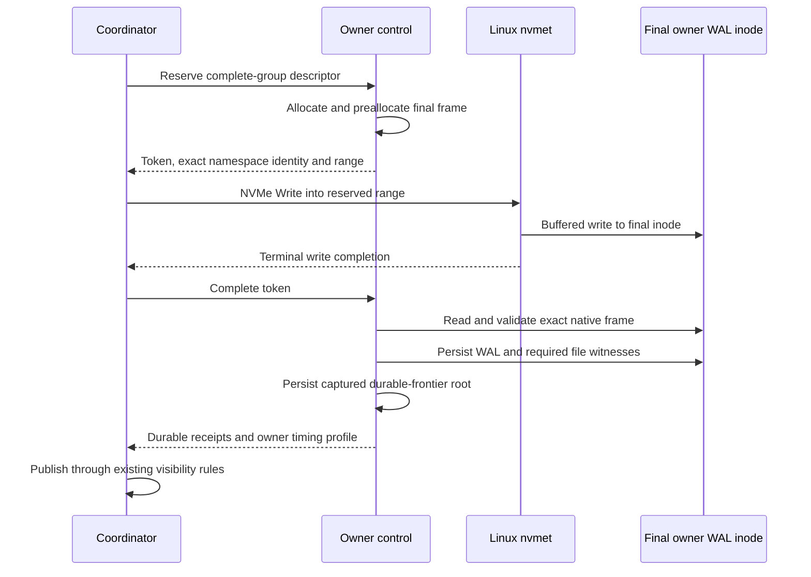
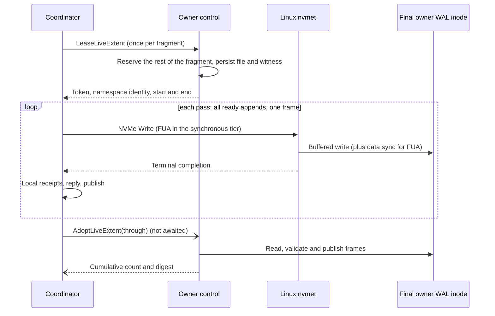

# Live owner WALs over NVMe-oF

This path writes the final Tidehunter WAL inode using either Linux nvmet or an explicitly selected SPDK target. It is distinct from the sealed-image experiment in [README.md](README.md). Neither an accepted configuration nor an ordinary-file test proves a kernel or RDMA path.

## Data ownership and visibility

The coordinator retains the distributed index, logical version allocator, publication frontier and value cache. Each owner retains its own native physical WAL allocator and files, with a separate stream for each authority epoch. There is no shared cluster-wide physical WAL offset. An address identifies its owner, epoch, generation and local WAL position.

One application atomic batch stays on one owner. Several independent complete batches for that owner can share a CompleteGroup. Different owners can execute concurrently, but the existing publication rules still decide when durable batches become visible. This work does not remove the publication prefix, introduce consensus, or create cross-owner transactions.



A successful NVMe Write completion is not a durable database acknowledgement. The owner validates and persists the actual backing inode before returning durable receipts. There is no staging payload that is then appended a second time.

For live SPDK, each case/owner uses an externally supervised root daemon,
started before owner open and retained across owner restart and recovery.
`live_target.spdk` has exactly `rpc_socket` and `executable` absolute paths;
absence selects the kernel target. The SPDK AIO bdev exposes the preallocated
final WAL inode with verified `O_RDWR | O_DIRECT`. Reservations, validation,
owner persistence and durable receipts remain unchanged. Each daemon has a
private RPC socket, exact process/binary/socket identity, bounded systemd
lifetime and an absolute deadline no later than fleet deletion. A successful
owner-issued drain proof and initiator cleanup precede daemon shutdown; an
ambiguous failure retains the daemon, state and logs for quarantine until fleet
teardown. Sealed exports retain their separate `O_RDONLY | O_DIRECT` policy.

Before the daemon stops, its private RPC lock is bound to its actual PID and
inode. After the exact process exits, cleanup may remove only that recorded
lock and socket; unknown or replaced objects remain quarantined. A separately
journaled systemd `ExecStopPost` exit receipt must bind the unit and process
and report successful exit status zero for a graceful qualification. A
timeout or SIGKILL remains a failed qualification even if exact-owned runtime
files can be cleaned after the owner and initiator fences. SPDK subsystem and
namespace absence alone does not prove physical RDMA queue-pair drain.

The experimental node registry retains at most 32,768 SPDK identities to
prevent reuse and tries at most eight random identities per allocation. Hitting
the bound fails before exposing a namespace or mutating a pin. The separate
4 MiB root metadata state bound still applies.

The SPDK direct-file cohort is not an OS-page-cache-hit cohort: repeated reads
do not establish RAM hits or NAND access. SPDK AIO can silently retry without
`O_DIRECT`, so actual descriptor flags and inode must be inspected, not inferred
from the request. Mixing direct I/O and mmap/buffered I/O to the same file has
documented [Linux coherence hazards](https://man7.org/linux/man-pages/man2/open.2.html);
disjoint 4096-byte regions alone do not prove safety with larger pages or
folios. Require exact-filesystem/native recovery and crash qualification, not
just successful component I/O. SPDK write completion does not replace the
owner's WAL/witness/root persistence barriers.

Local TCP qualification must be explicitly selected. A raw file-bdev TCP
component experiment is not native WAL recovery evidence; a successful native
recovery qualification over TCP can establish only its tested recovery scope.
Neither establishes physical RDMA, power-loss or performance. Production
comparisons explicitly require RDMA with no TCP fallback.

Example owner target selection (the campaign generates owner-specific paths):

```yaml
spdk:
  rpc_socket: /run/tidehunter-spdk-live/0123456789abcdef0123456789abcdef/rpc.sock
  executable: /opt/tidehunter/runtime/spdk/bin/nvmf_tgt
```

The native qualification driver's input uses `target_implementation: spdk`
for this arm (omission defaults to `kernel`); the existing CLI is unchanged.
The selected SPDK target still uses the Linux NVMe initiator and its io_uring
path. The driver must verify the actual SPDK binding and target shutdown, not
merely echo this input. Sealed read-only SPDK is a separate control.

## Native mechanisms retained

| Mechanism | Live distributed use |
|---|---|
| Values remain in the WAL | The block write lands in the final owner WAL file. Reads use the published physical reference. |
| Native CRC framing | CompleteBatch member frames remain native CRC frames. CompleteGroup v3 adds canonical CRC-covered padding so the outer frame is a multiple of 4096 bytes. v2 remains readable. |
| Local physical allocation | Each owner allocates its own positions. The coordinator cannot choose or reuse an arbitrary physical range. |
| Completed-position tracking | An external allocation guard holds the native tracker until owner validation completes. Dropping an unresolved guard stops progress rather than advancing across the hole. |
| Recovery of complete batches | Recovery admits complete, validated groups within the recorded durable frontier. It does not expose part of an atomic batch. |
| Protected read lifetime | File, descriptor, namespace and operation owners remain alive through terminal I/O completion. Retirement cannot invalidate an admitted read. |
| Target cache | Linux nvmet `buffered_io=1` uses the target's page cache. Live SPDK requests and verifies direct file I/O and is a separate cache cohort. Neither restores an owner application value cache. |

The native `Db` WAL format and ordinary native append path are not replaced. The explicit external-allocation hook and mapper-thread preallocation are additions for the experimental distributed path. No native mutex has been removed or replaced by an unsafe lock-free approximation.

## Durability and unknown writes

Each live stream has one unresolved external reservation at a time. In leased mode with `lease_ahead` (default on) the stream holds one open extent and at most one pre-leased next extent; see "Lease-ahead" below. A timeout, failed completion or invalid external frame is not proof that nothing was written. The stream cannot allocate a later frame behind that uncertainty.

A live-only, CRC-protected durable-frontier root records the captured completed end and terminal-frame identity. Persistence captures that prefix under the state lock, persists the WAL and required file witnesses, then writes and fsyncs a small new root, atomically renames it, and fsyncs the containing directory. Durable receipts follow all required barriers. A concurrent later append cannot extend the captured root.

This root is necessary because a file-level existence witness does not distinguish an unacknowledged torn tail from corruption of an acknowledged, not-yet-checkpointed frame. Recovery:

1. Revokes and drains old target capabilities.
2. Releases old live pins and reader-authority handles; it does not bypass the partition lock.
3. Validates every frame inside the persisted durable frontier (the **synced** frontier). A bad CRC, invalid geometry, corrupt root, missing fragment or inconsistent terminal frame there is fatal.
4. Continues past the root, frame by frame, and adopts a frame only if it is complete and valid: outer CRC, 4 KiB geometry, group decode with inner CRCs and digests, owner epoch, batch validation, no identity or version already present. The first missing, torn or invalid frame (or a skip-marker suffix that is not zero-filled) ends the scan without error, the same rule as native WAL replay. Adopted frames are appended, not yet synced; recovery syncs them before sealing.
5. Seals the old stream and durably adopts a new authority epoch.

The root adds a file and directory persistence barrier. Its cost is measured separately; this document does not claim that NVMe writes are faster than the existing RPC append path. Native frame alignment is not a claim of power-fail atomic 4 KiB writes.

A typed incomplete-external-frame outcome permits only status and a strictly higher recovery fence while the owner is unhealthy. Actual I/O, persistence and internal failures remain fail-stop. A failed seal cannot become a successful acknowledgement merely because an in-memory `sealed` flag was set before its failed barriers. Missing live registration with a remaining frontier is an error, never permission to reopen as an ordinary stream.

### Durability tiers on the live path

| Tier | Completion RPC replies | Persistence |
|---|---|---|
| `synchronous` | after validation **and** the covering sync (WAL fdatasync, frontier file sync, rename, directory sync) | the owner's single flusher waits on the log's synced frontier once for every completion queued behind one sync |
| `native` (default) | after validation; the group is already in the owner's page cache and in the contiguous *appended* frontier | the log's syncer thread runs the same barrier sequence in the background, on demand or at a fragment boundary |

The root is the **synced** frontier and the checkpoint cut. It is written only by the barrier sequence above, never on the acknowledgement path of the native tier.

**Why the native tier keeps acknowledged writes across an owner process crash.** A live completion publishes its group into the appended frontier only after owner validation, in WAL order, under the partition state lock, and a stream has at most one unresolved reservation. So no acknowledged frame lies beyond a missing or unfinished frame: an unfinished reservation also blocks every later reservation, hence every later acknowledgement. After a process crash the frames are in the target's or the owner's page cache (or on the device for a direct-I/O target) even though the root is older. Recovery rule 4 above replays them in order and stops at the first frame that is not complete, which by the previous sentence cannot precede an acknowledged one. Nothing is acknowledged that rule 4 would reject.

**After a kernel or power crash** the unsynced suffix may be partly or wholly absent, and page write-back order is arbitrary: a later frame can survive while an earlier one is lost. Rule 4 stops at the first invalid frame, so recovery yields a valid prefix, never a corruption error and never a gap. The loss window is the unsynced suffix, as in native Tidehunter. A defect *below* the root remains fatal, because every frame there was covered by a completed barrier.

**No abandoned reservation is ever skipped.** The owner never allocates a frame behind an unresolved reservation and fails stop on any unknown outcome, so a recoverable stream never contains a valid frame beyond a hole. This keeps the format unchanged: no hole or skip record is needed. Allowing several outstanding reservations would need such a record (or the contiguous-tracker proof above applied to each hole) and is not done here.

**Checkpoint invariant.** A checkpoint proof persists exactly its captured prefix before it is issued (`checkpoint_proof` calls `persist_through`), and the coordinator publishes a checkpoint frontier only from a proof. The persisted index image therefore never references owner data beyond that owner's synced frontier, so an owner kernel crash cannot leave the image pointing at lost bytes.

### Owner history persistence (`history_persistence`, default `wal_replay`)

`wal_replay` is the default (13 November 2026). It follows the Tidehunter paper (arXiv:2602.01873v2, sections 3.3 and 3.4): the owner WAL is the only record, the coordinator snapshot stores one WAL position for each owner stream, and recovery replays each WAL from its position.

- The owner keeps the receipts of the newest 4,096 batches in memory for exact retries and version conflicts. It writes no history file and starts no history thread. No put waits for a spill.
- A reference outside the window is served from WAL bytes: the owner reads the member frame at the address, checks length and CRC, and decodes the descriptors. The coordinator index is the authority for a read.
- The owner root file `partition-wal-root-v1` (fixed-integer bincode with a CRC32; file sync, rename, directory sync) holds the scan start (`scan_from`, a fragment start), the largest synced position (`synced_end`) and the retired WAL files. `CheckpointPosition` syncs the WAL file data through a position and writes the root; it needs no adoption and no settle of a leased extent. Its reply (`durable_end`) is `synced_end`.
- An owner restart scans from `scan_from`. An invalid frame below `max(synced_end, live frontier end)` is fatal. Beyond that bound a live stream stops at the first invalid frame; an ordinary owner RPC stream stops inside that fragment and continues at the next fragment (a complete group in a later fragment survives a lost skip marker). Bytes before `scan_from` are not read again.
- `ReplayWal` and `ReplayLiveWal` return whole groups in WAL order from a WAL offset; `next` is a WAL offset. The owner decides the page end (receipt count and byte budget) and remembers the returned cursor, so paging a fragment decodes each group once.
- The coordinator image (format 3) holds, for each stream, `replay_from`, the offset of the last covered receipt, the durable end and a `complete` flag, plus the 4,096 most recent checkpointed identities. Reopen replays each sealed stream with `ReplayWal` (owner RPC route) or `ReplayLiveWal` (NVMe-oF route). A sealed WAL that ends below the durable end of the image fails the reopen.
- Retry rule: an exact retry gets its old version only inside the replay suffix or the recent 4,096 identities. An older retry is written again; the higher WAL position wins.
- The replay suffix has no batch or byte limit. A checkpoint starts at the soft trigger and runs in the background. Recovery time grows with the suffix. The bound on unresolved identities in memory (`max_admitted_batches`) stays. The pending-byte budget must hold one replay group for each owner.
- A pending `CheckpointPosition` does not stop leased appends when the next frame needs no owner exchange (an extent is open and the frame fits, or the pre-leased extent is ready). An append that needs an owner exchange waits for the position reply. While the reply is pending the coordinator sends no close, pre-lease or adoption.
- Retirement uses `RetireWalFiles`; the owner records the file in its root before the unlink. The coordinator retires a file of a stream only after a committed image marks the stream complete and no index entry references the file. A stream becomes complete in the first image after its replay ended.

`on_disk` is kept for compatibility only (old documents, the in-process `LocalInventory` database, and tests of the old proof protocol): the owner keeps the receipts of the newest 1,024 batches in a window and spills older ones to the reference-history files. In the page-cache tier the window fills before the next fragment sync, and a put waits for the spill (run 11: 50 to 65 ms for each 1,024 batches). A launch file, receipt, configuration or manifest without the key was written before the change and means `on_disk`. A stored partition keeps its mode; a request for a different mode fails.

`memory_only` exists only in a build with the `test-utils` feature; a build without it rejects the value when it reads the launch file. In this mode:

- The owner keeps each receipt, its group end and its prefix digest state in memory (at most 2,097,152 batches; then a put fails with a capacity error). It writes no history file and starts no history thread, so no put waits for a spill.
- Retries, version conflicts, receipt pages and checkpoint prefixes give the same answers as with `on_disk`.
- The record descriptors are not kept. An owner RPC read of a batch outside the window, an on-demand live grant and a coordinator reopen fail with an error. Reads must use a permanent live export (`export_mode` below).
- WAL file retirement fails with an error. An owner cannot start on a root that has history or WAL data; a second start of the same owner fails.

The launch file and the owner durability receipt always record `history_persistence`. A result measured with `memory_only` excludes the cost of recovery and must say so.

### Lease-ahead (`lease_ahead`, default on in leased mode)

Without lease-ahead, the group that does not fit the open extent waits for the skip marker, the adoption settle, the close and the next lease (run 12: 17.6 ms mean for a 128 MiB fragment). With lease-ahead the coordinator asks for the next extent (`PreleaseLiveExtent`) after each install. The switch on the put path is: write the skip marker, use the pre-leased extent, write the frame. The close of the old extent and the next pre-lease run after the reply. If the pre-lease is late, the switch waits for it (`extent_switch_waits`). The paper keeps a buffer of pre-allocated maps for the same reason (section 3.1).

The owner holds one open extent and one pre-leased extent. A close promotes the pre-leased extent. A seal or a control command with an unused pre-leased extent skips that fragment (no data is written into it). Recovery scans bytes: an empty pre-leased extent is an unwritten tail.

### Polled writes (`polled_writes`, default off)

The leased writer ring can use `IORING_SETUP_IOPOLL` when the connection has a poll queue (`queue_geometry.poll_queues >= 1`) and the write mode is `leased`. Other combinations fail validation.

### Merged live reservations

The per-owner coordinator worker merges the append groups already queued for one owner into one `CompleteGroup`, bounded by the owner's group limits (batch count, payload bytes, aligned frame size) and never across epochs or a non-append command. One reservation RPC, one block write, one completion RPC and one persistence sequence then serve the whole merge; receipts are split back to the original commands in order. A failure fails every command of the merge as uncertain. The on-disk and wire formats are unchanged: a group already carries several batches.

### Leased extents (`write_mode: leased`, opt-in, not power-loss qualified)

The `reserved` mode above needs two control exchanges for each group (reserve, complete), an owner read-back and the frontier-root barrier before the reply. The `leased` mode removes the owner from the acknowledgement path. It follows the split of the Tidehunter paper (section 3.1): the coordinator is the synchronous controller of the stream (it allocates positions and writes), the owner is the asynchronous controller (it allocates extents, validates, persists the root, retains and recovers). `reserved` stays the default. There is no fallback between the modes.



**Stream layout.** An extent is one native external allocation: the rest of the current WAL fragment. A stream has at most one open extent. The coordinator writes a gap-free sequence of v3 frames into it. When the next frame does not fit, it writes one 4096-byte block that starts with the native skip marker and continues in the next fragment after one `AdoptLiveExtent{close, lease_next}` exchange. No frame type, hole record or format version was added.

**Acknowledgement.** One write is in flight for each stream. A command is acknowledged when its frame's write and every earlier write of the stream completed. Any failed, short, timed-out or cancelled write is an unknown outcome: the authority is poisoned, the write is never retried and the range is never reused. An operation whose acknowledgement was lost can be present after recovery.

| Tier | Acknowledged when | Owner frontier root |
|---|---|---|
| `native` | the NVMe write completed: the frame is in the owner host's page cache | follows through adoption and the background sync |
| `synchronous` | an FUA write (`RWF_DSYNC`) completed: the nvmet file backend ran a data sync of the written range on the final inode | NOT yet updated; follows through adoption |

**Frontiers.** Four positions stay distinct: the coordinator's written end (acknowledged), the owner's adopted end (its appended frontier), the owner's synced frontier (the root) and the checkpoint cut. Adoption, including the owner's own forward scan (self-adoption), publishes to the appended frontier only. A synchronous-tier read, a checkpoint proof and the durable frontier still need the owner's barrier. The checkpoint invariant above is unchanged.

**What the owner checks, and when.** The coordinator enforces batch and group limits, the epoch and unique identity and version before it writes. The owner repeats the full frame validation at adoption (CRC, v3 geometry, group decode, batch validation, fresh identity and version). A violation poisons the stream. Each adoption reply carries the cumulative receipt count and a BLAKE2b-256 digest at the owner's adopted end; the coordinator compares them with the receipts it acknowledged and fails stop on a difference or a shortfall.

**Before a lease is granted** the owner makes the extent's file durable as a file: final size and pre-allocation, directory entry, inventory witness. A data sync of a frame does not make a new file's directory entry durable.

**A lease is not idempotent.** A lease request for a stream that has an open extent is refused without poison, so one caller holds each extent. The coordinator treats a failed or lost lease exchange as an unknown outcome and fails stop. A fence then recovers the extent through the recovery scan.

**Adoption and the owner sync.** In the synchronous tier each adoption requests the frontier sync and does not wait for it. In the native tier only the extent close (the fragment boundary) and the on-demand paths (flush, checkpoint, seal) request it, as in native Tidehunter. The coordinator keeps the receipt boundaries of at most 1024 frames that no adoption reply has covered. When that history is full, the next put first waits for a synchronous adoption: this is the backpressure for an owner that falls behind.

**Why the owner falls behind.** The frame work is not the cause. Adoption reads the first 4096-byte block once (and the suffix of a larger frame), validates and publishes one frame per hold of the partition state lock; the workstation fixture measured about 8 µs per 1 KiB frame. The cause is the owner's reference-history writer, which the owner RPC append shares. The owner keeps at most 1024 batches that the durable history root does not cover. When that window is full, it appends descriptors, receipt slots and copy-on-write index nodes, syncs the three files and replaces the root; adoption (or an RPC append) waits for it. On the workstation fixture one such spill took 57 to 85 ms and wrote about 7 to 9 KiB of history per 1 KiB batch. Nothing prunes these files. A 4096-put case therefore contains about three or four such waits on either route. Report the settle count and time with every leased result, not only a percentile.

**Adoption evidence.** The live metrics, the Prometheus export and the write profile carry three values for it: `adoption_async_ns` with `adoption_async_samples` (asynchronous adoption, from a successful submission to a validated reply), `adoption_settle_ns` with `adoption_settle_samples` (a synchronous settle that keeps the extent open, including the wait for an outstanding asynchronous adoption) and the counter `adoption_history_full_settles`. Only successful operations add a sample. They are sums and counts: a mean exists, a distribution does not. In the synchronous tier the FUA write count equals the frame count plus the skip-marker count. An asynchronous adoption can finish after the last put. The benchmark therefore takes each measurement boundary only when no adoption is outstanding; it waits at most 5 s and then fails the case.

**Tier binding.** The coordinator configuration names the tier it requires (`leased_durability`, mandatory with `write_mode: leased`). Each lease reply carries the owner's tier for that stream, fixed when the stream's frontier started. A reply with another tier is refused before any write. The coordinator never infers the tier from a connect-time status and never defaults to a plain write.

**Recovery** is the existing rule: after revocation and drain, validate everything inside the root (a defect there is fatal), then adopt complete valid frames beyond the root, across skip markers, and stop at the first invalid frame. An open extent is in-memory state only. Limit to state in every report: in the synchronous tier an acknowledged frame can lie beyond the root. If such a frame is corrupt after a kernel or power crash, the owner cannot tell it from a torn tail, as in native Tidehunter replay. A live coordinator detects the shortfall.

**Commands on the writer.** A checkpoint first settles (a synchronous adoption through the written end; the extent stays open). A seal and every control closure first close the extent, which wastes the rest of the fragment. A clean shutdown closes a healthy open extent.

**Not done.** No power-loss or kernel-crash qualification of the FUA acknowledgement exists for this mode. More than one frame in flight, polling queues and registered buffers are not implemented. Run 11 (11 November 2026) ran the campaign selection `leased_ab_compact` on the kernel target over RDMA: 72 of 72 cases, with the FUA and exchange gates satisfied in all 24 `leased` cases. Results: `docs/distributed/FOCUSED_CAMPAIGN_2026-11-07.md`, "Run 11 results". At 1 KiB the synchronous `leased` put is slower than the owner RPC put; at 64 KiB it is faster.

## Reads and caches

A coordinator value-cache hit does not issue a shard payload read. On a miss, a dedicated bounded live read lane obtains an authenticated owner mapping, opens the verified namespace and issues aligned block reads. It validates the returned member and preserves input order, missing entries and duplicates.

A lane caches at most eight file grants, namespace descriptors and I/O queues. This is a mapping/resource cache, not a value cache. A cached mapping is usable only for trusted published-index references in its exact owner/epoch/file generation. Connection and grant setup is kept out of the shared read-progress actor. Direct low-level client reads use a temporary grant cache rather than assuming they possess a persistent published-index mapping.

A scalar read of live data runs on the caller thread when its lane is idle and holds a healthy cached grant with free credit (`LiveClientConfig.inline_reads`, default true). It takes no actor or lane-worker hop. Any other state falls back to the lane worker and counts its reason (`read_profile_live_inline` and six `read_profile_live_inline_fallback_*` counters in the measurement boundary evidence). `inline_reads: false` sends every such read to the lane worker and counts nothing; the option exists for a matched comparison. Aligned block ranges that overlap or touch are merged into one read command (at most 32 members).

A lane keeps several requests in flight. `LiveReadCache::submit` starts the I/O of a request without waiting for a CQE, `poll` harvests every grant's CQEs and returns finished requests in completion order, and `wait` blocks in `poll(2)` on the grant rings and a lane waker until a CQE, a wake or a timeout, so an idle or waiting lane does not spin. In-flight work is bounded by the lane request bound and, per grant, by the `LiveIo` member slots and byte credit; a request larger than the free credit is admitted in waves. The cached grant that is evicted when the cache is full is the least recently used idle grant, never one with I/O in flight. A controller connect or an idle-controller delete runs outside the controller-pool lock; the pool entry is marked closing, so other users of that target wait, and a failed delete leaves an unusable entry for retry.

Verified member values are slices of the aligned I/O blocks. A block returns to its queue's pool only after the terminal CQE and after every slice of it dropped. A slice that a caller retains (for example in a value cache) keeps its whole block, at least one device block plus alignment slack, alive outside the queue's byte budget: the retaining cache must account for that or copy the value.

The same NVMe transport serves target Linux-cache hits and target storage reads. `O_DIRECT` on the initiator's block device does not bypass the remote target's page cache. A first-touch label or logical WAL-read count alone does not prove physical SSD access. Cold cohorts retain their explicit cache procedure and device/trace evidence; unavailable cache-hit or device observations are not replaced with zero.

Before physical retention, the coordinator pauses new read admission and drains each live lane's cached grants through a bounded FIFO barrier. Outstanding read handles make this preflight busy before mutation; they must not poison the authority. The coordinator value cache and index are not cleared. Namespace FDs and accepted I/O retire before the corresponding strict owner pin release.

### Queue geometry and polled inline reads (`queue_geometry`, default 1 × 32, no poll queue)

`LiveClientConfig.queue_geometry` has three fields: `io_queues` (1 to 16, default 1), `queue_size` (16 to 128, default 32) and `poll_queues` (0 to 4, default 0). Each coordinator connect of the live route uses it (`nr_io_queues`, `queue_size`, and `nr_poll_queues` only when it is not zero). After the connect the coordinator reads sysfs and fails closed unless `queue_count` equals `io_queues + poll_queues + 1` and `sqsize` equals `queue_size - 1`. The owner check connect uses the default. A configuration without the field gets the default, and the connect string is then the same as before.

With `poll_queues > 0` each lane grant has a second ring with `IORING_SETUP_IOPOLL` for the caller-inline read. The caller reaps its completion in a loop that the read deadline bounds; it does not sleep in the kernel. Lane workers and the write ring keep the interrupt ring, because they wait in `poll(2)` on ring descriptors. `poll_queues > 0` with `inline_reads: false` is rejected. A change of the default geometry needs the owner's decision.

Not verified on the workstation: `nr_poll_queues` on `nvme-rdma` and `IOPOLL` on that block device in the guest kernel. The polled canary of run 12 is the first execution.

### Permanent export (`export_mode`, default `on_demand`)

`on_demand` is the behaviour described above: the owner exports a WAL file when it leases the file for writes or when a lane asks for a grant, and a lane keeps at most eight file grants.

`per_owner` makes a WAL position sufficient for a read of the active epoch, as in the original engine:

| Event | `on_demand` | `per_owner` |
|---|---|---|
| Owner leases a WAL file for writes | exports that file | adds the file as a namespace of the owner subsystem |
| First read of a lane | request, owner history lookup, export with a check connect, controller connect | one request (`OpenLiveExports`), then a controller connect if the process has none |
| First read in another WAL file | the same as the first read | local open of the block device |
| Read in a file that is open | direct | direct |
| Lane limit | 8 files | 8 subsystems of 1,024 files |

For a file `i` of the active epoch and `F` files for each subsystem (`per_owner`: 1,024; `per_file`: 1), the subsystem is `i / F` and the namespace id is `i % F + 1`. The subsystem NQN and the namespace UUID are BLAKE2b hashes of the database id, partition, epoch and subsystem or file index. The owner and the coordinator compute them with one function (`wal_export_name`), so the owner sends no location. `per_file` is the fallback: no namespace is added to a connected subsystem.

Rules:

- The coordinator configuration and the owner launch file must select the same mode; `OpenLiveExports` fails on a difference. A permanent mode needs `write_mode: leased` and the kernel target.
- The modes cover the active authority epoch. A reference of a sealed epoch uses the on-demand path. A seal, a new epoch and a file retirement remove the exports as before.
- A reader opens a namespace read-only without setting the block device read-only (`ReadShared`), because the writer of the same host uses the same device.
- All files of an owner use one controller. The queue geometry above applies to it.
- Faults: after an owner stop, a connection loss or a retirement, a read through the failed subsystem returns an error. A lane records each subsystem of the active epoch that had an I/O error or a failed setup, and refuses it without a new owner request or connection until the coordinator opens the database again. A deadline, a cancelled request or a record that fails its check returns an error for that read only. Recovery and retries are not implemented for these modes. A grant that a lane evicted in a healthy state can be opened again (`per_file` with more than eight files needs this). The coordinator checks of a read (namespace UUID, geometry, CRC) stay.
- The owner holds one pin descriptor for each exported file; the coordinator holds one descriptor for each file that it used. At 1,024 exported files a systemd unit needs a descriptor limit above the default soft limit of 1,024 [INFERENCE].

Kernel facts read in the v5.14 source (the guest kernel is a vendor build of 5.14 and is not verified): a subsystem has at most 1,024 namespaces (`NVMET_MAX_NAMESPACES`); enabling a namespace sends a namespace-changed event and a connected host scans again without a reconnect; the scan is asynchronous, so the first open of a new file waits for the device in a loop that the connect deadline bounds.

## Target fencing and cleanup

Targets use actual preallocated native WAL files and verify device/inode identity, size and allocation. Writable and sealed read-only exports are distinct states. Private loopback NVMe/TCP commissioning verifies namespace identity, geometry and required read-only protection before the public link is exposed. The TCP commissioning connection is not a payload fallback for a selected RDMA experiment.

A durable owned-object journal precedes exposure. Startup reconciliation runs under the node inventory lock before WAL recovery. Actual namespace disable/drain, not merely a client epoch field or local disconnect, establishes the old-I/O boundary. Existing sealed markers are directory-synced again before their recovery registration can be retired. Physical WAL paths are not reused for a later generation.

Initiator controller intents are published atomically. Hidden native-multipath path devices are not mistaken for usable namespace heads. Every uncertain connection outcome retains its bounded pool slot and durable intent, including non-timeout failures. Teardown operates on exact owned controllers and namespaces; it never performs a global disconnect or deletes another run's objects.

Ordinary database close is reopenable. Final target shutdown is a separate operation. The owner process writes a private, atomically installed shutdown receipt bound by BLAKE2b-512 to the exact loaded launch bytes, node identity, PID and process start ticks. Hardware cleanup proof requires non-fixture statistics, no target errors and zero remaining owned namespaces. An unresolved client or owner drain prevents successful cleanup admission.

The trust model is an isolated network with authorized, non-Byzantine privileged initiators. NQN ACLs are not cryptographic authentication, and privileged root can alter namespace protection or backing files. This is not Byzantine fault tolerance or protection against malicious root.

## Source map

| Source | Responsibility |
|---|---|
| `tidehunter/src/distributed/group.rs` | Canonical aligned v3 complete-group encoding and strict decode. |
| `tidehunter/src/distributed/storage.rs` | Live reservation/completion, durable frontier, recovery, physical reference and retirement invariants. |
| `tidehunter/src/wal/{mod,tracker,mapper}.rs` | External allocation guard, completed-position tracking and serialized final-file preallocation. |
| `tidehunter/src/distributed/nvmeof/live_storage.rs` | Reservation, segment and pinned-location data types. |
| `tidehunter/src/distributed/nvmeof/live_target.rs` | Owned configfs lifecycle, commissioning, fencing and restart reconciliation. |
| `tidehunter/src/distributed/nvmeof/{live_namespace,live_connect,live_pool,live_io}.rs` | Verified block devices, controller ownership/pooling and bounded io_uring I/O. |
| `tidehunter/src/distributed/tcp/{live_control,live_client,live_read,live_recovery}.rs` | Authenticated metadata, final-frame writes, member reads and payload recovery without payload RPC fallback. |
| `tidehunter/src/distributed/tcp/{control,inventory}.rs` | Owner authority, persistence, target publication and higher-epoch recovery. |
| `tidehunter/src/distributed/remote_db.rs` and `remote_db/{pending_read,concurrent,checkpoint_lifecycle,transports}.rs` | Live dispatch, queued checkpoint overlap, grant drainage, open/close/reopen and controller ownership. |
| `tidehunter/src/distributed/sui.rs` | Existing Sui-facing operations, typed live evidence and separate final shutdown. |
| `tidehunter/src/distributed/nvmeof/{live_metrics,live_prometheus}.rs` | Per-client counters, bounded observed-route evidence and pull-based Prometheus collection. |
| `benchmarks/kv-research/src/backends/tidehunter/live_qualification.rs` | Real-file component qualification and actual-kernel operation/crash-recovery qualification. |
| `experiments/gcp-rdma/{gcp_live_qualification,gcp_qualify_bootstrap,manual_campaign}.py` | Two-host transport qualification, source/image binding and bounded manual cloud lifecycle. |

## Timing interpretation

Per-case raw API, scheduling and response samples remain the percentile populations. Live counters are taken at quiescent measurement boundaries and retain raw start/end observations and deltas. Routes are recorded only after opening an actual verified kernel namespace.

`LiveNvmeStats` separates client allocation, control round trips, namespace setup, client validation, queue delay, submit calls and completion residence. Owner frame read/validation and persistence come from the owner completion response. WAL file/namespace and durable-frontier file/namespace barriers have separate sums and sample counts.

Lane counters in `LiveNvmeStats` (and `tidehunter_nvmeof_live_*`): `lane_inflight_samples` with `lane_inflight_request_sum`/`lane_inflight_op_sum` (mean requests and member operations in flight, sampled at each flight submission) and the peaks `lane_inflight_request_max`/`lane_inflight_op_max` (the peaks keep the largest value across lanes, not a sum); `delivery_*` (observed CQE to delivered, validated result, per request); `grant_hits`, `grant_misses`, `grant_evictions`; `controller_connect_*` and `controller_disconnect_*` (the blocking kernel connect and idle-controller delete, without pool waits); `copy_bytes_avoided` (member bytes delivered as slices instead of a copy). Submission-to-CQE stays in `cq_*`. The benchmark harness delta lists name counters explicitly: the new sums need adding there to appear in measurement-boundary deltas.

The Prometheus prefix is `tidehunter_nvmeof_live_*`. Timing sums are seconds with explicit sample counters. A timing with zero samples is unavailable, not zero latency. Target fencing statistics are the latest recorded per-partition observations, not continuous remote probes. Namespace IDs and device paths are retained in bounded artifacts rather than high-cardinality metric labels.

Submission-to-CQ and read-I/O spans include initiator scheduling, kernel work, fabric, target execution and storage where applicable. They are **not pure transport time**. Owner persistence total nests its file/namespace/root stages; those children must not be added to the total. Failed completion RPCs do not provide owner-side timing evidence. Target trace and backing-device observations remain separate populations.

## Qualification and cloud admission

The reviewed full comparison plans 473 cases: 37 live NVMe cases, 26 sealed-read controls and 410 other cases, including twelve added Valkey diagnostics. There are 29 primary live cases. Backend capability differences, including atomic batch support, remain explicit. Single-repetition development results have no run-to-run error bars or statistical-significance claim.

Local qualification must exercise the real final-WAL file path and, where kernel privileges permit, actual Linux NVMe/TCP. An ordinary-file io_uring test is labeled component-only. Kernel qualification includes writes, deletes, mixed atomic batches, scalar and ordered/missing reads, iteration/checkpoints, coordinator cache miss/hit, graceful reopen, and separate abrupt coordinator exit with acknowledged but uncheckpointed data. Only the abrupt-tail reopen requires positive payload recovery-read counts; a fully checkpointed graceful reopen can legitimately read no payload.

Cloud allocation requires a freshly rebuilt, source-sealed package and a successful two-host physical transport qualification. GCP Falcon/RDMA is not proved by a Linux TCP run, a device name, or compilation. The full fleet uses the admitted source/image, one bounded campaign and exact-owned cleanup. If admission or execution fails, preserve partial artifacts and terminate the owned resources; do not launch a replacement fleet silently.

### Local verification, 2026-11-04

The actual Linux NVMe/TCP qualification passed on the laptop kernel, not on an ordinary-file substitute. It exercised scalar writes and deletes, mixed atomic batches, ordered/missing reads, iteration and checkpoints, coordinator cache miss/hit, graceful reopen, and recovery after an abrupt coordinator exit with an acknowledged uncheckpointed write. Recovery recorded a positive NVMe payload-read completion; all recorded payload-RPC counters were zero.

The target shutdown receipt recorded six namespace exports and six completed disable/drains, four read-only commissioning successes, zero target errors and zero remaining owned namespaces. This proves the exercised local lifecycle, not Falcon/RDMA compatibility, physical cold-SSD latency or cluster performance.

Kernel execution exposed two lifecycle defects that unit-only qualification had missed:

- Controller deletion is asynchronous. Cleanup now waits for the exact original device/inode to disappear, with a deadline and retained uncertainty journal.
- Revoking the last read-only target namespace can remove its initiator controller before pool shutdown; Linux can then reuse the same controller number. Cleanup recognizes disappearance or replacement of the original inode and never deletes the replacement. Missing teardown attributes trigger bounded observation, not a second delete or blanket error suppression. Namespace/device readiness also distinguishes transient disappearance from permission or I/O failure.

Qualification-only progress files preserve phase labels and actual counters on failure. They are explicitly partial diagnostics, never successful qualification receipts.

| Local check | Observed result |
|---|---|
| Core distributed/fabric/NVMe library tests | 1,002 passed; 21 ignored |
| KV adapter library tests | 88 passed |
| NVMe qualification binary test | 1 passed |
| Core and adapter all-target Clippy | Passed with `-D warnings` |
| Python comparison/GCP/observer/NVMe suites | 846 tests; 7 skipped; no failures |
| Pinned Prometheus/Grafana | Live capture, authenticated queries, offline restoration and rendered live-stage panels passed; exact-owned containers stopped |

The observer exercise uses an explicitly failed fixture, not invented workload samples. Its unavailable live-NVMe panels correctly remain `No data`. Persistent local receipts are under `checkpoint-work/live-nvmeof-local-qualification-20261104/` in the parent workspace.

Before cloud allocation, GCloud MCP listed no `bench-*` VMs. Project management, guest delegation and artifact permission tests passed. The infrastructure preflight also read the exact reviewed READY image under the guest identity through MCP and matched its numeric ID and geometry. This actual resource check replaces a redundant guest project-wide Resource Manager probe that required an otherwise unused API; no API or IAM change was needed. Future image access, quota and physical RDMA operation still require their own admission checks.

The shared MCP Compute wrapper uses error-only CLI verbosity so informational and impersonation warnings do not contaminate JSON output. It still propagates command failures and rejects malformed JSON. The actual guest image request was exercised through this shared wrapper before allocation, not only through the preflight helper.

Manual VM creation uses the stable Compute command with explicit private GVNIC and IRDMA interfaces and the original absolute `DELETE` deadline. It does not require Compute Alpha Access. Both the installed stable NIC parser and its Compute v1 model were exercised offline with `IRDMA`; the older help text lists fewer NIC choices than the implementation.

Provider observation exposed millisecond truncation of a requested microsecond deadline. New deadlines are rounded down to whole seconds before persistence and submission; exact `DELETE` expiry equality remains required. Cleanup requests forced shutdown after generation- and digest-bound results are durable in object storage, or after an aborted phase. It observes scoped absence for at most ten minutes. Validated terminal exports are downloaded after compute deletion; unknown, corrupt or unbound exports retain the bounded collect-first fallback. A lost command reply is not proof of absence, and observation does not reissue the delete.

The first Falcon pair reached RDMA connections and loaded the NVMe/RDMA modules, but live-I/O qualification stopped in the route collector before it could produce a live-I/O receipt. Linux returns `EINVAL` for an individual `gid_attrs/ndevs/<index>` with no usable GID/netdev association. The collector now skips only that per-index result and continues looking for the exact routed interface. It still requires exactly one matching ACTIVE port; other I/O, permission, disappearance, state and counter errors remain fatal. A regression covers an unmapped first slot followed by a valid mapping, absence of a matching interface, and propagation of other errors.

The second Falcon pair also reached RC send/read connections and loaded NVMe/RDMA modules, but its route collector found no `counters/port_xmit_data`. Linux creates the classic PMA counter directory only when the provider implements `process_mad`; it is not a universal RDMA ABI. The collector independently discovers PMA `port_xmit_data`/`port_rcv_data` (four-octet units), IRDMA `hw_counters/ip4OutOctets`/`ip4InOctets` (octets), and `OutRdmaSends`/`InRdmaSends` (operations). The IRDMA driver source identifies candidates, not proof that Google exposes or advances them. Both attributes absent make a family unavailable; partial pairs, malformed reads, permission/I/O failures, port identity changes and resets are errors. All available families retain their units and paths.

Route snapshots also retain bounded raw `counters` and `hw_counters` filename listings to diagnose the actual provider ABI. Unknown filenames are not interpreted as counters and cannot establish admission evidence.

The typed counter collector was also exercised on the laptop's actual routed network interface: a real HTTPS exchange produced increasing byte counters with stable interface identity. This is a TCP counter-component check, not RDMA qualification or a performance result. The local GCP suite now covers native-family selection, unavailable counters, unit/path/port changes, resets, bounded partial capture, and preserving the primary failure and final-status budget.

Admission requires a common family advancing in both directions on both hosts, alongside the actual NVMe namespace identity, expected RDMA address, operation CQs, data integrity, recovery, cache hit/miss, fencing, shutdown and zero payload-RPC-fallback evidence. Shared port counters are independent physical-route evidence; they do not uniquely attribute bytes or operations to this workload or QP. Missing independent counters need not stop the kernel functional probe, but its bounded partial diagnostics are explicitly non-admitted and cannot authorize the fleet. Neither failed pair is a performance result. Their owned VMs, disks, placement policies and temporary images were deleted; those two attempts did not start a six-host fleet.

### Physical qualification and campaign repair, 2026-11-04

Campaign `bench-33a29f5b0f80447c` subsequently passed the physical Falcon/Linux NVMe-RDMA gate. Both hosts advanced the same native `irdma_sends` operation-counter family. The live path completed scalar writes and deletes, mixed atomic batches, ordered reads with missing keys, iteration, checkpoint, reopen, abrupt-tail recovery, cache hit/miss and fencing/drain checks. Payload-RPC fallback remained zero; six target namespace exports were drained and no owned namespace remained. These are functional qualification observations, not cold-storage latency results.

Its six-host comparison stopped after 25 of 461 cases, all Valkey TCP. Case 0024 completed, but the client's `io.stat` device population changed between boundary samples. The resource collector rejected the whole interval; the controller then refused the next case. The Prometheus/Grafana capture itself was complete. No native/TCP/RDMA comparison can be drawn from this partial run.

The repair treats CPU/memory identity and I/O validity separately. A changed I/O device set leaves I/O totals unknown; it never fabricates zero for an absent device. Independently validated CPU and available memory gauges remain usable. Resource receipts still report incomplete I/O, and Grafana exposes full, core and I/O availability separately. Genuine core/identity/observer failures remain fatal. Replaying the actual case-0024 boundary files proved `core_complete=true`, `io_complete=false`, with I/O totals absent.

Cleanup now submits at most six exact-owned per-host deletion paths concurrently under the original shared deadline, so one slow `STOPPING` VM cannot prevent requests for the other hosts. The parent pins terminal receipts, archives and inventories in object storage before teardown; local bulk retrieval follows cleanup for validated success and failure exports. Unknown, corrupt or unbound exports retain bounded best-effort collection before cleanup. A timeout of the exact read-only delegated guest-token command during mailbox polling retries observation of the same request, not command submission, under the original deadline. Other credential/permission errors still fail.

All resources from this attempt were independently verified absent, its lease was released, and 476 objects were generation/digest-verified locally. Its 14,786.127 aggregate VM insert-to-delete seconds imply about $13.50 at the configured hourly rate; this is a wall-window estimate, not an invoice. The shared weekly reservation limit is now $900 so a reviewed $95 corrective campaign can fit after $758 in prior reservations; reservations are not measured spend.

After these Python-only repairs, local suites passed 857 tests with seven skips across comparison, GCP lifecycle, observability and NVMe tooling. The deployed Rust engine was unchanged. A new package must still be sealed from the repaired sources before allocation.

### Read-only control timeout repair, 2026-11-04

The next campaign, `bench-245586a38b604d9e`, again passed physical NVMe/RDMA qualification. Its six-host fleet, `bench-cd2cbd3375d446aa`, stopped before controller submission: one guest boot-disk description exceeded the Compute callback's 30-second observation limit. A separate delegated-token timeout interrupted export. Recorded DNS/TLS errors also affected cleanup. This attempt produced no KV comparison measurements.

Emergency cleanup checked the saved resource IDs, source and ownership nonce. Four timed-out delete calls did take effect: the provider reported `STOPPING`, then absence. Recovery subsequently completed unchanged with `cleanup_verified=true`, no errors and no lease. The independent MCP watcher confirmed every owned VM, disk, policy and temporary image absent; the original base image remains. Thirty-eight qualification objects were generation/digest-verified locally. The configured-rate VM wall-window proxy is $7.625, or $21.126 combined with the preceding attempt; neither is an invoice.

Read-only Compute timeouts now allow three observations with identical arguments under the original deadline. A recorded delete is never replayed because its reply timed out; cleanup observes the same resource and refuses success while its outcome is unresolved. Delegated token acquisition retries only subprocess timeouts before an HTTP request, killing and reaping each timed-out child. It does not retry artifact mutations or explicit SDK errors. Mailbox transport failures retain the same request reference; certificate/permission/provenance/integrity failures still propagate.

All 865 local tests passed, with seven skips. An injected first observation timeout followed by a real guest-authenticated MCP read returned the unchanged base-image ID with identical arguments and no allocation. An actual generation-pinned GCS read verified its SHA-256 through the repaired token path. These checks prove control behavior, not KV performance. Callback and DNS bounds remain cooperative; each VM's original provider DELETE expiry remains mandatory.

The editable weekly reservation limit is now $1,000, allowing one reviewed $95 campaign after $853 in prior reservations. The per-campaign reservation, fleet duration, export reserve, cases, workloads and samples are unchanged. A fresh source package and live-ledger admission remain required before allocation.

### Live-write diagnostic population repair, 2026-11-04

Campaign `bench-310139cab76b45d6` passed physical qualification and reached case 0189, `tidehunter_nvme_rdma`, 1 KiB concurrent writes with write-stage diagnostics. That case completed 4,096 preload, 512 warm-up and 4,096 measurement rows. Strict artifact admission then rejected its diagnostic: the live NVMe adapter had armed the RPC-append connection sampler, which observed zero requests because payload writes bypass that RPC. This is an instrumentation failure, not evidence of zero NVMe writes or a completed full comparison. A later conservative cleanup error obscured the first validation error.

The live adapter now snapshots its existing NVMe counters at measurement start and freezes the end snapshot before the completion gate. The profile mode is `live_nvmeof_phase_counters`, with population `measurement_nvme_io_cumulative_delta`. Its selected operations count actual completed NVMe writes, not application calls or a sampled prefix. A nonzero requested limit enables this fixed-space cumulative observation; it does not claim to capture only the first N requests. TCP/verbs append sampling remains separate. No new clock or lock was added to the storage hot path.

Admission rejects missing or reset boundaries, absent real write completions, transport errors, unknown write outcomes and payload-RPC fallback. Exported sums and counts retain this population; they are not per-stage percentiles, pure wire time or pure device time. Coordinator timing intervals remain separate. Controller receipts and raised errors now preserve the first failure and record cleanup failures separately. Quiescence, fencing, namespace retention and drain requirements were not relaxed.

The rebuilt executable `7ba6fb1ec4e4f771c9db2aea5815cee9749fe4923e7bcbe1c105ddeca109d826` passed fresh eight-backend API qualification, actual five-primary Valkey TCP qualification and actual five-owner Tidehunter TCP qualification. The adapter tests passed 77 library tests and one binary test; all-target Clippy passed with `-D warnings`. The comparison, GCP, observer and NVMe Python suites passed 869 tests with seven skips.

An ordinary benchmark run through actual local Linux NVMe/TCP then exercised the new diagnostic and strict cloud validator: 256 API measurement writes produced 243 NVMe write completions and 243 CQ samples, with positive CQ time, zero payload RPCs and no invented append-RPC samples. The requested limit was one, demonstrating that the retained population is the whole measurement window rather than a prefix. Target shutdown completed with zero errors and zero remaining owned namespaces. A separate full kernel API/recovery qualification passed using the same executable. These checks prove functionality, not Falcon/RDMA performance or physical cold-SSD latency. Receipts and raw diagnostic files are retained under `checkpoint-work/gcp-manual-nvme-diag-prep-20261104/` in the parent workspace.

The first local diagnostic fixture was correctly rejected because its prepared owner disabled resident-first reads while its benchmark options enabled them. The corrected scenario used a fresh owned WAL and matching options; configuration validation was not weakened.

For a subsequent full manual run, the six-host fleet bound is five hours, with a $120 reservation and the existing 15-minute export reserve. The parent bound is 20,100 seconds, below the six-hour provider reaper. This is headroom based on observed case/setup duration, not a claim that a deadline caused case 0189 to fail. The automated CI allocation policy remains limited to four hours. All 461 cases, workloads, samples, cache cohorts and one independent development repetition remain unchanged. The editable weekly reservation limit is $1,100; reservations are not invoices.

### MCP delete-reply qualification, 2026-11-04

Parent `bench-2dc887e235f94b42` completed the software bake and captured its image, but stopped during baker cleanup before allocating a qualification pair or benchmark fleet. Recovery and independent MCP checks confirmed its VM, boot disk, placement policy, temporary image and lease absent; the original base image was retained. Its configured-rate insert-to-delete wall-window proxy is $0.403, including stopped time, not an invoice.

A subsequent zero-VM experiment created and deleted one uniquely owned, source/ID-checked free placement policy through MCP. The successful delete returned `[]` followed by an `STDERR:` section containing the SDK's deletion notice. The JSON parser rejected this combined response even though a separate exact-name query proved the policy absent. A read-only command also demonstrated that MCP adds response metadata, so whole-envelope equality is not a reliable void-output test. The original campaign reply was not retained; this experiment proves a matching control-contract defect, not byte-for-byte identity with the missing reply.

Compute cleanup now treats a malformed or failed delete reply as an unresolved command outcome, preserves it in `delete_reply_errors`, and verifies exact scoped absence under the existing deadline. It never replays the delete or treats error prose as an empty resource list. Ownership, numeric-ID checks, pending-create handling, attached/replaced-disk refusal, saved delete intent and strict observation parsing remain unchanged. Image teardown already used an independent absence observation. A second real free-policy experiment exercised the corrected Compute delete path: one mutation, the combined reply preserved as uncertain, and verified absence, with no VM allocated.

The deterministic regressions cover successful remote deletion with an ambiguous MCP notice, and a still-unresolved resource that must not be marked deleted or receive another delete on recovery. The full local Python suites passed 871 tests with seven skips. The rebuilt Rust executable is unchanged from the real-kernel-qualified `7ba6fb1e` binary. The two free probe policies were removed. No benchmark observations were produced by the failed baker attempt or these control probes.

The editable weekly reservation limit is $1,200, allowing a reviewed $120 campaign after $1,068 in historical reservations. The five-hour fleet, 20,100-second parent bound, mandatory physical gate, full 461-case matrix and per-case observations are unchanged. The configured-rate proxy for the four recorded attempts is approximately $56.184 before any subsequent run; this is separate from reservations and excludes other billing charges and adjustments.

## Cold-preload investigation and correlated diagnostics, 2026-11-04

The latest retained six-host export contains 190 completed cases. The next case,
0190, failed during the 131,072-key, 64-KiB preload and produced no measurement
reads. The retained reply-drop errors do not identify the first owner failure.
The original cause remains **unproved**. Case order, a first-member threshold,
or a service deadline is not sufficient evidence to assign it.

Two full-size one-owner negative controls completed 131,072 preload writes and
16 subsequent writes: the unchanged cloud executable over real Linux NVMe/TCP,
and the newly instrumented executable over real Linux NVMe/RDMA using software
RoCE (RXE). Each exposed and drained nine namespaces with zero target errors
and no remaining owned namespace. The RXE run also reported zero payload-RPC
fallback. These checks rule out an unconditional failure at that one-owner
size/member threshold. They do not reproduce five hosts, Falcon/IRDMA, the
original namespace, or the original 4,096 cold measurement reads, and are not
cold-storage performance results.

The rebuilt real-kernel qualification now crosses a 1-GiB WAL-member boundary,
checks distinct early/before/after values and a delete, then rechecks recovery
after graceful and abrupt coordinator restart. It preserves positive NVMe
completion and zero payload-RPC-fallback checks. New qualification failure
diagnostics do not replace a successful receipt.

### Code and evidence map

Core module paths below are relative to `tidehunter/src/distributed/`;
comparison-tool paths are relative to `experiments/kv-comparison/`.

| Component | Implementation and recorded boundary |
|---|---|
| First causal failure | Core `remote_db/concurrent.rs`: retain one bounded UTF-8 error before publishing the worker-failed flag; a dropped reply keeps its own uncertain batch identity and adds the retained cause |
| Owner failure capture | Comparison `cloud_controller.py`: bounded exact-unit status/journal evidence before quarantine/teardown; secondary capture, checkpoint/archive, progress and cleanup failures cannot replace the workload error |
| Per-call writes | Core `write_timeline.rs`, `remote_db/concurrent.rs`, `tcp/live_client.rs`, `tcp/live_control.rs`: admission, group build, reserve, namespace setup, I/O, completion/receipt and publication boundaries; join live groups by owner and batch version |
| Per-call reads | Core `remote_db/pending_read/read_trace.rs`, `remote_db/pending_read.rs`, `remote_db/pending_read/concurrent.rs`, `nvmeof/live_io.rs`: original caller/member identities, lane/dispatch and paired queue-ID/I/O-token events |
| Append validation | Core `storage.rs`: basic validation, conflict lookup, geometry/capacity, metadata reservation and descriptor preparation; five exclusive child durations preserve the inclusive append-validation total |
| Valkey client | `benchmarks/kv-research/src/backends/valkey_rdma.rs`, its C shim and comparison `prepare_valkey_rdma.py`: mutex/worker/CQ stages, bounded measurement-only selection and pinned source/archive provenance |
| Kernel/target | `experiments/nvmeof/collect.py` and comparison `rdma_diagnostics.py`: begin/end target file/block/controller/provider evidence, including preload, missing counters, resets and identity changes |
| Admission and display | Comparison `cloud_campaign.py`, `analyze.py`, `observability/campaign_{exporter,monitor}.py` and `observability/dashboards/campaign.json`: validate raw caller joins, export bounded sums/counts and availability, retain them in historical/offline capture |

The owner timing record changes the wire format: protocol 19 requires rebuilding
**both coordinator and owners**. It does not change the inherited native WAL
format or require a Sui checkout change.

### Interpretation rules

- Diagnostic storage is bounded and opt-in. Disabled sampling adds no diagnostic
  clock, trace allocation or trace lock. Do not enable the legacy write sampler
  merely to obtain the new request-linked timeline.
- A logical read member or coalesced member is not a physical I/O count. Pair
  actual live submissions/completions by `(queue_id, io_token)`. Unpaired events,
  dropped records and incomplete/cancelled work remain explicit.
- Group-level owner persistence is recorded once, not once per caller. Its WAL,
  frontier-file and frontier-directory durations retain their own denominators
  and can be nested inside a control round trip. Never add overlapping sums,
  subtract unrelated percentiles, or label residual API time as wire latency.
- Target `buffered_io=1` preserves Linux page cache. Initiator `O_DIRECT` does not
  bypass that target cache. Optional `fincore` reports boundary residency, not
  per-request hits/misses. Device-wide block deltas are not file-attributed NAND
  service; a device read count is not a cache-hit denominator.
- Counter comparisons require the same available host boot ID and a positive,
  unchanged block `diskseq`, in addition to image/device identity. This applies
  to standalone snapshots too. Missing identity or recreated devices invalidate
  deltas rather than yielding zero.
- Kernel `queue_count` includes the admin queue; `sqsize` is zero-based. Provider
  retry/credit fields retain units and availability. PMA transmit-wait ticks
  can reflect credit or arbitration waits, not one unique cause.

Actual local checks admitted 128 linked NVMe/TCP write calls in 66 live groups
and 107 read calls, plus a separate RPC-TCP run with 128 write calls, 72 owner
envelopes and 108 reads. These are bounded diagnostic populations, not matched
performance trials. During the actual RXE preload, the collector observed an
exported 1-GiB target inode, file residency, stable boot/disk generation,
kernel queue settings and an available RXE counter device. Software RXE does
not qualify physical Falcon credits, retries or wire latency.

Raw proof/configuration/sample files and hashes are retained in the parent
workspace under `checkpoint-work/gcp-local-phase-diagnostics-20261104T214511Z/`;
the old-binary full-size TCP negative control is under
`checkpoint-work/gcp-manual-nvme-diag-prep-20261104/actual-kernel-full-cold-preload-unchanged-raw/`.
No private TLS key or WAL payload belongs in the preserved diagnostic export.

The final core suite passed 1,012 tests with 21 ignored; the KV adapter library
passed 84 and its qualification binary passed one. All-target Clippy passed
with warnings denied for both RDMA/NVMe and non-RDMA configurations. The four
Python suites passed 901 tests with seven skips. The added native-build shell
argument passed `bash -n`.

Pinned Prometheus/Grafana displayed the new timing and CQ-availability panels
using completed real local profiles. All four new metric families survived
digest-verified historical export and offline restoration with the original
timeline and no verification gaps. This is an observability functional check,
not a claim that these collectors monitored the original cloud workload.
The exact-owned live and replay containers were stopped afterward.

The remaining causal check needs a fresh five-owner Falcon reproduction with
the original cold-preload settings and the new first-error/owner-journal capture.
The reviewed manual runner currently accepts its full comparison specification,
not a one-case filter: lowering `max_cases` or editing `matrix.json` is not a
supported selector. Do not report this failure fixed or publish cold-SSD
latencies from the failed case.

## References and their use

- [Tidehunter, arXiv:2602.01873v2](https://arxiv.org/abs/2602.01873v2), §§3.1–3.4 and 4.3–4.4: final-location WAL values, index-assisted reads, completed-position and batch/recovery constraints. Local source: `papers/parsed/Tidehunter-2026-v2.md`; QMD collection: `tidehunter-papers`. The distributed authority and target frontier are additional mechanisms, not claims that native Tidehunter already implements distributed block writes.
- [Linux v7.0 file-backed nvmet](https://github.com/torvalds/linux/blob/v7.0/drivers/nvme/target/io-cmd-file.c): buffered file I/O and target flush semantics. This motivates persisting the actual inode and not treating an ordinary CQE as a durable receipt.
- [Linux v7.0 target core](https://github.com/torvalds/linux/blob/v7.0/drivers/nvme/target/core.c): namespace lifetime and drain boundary. This motivates synchronous disable/drain before replay or reuse of authority.
- [Linux page-cache documentation](https://docs.kernel.org/mm/page_cache.html): the target cache belongs to the backing file; it is not a separate application value tier or a guarantee of atomic frame writes.
- [Linux fsync contract](https://man7.org/linux/man-pages/man2/fsync.2.html): file persistence does not replace the directory barrier needed by root/journal/marker publication.
- [Linux native NVMe multipath](https://github.com/torvalds/linux/blob/v7.0/drivers/nvme/host/core.c): hidden path devices are not usable namespace heads. Discovery preserves exact controller/subsystem/UUID checks.
- [CORFU, NSDI 2012](https://www.usenix.org/conference/nsdi12/technical-sessions/presentation/balakrishnan): distinguishes allocation, completion and fencing. This implementation does not copy CORFU's global sequence or assume a distributed write-once device.
- [SpanDB, FAST 2021](https://www.usenix.org/conference/fast21/presentation/chen-hao): parallel WAL I/O and asynchronous request processing motivate bounded I/O lanes rather than blocking the shared progress actor. SpanDB uses SPDK with an LSM tree; this path instead preserves Tidehunter's final WAL inode and Linux target cache. Its results do not establish this implementation's performance or power-fail atomicity.
- [Linux GID sysfs implementation](https://github.com/torvalds/linux/blob/v7.0/drivers/infiniband/core/sysfs.c), `print_ndev` and `_show_port_gid_attr`: `EINVAL` is a supported outcome for an individual unmapped GID slot. This justifies skipping that slot only, not suppressing route, state or counter failures.
- [Linux v7.0 InfiniBand sysfs](https://github.com/torvalds/linux/blob/v7.0/drivers/infiniband/core/sysfs.c), port PMA counter creation: conditional on `process_mad`, not guaranteed by a mapped ACTIVE port.
- [Linux v7.0 IRDMA verbs counters](https://github.com/torvalds/linux/blob/v7.0/drivers/infiniband/hw/irdma/verbs.c) and [Google's published IRDMA counter definitions](https://github.com/GoogleCloudPlatform/irdma-idpf-oot/blob/main/rdma-driver/src/irdma/verbs.c#L4103-L4124): candidate native counter names and types. Google's source repository is not actively developed and does not identify the installed CIQ driver; actual availability and advancement must still be observed. See also [current Google IRDMA setup](https://docs.cloud.google.com/compute/docs/networking/using-irdma).

## Partial-result audit: cached WAL records are not SSD observations

The recovered cloud cases below use 1 KiB values, concurrency 16, RF1, five
owners, 4,096 keys, 512 warm-up operations and a disabled coordinator value
cache. The owner application value cache is absent; Linux page cache remains.
The cases ran sequentially and use different storage paths. They are not a
transport-only isolation or proof of cold device latency.

| Case | Path | API p50 (µs) | API p99 (µs) | Observed service |
|---|---|---:|---:|---|
| 0147 | Owner verbs, scalar read | 37.845 | 202.829 | All 8,186 observed owner reads completed through exact nonblocking resident reads; zero asynchronous submissions |
| 0180 | Live NVMe/RDMA, scalar read | 78.590 | 481.314 | 8,176 completed aligned block reads; no measured namespace connections; target file uses buffered I/O |
| 0130 | Owner verbs, MGET32 | 1,176.351 | 3,670.765 | Mixed resident/probe-deferred asynchronous service; asynchronous does not prove SSD access |
| 0163 | Live NVMe/RDMA, MGET32 | 1,334.412 | 5,684.176 | 63,646 completed aligned block reads |

Batch latency is for the complete 32-key API call, not one key. The scalar
owner case has 8,192 API observations but 8,186 owner reads; the scalar live
case has 8,192 observations but 8,176 completed block reads. Do not equate API
calls, member reads, distinct blocks, packets and physical device operations.
The failed larger cold-preload case 0190 produced no measurement reads; its
root cause remains unproved.

Case 0180 transferred 33,517,568 initiator read bytes: approximately 4 KiB per
completed I/O, versus 1,068 encoded bytes per owner scalar read. The aggregate
does not establish that every individual I/O was exactly 4 KiB, or that device
read amplification equals this difference. Both file paths can cause page-size
device reads on a miss. The additional aligned bytes travel to the NVMe
initiator even when the requested value is smaller.

Its mean submission-to-CQ residence was 36.631 µs per completed I/O. That span
includes both endpoint kernels, scheduling, target service and fabric; it is
not measured network time. Ten control requests and zero namespace connections
occurred in the measurement window. Reconnecting on every read is therefore
not an explanation for this case. Sums/means and API percentiles are different
populations and must not be subtracted to invent a compute/transport split.

### Why the record RPC can win

The existing owner protocol already implements a single RDMA transport with
automatic Linux RAM/disk service. The owner validates the reference and attempts
an exact resident read; a miss or probe deferral uses asynchronous buffered
file I/O, then returns the record over the same transport. It does not need a
separate application cache or NVMe-oF to read an SSD on a cache miss.

Source anchors:

- `tidehunter/src/distributed/tcp/read_executor.rs:350-460,700-860`:
  bounded `preadv2(RWF_NOWAIT)` probes and asynchronous fallback. Size/probe
  budgets can defer a resident read; an asynchronous submission is not a
  cache-miss counter.
- `tidehunter/src/distributed/tcp/read_executor.rs:365-420`: authorized,
  same-file gap-free overlapping/adjacent ranges can share an asynchronous
  read, bounded to 32 members and 64 KiB.
- `tidehunter/src/distributed/tcp/live_read.rs:295-370` and
  `tidehunter/src/distributed/nvmeof/live_io.rs:250-269,317-360`: live member ranges are aligned separately
  and each produces an I/O SQE. Group submission is not block coalescing.
  Identical full references are separately deduplicated/joined by
  `tidehunter/src/distributed/remote_db/pending_read.rs`; distinct references sharing a block are not
  coalesced here.
- `tidehunter/src/distributed/nvmeof/live_namespace.rs:140-149` opens the
  initiator namespace with `O_DIRECT`; `tidehunter/src/distributed/nvmeof/live_target.rs:680-705` exports the
  owner's final WAL file with `buffered_io=1`. Initiator direct I/O does not
  disable the target's Linux page cache.

NVMe-oF is a block interface, not an automatic shortcut around those operations.
Its current path adds block alignment, initiator/target queues and completions,
plus extraction and record validation. A warm grant does not necessarily add
another network round trip; grant setup must be measured separately.
The [Tidehunter paper](https://arxiv.org/abs/2602.01873v2), §§3.1–3.4, explicitly
uses indexed WAL locations and RAM/OS caching. A WAL-backed read is not, by
definition, a physical NVMe access.

### Faster implementation candidates and the next controlled comparison

Keep the record-RDMA path as the baseline. There is no evidence here that all
remote SSD reads are inherently faster through it, because a successful
cache-disabled physical-SSD cohort is still missing.

Before changing protocol, test bounded coalescing of overlapping aligned live
ranges. Require the same owner, epoch, file, namespace and compatible grants;
hold every reference/cut/segment pin and DMA buffer through completion. Authorize
the entire transferred range, retain caller order/duplicates, and validate each
record independently. Compare correlated bytes, completed I/Os, queue pressure,
CPU and API distributions. No speedup is established by this audit.

[SPDK NVMe-oF](https://spdk.io/doc/nvmf.html) is a candidate implementation of
the same RDMA protocol, not a different wire protocol. Poll-mode target/initiator
execution can remove some wakeups and kernel queueing at the cost of dedicated
CPU and registered-buffer/NUMA discipline. SPDK also supports interrupt mode;
that is a separate configuration, not evidence of equivalent latency.

SPDK need not own the whole SSD for an initial experiment:
its [AIO](https://github.com/spdk/spdk/blob/v26.01/module/bdev/aio/bdev_aio.c) and
[uring](https://github.com/spdk/spdk/blob/v26.01/module/bdev/uring/bdev_uring.c)
bdevs accept files. They attempt direct I/O, so their actual open mode and cache
cohort must be recorded. File-backed SPDK retains Linux filesystem/storage work;
it is not full kernel bypass. A raw-device SPDK backend is a much larger change
to ownership of the existing Linux WAL.

The sealed read-only control varies the target while retaining the Linux
initiator. The live arm is a separate writable target and must satisfy the
fencing, pinning, revoke/drain, recovery and durable-frontier requirements above.
The Linux direct-I/O/mmap warning remains a qualification constraint, not a
claim that the sealed control proves safe live writes.

OCF is not required. An earlier deprecation notice must not be treated as proof
of removal: [SPDK v26.01 still includes the OCF bdev](https://github.com/spdk/spdk/tree/v26.01/module/bdev/ocf).
It is not automatically coherent with the owner's out-of-band WAL writes, so
it is not a drop-in cache for this live-file design.

Compare owner-RDMA, kernel NVMe/RDMA and any SPDK candidate on the same frozen
records, hardware, queue depth, cache state and CPU/NUMA placement. Include
separate verified target-resident and target-cold cohorts, local-device latency,
target cache/block evidence and CPU on both endpoints. A small transport-only
benchmark establishes a network floor, not an end-to-end WAL-read prediction.
Keep write comparisons separate: reserve/write/complete control exchanges and
durable-frontier barriers do not disappear when the NVMe target changes.

Audit inputs are the recovered
`checkpoint-work/gcp-manual-nvme-diag-prep-20261104/manual-live-nvmeof-delete-observed-20261104T181245Z/canonical-terminal/expanded/`
artifacts in the parent workspace. No new cloud performance run or SPDK
implementation is claimed by this investigation.
